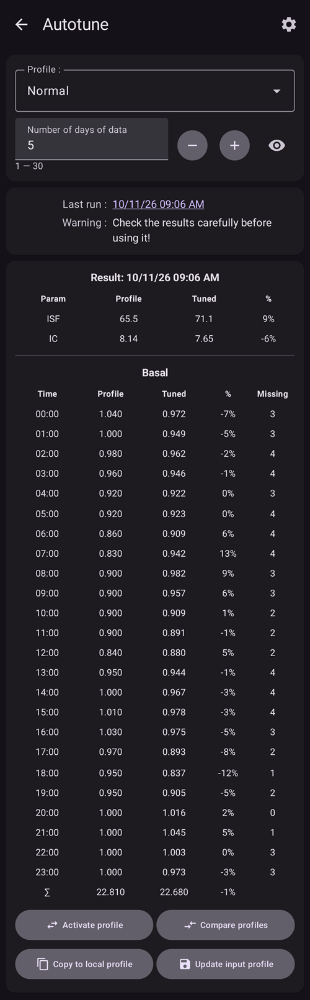
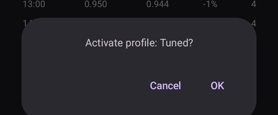
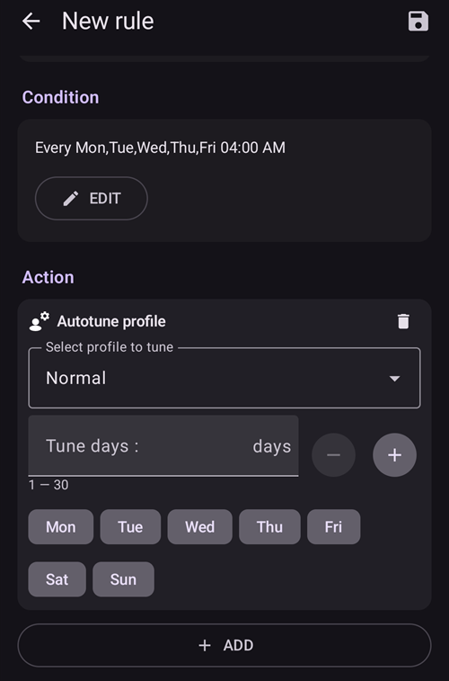

# 如何使用 Autotune 外掛

Autotune 外掛是在 AAPS 中實作的 OpenAPS 自動調整算法。 It analyzes your recent AAPS history to suggest adjustments to your basal rates, ISF and carb ratio.

Autotune Plugin is available in AAPS releases since [3.4](#version3400) but is hidden by default.

(autotune-how-autotune-calculates-adjustments)=
## How Autotune calculates adjustments

Autotune looks back over your recent AAPS history — CGM readings, boluses, carbs and temporary basal rates — and works out where your **Profile** (basal rates, ISF, carb ratio) doesn't quite match what actually happened to your BG.

For each 5-minute data point, it compares your **actual BG change** to the change your Profile predicted, and sorts the resulting deviation into one of three buckets:

* deviations that happened with no carbs on board and no insulin activity (used to tune **basal rates**, hour by hour),
* deviations that happened after a bolus/correction with no carbs (used to tune **ISF**), or
* deviations that happened while carbs were absorbing (used to tune **carb ratio**).

It then looks at the pattern of deviations in each bucket (using percentiles rather than a simple average, so a few noisy data points don't skew the result) and proposes a new value for that hour/parameter.

To keep any single run from overcorrecting, each Autotune run only ever moves a value a fraction of the way towards what the data suggests: up to 10% for ISF and carb ratio, and up to 20% for each basal segment. Overall drift is further capped by the **Max autosens ratio** / **Min autosens ratio** settings (see [Other settings](#autotune-other-settings) below) — the same bounds that limit Autosens. This is why Autotune is meant to be run repeatedly (day after day, or nightly) rather than trusted after a single run: results should converge gradually, and a big jump on one run is a sign to double check your data (missed carbs, a bad sensor day, _etc._) rather than to trust it blindly.

Autotune can be run three ways: manually as a one-off from within the plugin (as described below), automatically every night via an [automation rule](#autotune-run-autotune-with-an-automation-rule), or — outside of AAPS entirely — as a standalone command-line tool against exported data, which is how some community guides describe using it without a phone actively running AAPS.

*For the underlying oref0 algorithm in full mathematical detail, see [OpenAPS's Autotune documentation](https://openaps.readthedocs.io/en/latest/docs/Customize-Iterate/autotune.html).*

## 顯示 Autotune 外掛

在手機的 [AAPS 目錄](#preferences-maintenance-settings) 下的 `extra` 子資料夾中，建立一個名為 `enable_autotune` 的空白檔案。

***注意：請在 **AAPS** 設定中確認你的 AAPS 目錄位置，並確定你把檔案放在正確的目錄裡。已有多人因把檔案放錯資料夾而受影響。***


Restart **AAPS**. Then open the **menu** (☰), select **Configuration**, then the **General** category, and tick **Autotune**. The card then shows **Settings** and **Open plugin**:


## Autotune 使用者介面

Tap **Open plugin** on the **Autotune** card to open the Autotune screen:


- 你可以在「設定檔」下拉選單中選擇要調整的輸入設定檔（預設會選擇目前的活動設定檔）。
  - Note: each time you select a new profile, previous results will be removed and the **Number of days of data** will be set to its default value
- Then **Number of days of data** (called **Tune days** in older versions) is to select the number of days used in calculation to tune your profile. 最小值為 1 天，最大值為 30 天。此數字不應該太小，才能獲得正確的迭代和平滑結果（每次計算需超過7天）。
  - Note: each time you change the **Number of days of data**, previous results will be removed
- 「最後運作」是一個鏈接，可恢復你最後一次有效的計算結果。如果你當天尚未啟動自動調整，或者如果以前的結果由於上面的計算參數修改而被刪除，則你可以恢復最新成功運行的參數和結果。
- 警告範例顯示有關選定設定檔的一些資訊（例如你有多個 IC 值或 ISF 值）。
  - 注意：Autotune 計算僅適用於單一的 IC 和單一的 ISF 值。目前沒有現有的 Autotune 算法來調整生理週期 IC 或生理週期 ISF。如果你的輸入設定檔有多個數值，你可以在警告區看到調整設定檔時考慮的平均值。
- Check Input Profile button open the Profile Viewer to allow you a quick verification of your profile (Units, IC, ISF, basal and target)
  - 注意：Autotune 只會調整你的 IC（單一數值）、ISF（單一數值）以及有日夜變化的基礎率。 Units and target will remain unchanged in output profile.

- "Run Autotune" will launch Autotune calculation with selected profile and the selected number of days of data
  - 注意：Autotune 計算可能需要較長時間。當啟動後，你可以切換到其他視圖（主頁等），稍後再回到 Autotune 外掛查看結果。

  

- 運作過程中，你將在下方看到中間結果。

  - 注意：運作過程中，設定將被鎖定，無法再變更選擇的輸入設定檔或天數。如果你想用其他參數啟動另一個運作，你必須等待目前計算結束。

  

- 當 Autotune 計算完成後，你將看到結果（調整後的設定檔）及下方的四個按鈕。

  

- 重要的是要比較輸入設定檔（「設定檔」欄）、輸出設定檔（「調整後」欄）和每個數值的變異百分比（「百分比」欄）。

- 對於基礎率，你也會看到「缺失天數」。當 Autotune 沒有足夠的資料分類為「基礎率」來調整這段時間的基礎率時（例如每次餐後碳水化合物吸收時），就會出現缺失天數。這個數字應該越低越好，特別是當基礎率很重要時（例如夜間或下午晚些時候）。

- 「比較設定檔」按鈕會打開設定檔比較視圖。輸入設定檔顯示為藍色，輸出設定檔（名稱為「調整後」）顯示為紅色。

  - 注意：以下範例中，輸入設定檔有 IC 和 ISF 的日夜變化，但輸出計算後的設定檔只有單一數值。如果您對獲得日夜變化輸出檔案感興趣，請參見 [日夜變化 IC 或 ISF 檔案](#autotune-circadian-ic-or-isf-profile) 下方。

  

- 如果你信任結果（輸入和輸出設定檔之間的變異百分比很低），你可以點擊「啟用設定檔」按鈕，然後點擊 OK 進行確認。

  - Activate Tuned profile will automatically create a new profile "Tuned" in your profile list (**Manage → Profile**).
  - If you already have a profile named "Tuned" in **Manage → Profile**, then this profile will be updated with calculated Autotune profile before the activation

  

- 如果你認為調整後的設定檔需要修改（例如你認為某些變化太大），那麼你可以點擊「複製到本地設定檔」按鈕。

  - A new profile with the prefix "Tuned" and the date and time of the run will be created in **Manage → Profile**

  

- You can then edit the Tuned profile: open **Manage** > **Profile**, swipe to the card named "Tuned" with the date and time of the run, and tap the **Edit** (pencil) button

  - the values in the profile will be rounded in the user interface to your pump capabilities

  

- 如果你想用 Autotune 結果替換你的輸入設定檔，點擊「更新輸入設定檔」按鈕並在彈出視窗中點擊 OK 確認。

  - 注意：如果你在「更新輸入設定檔」後點擊「啟用設定檔」，那麼你將啟用更新後的設定檔，而不是預設的「調整後」設定檔。

  

- 如果你已更新你的輸入設定檔，那麼「更新輸入設定檔」按鈕將被「還原輸入設定檔」按鈕替代（參見下圖）。 You can that way immediately see if your current input profile in **Manage → Profile** already includes the result of last run or not. 你也可以使用此按鈕恢復未包含 Autotune 結果的輸入設定檔。

  


## Autotune 設定。

(autotune-plugin-settings)=

### Autotune 外掛設定。

  

```{admonition} Only DEV
:class: note
The **Auto switch profile** feature is only available in Dev/Engineering mode.
```

- **Auto switch profile** (default Off): see [Run Autotune with an automation rule](#autotune-run-autotune-with-an-automation-rule) below. 如果你將此設定更改為開啟，則輸入設定檔將自動被調整後的設定檔更新並啟用。
  - **請小心，你必須在接下來幾天內信任並驗證，在更新和啟用未修改的調整配置後，它會改善你的循環運行**

- **Categorize UAM as basal** (default Off): This setting is for the users using AndroidAPS without any carbs entered (Full UAM). 當關閉時，他將阻止 UAM 被分類為基礎率。
  - 注意：如果當天偵測到至少一小時的碳水化合物吸收，無論此設定（開啟或關閉），所有分類為「UAM」的資料都會被分類為基礎率。
- **Default tune days** (default 5): You can define the default value with this setting. Each time you select a new profile in the Autotune plugin, the **Number of days of data** will be replaced by this default value
- **Use circadian IC/ISF** (default Off): see [Circadian IC or ISF profile](#autotune-circadian-ic-or-isf-profile) below.

(autotune-other-settings)=
### 其他設置

- 自動調整還使用最大自動感應比和最小自動感應比來限制變化。 You can see and adjust these values in [**Settings** > **Absorption settings** > **Advanced Settings**](../SettingUpAaps/Preferences.md) (**Autosens max** and **Autosens min**).

  


## 進階功能

(autotune-circadian-ic-or-isf-profile)=

### 日夜變化的 IC 或 ISF 設定檔

- If you have important variation of IC and/or you ISF in your profile, and you fully trust in your circadian time and variation, then you can enable **Use circadian IC/ISF** (called "Apply average result in circadian IC/ISF" in older versions)

  - 注意，Autotune 計算將始終使用單一數值，Autotune 不會調整日夜變化。此設定僅適用於將計算的平均變化應用於 IC 和/或 ISF 的日夜變化數值。

- 請參閱下方截圖，左側為未應用平均變化的調整後設定檔，右側為應用平均變化的調整後設定檔。

  


### 調整特定星期幾

- If you tap the **eye** icon on the right of the **Number of days of data** field, you will see the day selection. 你可以指定 Autotune 計算應包含哪些星期幾（在下方截圖中可以看到「工作日」的範例，週六和週日被排除在 Autotune 計算之外）。
  - If the number of days included in Autotune calculation is lower than the **Number of days of data**, then you will see how many days will be included on the right of the days selector (10 days in the example below)
  - This setting gives good results only if the number of remaining days is not to small (for example if you Tune a specific profile for week end days with only Sunday and Saturday selected, you should set **Number of days of data** to at least 21 or 28 to have 6 or 8 days included in Autotune calculation)

  

- During Autotune calculation, you can see the progress of the calculations ("Partial result day 1 / 4 tuned" in the example below, with Saturday and Sunday excluded)

  


(autotune-run-autotune-with-an-automation-rule)=

## 使用自動化規則運作 Autotune

```{admonition} Only DEV
:class: note
The **Auto switch profile** feature is only available in Dev/Engineering mode.
```

第一步是為 Autotune 定義正確的自動化規則觸發條件：

注意：有關如何設定自動化規則的更多資訊，請參閱[此處](../DailyLifeWithAaps/Automations.md)。

- 你應選擇定期時間觸發：每天只運行一次自動調整，而自動調整設計為每天運行（每次新運行會推遲一天，且快速的設定檔修改應該很小）

  

- 最好一開始在白天運作 Autotune 以便能夠檢查結果。如果你想在夜間運作 Autotune，你必須在觸發條件中選擇 4AM 或之後，以包含當天在下一次 Autotune 計算中。

  

- Then you can select the **Autotune profile** action (in the **Loop & insulin** group)

  

- You can then adjust the parameters of the action for your run. In a new action, **Select profile to tune** shows the first profile of your local profile list, the **Tune days** field is empty and all days are selected. Choose the profile to tune and enter the number of **Tune days** (1 to 30).

  

- After a few days, if you fully trust Autotune results and percentage of modification is low, you can modify [Autotune settings](#autotune-plugin-settings) "**Auto switch profile**" to enabled to automatically update and activate profile tuned after calculation.

注意：如果你想為特定的星期幾自動調整設定檔（例如「週末天數」的設定檔和「工作日」的設定檔），那麼為每個設定檔建立一個規則，選擇相同的日期作為觸發條件和 Autotune 動作中的日期，調整天數必須足夠高以確保至少有 6 或 8 天包含在內，且不要忘記在觸發條件中選擇 4AM 之後的時間…

- See below an example of rule that runs every working day (Monday to Friday) at 04:00 and tunes the profile "Normal" with 14 **Tune days**, working days only (so only 10 days are included in the Autotune calculation).

  


## 提示與技巧

Autotune 使用現有資料庫中的資訊，因此如果你剛在新手機上安裝了 AAPS，你必須等待幾天才能啟動 Autotune，以獲得足夠天數的資料來獲得相關結果。

Autotune 只是輔助工具，重要的是定期檢查你是否同意計算出的設定檔。如果有任何疑問，請更改 Autotune 設定（例如天數）或將結果複製到本地設定檔，並在使用之前調整設定檔。

在應用 Autotune 結果之前，請務必手動使用 Autotune 幾天來檢查結果。只有當你完全信任 Autotune 結果，並且前一個設定檔與計算出的設定檔之間的變異變得非常小時，才開始使用自動化（絕不要提前）。

- Autotune 對某些使用者非常有效，但對其他人可能不適用，因此**如果你不信任 Autotune 結果，請不要使用他**

It's also important to analyze Autotune results to understand (or try to understand) why Autotune proposes these modifications

- 你可能會發現設定檔的強度整體增加或減少（例如總基礎率增加，與 ISF 和 IC 值的減少相關聯）。這可能與隨後幾天的自動敏感度修正超過 100%（需要更激進的調整）或低於 100%（您更敏感）有關。
- 有時，自動調整會提出基礎率和 IC/ISF 之間的不同平衡 (例如：較低基礎率和更積極的 IC/ISF)

我們建議在以下情況下不要使用 Autotune：

- 你沒有輸入所有的碳水化合物。
  - 如果您沒有輸入因低血糖而進行的碳水化合物修正，自動調整會看到您的 **血糖** 值意外上升，並在 4 小時前提高您的基礎率，這可能正好相反，會導致您避免低血糖，特別是如果它發生在深夜時。因此，輸入所有碳水化合物，尤其是低血糖的修正是非常重要的。
- 您有很多被偵測到的 UAM 期間。
  - 您輸入了所有碳水化合物並正確估算了它們嗎？
  - 所有的未註明餐點（UAM）時間段（除非你在一天內沒有輸入碳水化合物並且未啟用將未註明餐點歸類為基礎率），所有的未註明餐點時間將會被歸類為基礎率，這可能會大幅增加你的基礎率（遠超出必要範圍）。

- 你的碳水化合物吸收速度非常慢：如果大部分的碳水化合物吸收是根據 min_5m_carbimpact 參數計算的（你可以在 COB 曲線頂端看到一個小橙點標示的這些時間段），COB 的計算可能會出錯，並導致錯誤的結果。
  - 當你運動時，你的敏感度通常會增加，血糖不會上升很多，因此在運動期間或之後，通常會看到一些碳水化合物的緩慢釋放期。但如果你經常發生意外的碳水化合物吸收過慢的情況，那麼你可能需要調整你的設定檔（增加 IC 值）或調低 min_5m_carbimpact。
- 您有「非常糟糕的日子」，例如在高血糖數值中卡住幾小時，並需要使用大量胰島素才能恢復到正常範圍，或在傳感器更換之後您有長時間的錯誤 **血糖** 值。如果在過去幾週中，您只有一兩天的「糟糕日子」，您可以在自動調整計算中手動禁用這些天，以排除它們的計算，再次 **仔細檢查是否可以信任結果**
- 如果修改的百分比過高。
  - 你可以嘗試增加天數以獲得更平滑的結果。
