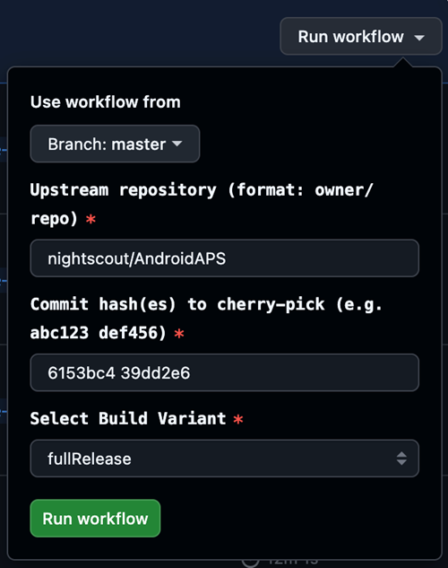

(github-cherry-pick)=

# 瀏覽器建置：挑選提交

```{note}
這是選擇性進階操作。只有使用 **fork** 進行建置時才能使用（[瀏覽器建置步驟 1–4](../SettingUpAaps/BrowserBuild.md)）。 **AAPS Builder** 的儲存庫不包含這個工作流程。
```

只有在開發者請您測試某項特定變更時才使用此功能（開發者會提供一個或多個提交雜湊值），也就是在該變更納入正式發布版本之前進行測試。

## 開始之前

- [同步您的 fork](#Update-to-new-version-update-your-repo)：此工作流程會建置您分支目前的狀態，而不是從清單中選擇的版本。
- 必須先授權 Google Drive（[步驟 3](../SettingUpAaps/BrowserBuildGoogleDrive.md)）：建置完成的 App 會儲存在 Google Drive 中，與一般建置相同。

## 執行工作流程

1. 在 AndroidAPS 的 GitHub fork 中，開啟 **Actions**。
2. 展開 **All workflows**，然後選擇 **Cherry Pick CI (Pre-release Feature Backport)**。
3. 點選 **Run workflow**，並填寫以下欄位：

   

   - **Use workflow from**：要加入提交的分支，通常是 `master`。
   - **Upstream repository**：提交來源的儲存庫。除非開發者另有指示，請保留 `nightscout/AndroidAPS`。
   - **Commit hash(es) to cherry-pick**：填入開發者提供的提交雜湊值，多個值請以空格分隔。
   - **選取建置變體**：請參閱[變體](#browserbuild-variant)（通常為 `fullRelease`）。
4. 點選 **Run workflow**。完成後，應用程式就會出現在你的 Google Drive 中，就像[一般建置](../SettingUpAaps/BrowserBuildAPK.md)完成後一樣。
