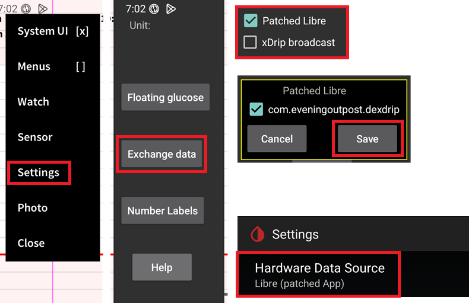

# Juggluco 設定

如果尚未設置，請下載 [Juggluco](https://www.juggluco.nl/Juggluco/download.html)。

遵循 [指示](https://www.juggluco.nl/Jugglucohelp/introhelp.html) 來連接您的傳感器。

## 所有 CGM 系統的基本設定

### 停用 Nightscout 上傳器

You shouldn't let any other app upload data (blood glucose and treatments) to Nightscout.

在 Juggluco 中停用任何活動的 Nightscout 上傳器。

(juggluco-to-aaps)=

## Juggluco 到 AAPS

Juggluco 可以將血糖直接傳送到 AAPS，當您使用 [可信任的傳感器](#GettingStarted-TrustedBGSource) 時，讓 SMB 始終啟用。

使用 Libre 2/2+/3/3+ 傳感器時，會將每分鐘的讀數傳送到 AAPS，但不會觸發 AAPS 中的每分鐘計算。

在 Juggluco 中啟用 xDrip 廣播（不啟用 Patched Libre），確認並儲存 AAPS 套件資訊。 Select the xDrip BG data source in AAPS.

在 AAPS 中應用足夠的 [平滑處理](./SmoothingBloodGlucoseData.md)。

(juggluco-to-xdrip)=

## Juggluco to xDrip

Juggluco can send blood glucose to xDrip which will then send them to AAPS.

在 Juggluco 中啟用 Patched Libre（不啟用 xDrip 廣播），確認並儲存 dexdrip 套件資訊。 Select the xDrip BG data source in AAPS.

Apply sufficient [smoothing](./SmoothingBloodGlucoseData.md) in AAPS if necessary, when using a Libre 2/2+/3/3+ sensor, xDrip will average the minute-by-minute to 5 minutes readings and [also smoothen](#libre2-value-smoothing-raw-values) them.

