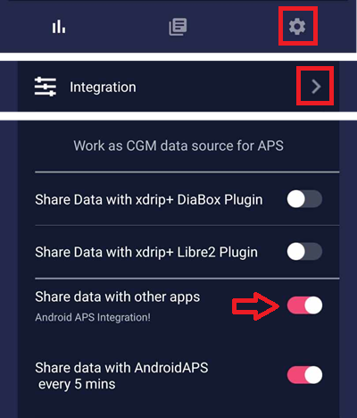

# Freestyle Libre 2 和 2+

即使使用官方應用程式，Freestyle Libre 2 傳感器現在也是一款真正的連續血糖監測儀（CGM）。然而，LibreLink 仍無法將資料傳送至 AAPS。有幾種解決方案可以將其與 AAPS 搭配使用。

## 1. 使用藍牙橋接器和 OOP

藍牙發射器可用於 Libre 2（EU）或 2+（EU），以及一個 非處理演算法 應用程式。你可以像使用 [Libre 1](./Libre1.md) 一樣每 5 分鐘接收一次血糖讀取值。

Check the bridge and app you want to use are compatible with your sensor and xDrip.

Libre2 的 OOP（可在[此處](#Libre2_OOP2)找到）產生的血糖讀值與原始接收器所顯示的結果相同。 AAPS 與 Libre 2 的讀取值會經過 10 至 25 分鐘的平滑處理，以避免某些讀取值的跳動。請參閱以下內容[讀取值平滑化及原始讀取值](#libre2-value-smoothing-raw-values)。 OOP 每 5 分鐘生成一次讀取值，並取最近 5 分鐘的平均值。因此，這些血糖讀取值可能不如其他方法平滑，但他們與原始讀取器的讀取值一致，並且更快速地反應“真實”血糖讀取值。 If you try to loop with OOP please enable all smoothing settings in xDrip.

有幾個使用藍牙傳輸器的理由：

-   你可以選擇多種 OOP2 校正策略（1）：使用「無校正」獲得讀取器讀取值，或者像 Libre 1 一樣使用「基於原始資料進行校正」，或者最終使用「基於葡萄糖進行校正」來校正讀取器的讀取值。  
  請確保停用 OOP1（2）。

    → 漢堡選單 → 設定 → 不常見的設定 → 其他雜項選項選項


-   Libre 2 傳感器可像 Libre 1 一樣使用 14.5 天。
-   支援 8 小時的回填資料。

備註：傳輸器可以與 LibreLink 應用程式並行使用而不會相互干擾。

### 啟動傳感器

- → 漢堡選單 (1) → 啟動傳感器 (2) → 啟動傳感器 (3) → 回答「暫不」(4)。


這不會實際啟動任何 Libre2 傳感器，也不會與其進行任何互動。 This is simply to indicate xDrip that a new sensor is delivering blood sugar levels. 如果可用，請輸入兩個指血測量值進行初始校正。 Now the blood glucose values should be displayed in xDrip every 5 minutes. 錯過的讀取值，例如因為你離手機太遠，不會被回填。

After a sensor change xDrip will automatically detect the new sensor and will delete all calibration data. 啟動後，你可以檢查你的血糖值並進行新的初始校正。

### 設定 AAPS（僅用於循環功能）

-   In **AAPS**, open the **menu** (☰) in the top-left corner, go to **Configuration** > **BG Source** and select **xDrip+**


-   If AAPS does not receive BG values when phone is in airplane mode, use 'Identify receiver' as describe on [xDrip settings page](#xdrip-identify-receiver).

## 2. Use xDrip direct connection

```{admonition} Libre 2 EU only
:class: warning
xDrip doesn't support direct connection to Libre 2 US and AUS.
僅支持 Libre 2 和 2+ **EU** 型號。
```

- Follow [these instructions](./Libre2MinimalL00per.md) to setup xDrip as the original documentation links to an obsolete OOP2  version.
- Follow setup instructions on [xDrip settings page](../CompatibleCgms/xDrip.md).

-   Select xDrip+ in [Configuration > BG Source](#Config-Builder-bg-source).

(libre2-value-smoothing-raw-values)=

### 讀取值平滑化與原始值

Technically, the current blood sugar value is transmitted to xDrip every minute. 加權平均濾波器預設會計算最近 25 分鐘內的平滑資料。你可以在 NFC 掃描功能選單中更改此時間段。

→ 漢堡選單 → 設定 → NFC 掃描功能 → 使用 xxx 方法時平滑 Libre 3 資料


這對循環是必要的。曲線看起來很平滑，循環結果也非常好。用來設定鬧鐘的原始值波動稍大一些，但與讀取器顯示的值相符。 In addition, the raw values can be displayed in the xDrip graph in order to be able to react in time to rapid changes. 請開啟「不常見的設定」\>「Libre 2 的進階設定」\>「顯示原始值」和「顯示傳感器資訊」。然後，原始值會額外顯示為小白點，並在系統選單中提供更多傳感器資訊。

當血糖快速變化時，原始值非常有幫助。即使這些點的波動較大，但與平滑線相比，你能更好地察覺趨勢，從而做出正確的治療決策。

→ 漢堡選單 → 設定 → 不常見的設定 → Libre 2 的進階設定


#### 校正

You can calibrate the Libre2 **with an offset of -40 mg/dL to +20 mg/dL \[-2,2 mmol/L to +1,1 mmol/L\]** (intercept). 斜率無法更改。請在設置新傳感器後進行指血測試，並注意插入後的前 12 小時可能不太準確。由於血糖測試可能存在較大誤差，請每 24 小時驗證一次並在必要時校正。如果幾天後傳感器的讀取值完全不準確，應考慮更換傳感器。

## 3. 使用 Diabox

- 安裝 [Diabox](https://www.bubblesmartreader.com/_files/ugd/6afd37_f183eabd4fbd44fcac4b1926a79b094f.pdf)。在設定中，進入「整合」，啟用「與其他應用程式共享資料」。



- Select xDrip+ in [Configuration > BG Source](#Config-Builder-bg-source).

## 4. 使用 Juggluco

請參閱 [這裡](./Juggluco.md).
