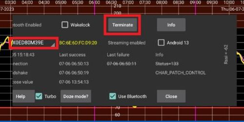

# **Freestyle Libre 3** 和 3+

Freestyle Libre 3 (FSL3) 需要特殊設定才能將血糖值接收至 AAPS。有兩種可能的方法將 Freestyle Libre 3 (FSL3) 值傳送到 AAPS。

下述方法使用單獨的應用程式 Juggluco 來實現此目的。 It uses Juggluco to receive raw, 1-minute interval data from the sensor which is then passed to xDrip or AAPS. 可以使用 Libre 3 應用程式或直接在 Juggluco 中啟動新傳感器。下方指南說明如何使用 Juggluco 應用程式啟動傳感器的過程。如果傳感器是使用已登入 Libreview 帳戶啟動的，也可以在 Juggluco 和 Libre 3 應用程式之間切換作為接收器。

當傳感器使用 Libre 3 應用程式啟動時，Juggluco 也可以將資料傳送至 LibreView 以與醫療提供者共享。

Within xDrip the sensor can be calibrated in the range of -40 mg/dL to +20 mg/dL (-2.2 mmol/L to +1.1 mmol/L) to compensate for differences between a manual meter reading and the sensor readings.

## 方法一：直接使用每分鐘的資料值
**AAPS** is tailored for 5-minute readings. 因此，在某些情況下處理每分鐘的資料值時，會有些侷限。

請參閱 [這裡](#juggluco-to-aaps).

## 方法二：透過 xDrip 將每分鐘的資料值轉換為每 5 分鐘的資料值。
This method uses Juggluco to receive raw, 1-minute interval data from the sensor which is then passed to xDrip to be smoothed into 5-minute interval data to be passed to AAPS.

### 步驟 1：設定 Juggluco
從[此處](https://www.juggluco.nl/Juggluco/download.html)下載並安裝 Juggluco 應用程式。按照[此處](https://www.juggluco.nl/Juggluco/libre3/)的指示操作。

Make sure you send the glucose values to xDrip: In Juggluco's settings you can configure Juggluco to send its glucose value to other apps. Juggluco can send three types of such broadcasts: The **Patched Libre broadcast** was originally used by the patched Librelink app and can be used to send glucose values to xDrip

### 步驟 2：設定 xDrip

The blood glucose values are received by the xDrip app on the smartphone.

- If not already set up then download [xDrip](https://github.com/NightscoutFoundation/xDrip) and follow the instructions on [xDrip settings page](../CompatibleCgms/xDrip.md).
- In xDrip select "Libre2 (patched app)" as data source.
- 如果需要，請在「不常見的設定」→「額外日誌紀錄設定」→「日誌紀錄的額外標籤」下輸入 "BgReading:d,xdrip libre_receiver:v"。這將紀錄額外的錯誤訊息以便進行問題排除。

- Technically, the current blood sugar value is transmitted to xDrip every minute. 加權平均濾波器預設會計算最近 25 分鐘內的平滑資料。你可以在 NFC 掃描功能選單中更改此時間段。

  → 漢堡選單 → 設定 → NFC 掃描功能 → 使用 xxx 方法時平滑 Libre 3 資料

  

### 步驟 3：在 xDrip 中啟動傳感器

In xDrip start the sensor with "Start Sensor" and "not today". 無需將手機靠近傳感器。事實上，「啟動傳感器」不會實際啟動任何 Libre 3 傳感器，也不會與他們進行任何互動。 This is simply to indicate xDrip that a new sensor is delivering blood sugar levels. 如果可用，請輸入兩個指血測量值作為初始校正。 Now the blood glucose values should be displayed in xDrip every 5 minutes. 跳過的讀取值，例如因為你離手機太遠，將不會被回填。

如果仍然沒有資料，請等待至少 15-20 分鐘。

After a sensor change xDrip will automatically detect the new sensor and will delete all calibration data. 啟動後，你可以檢查你的指血血糖並進行新的初始校正。

### Step 4: Configure AAPS

- 請參閱 [這裡](#juggluco-to-xdrip)然後返回。

- If **AAPS** does not receive BG values when phone is in airplane mode, use "Identify receiver"
- Turn off Smoothing (done in xDrip already)

## 後續傳感器更換

1. 打開 Juggluco 並記下現有傳感器的序列號。

2. 現在，只需使用手機的 NFC 閱讀器掃描你的新傳感器。如果過程成功開始，Juggluco 會顯示通知。
3. 當你準備停用舊傳感器時，請點擊螢幕左上角的空白區域打開 Juggluco 選單。
4. 選擇過期的傳感器並點擊「終止」

Note: When two sensors are active Juggluco will send the most recent value from either sensor to xDrip. If the sensors are not calibrated and reading BG similarly, this may result in jumpy BG values being reported to xDrip. 如果你終止了錯誤的傳感器，可以透過掃描傳感器重新啟用他。

## 在 Libre 3 和 Juggluco 應用程式之間切換傳感器

如果傳感器是使用已登入 Libreview 帳戶啟動的，也可以在 Juggluco 和 Libre 3 應用程式之間切換作為接收器。這需要以下步驟：

1. 從 Google Play 商店安裝 Libre 3 應用程式。
2. 使用啟動傳感器的 Libreview 帳戶設定 Libre 3 應用程式。
3. 在 Android 設定中強制停止 Juggluco 應用程式。
4. 在 Libre 3 選單中，點擊「啟動傳感器」，選擇「是」，「下一步」，然後掃描你的傳感器。
5. 幾分鐘後，血糖 值應該會顯示在 Libre 3 應用程式中。

要從 Libre 3 應用程式切換到 Juggluco，你需要透過 Android 設定強制停止 Libre 3 應用程式，然後執行步驟 1 和步驟 2。

(libre3-experiences-and-troubleshooting)=
## 經驗與問題排除

### Libre3 -> Juggluco 連線問題排除

- 確保你使用的是 Juggluco 應用程式的最新版本。
- 根據本指南檢查你的設定。
- 有時你可能需要強制停止 Libre 3 應用程式和 Juggluco 並重新啟動他。
- 停用藍牙並重新啟用。
- 稍等片刻或嘗試關閉 Juggluco。
- 低於 2.9.6 的 Juggluco 舊版本不會將後續資料從 Libre3 傳感器發送到連線的設備（例如：WearOS 上的 Juggluco）。你可能需要在修補版 Libre3 應用程式中點擊「重新發送資料」（Juggluco 選單）。

### 進一步幫助

原始說明：[jkaltes 網站](https://www.juggluco.nl/Juggluco/libre3/)

其他 Github 倉庫：[Github 連結](https://github.com/maheini/FreeStyle-Libre-3-patch)
