# AP550 胰島素幫浦

_胰島素幫浦 uAP 550S_

_如果您使用 uAP 550S，請依照以下指示設定 AAPS 和幫浦。驅動程式會透過 Bluetooth LE 與幫浦通訊。_

幫浦使用標準的 **AAA 電池**。

(AP550-Insulin-Pump-pairing-pump)=
## 幫浦配對

* 在 AAPS 首頁畫面中，按下左上角的漢堡選單，然後前往 **組態建置工具**。
* 在幫浦區段中選取 **AP550**。 
* AP550 總覽畫面隨即開啟。點選顯示 **「胰島素幫浦尚未配對」**的連線卡片。您也可以點選底部的 **「配對」**按鈕

  

* 配對精靈隨即啟動。您可以透過兩種方式找到幫浦：

  1. **掃描** — 配對精靈會搜尋附近的幫浦 15 秒，並依名稱和序號列出（幫浦序號位於背面的標籤上）。點選清單中的幫浦。
  2. **QR Code** — 點選「掃描 QR Code」，並將相機對準**幫浦背面**的 QR Code。 QR Code 包含型號和序號。接著，AAPS 會持續掃描，直到找到序號相符的幫浦。

  

* AAPS 正在連線至幫浦（「正在連線至 Bluetooth...」）。
* **輸入幫浦上顯示的 6 位數配對碼。**您也必須在幫浦上確認此配對碼。這和一般的 Bluetooth 配對方式相同，例如手機與汽車音響的配對。 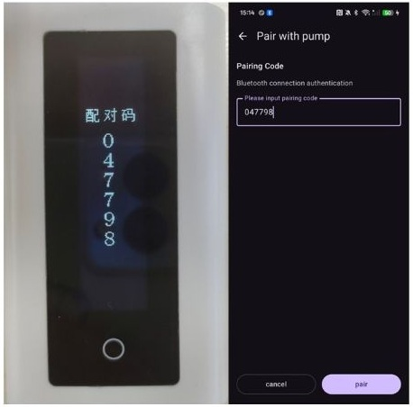
* 如果配對碼錯誤，您可以再試一次。第二次輸入錯誤的配對碼後，連線會中斷，您必須從掃描步驟重新開始。
* 配對成功時，您會看到「幫浦配對成功」。按下「確定」返回總覽。

## 操作幫浦

進入幫浦選單的預設密碼為 **211**。

### 解鎖幫浦

1. **點兩下螢幕上的圓圈**以喚醒螢幕。
2. 點選**解鎖按鈕**。
3. **向上滑動**即可解鎖。 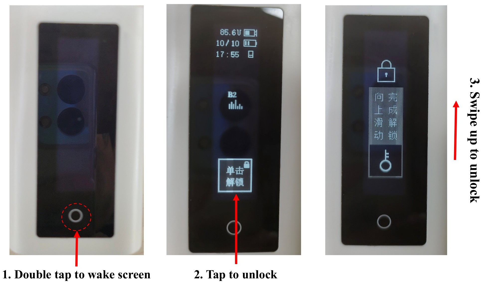

### 幫浦按鈕

下表列出 AP550 幫浦的常用按鈕及其功能。單張螢幕截圖可能會同時顯示多個按鈕；在這種情況下，圖片會跨越多列，而每個按鈕都有各自的說明列。

<table>
  <tr>
    <th>按鈕</th>
    <th>描述</th>
  </tr>

  <!-- Group 1: one screenshot containing 4 buttons -->
  <tr>
    <td rowspan="4">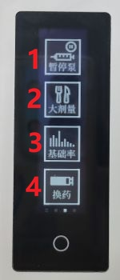</td>
    <td>1：停止幫浦注射</td>
  </tr>
  <tr><td>2：注射</td></tr>
  <tr><td>3：基礎率</td></tr>
  <tr><td>4：更換輸注組</td></tr>

  <!-- Group 2: one screenshot containing 2 buttons -->
  <tr>
    <td rowspan="3">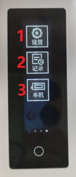</td>
    <td>1：設定</td>
  </tr>
  <tr><td>2：歷史記錄</td></tr>
  <tr><td>3：裝置資訊</td></tr>

  <tr>
    <td rowspan="2">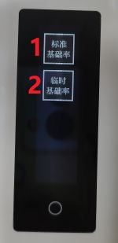</td>
    <td>1：一般基礎率</td>
  </tr>
  <tr><td>2: 臨時基礎率</td></tr>

  <tr>
    <td rowspan="2"></td>
    <td>1: 以百分比設定臨時基礎率。</td>
  </tr>
  <tr><td>2: 以速率設定臨時基礎率</td></tr>

  <tr>
    <td rowspan="2">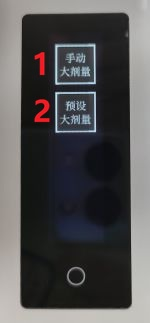</td>
    <td>1: 手動注射</td>
  </tr>
  <tr><td>2: 預設注射</td></tr>

  <tr>
    <td rowspan="4">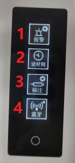</td>
    <td>1: 警報</td>
  </tr>
  <tr><td>2: 時間</td></tr>
  <tr><td>3: 輸注</td></tr>
  <tr><td>4: 無線</td></tr>

  <tr>
    <td rowspan="4">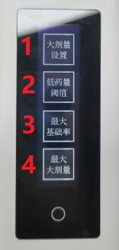</td>
    <td>1: 注射設定</td>
  </tr>
  <tr><td>2: 儲液槽低量閾值</td></tr>
  <tr><td>3: 最大基礎率</td></tr>
  <tr><td>4: 最大注射量</td></tr>

</table>

### 更換儲液槽和輸注組

主選單中的 **更換輸注組** 按鈕用於需要打開輸注管路時。有兩種情況：

* 儲液槽中的胰島素已用完，必須更換新的儲液槽：

  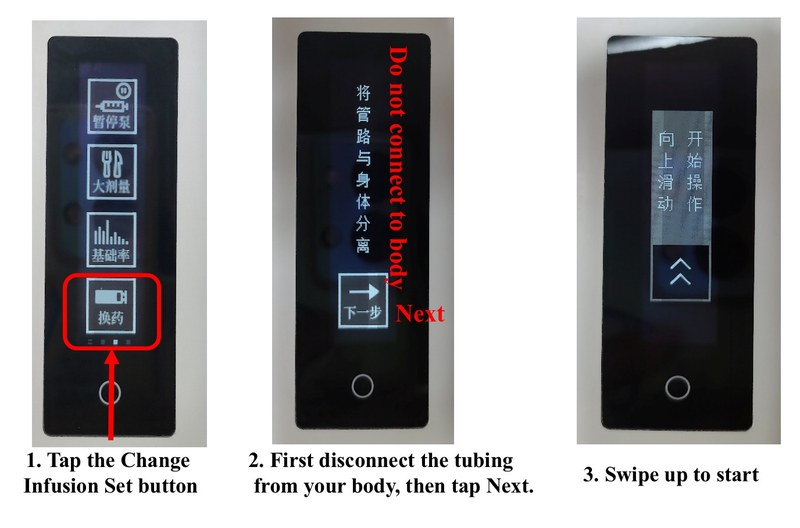

  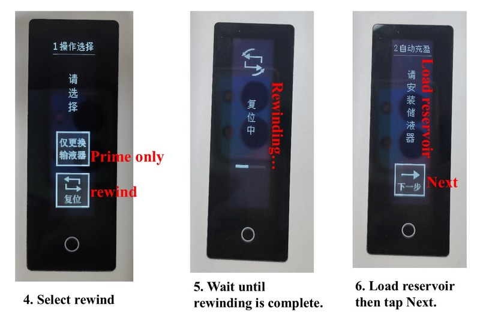

  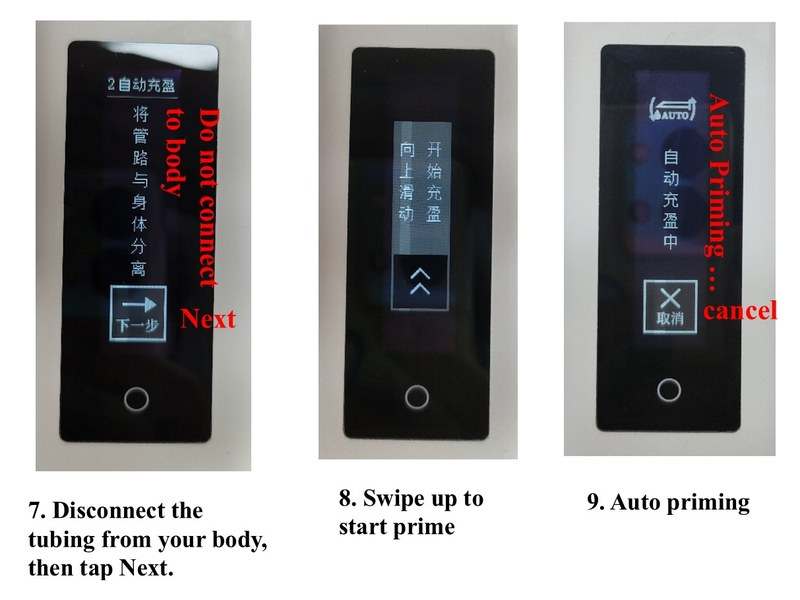

  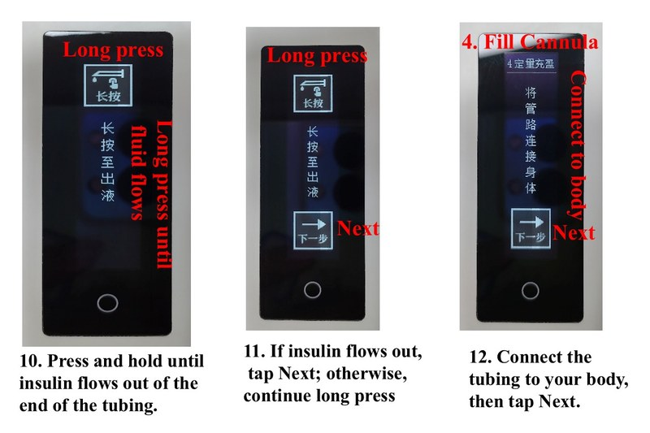

  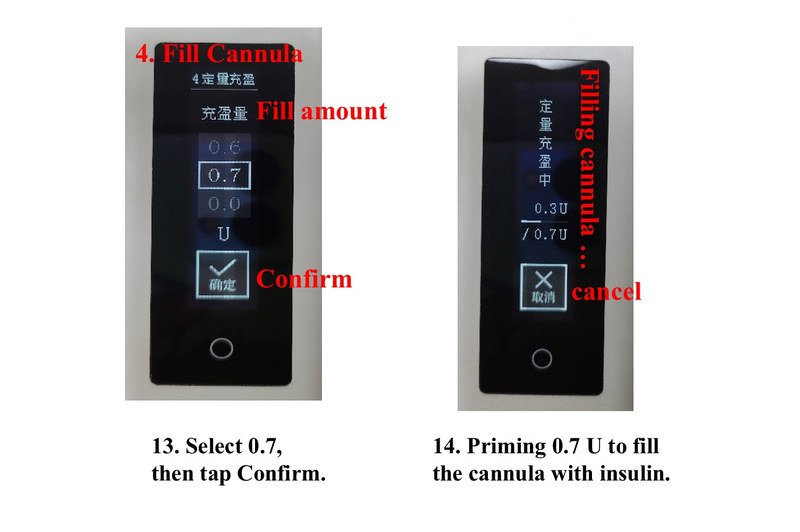

* 必須更換輸注組（管路和導管）：

  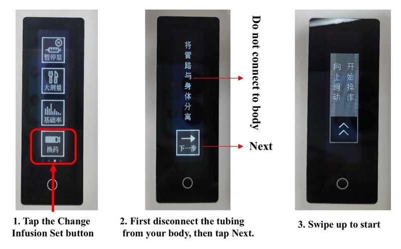

  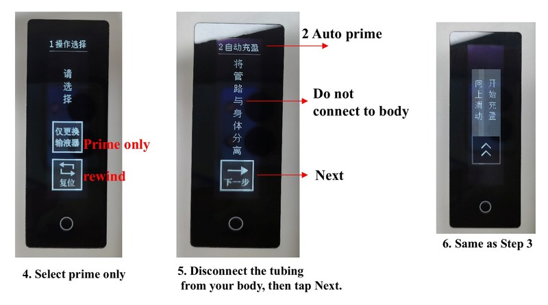

  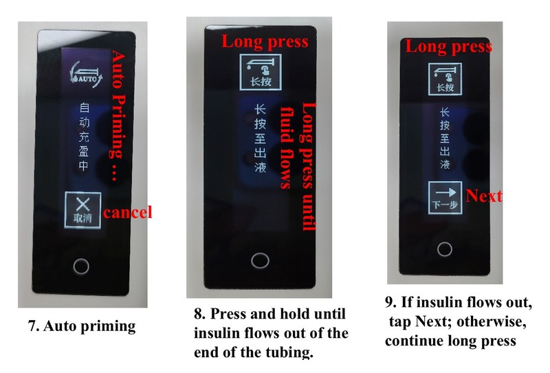

  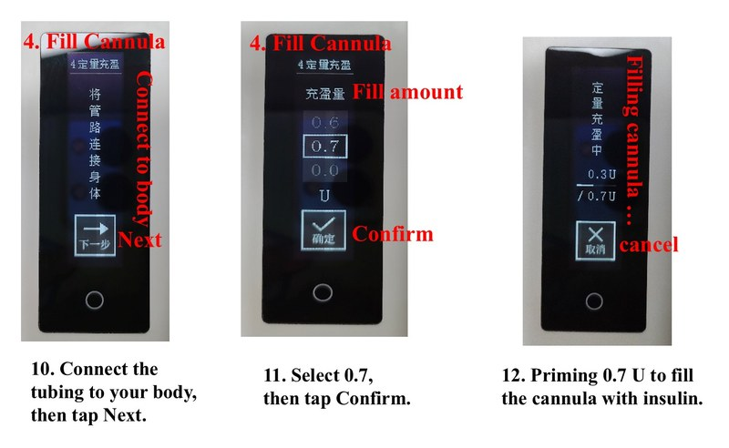

### 幫浦警報

幫浦在有狀況需要您注意時會顯示警報畫面。下方圖片顯示幫浦上的警報畫面，以及您可以按下的按鈕。表格中會說明各項警報。

<table>
  <tr>
    <th>警報</th>
    <th>意義／處理方式</th>
  </tr>
  <tr>
    <td rowspan="9">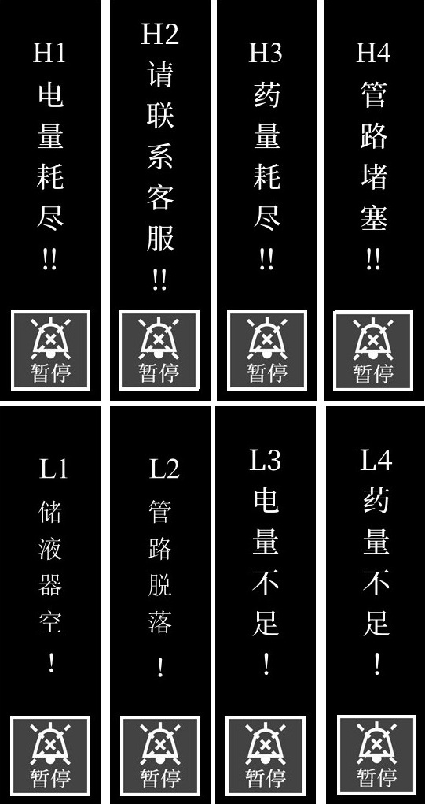</td>
    <td><strong>H1 幫浦電池電量耗盡</strong> — AAA 電池已耗盡。請立即更換電池。</td>
  </tr>
  <tr><td><strong>H2 幫浦馬達異常</strong> — 幫浦偵測到馬達故障。請停止使用幫浦並聯絡供應商。</td></tr>
  <tr><td><strong>H3 胰島素已用盡</strong> — 胰島素已用盡。無法完成輸注。</td></tr>
  <tr><td><strong>H4 阻塞</strong> — 管路或導管阻塞。請檢查輸注組，必要時予以更換。</td></tr>
  <tr><td><strong>L1 儲液槽已空</strong> — 未偵測到儲液槽。</td></tr>
  <tr><td><strong>L2 管路脫落</strong> — 管路已脫落。請重新連接或更換輸注組。</td></tr>
  <tr><td><strong>L3 電池電量不足</strong> — 電池電量即將耗盡。請儘快更換電池。</td></tr>
  <tr><td><strong>L4 胰島素不足</strong> — 剩餘胰島素低於警報閾值。</td></tr>
</table>

### 幫浦提示

除了警報之外，幫浦也會顯示**提示**：簡短畫面會要求您確認某項操作，或告知幫浦狀態。下方表格會列出各提示畫面，並說明其代表的意義。

<table>
  <tr>
    <th>提示</th><th>意義</th>
    <th>提示</th><th>意義</th>
    <th>提示</th><th>意義</th>
  </tr>

  <!-- Row 1: prompts 1–3 -->
  <tr>
    <td></td>
    <td>裝置已關機太久。請重設時間。</td>
    <td></td>
    <td>數值超出上限。請重新輸入。</td>
    <td></td>
    <td>已於 ** U ** 分鐘前注入。</td>
  </tr>

  <!-- Row 2: prompts 4–6 -->
  <tr>
    <td></td>
    <td>此注射最多可注入 ** U。</td>
    <td></td>
    <td>已達 4 小時注射上限：** U。</td>
    <td></td>
    <td>已達每日注射上限：** U。</td>
  </tr>

  <!-- Row 3: prompts 7–9 -->
  <tr>
    <td></td>
    <td>注射已中止。請檢查紀錄。</td>
    <td></td>
    <td>目前的警報狀態下無法恢復輸注。</td>
    <td></td>
    <td>注射進行中。不允許更換輸注組。</td>
  </tr>

  <!-- Row 4: prompts 10–12 -->
  <tr>
    <td></td>
    <td>臨時基礎率進行中。不允許更換輸注組。</td>
    <td></td>
    <td>注射進行中。不允許編輯。</td>
    <td></td>
    <td>臨時基礎率進行中。不允許編輯。</td>
  </tr>

  <!-- Row 5: prompts 13–15 -->
  <tr>
    <td></td>
    <td>劑量為 0。無法設定。</td>
    <td></td>
    <td>輸注已暫停。請前往主畫面以恢復輸注。</td>
    <td></td>
    <td>所有輸注皆已暫停。不允許編輯。</td>
  </tr>

  <!-- Row 6: prompts 16–18 -->
  <tr>
    <td></td>
    <td>不是新電池。</td>
    <td></td>
    <td>請更換電池。</td>
    <td></td>
    <td>請重設時間。</td>
  </tr>

  <!-- Row 7: prompts 19–21 -->
  <tr>
    <td></td>
    <td>請重設胰島素幫浦參數。</td>
    <td></td>
    <td>有尚未完成的操作。</td>
  </tr>
</table>

## 總覽畫面

AP550 總覽畫面會顯示幫浦的狀態：

* 頂端的連線卡片：輕觸即可**連線**或**中斷連線**。
* 資訊列：序號、電池、上次連線時間、每日單位數、 儲液槽、基礎率、基礎率增量、注射增量、韌體、最大注射量、最大基礎率。
* **幫浦歷史紀錄** — 注射、臨時基礎率、警報、補充藥量等紀錄。這些歷史紀錄來自幫浦本身，並會保留在手機上。
* **停止幫浦注射 / 恢復幫浦注射** — 暫停或恢復幫浦注射。 AAPS 會先要求你確認。
* **連線狀態** — 列出過去連線與中斷連線的事件。
* **開啟 / 關閉幫浦音效** — 將幫浦設為靜音或取消靜音。 AAPS 會先要求你 確認。

## 設定

透過組態建置工具開啟幫浦設定（AP550 旁的齒輪圖示）：

* **以百分比顯示基礎率** — 幫浦使用百分比表示的臨時基礎率 （10 % – 300 %）。啟用此設定後，AAPS 會以百分比而非 U/h 傳送並顯示臨時基礎率。
* **低血糖風險警示** — 當近期可能發生低血糖時，幫浦會發出警示。 AAPS 每天會檢查一次風險，並在每次注射後檢查。
* **解除配對** — 移除幫浦的配對資訊。

## 注射量上限

幫浦和驅動程式會限制可注射的胰島素量：

* 單次注射上限 — 在幫浦上設定。
* **4 小時注射總量上限** — 幫浦最大注射量的 2 倍。
* **每日注射總量上限** — 幫浦最大注射量的 4 倍。

如果注射量會超過其中一項上限，AAPS 就會阻止注射。

## 錯誤與警報

### 胰島素注射期間發生錯誤

如果注射進行期間連線中斷（例如你離開手機旁），AAPS 會顯示訊息，告知你與幫浦的通訊中斷，並要求你**查看幫浦，確認實際注射了多少胰島素**。下次連線時，系統會從幫浦讀取實際注射量。

### 注射錯誤代碼

注射失敗時，幫浦會回報錯誤代碼。以下是最重要的代碼：

| 代碼 | 意義                           |
| -- | ---------------------------- |
| 01 | 手動暫停注射                       |
| 03 | 幫浦馬達異常                       |
| 04 | 幫浦電池電量耗盡                     |
| 05 | 已達每日劑量上限                     |
| 06 | 阻塞（幫浦輸液管路堵塞）                 |
| 07 | 儲藥槽已空                        |
| 08 | 輸液管路脫落                       |
| 09 | 注射量超過幫浦上限                    |
| 10 | 電池電量低 — 或幫浦上已有注射 / 臨時基礎率正在執行 |
| 12 | 通訊錯誤，請重新連線幫浦                 |

### 連線問題

AAPS 嘗試連線至幫浦時，會每隔幾分鐘提醒你：

1. 請確認幫浦位於可搜尋的範圍內。
2. 請確認幫浦和手機的藍牙都已開啟。

如果 AAPS 超過 10 分鐘未收到血糖資料，就會顯示通知（「AAPS 血糖資料遺失」），讓你檢查連線。

### 基礎率設定檔不符

如果幫浦上的基礎率設定檔與 AAPS 中的設定檔不一致，幫浦會回報自己的速率（例如：「幫浦基礎率：0.80 U/h，請重設 設定檔」）。從 AAPS 重新傳送設定檔。

## 取消配對與更換手機

* **取消配對** — 在幫浦設定中按下「取消配對」並確認。驅動程式會忘記幫浦位址和序號。幫浦仍會與 Android 藍牙設定保持配對；如果需要，也可以在那裡移除。
* **配對其他幫浦** — 只要重新啟動配對嚮導即可。配對新的 幫浦會取代舊的註冊資料，而且不會 合併舊幫浦的歷史紀錄。
* **更換手機** — 在舊手機上取消配對（或直接重新配對），接著在舊手機上 [匯出設定](../Maintenance/ExportImportSettings.md)， 在新手機上安裝 AAPS，然後 [匯入設定](../Maintenance/ExportImportSettings.md)。如果連線 沒有恢復，請依照[上方](#AP550-Insulin-Pump-pairing-pump)的說明重新配對幫浦。

## 使用 AP550 跨時區旅行

AP550 不支援超過 24 小時的時間變更。如果您跨越 時區旅行，手機時間變更後，AAPS 會在下一次連線時更新幫浦時間。如果時間差超過 24 小時，AAPS 會先要求您確認 手機和幫浦上的時間。

請注意，變更幫浦上的時間可能會導致幫浦 歷史紀錄中的基礎率紀錄錯誤。另請參閱 [使用幫浦跨時區旅行](#timezone-traveling-with-pumps)。