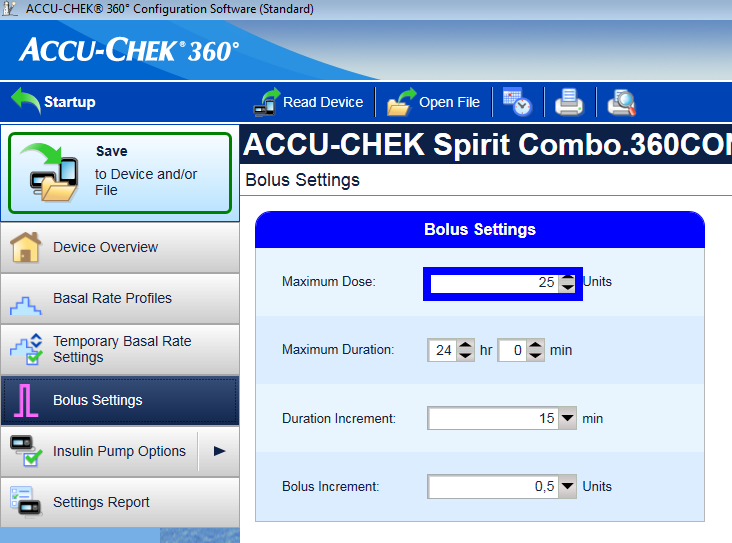

# Accu-Chek Combo

**這個軟體是 DIY 解決方案的一部分，並不是一個產品，因此需要你自己閱讀、學習並暸解系統以及如何使用他。他不是一個能為你完全管理糖尿病的工具，但如果你願意投入時間，他可以幫助你改善糖尿病並提高生活品質。不要急著使用，先給自己學習的時間。你需要對自己使用的結果負完全責任。**

```{admonition} Accu-Chek Combo is being phased out
:class: note

Roche is withdrawing from the insulin pump market to refocus its diabetes portfolio on the Accu-Chek SmartGuide CGM. It has communicated the end of sales of both the Accu-Chek Combo and Accu-Chek Insight pumps; its remaining Accu-Chek Solo micropump is also being wound down (last deliveries in Germany at the end of 2025). The change is being rolled out by region, starting in Germany, with other European markets expected to follow. If you rely on this pump, plan ahead for a transition to a supported pump.
```

```{contents} Table of contents
:depth: 1
:local: true
```

## 幫浦與AAPS的功能

* Communicates with **AAPS** over your phone's native Bluetooth, without an additional communication device.
* Automatic DST and timezone handling.

## 硬體和軟體需求

* 一台 Roche Accu-Chek Combo 幫浦（任何韌體版本均可使用）。
* 一個 Smartpix 或 Realtyme 裝置，配合 360 設定軟體來配置幫浦。 （Roche 在客戶要求下會免費寄送 Smartpix 裝置和設定軟體。）
* A compatible phone running Android 12 or newer. 請參閱 [發行說明](#maintenance-android-version-aaps-version) 以獲取詳細訊息。
* The **AAPS** app installed on your phone.

根據手機的藍牙支援品質及其是否具備額外的省電邏輯，有些手機可能比其他手機運作得更好。手機列表可以在 [AAPS 手機列表](#Phones-list-of-tested-phones) 文件中找到。請注意，這不是完整的列表，只反應個人使用經驗。我們鼓勵你也分享你的經驗，這樣可以幫助其他人（這些專案是關於傳遞經驗）。

(combov2-before-you-begin)=
## 開始之前

**安全第一**—請勿在無法復原的環境中嘗試此過程。隨身攜帶你的 Smartpix / Realtyme 裝置，以及 360 配置軟體。預計花費大約一小時來設置並檢查所有功能是否正常運作。

請注意以下限制：

* 目前不支援擴展注射和多波注射 (你可以使用 [擴展碳水化合物](../DailyLifeWithAaps/ExtendedCarbs.md) 作為替代)。
* 僅支援一個基礎設定檔（第一個）。
* The lowest basal rate in your **Profile** is 0.05 U/h. **AAPS** refuses a **Profile** with a lower rate. The Combo rounds basal rates to its own steps (0.01 U/h below 1 U/h, 0.05 U/h up to 10 U/h, 0.1 U/h above). **AAPS** uses the rates the pump really gives.
* Temporary basal rates are limited to 500% of the current basal rate. **AAPS** takes this limit into account.
* 如果幫浦上的目前活動設定檔不是設定檔 1，則循環模式將被停用。 This continues until profile no. 1 is made the active one; when that is done, the next time AAPS connects (either on its own after a while or because you tap **Refresh** on the Accu-Chek Combo pump screen), it will notice that profile no. 1 is the current one, and enable the loop again.
* 如果循環請求取消正在運作的 TBR，Combo 將設置一個 90% 或 110% 的 TBR，持續 15 分鐘。這是因為實際取消 TBR 會在幫浦上觸發警報，並產生大量震動，這些震動無法停用。
* 藍牙連線的穩定性隨不同手機而異，可能會出現「幫浦無法使用」的警報，這時幫浦無法再建立連線。 If that error occurs, make sure Bluetooth is enabled, tap **Refresh** on the pump screen (**Manage** > **Pump**) to see if this was caused by an intermitted issue and if still no connection is established, reboot the phone which should usually fix this.
* 另一個問題是重啟無法解決，必須按幫浦上的按鈕（這會重置幫浦的藍牙堆疊），幫浦才能再次接受來自手機的連線。
* 避免在幫浦上設定 TBR，因為循環控制 TBR。在幫浦上偵測到新的 TBR 可能需要長達 20 分鐘，並且 TBR 的效果僅從偵測時開始計算，因此最壞情況下可能有 20 分鐘的 TBR 沒有反應在 IOB 中。

The driver is currently written to support the following languages on the Combo. （這與 AAPS 的語系無關——是顯示在 Combo LCD 上的語系。）

* 英語
* 西班牙語
* 法語
* 義大利語
* 俄語
* 土耳其語
* 波蘭語
* 捷克語
* 匈牙利語
* 斯洛伐克語
* 羅馬尼亞語
* 克羅地亞語
* 荷蘭語
* 希臘語
* 芬蘭語
* 挪威語
* 葡萄牙語
* 瑞典語
* 丹麥語
* 德語
* 斯洛文尼亞語
* 立陶宛語

**重要**：如果你的幫浦設置為不在此列表中的語系，請聯繫開發人員，並將幫浦的語系設置為此列表中的一個語系。否則，驅動程式將無法正常工作。

## 手機設置

確保關閉電池優化設定非常重要。 AAPS 在自動偵測當受這些優化影響時，會發出請求將這些優化關閉。但在現代 Android 手機中，藍牙_本身_是一個應用程式（系統應用程式）。通常，「藍牙應用程式」在預設情況下_啟用了電池優化_。結果是，當手機為了省電而關閉藍牙應用程式時，藍牙可能拒絕回應。這意味著在藍牙系統應用程式的設置中，也必須關閉電池優化。不幸的是，不同手機找到藍牙系統應用程式的方法各不相同。在原生 Android 中，前往設定 -&gt; 應用程式 -&gt; 查看所有 N 個應用程式（N = 你手機上的應用程式數量）。然後，打開右上角的選單，點擊「顯示系統」或「顯示系統應用程式」或「所有應用程式」。現在，在新擴展的應用程式列表中，查找「藍牙」應用程式。選擇他，並在其「應用程式資訊」頁面上，點擊「電池」。在那裡，停用電池優化（有時稱為「電池使用量」）。

## Combo 設置

* 使用 Accu-Chek 360 設定軟體配置幫浦。如果你沒有這個軟體，請聯絡你的 Accu-Chek 客服專線。他們通常會向註冊用戶寄送附有 "360° 幫浦設定軟體" 的 CD 和 SmartPix USB 紅外線連線裝置（如果你有 Realtyme 裝置，也可以使用）。

  - **必要設定**（在螢幕截圖中以綠色標記）：

     * 將/保持選單配置設為「標準」，這將只顯示幫浦支援的選單/操作，並隱藏不支援的部分（如延長注射/多波注射、多重基礎率），使用這些功能會限制循環功能，因為無法在安全的情況下運作循環。
     * 確認 _快速資訊文本_ 設定為「快速資訊」（不加雙引號，位於 _胰島素幫浦選項_ 下）。
     * 將 TBR _最大調整_ 設定為 500%
     * 停用 _臨時基礎率的結束訊號_
     * 將 TBR _持續時間增量_ 設定為 15 分鐘
     * 啟用藍牙

  - **推薦設定**（在螢幕截圖中以藍色標記）

     * 根據你的需求設置低匣警報
     * 配置一個適合你治療的最大注射量，以防軟體中的錯誤
     * 同樣地，配置 TBR 的最大持續時間作為防護措施。允許至少 3 小時，因為選擇中斷幫浦 3 小時會設置 0% 持續 3 小時。
     * 啟用幫浦的按鍵鎖定，以防止從幫浦進行注射，特別是當幫浦之前已經使用過且快速注射是習慣時。
     * 將顯示逾時和選單逾時分別設置為最小值 5.5 和 5。這允許 AAPS 更快地從錯誤情況中恢復，並減少在這些錯誤期間可能發生的震動次數。

  

  

  

  

## 註冊驅動並將其與 Combo 配對

* Open the **menu** (☰) in the top-left corner, go to [**Configuration** > **Pump**](../SettingUpAaps/ConfigBuilder.md) and select **Accu-Chek Combo**.

  

  Once it is selected, the **Accu-Chek Combo** card shows two buttons, **Settings** and **Open plugin**:

  

  **Settings** opens the settings of the Accu-Chek Combo driver (see [Settings](#combov2-preferences) below):

  

  **Open plugin** (or **Manage** > **Pump**) opens the Accu-Chek Combo pump screen. Before a pump is paired it shows **Not paired to a pump**:

  

* On the pump screen, tap **Pairing**. The **Pair with pump** screen opens. Follow the steps shown on screen, then tap **Start pairing**. When Android asks for permission to make the phone visible to other Bluetooth devices, tap **Allow**. Eventually, the Combo shows a 10-digit pairing PIN on its screen, and **AAPS** asks for it. Enter that PIN in the **10-digit PIN** field.

  

  

  

  The next pictures are from an older **AAPS** version. The steps and texts are the same, but the screens look slightly different.

  

  

  

* If the PIN is entered incorrectly, **AAPS** shows **PIN did not work. Check if there was a typo. If this keeps happening, cancel and retry pairing.**

  

* When **Successfully paired with Combo** is shown, tap **OK**. You return to the pump screen, which now shows the pump status (see [Accu-Chek Combo pump screen contents](#combov2-tab-contents) below). The **Pairing** button is replaced by **Unpair**.

* 為了驗證你的設置（幫浦與任何導管**中斷連線**以確保安全！），使用 AAPS 設置一個 500％ 的 TBR 持續 15 分鐘並發出注射指令。幫浦現在應該正在運作 TBR，並且歷史紀錄中有注射紀錄。 AAPS 也應顯示活動的 TBR 和已注射的紀錄。

* 建議在 Combo 上啟用按鍵鎖定，以防止從幫浦進行注射，特別是之前已經使用幫浦並使用 "快速注射" 功能時。

## 關於配對的注意事項

Accu-Chek Combo 是在藍牙 4.0 發佈之前開發的，僅在第一款 Android 版本發佈一年後。這就是為什麼他與其他設備配對的方式，與當今 Android 中的方式不100％ 相容。要完全克服這一點，AAPS 需要系統級別的權限，這僅適用於系統應用程式。這些應用程式由手機製造商安裝在手機中 - 用戶無法安裝系統應用程式。

The consequence of this is that pairing will never be 100% without problems. 特別是，在配對過程中，Android 的藍牙 PIN 對話框可能會短暫顯示並自動消失。但有時，他會停留在螢幕上，並要求輸入 4 位數 PIN。（這與 10 位 Combo 配對 PIN 不同。）不要輸入任何東西，只需按取消即可。如果配對未繼續，請按照螢幕上的指示重試配對。

(combov2-tab-contents)=
## Accu-Chek Combo pump screen contents

To open the pump screen, go to **Manage** > **Pump**. Once a pump is paired, it shows the following information (items are listed from top to bottom):


1. **Driver state**: The driver can be in one of the following states:
   - **Disconnected**: There is no Bluetooth connection; the driver is in this state most of the time, and only connects to the pump when needed - this saves power
   - **Connecting**
   - **Checking pump**: the pump is connected, but the driver is currently performing safety checks to ensure that everything is OK and up to date
   - **Ready**: the driver is ready to accept commands from AAPS
   - **Suspended**: the pump is suspended (shown as "stopped" in the Combo)
   - A description of the command being executed, for example **Setting basal profile** or **Updating pump status**
   - **Error**: an error occurred; the connection was terminated, any ongoing command was aborted
2. **Last connection**: How many minutes ago the driver successfully connected to the Combo; if this goes beyond 30 minutes, this item is shown with a red color
3. **Battery**: Battery level; the Combo only indicates **Full**, **Low** or **Empty**, and does not offer anything more accurate (like a percentage), so only these three levels are shown here
4. **Reservoir**: How many IU are currently in the Combo's reservoir
5. **Last bolus**: How many minutes ago the last bolus was delivered; if none was delivered yet after AAPS was started, this is not shown
6. **Temp basal**: Details about the currently active temporary basal; if none is currently active, this is not shown
7. **Base basal rate**: Currently active base basal rate ("base" means the basal rate without any active TBR influencing the basal rate factor)
8. **Serial number**: Combo serial number as indicated by the pump (this corresponds to the serial number shown on the back of the Combo)
9. **Bluetooth address**: The Combo's 6-byte Bluetooth address, shown in the `XX:XX:XX:XX:XX:XX` format

While the driver is doing something (for example, setting a basal profile), a box below the list describes the current activity, with a thin progress bar showing the progress.

Combo 可以在 _遠端終端_ 模式或 _指令_ 模式下透過藍牙操作。遠端終端模式對應於 Combo 計的 "遠端控制模式"，該模式模擬了幫浦的 LCD 和四個按鈕。有些指令必須由驅動在此模式下執行，因為他們在指令模式中沒有相應的功能。後一種模式要快得多，但正如所說範圍有限。 When the remote-terminal mode is active, the current remote-terminal screen is shown in the field that is located just above the Combo drawing. 然而當驅動切換到指令模式時，該欄位將保持空白。

(You do not influence this; the driver fully decides on its own what mode to use. This is merely a note for you to know why sometimes you can see Combo frames in that field.)

At the bottom, there are these buttons:

- **Refresh**: Triggers an immediate pump status update. It is also used to let AAPS know that a previously discovered error is now fixed and that AAPS can check again that everything is OK (more on that below in [the section about alerts](#combov2-alerts)). You can only tap it when the driver is disconnected, suspended or in the error state.
- **Unpair**: Unpairs the paired Combo from **AAPS** and Android, after you confirm **Do you really want to unpair the pump?**. When no pump is paired, this button is replaced by **Pairing**.

(combov2-preferences)=
## 設定

These settings are available for the Combo driver (**Configuration** > **Pump** > **Accu-Chek Combo** > **Settings**, or the settings icon (cog wheel) on the pump screen). Items are listed from top to bottom:

1. **Discovery duration (in seconds)**: When pairing, the driver makes the phone discoverable by the pump. 這控制了這種可見性持續多久。預設選擇最大值（300 秒 = 5 分鐘）。 Android 不允許可見性無限期持續，因此必須選擇一個持續時間。
2. **Autodetect and automatically enter insulin reservoir change**: If enabled, the driver enters the "reservoir change" that you would normally enter yourself with **Manage** > **Prime/Fill**. 這在[下面進一步詳細說明](#combov2-autodetections)。
3. **Autodetect and automatically enter battery change**: If enabled, the driver enters the "battery change" that you would normally enter yourself with **Manage** > **Pump Battery Change**. 這在[下面進一步詳細說明](#combov2-autodetections)。
4. **Enable verbose Combo logging**: This greatly expands the amount of logging done by the driver. **注意**：除非開發人員要求，否則不要啟用此功能。 Otherwise, this can add a lot of noise to **AAPS** logs and lessen their usefulness.

Pairing and unpairing are done on the pump screen, not in the settings (see above).

(combov2-autodetections)=
## 自動偵測並自動輸入電池和儲存庫變更

驅動程式能夠透過跟蹤電池和儲存庫的電量來偵測電池和儲存庫變更。如果上次幫浦狀態更新時 Combo 報告的電池電量為低，且現在在新的幫浦狀態更新中顯示為正常，驅動程式就會推斷用戶必須已經更換了電池。儲存庫電量也採用相同的邏輯：如果現在顯示為比之前更高，這被解釋為儲存庫變更。

這僅當電池和儲存庫報告為低時_並且_電池和儲存庫有充分的填充時才起效。

These autodetections can be turned off in the driver [settings](#combov2-preferences).

(combov2-alerts)=
## 警報（警告和錯誤）以及如何處理他們

Combo 以遠端終端螢幕的形式顯示警報。警告會顯示一個“Wx”代碼（x 是一個數字），並附有簡短描述。其中一個例子是“W7”，“TBR OVER”。錯誤類似，但會顯示“Ex”代碼。

某些警告會被驅動程式自動消除。這些包括：

- W1 "reservoir low" : the driver turns this into a "low reservoir" warning that is shown on the AAPS main screen
- W2 "battery low" : the driver turns this into a "low battery" warning that is shown on the AAPS main screen
- W3、W6、W7、W8：這些僅供用戶參考資訊，驅動程式會自動消除他們，因此是安全的

其他警告 _不會_ 被自動消除。此外，錯誤 _絕不_ 會被自動消除。這兩者都是以相同方式處理：他們會導致驅動程式在 AAPS 介面上顯示警報對話框，並中止任何正在執行的指令。 The driver then switches to the "error" state (see [the Accu-Chek Combo pump screen contents above](#combov2-tab-contents)). 此狀態不允許任何指令執行。用戶需要在幫浦上處理錯誤；例如，阻塞錯誤可能需要更換套管。 Once the user took care of the error, normal operation can be resumed by tapping **Refresh** on the Accu-Chek Combo pump screen. 然後驅動程式會連線到 Combo 並更新其狀態，檢查畫面上是否仍顯示錯誤等。此外，驅動程式會在稍後自動重新整理幫浦狀態，因此手動按該按鈕並非必要。

注射是一個特殊案例。他在 Combo 的指令模式下執行，此模式下不會在中途報告出現的警報。因此，驅動程式無法在注射期間自動消除警告。這意味著不幸的是，幫浦在注射完成之前會一直發出哔哔聲。最常見的中途警報通常是 W1“儲液槽低”。**不要** 在注射期間手動取消幫浦上的 Comnbo 警告。這會有中斷注射的風險。注射結束後驅動程式會處理警告。

在驅動程式未與 Combo 連線期間發生的警報不會被驅動程式注意到。 Combo 無法自動將該警報推送到手機；始終需要手機發起連線。因此，該警報將持續存在，直到驅動程式連線到幫浦。 You can tap **Refresh** on the pump screen to trigger a connection and let the driver handle the alert right then and there (instead of waiting until AAPS itself decides to initiate a connection).

**重要**：如果發生錯誤或顯示非自動消除的警告，驅動程式會進入錯誤狀態。在這種狀態下，循環 **將會被阻斷** 直到幫浦狀態被重新整理！ It is unblocked after the pump status is updated (either by tapping **Refresh** or by the driver's eventual auto-update) and no error is shown anymore.

## 使用 Combo 時需注意的事項

* 請記住這不是一個產品，特別是在初期，使用者需要監控並暸解系統、其限制以及可能出現的故障方式。強烈建議不要在不充分瞭解系統的人使用該系統時使用他。
* 由於 Combo 的遠端控制功能運作方式，幾個操作（特別是設定基礎設定檔）相比其他幫浦較慢。這是 Combo 無法克服的不便限制。
* 不要在幫浦上設置或取消 TBR。循環假設他控制 TBR，否則系統無法可靠工作，因為無法確定用戶在幫浦上設定 TBR 的開始時間。
* 當 AAPS 與幫浦進行通訊時（幫浦上顯示藍牙標誌時），請不要按任何按鈕。這樣做會中斷藍牙連線。只有在建立連線時出現問題時才這樣做 (請參見[上述的 "開始之前" 部分](#combov2-before-you-begin))。
* 在幫浦注射時請不要按任何按鈕。特別是，不要嘗試透過按下按鈕來取消警報。請參閱[有關警報的部分](#combov2-alerts)以獲取更詳細的解釋。

## 無法建立與 Combo 連線時的檢查清單

驅動程式會盡最大努力連線到 Combo，並使用幾個技巧以最大化可靠性。然而，有時連線無法建立。以下是一些解決此情況的步驟。

1. 按一下 Combo 的按鈕。有時，Combo 的藍牙堆疊變得無反應，不再接受連線。按一下 Combo 的按鈕並顯示 LCD 螢幕內容，藍牙堆疊會重置。大部分情況下，這是解決連線問題所需的唯一步驟。
2. 重啟手機。如果手機的藍牙堆疊本身有問題，則可能需要這樣做。
3. 如果 Combo 的電池蓋已經老化，考慮更換他。老舊的電池蓋可能會導致 Combo 的電源供應問題，從而影響藍牙。
4. 如果連線嘗試仍然失敗，考慮解除配對並重新配對幫浦。

(combov2-tips-for-basic-usage)=
## Tips for basic usage

### How to ensure smooth operations

* Always **carry the smartphone with you**, leave it next to your bed at night. As your pump may lay behind or under you body while you sleep, a higher position (on a shelf or board) works best.
* Always make sure that the pump battery is as full as possible. See the battery section for tipps regarding the battery.
* Whenever possible, only operate the pump via the AAPS app. To facilitate this, activate the key lock on the pump under **PUMP SETTINGS / KEY LOCK / ON**. Only when changing the battery or the cartridge, it is necessary to use the pump's keys.


### Pump not reachable. What to do?

#### Activate pump unreachable alarm
* In **AAPS**, tap the **Settings** (gear) icon at the top right of the main screen, go to **Local alerts**, activate **Alert if pump is unreachable** and set **Pump unreachable threshold** to **31** minutes.
* This will give you enough time to not trigger the alarm when leaving the room while your phone is left on the desk, but informs you if the pump cannot be reached for a time that exceeds the duration of a temporary basal rate.

#### Restore reachability of the pump

* When AAPS reports a **pump unreachable** alarm, first release the keylock and **press any key on the pump** (e.g. "down" button). As soon as the pump display has turned off, tap **Refresh** on the Accu-Chek Combo pump screen (**Manage** > **Pump**). Mostly then the communication works again.
* If that does not help, reboot your smartphone. After the restart, AAPS will be reactivated and a new connection will be established with the pump.

* The tests with different smartphones have shown that certain smartphones trigger the "pump unreachable" error more often than others. See [AAPS Phones](#Phones-list-of-tested-phones) for successfully tested smartphones.

#### Root causes and consequences of frequent communication errors
* On phones with **low memory** (or **aggressive power-saving** settings), AAPS is often shut down. You can tell by the fact that the treatment buttons (QuickLaunch toolbar) on the main screen are not shown when opening AAPS because the system is initializing. This can trigger "pump unreachable alarms" at startup. In the **Last connection** field of the pump screen (**Manage** > **Pump**), you can check when AAPS last communicated with the pump.


* This error can drain the pump's battery faster because the basal profile is read from the pump when the app is restarted.
* It also increases the likelihood of causing the error that causes the pump to reject all incoming connections until a button on the pump is pressed.

### Cancellation of temporary basal rate fails
* Occasionally, AAPS cannot automatically cancel a **TBR CANCELED** alert. Then you have to either tap **Refresh** on the Accu-Chek Combo pump screen or the alarm on the pump will need to be confirmed.

### Pump battery considerations

#### Changing the battery
* After a **low battery** alarm, the battery should be changed as soon as possible to always have enough energy for a reliable Bluetooth communication with the smartphone, even if the phone is within a wider distance of the pump.
* Even after a **low battery** alarm, the battery might be used for a significant amount of time. However, it is recommended to always have a fresh battery with you after a "low battery" alarm rang.
* Before changing the battery, press on the **Loop** symbol on the main screen and select **Suspend loop** for 1 hour.
* Wait for the pump to communicate with the pump and the Bluetooth logo on the pump has faded.


* Release the key lock on the pump, put the pump into stop mode, confirm a possibly canceled temporary basal rate, and change the battery quickly.
* You don't need to re-set the pump's clock after the battery change: AAPS automatically updates the pump's date and time.
* Then put the pump back in run mode select **Resume** when pressing on the **Suspended Loop** icon on the main screen.
* AAPS will re-set a necessary temporary basal rate with the arrival of the next blood sugar value.

(Accu-Chek-Combo-Tips-for-Basic-usage-battery-type-and-causes-of-short-battery-life)=
#### Battery type and causes of short battery life
* As intensive Bluetooth communication consumes a lot of energy, only use **high-quality batteries** like Energizer Ultimate Lithium, the "power one"s from the "large" Accu-Chek service pack, or if you are going for a rechargeable battery, use Eneloop batteries.

 

Ranges for typical life time of the different battery types are as follows:
* **Energizer Ultimate Lithium**: 4 to 7 weeks
* **Power One Alkaline** (Varta) from the service pack: 2 to 4 weeks
* **Eneloop rechargeable** batteries (BK-3MCCE): 1 to 3 weeks

If your battery life is significantly shorter than the ranges given above, please check the following possible causes:
* There are some variants of the screw-on battery cap of the Combo pump, which partially short circuit the batteries and drain them quickly. The caps without this problem can be recognized by the golden metal contacts.
* If the pump clock does not "survive" a short battery change, it is likely that the capacitor is broken which keeps the clock running during a brief power outage. In this case, a replacement of the pump by Roche might help, which is not a problem during the warranty period.
* The smart phone hardware and software (Android operating system and Bluetooth stack) also impact the battery lifetime of the pump, even though the exact factors are not completely known yet. If you have the opportunity, try another smartphone and compare battery lifetimes.

### Extended bolus, multiwave bolus
The OpenAPS algorithm does not support a parallel extended bolus or multiwave bolus. But a similar treatment can be achieved by the following alternatives:
* Use **e-Carbs** when entering carbs or using the Bolus wizard by entering the carbs of the full meal and the duration you expect the carbs to arrive as glucose in your blood. The system will then calculate small carbs equally distributed over the whole duration which will cause th algorithm to provide equivalent insulin dosing while still permanently checking the overall rise/decrease of the blood glucose level. For a multiwave bolus approach, you can also combine a smaller immediate bolus with e-carbs.
* Before eating, set a temporary **Eating Soon** target with glucose 80 for several hours (press the target on the main screen, or **Manage** > **Temp Target**). The duration should be based on the interval you would choose for an extended bolus. This will keep your target lower than usual and therefore increase the amount of insulin delivered.
* Then use the **Bolus wizard** to enter the full carbs of the meal, but do not directly apply the values it suggests. If a multiwave-like bolus is to be delivered, correct the insulin dosage down. Depending on the meal, the algorithm now has to deliver additional SMBs or higher temporary basal rates to counteract the increase in blood sugar. Here, the safety limitation of the basal rate (Max IE / h, Maximum basal IOB) should be very carefully experimented with and, if necessary, temporarily changed.

* Don't use the extended or multiwave bolus directly on the pump. The driver does not support them (see [Before you begin](#combov2-before-you-begin)); if a multiwave bolus is given on the pump anyway, **AAPS** records it from the pump history as a normal bolus plus an extended bolus, so it is counted in IOB. An extended bolus does not work in a closed loop environment (see [this page](#extended-bolus-and-why-they-wont-work-in-closed-loop-environment) for details).

### Alarms at bolus delivery
* After each bolus, the driver reads the pump's bolus history. This is a safety mechanism to correctly calculate insulin on board (IOB), even when a bolus is delivered directly from the pump.
* Before a bolus, if the pump history has a bolus that **AAPS** did not know about (for example, a bolus given directly on the pump), the requested bolus is **not given**, because it was calculated without that insulin. **AAPS** shows **The pump history has a bolus that AAPS did not know about. The requested bolus was not given...** Check the bolus history on the pump and your IOB. If a bolus is still needed, calculate it again. This also applies when the unknown bolus is found on a new connection.
* If the bolus was given but the pump history also had other boluses that **AAPS** did not know about, they are recorded now and **AAPS** asks you to check IOB before the next bolus.
* If the connection to the pump is lost **during** a bolus, **AAPS** does not record 0 U: it shows how much the pump had given by then and warns that the pump may still give the rest. **Do not bolus again.** **AAPS** reads the real amount from the pump history at the next connection.
* If the connection is lost while **AAPS** sends the bolus, it is not known whether the pump got it. Check the bolus history on the pump before the next bolus.
* If **AAPS** cannot confirm that a bolus was delivered, it shows **Bolus delivery failed. It appears no bolus was delivered. To be sure, please check the pump to avoid a double bolus and then bolus again.** Boluses are never retried automatically.

## 如何尋求協助

Development of the Combo driver is done by the community on a **volunteer** basis. Before requesting help, please:

1. **Read** the relevant section of this documentation to confirm how the feature is meant to work.
2. **Ask** on the *#AAPS* channel on [Discord](https://discord.gg/4fQUWHZ4Mw), or in one of the other [community channels](../GettingHelp/WhereCanIGetHelp.md).
3. **Report a bug** by searching the [existing issues](https://github.com/nightscout/AndroidAPS/issues); if yours is not listed, open a [new issue](https://github.com/nightscout/AndroidAPS/issues) and attach your [log files](../GettingHelp/AccessingLogFiles.md).

When asking for help, include your phone make and model, Android version, **AAPS** version, and a plain-English description of the problem (what changed, when it last worked).
