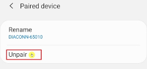

# Diaconn G8

```{contents} Table of contents
:depth: 1
:local: true
```

## 幫浦與AAPS的功能

* 透過手機內建的藍牙與**AAPS**通訊，不需要額外的通訊裝置。
* 夏令時間和時區變更必須手動處理。

## 胰島素幫浦藍牙配對

- 點選左上角的**選單**（☰）。


- 點選**組態設定** &gt; **幫浦**，然後選取**Diaconn G8**。


選取後，**Diaconn G8**卡片會顯示兩個按鈕：「**設定**」和「**開啟外掛**」：


**設定**會開啟 Diaconn G8 驅動程式的設定（請參閱下方的[Diaconn G8 胰島素幫浦選項設定](#diaconn-g8-insulin-pump-option-setting)）。

**開啟外掛**（或選取**管理** &gt; **幫浦**）會開啟 Diaconn G8 幫浦畫面。尚未配對幫浦時，畫面如下：


```{admonition} Older screenshot
:class: note
上方的螢幕截圖來自較早期的 **AAPS** 版本。在 **AAPS** 4 中，請從幫浦畫面上的 **配對** 按鈕開始配對；沒有「**已選取的幫浦**」設定。
```

- 在幫浦畫面上，點選**配對**。系統會開啟**Diaconn 幫浦配對**畫面，並由**AAPS**搜尋附近的幫浦。
- 清單中出現您的胰島素幫浦型號後，點選該型號（例如 **DIACONN-65010**）。


- 有兩種方法來檢查你的型號：

1. 幫浦背面的 SN 編號的最後五位數字。
2. 點擊 O 按鈕 > 資訊 > 藍牙 > 最後五位數字。


- 選取幫浦後，畫面會出現要求輸入 PIN 碼的視窗。輸入幫浦上顯示的 PIN 碼，即可完成連線。

 

- 畫面顯示**配對成功！**時，點選**確定**返回幫浦畫面。

## 幫浦狀態檢查與日誌同步

- 幫浦連線後，開啟幫浦畫面（**管理** &gt; **幫浦**）。畫面會顯示幫浦狀態（電池、儲藥槽、上次連線時間、上次注射、基礎率等）。
- 點選**重新整理**以連線至幫浦、更新狀態並同步記錄。
- 點選**幫浦歷史記錄**，即可查看從幫浦讀取的歷史記錄。


```{admonition} Older screenshot
:class: note
上方的螢幕截圖來自較早期的 **AAPS** 版本。在 **AAPS** 4 中，幫浦狀態會顯示於幫浦畫面（**管理** > **幫浦**），並透過<strong x-id="1">重新整理</strong>按鈕同步。
```

(diaconn-g8-bluetooth-troubleshooting)=

## 藍牙問題排除

**如果幫浦的藍牙連線不穩定時該怎麼做。**

### 方法 1）重新啟動 AAPS，然後再次檢查幫浦

- 點選左上角的**選單**（☰）。
- 點選選單底部的**結束**。


- 再次啟動**AAPS**，並檢查與幫浦的連線。

### 方法 2）如果方法 1 無效，請中斷藍牙連線，然後重新連線。

- 按住頂部的藍牙按鈕約 3 秒鐘。


- 點擊已配對的 Diaconn G8 胰島素幫浦上的設定按鈕。


- 取消配對。



- 在**AAPS**中，開啟幫浦畫面（**管理** &gt; **幫浦**），點選**取消配對</strong)，並確認「**要重設配對資訊嗎？**」。</li>
- 重複幫浦的藍牙配對過程（見上文）。</ul>

## 更多資訊

(diaconn-g8-insulin-pump-option-setting)=

### Diaconn G8 胰島素幫浦選項設定

- **組態設定** &gt; **幫浦** &gt; **Diaconn G8** &gt; **設定**
- 或者，在幫浦畫面（**管理** &gt; **幫浦**）中，點選右上角的設定圖示（齒輪）。


- **注射速度**可設定幫浦注射的速度。
- 如果已啟用 **記錄儲藥槽更換**選項，發生「胰島素更換」事件時，系統會自動將相關詳細資料上傳至照護入口。
- 如果已啟用 **記錄針頭更換**選項，發生「輸注部位更換」事件時，系統會自動將相關詳細資料上傳至照護入口。
- 如果已啟用 **記錄管路更換**選項，發生「管路更換」事件時，系統會自動將相關詳細資料新增為備註。
- 如果已啟用 **記錄電池更換**選項，發生「電池更換」事件時，系統會自動將相關詳細資料上傳至照護入口。您也可以透過 **管理** > **幫浦電池更換**自行記錄電池更換。（注意：更換電池前，請先停止所有進行中的注射功能。）
- **Diaconn 雲端同步**會將幫浦紀錄傳送至 Diaconn 雲端。


```{admonition} Older screenshot
:class: note
上方的螢幕截圖來自較早期的 **AAPS** 版本。在 **AAPS** 4 中，請透過 **管理** > **幫浦電池更換**記錄電池更換；此版本沒有 **動作**分頁。
```

### 延長注射功能

- 如果使用延長注射功能，將會停用循環模式。
- 請參閱[本頁](#extended-bolus-and-why-they-wont-work-in-closed-loop-environment)了解為何延長注射功能無法在循環模式下運作的詳情。

## 如何尋求協助

Diaconn G8 驅動程式由社群成員以**志工**方式開發。尋求協助前，請先：

1. **請閱讀**本文件中相關的章節，確認此功能的運作方式。
2. 請在 [Discord](https://discord.gg/4fQUWHZ4Mw) 的 *#AAPS* 頻道，或其他[社群頻道](../GettingHelp/WhereCanIGetHelp.md)之一**提出問題**。
3. 若要**回報錯誤**，請先搜尋[現有問題](https://github.com/nightscout/AndroidAPS/issues)；如果沒有列出您的問題，請[新增問題](https://github.com/nightscout/AndroidAPS/issues)，並附上您的[紀錄檔](../GettingHelp/AccessingLogFiles.md)。

尋求協助時，請提供手機廠牌與型號、Android 版本、**AAPS** 版本，以及簡明易懂的問題描述（發生了什麼變化、上次正常運作的時間）。
