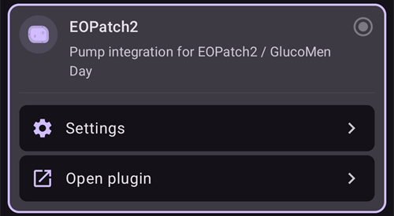
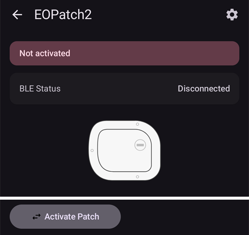
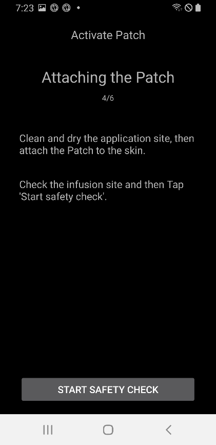
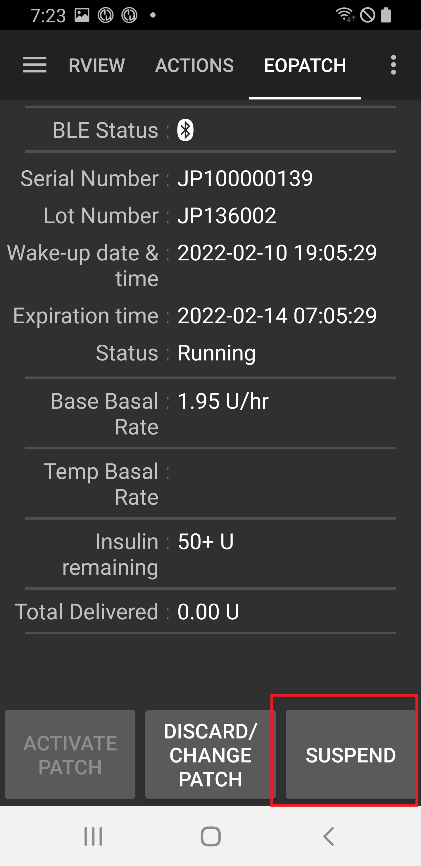
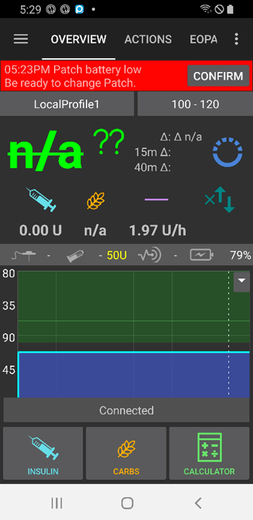

# EOPatch2

貼片需要使用 U-100 速效胰島素，例如 NovoRapid 或 Humalog。請使用醫師為您開立的速效胰島素。

貼片可注射的最小劑量為 0.05 U。請將**設定檔**中的每個基礎率都設為至少 0.05 U/hr，並以 0.05 U/hr 為增量。否則，**AAPS** 會將每個基礎率四捨五入至最接近的 0.05 U/hr（不會向下取整至 0），並使用貼片實際輸注的基礎率，因此每天的胰島素總量會與**設定檔**略有差異。同樣地，注射劑量也必須至少為 0.05 U。

```{contents} Table of contents
:depth: 1
:local: true
```

## 幫浦與AAPS的功能

* 透過手機內建的藍牙與**AAPS**通訊，不需要額外的通訊裝置。
* 夏令時間和時區變更必須手動處理。

## 幫浦設定

1. 在 **AAPS** 主畫面左上角開啟**選單**（☰），然後選取**組態設定**。
1. 在**幫浦**區段中，選取**EOPatch2**。
1. 按下返回鍵，回到主畫面。

 

選取後，**EOPatch2** 卡片會顯示兩個按鈕：**設定**和**開啟外掛**：



## 設定

您可以透過以下任一方式開啟 EOPatch2 設定：

* 在**組態設定**中的 **EOPatch2** 卡片上，按下**設定**；或
* 開啟幫浦畫面（**管理** → **幫浦**），然後按下右上角的齒輪圖示。

共有三項設定：


### 低儲存量警報

貼片中剩餘的胰島素量降至此數值或更低時，系統會顯示警告。您可以設定為 10 到 50 U，每次增加 5 U。預設值為 10 U。

### 貼片到期提醒

提醒您目前貼片距離效期結束還剩多少時間。您可以設定為 1 到 24 小時，每次增加 1 小時。預設值為 4 小時。

### 貼片嗶聲提醒

開啟此選項後，貼片會在注射、延長注射或臨時基礎率開始及結束時發出嗶聲。此設定不會影響一般基礎率。預設為關閉。

## 啟動新貼片

### 開啟啟動嚮導

透過 **管理** → **幫浦**開啟幫浦畫面（或按下**組態設定**中 **EOPatch2** 卡片上的**開啟外掛**）。沒有啟動貼片時，畫面會顯示**尚未啟動**，底部則會顯示**啟動貼片**按鈕。

按下**啟動貼片**即可開始嚮導。



嚮導會引導您完成每個步驟。頂端的圓點列會顯示目前的進度。

```{note}
如果您從未在 **AAPS** 中啟動過 **設定檔**，嚮導會先顯示 **需要設定檔**頁面。選取要使用的設定檔，然後按下 **啟用設定檔**。
```

### 填充胰島素

將注射器針頭插入貼片上的胰島素注入孔。慢慢推動活塞，將胰島素注入貼片。貼片內的胰島素超過 80 U 後，會嗶一聲並開始啟動（開機）。

聽到嗶聲時，按下 **開始配對**。


```{warning}
- 嚮導提示您之前，請勿轉動針頭操作桿。太早轉動可能會導致填充或安全檢查時發生嚴重問題。
- 貼片可容納 80 至 200 U。若注入量少於 80 U，貼片將無法運作。
- 填充前 15 至 30 分鐘，請先將胰島素從冰箱取出，讓它回到室溫。胰島素溫度必須至少達到 10°C。
```

### 貼片配對

**AAPS** 現在會嘗試自動與貼片配對。配對期間會出現兩個 Android 藍牙配對要求。在第一個配對要求中按下 **確定**。接著在第二個配對要求中再次按下 **確定**；這個要求會顯示密碼金鑰。

```{warning}
- 配對時，貼片與手機之間的距離請保持在 30 cm 以內。
- 貼片啟動後，每隔 3 分鐘會嗶一聲，直到配對完成。
- 您必須在貼片啟動後 60 分鐘內完成貼片註冊。若無法完成，請丟棄貼片。
```

  

```{admonition} Older screenshot
:class: note
這兩張藍牙配對畫面截圖來自較早版本的 **AAPS**：Android 配對要求後方的 **AAPS** 畫面與 **AAPS** 4 中的畫面不同。
```

### 選取胰島素

選取您用來填充貼片的胰島素，然後按下 **下一步**。啟動後，**AAPS** 會套用使用此胰島素的設定檔切換。

### 準備貼片

撕下貼片上的膠帶，然後按下 **下一步**。

如果有針頭露出，或貼片潮濕、髒污，或膠帶摺起，請改按 **丟棄**，並改用新的貼片。


### 輸注部位

只有在「部位輪替設定」中開啟 **管理幫浦部位輪替** 時，才會顯示此步驟。在身體圖示上點選您要貼上貼片的位置，然後按下 **下一步**；或按下 **略過**。

### 貼上貼片

胰島素應注入皮下脂肪較多、神經或血管較少的位置。腹部、手臂或大腿都是合適的位置。清潔並擦乾部位，然後將貼片貼在外觀上。

檢查輸注部位，然後按下 **開始安全檢查**。

```{warning}
- 請均勻按壓貼片膠帶的邊緣，確保整片貼片都牢牢貼在外觀上。
- 如果貼片沒有完全貼合，空氣可能會進入貼片與外觀之間。這會降低黏性和貼片的防水性。
```



### 安全檢查

安全檢查約需 30 秒。檢查完成時，貼片會嗶一聲。如果檢查失敗，請按下 **重試**。

```{warning}
為確保安全，請等安全檢查完成後再轉動針頭操作桿。
```

 

```{admonition} Older screenshot
:class: note
從 **準備貼上貼片** 到 **安全檢查** 的畫面截圖來自較早版本的 **AAPS**，在 **AAPS** 4 中可能會有所不同。
```

### 插入針頭

請穩穩握住貼片。將針頭操作桿向上轉動超過 100°，以插入針頭。針頭正確插入時，貼片會嗶一聲。接著繼續轉動操作桿到底，將它取下。按下 **下一步**。

```{caution}
如果未聽到嗶聲就進入下一個步驟，畫面會顯示 **針頭插入錯誤**。確認是否聽到嗶聲，然後按下 **重試**。如果錯誤仍然存在，請按下 **丟棄**，以停用貼片。
```

### 貼片註冊完成

最後一頁會確認貼片已啟用，並提醒您貼片即將到期。按下 **完成**，返回幫浦畫面。

## 丟棄貼片

當貼片中的胰島素所剩不多、貼片已到期或貼片故障時，請更換貼片。建議每片貼片啟動後的使用時間不要超過 84 小時。

1. 開啟幫浦畫面（**管理** → **幫浦**）。貼片啟動期間，請按下 **捨棄貼片**。
1. **捨棄貼片**頁面會顯示貼片剩餘時間和剩餘胰島素量。按下 **捨棄貼片**。
1. 系統會顯示對話方塊，請你確認。再次按下 **捨棄貼片**。
1. 貼片停用後，嚮導會顯示 **已完成捨棄貼片。**請從身上取下貼片，然後按下 **確認**。

接著，嚮導會直接繼續進行新貼片的註冊程序（請參閱上文）。如果要暫停此程序，請按下返回箭頭。

沒有貼片啟動時，**AAPS** 會將幫浦顯示為已暫停，並記錄 0 U/hr 的臨時基礎率。因此，在下一片貼片註冊前，不會將任何基礎胰島素計入 IOB。

   

```{admonition} Older screenshot
:class: note
以上螢幕截圖來自較早版本的 **AAPS**。在 **AAPS** 4 中，請從 **管理** → **幫浦** 開啟幫浦畫面，畫面上的按鈕標示為 **捨棄貼片**。
```

```{admonition} If the patch does not respond
:class: warning
如果 **AAPS** 無法連線至貼片，可能會顯示手動關閉貼片警報的說明頁面：請從身上取下貼片，撕下黏著膠帶，然後用迴紋針用力按壓胰島素注入口旁的孔洞。

**捨棄貼片**頁面也有 **強制重設**按鈕。此按鈕只會從 **AAPS** 中清除貼片資料，不會向貼片傳送任何指令。貼片會持續輸注胰島素，直到電池耗盡或你手動將貼片關閉。只有在一般捨棄程序失敗時才使用此功能，並請從身上取下貼片。
```

## 暫停及恢復胰島素輸注

暫停胰島素輸注也會取消任何延長注射和臨時基礎率。恢復輸注時，這些設定**不會**重新啟動。胰島素輸注暫停期間，貼片每隔 15 分鐘會發出嗶聲。

### 暫停胰島素輸送

1. 開啟幫浦畫面（**管理** → **幫浦**），然後按下 **暫停幫浦**。
1. 對話方塊會說明即將暫停的項目。按下 **確認**。
1. 在 **基礎率暫停時間**對話方塊中，選擇暫停時間：30 分鐘、1 小時、1 小時 30 分鐘或 2 小時。按下 **確認**。

胰島素輸注會暫停你選擇的時間。

  

```{admonition} Older screenshot
:class: note
以上螢幕截圖來自較早版本的 **AAPS**。在 **AAPS** 4 中，請從 **管理** → **幫浦** 開啟幫浦畫面，畫面上的按鈕標示為 **暫停幫浦**。
```

### 恢復胰島素輸送

1. 開啟幫浦畫面（**管理** → **幫浦**），然後按下 **恢復幫浦**。
1. 在 **恢復胰島素輸注**對話方塊中，按下 **確認**。

 

```{admonition} Older screenshot
:class: note
以上螢幕截圖來自較早版本的 **AAPS**。在 **AAPS** 4 中，請從 **管理** → **幫浦** 開啟幫浦畫面，畫面上的按鈕標示為 **恢復幫浦**。
```

```{warning}
暫停時間結束時，**AAPS** 會顯示 **胰島素暫停結束**警告。除非你確認，否則胰島素輸注<strong x-id="1">不會</strong>重新啟動。如果沒有重新啟動，可能會導致高血糖。
```

(eopatch2-alarms-and-warnings)=

## 警報與警告

### 警報

警報用於緊急且優先度最高的情況，需要你立即處理。 **AAPS** 會持續發出警報聲，直到你確認為止，並在**總覽**畫面以通知顯示訊息。警報表示目前使用的貼片有問題。在許多情況下，必須捨棄貼片並換上新貼片。

在通知上按下 **確認**後，**AAPS** 會處理此警報。對大多數警報而言，這會停用貼片。如果是**溫度不適**警報，按鈕會顯示為**重試**。

 

```{admonition} Older screenshot
:class: note
警報畫面截圖來自較早版本的 **AAPS**，在 **AAPS** 4 中可能會有所不同。
```

以下說明各種警報。

| 警報     | 說明                                                    |
| ------ | ----------------------------------------------------- |
| 儲存量已空  | 貼片中的胰島素已用完。                                           |
| 貼片到期   | 貼片已超過使用期限，無法再輸送胰島素。                                   |
| 堵塞     | 貼片的胰島素輸送管路似乎遭到阻塞。                                     |
| 開機自檢失敗 | 貼片在開機後進行自我測試時發生未預期的錯誤。                                |
| 不適當的溫度 | 註冊或使用貼片時，貼片所在位置的溫度超出正常運作範圍。請將貼片移至溫度適當的位置（4.4 至 37°C）。 |
| 針頭插入錯誤 | 註冊貼片時，針頭未正確插入。請確認貼片的針頭插入側與針頭動作桿位於同一直線上。               |
| 貼片電池錯誤 | 貼片的內建電池即將耗盡，貼片將會關機。                                   |
| 貼片啟動錯誤 | 貼片開機後 60 分鐘內未完成註冊。                                    |
| 貼片錯誤   | 註冊或使用貼片時發生未預期的錯誤。                                     |

### 警告

警告適用於中度或低度優先情況。警告會以通知的形式顯示在**總覽**畫面上。



```{admonition} Older screenshot
:class: note
此截圖來自較早版本的 **AAPS**：在 **AAPS** 4 中，警告會顯示在主畫面上，畫面外觀也有所不同。
```

以下說明各種警告。

| 警告       | 說明                                     |
| -------- | -------------------------------------- |
| 胰島素暫停結束  | 您設定的暫停時間已結束。請點選通知上的**恢復幫浦**，重新開始輸送胰島素。 |
| 儲存量過低    | 貼片中剩餘的胰島素量低於**儲液量偏低警示**中設定的數值。         |
| 貼片使用期限到期 | 貼片已超過使用期限。                             |
| 貼片即將到期   | 貼片必須在 1 小時內丟棄。                         |
| 貼片啟動不完整  | 配對後，貼片註冊流程中斷超過 3 分鐘。請開啟幫浦畫面並完成貼片註冊。    |
| 貼片電池電量低  | 貼片電量偏低。                                |

## 如何尋求協助

EOPatch2 驅動程式由社群成員以**志願**方式開發。尋求協助前，請先：

1. **請閱讀**本文件中相關的章節，確認此功能的運作方式。
2. 請在 [Discord](https://discord.gg/4fQUWHZ4Mw) 的 *#AAPS* 頻道，或其他[社群頻道](../GettingHelp/WhereCanIGetHelp.md)之一**提出問題**。
3. 若要**回報錯誤**，請先搜尋[現有問題](https://github.com/nightscout/AndroidAPS/issues)；如果沒有列出您的問題，請[新增問題](https://github.com/nightscout/AndroidAPS/issues)，並附上您的[紀錄檔](../GettingHelp/AccessingLogFiles.md)。

尋求協助時，請提供手機廠牌與型號、Android 版本、**AAPS** 版本，以及簡明易懂的問題描述（發生了什麼變化、上次正常運作的時間）。
