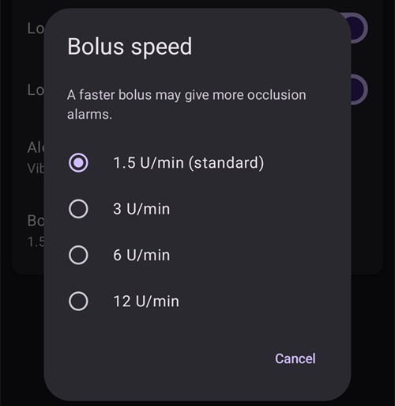
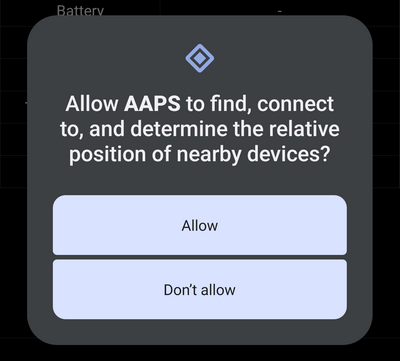

# Equil

這些指示是用於配置 Equil 胰島素幫浦。

```{contents} Table of contents
:depth: 1
:local: true
```

## 幫浦與AAPS的功能

* 無導管貼片式幫浦，可透過手機內建的藍牙與 **AAPS** 通訊，不需要額外的通訊裝置。
* **AAPS** 將 Equil 視為儲液槽容量為 200 U 的貼片式幫浦：主畫面會顯示貼片式幫浦的狀態燈號，且不提供 **預充／填充**和 **更換幫浦電池**功能。填充、預充和更換電池都要在幫浦嚮導中完成。
* 幫浦暫停或停止時，**AAPS** 會記錄一筆 0 U/h 的臨時基礎率，因此不會將基礎胰島素計入活性胰島素。
* 夏令時間和時區變更必須手動處理。

## 硬體和軟體需求
* **相容的 Equil 硬體**

  目前支援 Equil 5.3 和 5.4。

* 依照 [建置 APK](../SettingUpAaps/BuildingAaps.md) 說明建置並安裝的 **AAPS**

## 設定

### 選擇 Equil 幫浦

點選左上角的 **選單**（☰），選擇 **[組態設定工具](#Config-Builder-pump)**，然後在 **幫浦**下方選取 **Equil**。

選取後，**Equil** 卡片上會顯示兩個按鈕：**設定**和 **開啟外掛**：


點選 **開啟外掛**（或 **管理** → **幫浦**）即可開啟 Equil 幫浦畫面。尚未配對幫浦時，畫面如下：


### 設定

點選 **Equil** 卡片上的 **設定**，或點選幫浦畫面右上角的齒輪圖示，即可開啟 Equil 設定。


* **電池電量不足警示**：幫浦電池電量不足時發出警示。
* **藥量不足警示**：儲液槽中的胰島素不足時發出警示。
* **警示音效**：設定幫浦發出警示的方式：**靜音**、**僅震動**、**僅音效**或 **震動和音效**。
* **注射速度**：設定注射速度：**1.5 U/min（標準）**、**3 U/min**、**6 U/min**或 **12 U/min**。較快的注射速率可能會觸發更多阻塞警報。



```{admonition} Max basal and max bolus on the patch
:class: note
貼片本身會拒絕任何高於 **AAPS** 設定上限的基礎率。 **AAPS** 會採用你的 **最高基礎率**[設定](../SettingUpAaps/Preferences.md)與 **設定檔**中最高的每小時基礎率，兩者之中較高的數值。因此，貼片一定會接受你的設定檔，以及循環功能要求的臨時基礎率。 **AAPS** 也會將允許的最高注射量傳送至貼片。

變更 **最高基礎率**或 **最高注射量**時，**AAPS** 會自動將新數值傳送至貼片。每次切換設定檔時，也會傳送這些數值。不需要在貼片本身進行任何設定。
```

### 配對幫浦

在幫浦畫面中，按下 **配對**。嚮導會逐步引導你完成各項操作。頂端的圓點列會顯示目前的進度。

如果 Android 詢問是否允許 **AAPS** 搜尋並連線至附近的裝置，請按下 **允許**。 **AAPS** 需要這項權限才能搜尋幫浦。



嚮導包含以下步驟。按下 **下一步**繼續，或按下 **取消**離開嚮導。

1. **需要設定檔**：只有在你尚未於 **AAPS** 中註冊任何 **設定檔**時，才會顯示此步驟。選取要使用的設定檔，然後按下 **啟用設定檔**。
1. **組裝幫浦**：組裝幫浦、已填充的儲液槽和已充電的電池。

   

1. **尋找幫浦**：**AAPS** 會搜尋附近的 Equil 幫浦。從清單中選取你的幫浦。

   
1. **配對裝置**：你可以在 **設定配對密碼**中輸入配對密碼。密碼必須為 4 個字元，且只能使用 `ABCDEF0123456789`。按下 **配對**。

   

1. **選取胰島素**：只有在設定了多種胰島素時才會顯示。選取藥量中的胰島素。
1. **預充／填充**：幫浦**不可**放在底板上。按下**預充／填充**，為藥量預充，直到針尖上出現一滴胰島素。按下 **下一步**。

   
1. **部位輪替**：只有在部位輪替設定中開啟**管理幫浦部位輪替**時才會顯示。點選要安裝幫浦的位置，或按下**略過**。
1. **安裝幫浦**：將幫浦安裝到底板上。

   
1. **預充套管**：幫浦安裝到底板上後，按下**排出空氣**，排出套管中的空氣。按下 **下一步**。

   

1. **確認**：將幫浦戴在身上，然後按下**完成**。

   

```{warning}
如果您設定了自己的配對密碼（建議這麼做以確保安全），請將密碼存放在安全的地方。密碼會儲存在幫浦中。每次重新配對時，幫浦都會要求輸入密碼，直到您在 **AAPS** 中正確取消配對為止。在此之前，您也無法使用原廠手持控制器（PDA）操作幫浦。
```

### 配對後的幫浦螢幕

幫浦配對後，幫浦螢幕會顯示以下按鈕：

* **重新整理**：立即讀取幫浦的狀態和歷史記錄。
* **暫停**／**恢復輸注**：停止或重新開始輸注胰島素。
* **更換藥量**：引導您取下幫浦、裝入新的藥量（以及視需要更換電池）、預充，然後重新安裝幫浦。第一個步驟會詢問：*您也要換上新的輸注組（底板和套管）嗎？*
  * **是，使用新的輸注組**：您可以選擇部位並預充套管，而**AAPS**會記錄胰島素更換和套管更換。
  * **否，只更換藥量或電池**：不會預充套管，而**AAPS**只會記錄胰島素更換。

  更換藥量後，電池電量會顯示為**-**，直到**AAPS**再次從幫浦讀取電量為止。

  

* **歷史記錄**：顯示幫浦記錄的事件。
* **取消裝置配對**：引導您取下幫浦，並取消幫浦與**AAPS**的配對。這會停止胰島素輸注、將幫浦的活塞退回底部，並刪除配對資料。

### 警報

* 低胰島素警報會在每個剩餘量門檻（10 U、5 U 和 2 U）各響一次，並在藥量用盡時響起。低電量警報會在電量降至 10% 和 5% 時各響一次。每個門檻只會警報一次，直到下次更換藥量為止。
* 幫浦警報和停止輸注事件也會以通知的形式記錄在治療資料中，並標註幫浦記錄事件的時間，方便您日後查看幫浦停止的時間和原因。
* 如果藥量在注射期間用盡，**AAPS**只會記錄到當時已注射的胰島素量，並告知您兩個數值。

## 如何尋求協助

Equil 驅動程式由社群以**志願**方式開發。尋求協助前，請先：

1. **請閱讀**本文件中相關的章節，確認此功能的運作方式。
2. 請在 [Discord](https://discord.gg/4fQUWHZ4Mw) 的 *#AAPS* 頻道，或其他[社群頻道](../GettingHelp/WhereCanIGetHelp.md)之一**提出問題**。
3. 若要**回報錯誤**，請先搜尋[現有問題](https://github.com/nightscout/AndroidAPS/issues)；如果沒有列出您的問題，請[新增問題](https://github.com/nightscout/AndroidAPS/issues)，並附上您的[紀錄檔](../GettingHelp/AccessingLogFiles.md)。

尋求協助時，請提供手機廠牌與型號、Android 版本、**AAPS** 版本，以及簡明易懂的問題描述（發生了什麼變化、上次正常運作的時間）。
