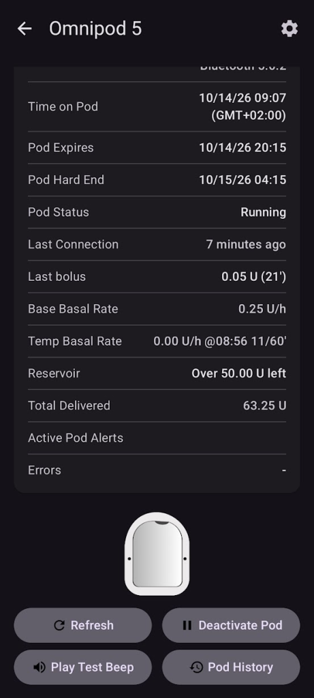

# 未來（可能）的幫浦驅動程式

這是一份目前市面上一些幫浦的清單，包含他們在任何閉環系統中的支援狀態，以及在 AAPS 中的狀態。最後有一些關於幫浦成為“可閉環”的需求資訊。

    {contents} Table of contents
    :depth: 1
    :local: true

## Pumps in AAPS integration phase

**Coming soon:** drivers for these pumps are in development and already running in test builds.

Omnipod 5 ([Homepage](https://www.omnipod.com/))

Tandem: t:Mobi ([Homepage](https://www.tandemdiabetes.com/))

## 可進行閉環的幫浦

### Kaleido ([官網](https://www.hellokaleido.com/))

**循環狀態：**幫浦是循環候選，但目前不知道協議。廠商對開放原始碼不感興趣。

**AAPS 硬體需求：**無。看起來已啟用藍牙 (BT)。

### Tandem: t:slim X3 ([Homepage](https://www.tandemdiabetes.com/about-us/pipeline))

**Loop status:** Possible future Loop candidate. The hope is that t:slim X3 will allow full control from a phone, which would enable AAPS support, but the timeline and features are still unknown.

**AAPS 硬體需求：**無。 It is expected to be Bluetooth enabled.

**Comments:** Not yet released. t:slim X3 appears to be repeatedly deprioritized on Tandem's roadmap in favour of t:Mobi (including a tubeless version) and Sigi (their patch pump).

### Twiist ([Homepage](https://www.twiist.com/))

**Loop status:** Loop candidate.

**AAPS 硬體需求：**無。 It is Bluetooth enabled.

### Willcare 胰島素幫浦 ([官網](http://shinmyungmedi.com/en/))

**閉環狀態：** 目前尚未是閉環候選者，但他們的員工已與我們聯繫，表示有興趣將幫浦擴展為可閉環（目前我認為他只缺少設定/取得設定檔的指令）。

**AAPS 硬體需求：**無。看起來已啟用藍牙 (BT)。

**評論：**由於公司對與 AAPS 整合感興趣，他們可能會自行實施該功能。

### Ypsopump ([Homepage](https://www.ypsomed.com/))

**Loop status:** Loop candidate. The pump's Bluetooth protocol has been reverse-engineered by the community, so communicating with it is possible in principle.

**AAPS 硬體需求：**無。 It is Bluetooth enabled.

**Comments:** The Ypsopump protects its Bluetooth communication with heavy third-party encryption. Working with it is technically demanding, which makes building and maintaining a reliable driver hard. There is no production-ready AAPS driver yet.

## 已停止銷售的幫浦（公司不再運營）

### Animas Vibe

### Animas Ping

### Cellnovo

### Accu-Chek Insight

**註解：**支援將於2025年3月結束。

## 不可閉環的幫浦

### Medtronic 藍牙

**評論：** 美敦力 [已撤回](https://www.tidepool.org/blog/tidepool-loop-partner-update-ace-pumps)。

### Tandem: t:slim X2 ([官網](https://www.tandemdiabetes.com/))

**Comments:** The Tandem Bluetooth protocol has been reverse-engineered, but on the t:slim X2 only boluses can be delivered — basal delivery cannot be controlled — so it cannot be used safely for looping. This is unlikely to change unless Tandem allows full control of the X2 from a phone, which would more probably arrive with the t:slim X3 instead.

### Accu-Chek Solo

**註解：**與Solo幫浦的溝通在社群中沒有成功案例。

## 幫浦成為可閉環的需求

**先決條件**

- 幫浦必須支援某種遠端控制。（藍牙、無線電頻率等）
- 協議已被破解/紀錄等。

**最低要求**

- 設置臨時基礎率
- 取得狀態
- 取消臨時基礎率

**對於 oref1(SMB) 或注射：**

- 設置注射

**可選功能**

- 取消注射
- 取得基礎設定檔（幾乎是必要的）
- 設置基礎設定檔（可有可無）
- 讀取歷史紀錄 

**其他（不是必需但有很好）**

- 設置延長注射
- 取消延長注射
- 讀取歷史紀錄
- 讀取每日總劑量 (TDD)

### 其他幫浦支援

如果你有其他幫浦想查看狀態，請在 Discord 上聯繫我們。