(omnipod5)=
# Omnipod 5

這些說明適用於搭配 **AAPS** 使用 **Omnipod 5** Pod。

```{admonition} In development
:class: warning
Omnipod 5 驅動程式仍在開發中。目前尚未納入正式發布的 **AAPS** 版本，只能在測試版本中執行。本頁的畫面和步驟在正式發布前仍可能變更。
```

```{contents} Table of contents
:depth: 1
:local: true
```

(omnipod5-how-it-works)=
## AAPS 如何使用 Omnipod 5

Omnipod 5 驅動程式的運作方式與 [Omnipod DASH 驅動程式](../CompatiblePumps/OmnipodDASH.md)幾乎相同：

- **AAPS** 透過手機的藍牙連線至 Pod。不需要 RileyLink 或其他橋接裝置。
- **AAPS** 只會在傳送指令（例如注射或 **臨時基礎率**）或讀取 Pod 狀態時連線，並會在完成後立即中斷連線。
- **AAPS** 會像一般幫浦一樣控制 Pod：設定基礎率、**臨時基礎率**、注射和 **微量注射**。 Pod 自己的自動模式不會啟用。
- 劑量和限制與 DASH 相同：注射以 0.05 U 為增量，基礎率以 0.05 U/h 為增量（最低 0.05 U/h），**臨時基礎率**最高可達 30 U/h，最長可維持 12 小時。
- 不支援延長注射。

與 DASH 的主要差異在於**個人憑證**。 **AAPS** 需要此憑證才能與 Omnipod 5 Pod 配對。在註冊第一個 Pod 之前，使用 GitHub 帳號登入即可取得一次（請參閱[取得 Omnipod 5 憑證](#omnipod5-certificate)）。

(omnipod5-requirements)=
## 需求

- Omnipod 5 Pod。
- 具備藍牙低功耗功能的相容 Android 手機（請參閱[手機](../Getting-Started/Phones.md)）。
- 包含 Omnipod 5 驅動程式的 **AAPS** 版本。
- 擁有已驗證電子郵件地址的 [GitHub 帳號](#omnipod5-github-account)，且帳號至少已建立 7 天。
- 第一次註冊 Pod 時，手機須能連上網際網路。
- 受支援的[連續血糖監測器（CGM）](../Getting-Started/CompatiblesCgms.md)，並依照一般方式連線至 **AAPS**。

### 安全第一

首次將 **AAPS** 連線至 Pod 前，請先備妥：

1. 備用 Pod（3 個以上）。
2. 備用胰島素和注射用設備。
3. 可正常運作的 Omnipod 5 控制器或 App，以備 **AAPS** 發生故障時使用。

### 藥匣僅與 AAPS 通訊

啟動藥匣的裝置，是唯一能控制該藥匣的裝置。 **AAPS** 啟動藥匣後，就無法再使用 Omnipod 5 控制器或 App 控制該藥匣。請仍保留控制器或 App，做為下一個藥匣的備用裝置。

### 藥匣在沒有 AAPS 的情況下仍會持續輸注胰島素

啟動時，**AAPS** 會將您目前啟用的 [**設定檔**](../SettingUpAaps/YourAapsProfile.md)中的基礎率設定到藥匣上。由 **AAPS** 設定的**臨時基礎率**只會執行有限時間。如果手機與藥匣失去連線，**臨時基礎率**結束後，藥匣會恢復使用這些基礎率。

### 設定檔限制

適用與 DASH 相同的限制：

- **AAPS** 設定檔只支援從整點開始的基礎率。開始時間為 09:30 的基礎率，必須改為 09:00 或 10:00。
- **設定檔**不支援 0 U/h 的基礎率。請改用零**臨時基礎率**、**中斷幫浦連線**或**暫停循環**。

(omnipod5-select)=
## 在 AAPS 中選取 Omnipod 5

1. 開啟主畫面左上角的**選單**（☰），然後選取**組態**。
2. 點選**幫浦**，然後選取 **Omnipod 5**（*「Omnipod 5 的幫浦整合」*）。
3. **Omnipod 5** 卡片現在會顯示兩個按鈕：
   - **設定**會開啟 [Omnipod 5 設定](#omnipod5-settings)。
   - **開啟外掛**會開啟 [Omnipod 5 幫浦畫面](#omnipod5-pump-screen)。

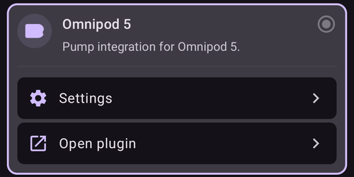

(omnipod5-pump-screen)=
## Omnipod 5 幫浦畫面

透過**管理** > **幫浦**開啟，或點選**Omnipod 5**卡片上的**開啟外掛**。您可以在此啟動和停用藥匣、重新整理藥匣狀態，以及查看藥匣記錄。

沒有啟用的藥匣時，**藥匣狀態**欄位會顯示**沒有啟用的藥匣**，並顯示**啟動藥匣**按鈕：

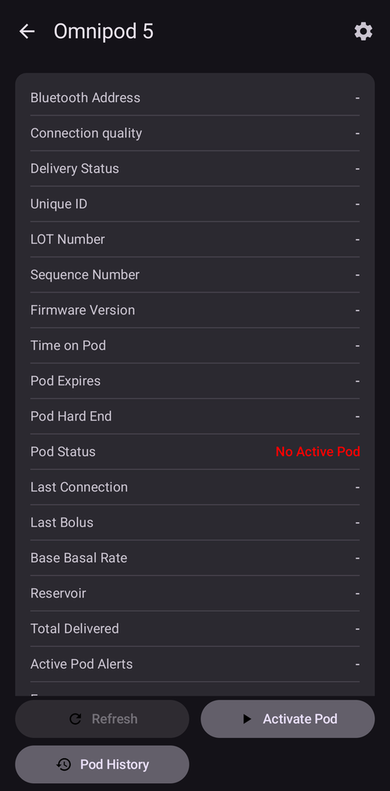

啟用藥匣後，畫面會顯示藥匣資訊和**停用藥匣**按鈕：

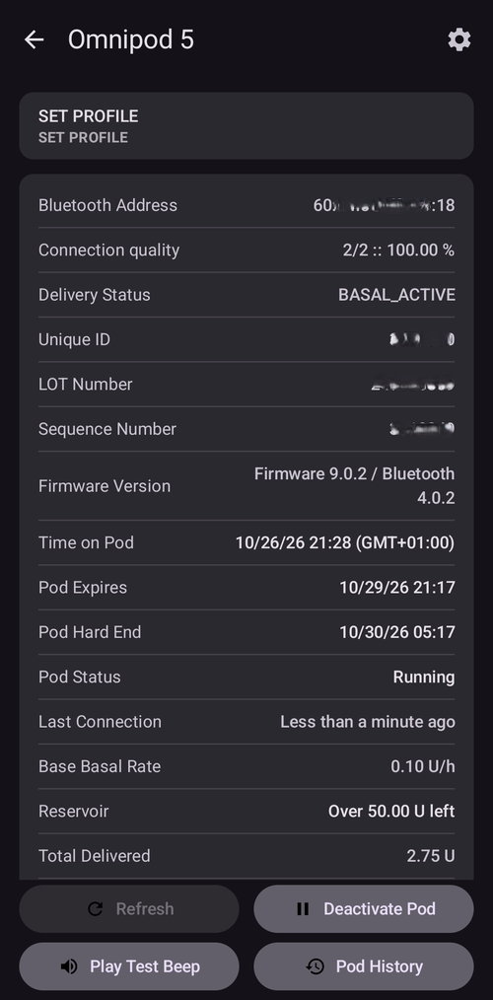

欄位和按鈕與 DASH 幫浦畫面相同：請參閱[欄位](#omnipod-dash-tab)及其下方的按鈕清單。幾點說明：

- **輸注狀態**只會在工程模式版本中顯示。
- 藥匣剩餘胰島素多於 50 單位時，**儲液槽**會顯示*剩餘超過 50.00 U*。剩餘量少於 50 單位後，就會顯示確切數量。
- 藥匣發生故障後，**PDM 通知**欄位會顯示故障訊息，格式與 Omnipod 5 App 顯示的相同，例如 *偵測到阻塞*、*藥匣胰島素耗盡*、*藥匣已到期*、*藥匣已關閉*或*藥匣錯誤*。
- 沒有暫停藥匣的按鈕。若要暫時停止輸注胰島素，請設定零**臨時基礎率**。

右上角的**設定**（齒輪）圖示會開啟 [Omnipod 5 設定](#omnipod5-settings)。

(omnipod5-certificate)=
## 取得 Omnipod 5 憑證

**AAPS** 需要個人憑證才能與 Omnipod 5 藥匣配對。登入 GitHub 一次即可取得。取得憑證後，即可在沒有網際網路連線的情況下啟動新藥匣。

您不必自行開始這個步驟：按下**啟動藥匣**時，如果尚未安裝憑證，**AAPS** 會先開啟**匯入憑證**畫面。

(omnipod5-github-account)=
### 您的 GitHub 帳號

請使用您用來建置 **AAPS** 的 GitHub 帳號。該帳號必須：

- 擁有**已驗證的電子郵件地址**：您必須點選 GitHub 寄給您的確認連結，
- **至少已建立 7 天**。

如果您還沒有 GitHub 帳號，請參閱[建置 AAPS](../SettingUpAaps/BuildingAaps.md)。請至少在計畫開始使用 Omnipod 5 前一週建立帳號。

### 步數

1. 請確認手機已連上網際網路。開啟 Omnipod 5 幫浦畫面，然後按下**啟動 Pod**。

   如果沒有網際網路連線，**AAPS** 會顯示 *無法連線。需要網際網路連線才能取得您的 Omnipod 5 憑證。*請將手機連上網際網路，然後按下**再試一次**。

   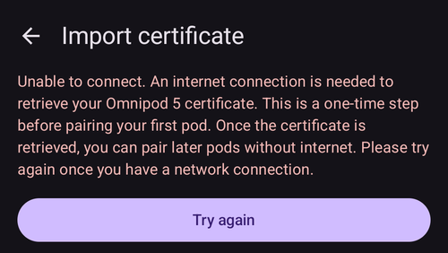

2. 開啟**匯入憑證**畫面，並載入**將 O5 連線至 AAPS**頁面。請閱讀頁面內容，然後按下**使用 GitHub 登入**。

   您的 GitHub 登入資訊只會用於此步驟。 **AAPS** 不會儲存這些資訊。

   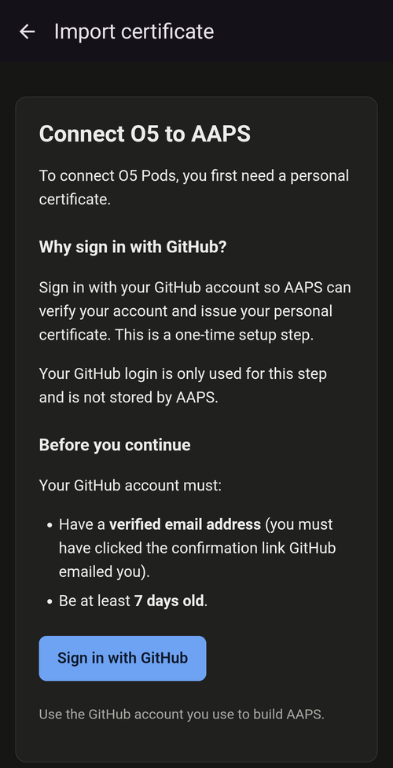

3. GitHub 登入頁面隨即開啟：*登入 GitHub 以繼續前往 OSAID Keymanager*。 OSAID Keymanager 是核發憑證的服務。輸入您的 GitHub 使用者名稱或電子郵件地址，以及密碼，然後按下**登入**。

   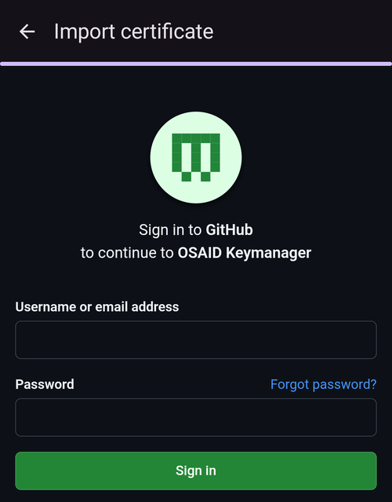

4. 如果您在 GitHub 上使用雙重驗證，請依照平常的方式確認登入。例如，開啟 GitHub Mobile App，並輸入手機上顯示的數字。

   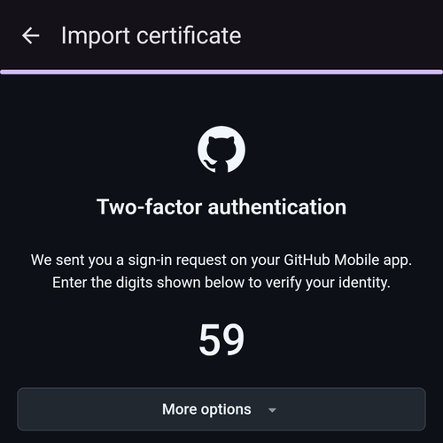

5. 畫面會短暫顯示 *正在將您重新導向至已授權的應用程式*。請稍候：您不需要點選該連結。

   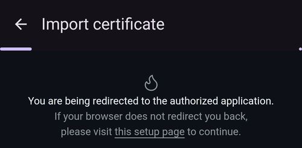

6. **AAPS** 會顯示 *已匯入 Omnipod 5 憑證*，並在**填充 Pod**步驟開啟啟動精靈。請繼續進行[啟動 Pod](#omnipod5-activate-pod)的第 2 步。

GitHub 會寄送電子郵件通知您，您的帳號已授權具有 *user:email* 範圍的第三方應用程式（*OSAID Keymanager*）。這是正常情況：此服務只會讀取您的電子郵件地址，以確認您的帳號。

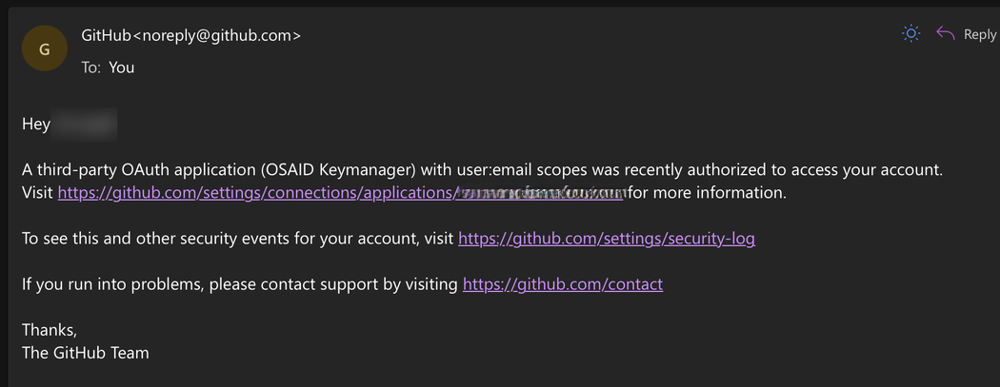

```{admonition} New phone or reinstall
:class: note
憑證會以加密方式儲存在手機上。憑證不包含在匯出的設定中。重新安裝 **AAPS** 或換新手機後，下次按下 **啟動 Pod** 時，**AAPS** 會再次要求您使用 GitHub 登入。請確認屆時手機已連上網際網路。
```

(omnipod5-activate-pod)=
## 註冊 Pod

1. 開啟 Omnipod 5 幫浦畫面（**管理** > **幫浦**），然後按下**啟動 Pod**。

   第一次操作時，**AAPS** 會先要求您[取得憑證](#omnipod5-certificate)。

   如果您從未在 **AAPS** 中啟用過**設定檔**，精靈會先顯示**需要設定檔**步驟：選取要在啟動時套用的設定檔，然後繼續。

2. 在**填充 Pod**步驟，為新的 Pod 注入足以使用 3 天的胰島素，**至少 80 單位**。聽到 Pod 發出兩聲嗶聲時，即表示已注入至少 80 單位。即使聽到兩聲嗶聲，也要將填充注射器完全排空。請先不要取下 Pod 的針頭保護蓋。

   ***注意：**預充 Pod 約會使用 3-10 單位。計算 3 天所需的胰島素時，請將這點納入考量。*

   讓新的 Pod 靠近手機，然後按下**下一步**。

   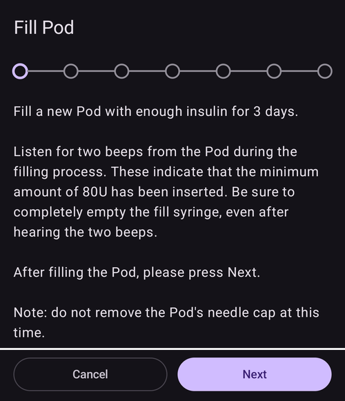

3. 如果您在 **AAPS** 中使用多種胰島素，畫面會顯示 **選擇胰島素** 步驟。**即將啟動**會顯示**AAPS**將使用的胰島素。如果您在藥匣中裝入不同的胰島素，請按下 **變更** 並選擇該胰島素。註冊完成後，**AAPS** 會套用使用此胰島素的 **設定檔切換**。按下 **下一步**。

   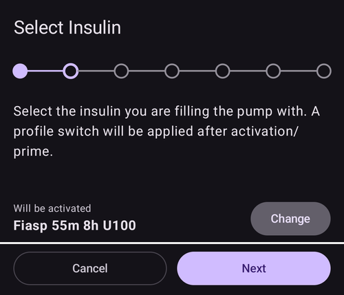

4. 在 **初始化藥匣** 步驟中，**AAPS** 會與新的藥匣配對並為其預充填。您會聽到一聲喀噠聲，接著 Pod 自行預充時會發出一連串滴答聲。完成後，畫面上會出現**下一步**按鈕。按下 **下一步**。

   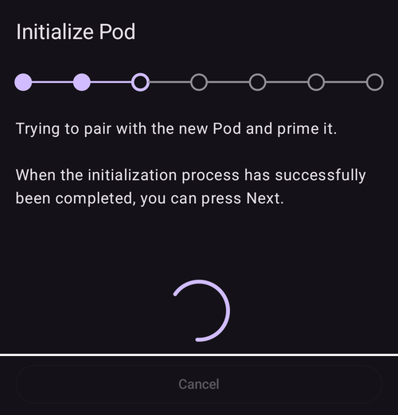    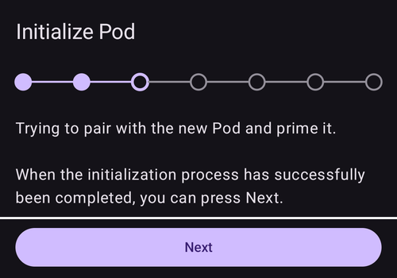

   如果顯示 *掃描失敗* 或 *找到太多個 Pod* 等錯誤，請按下 **重試**。如果顯示**找到太多個 Pod**，請先遠離其他正在等待啟動的 Pod。

5. 如果您在 **AAPS** 中管理幫浦部位輪替（在 [部位輪替](#Aapsscreens-site-rotation)設定中選取**管理幫浦部位輪替**），畫面會顯示 **部位位置** 步驟。在身體示意圖上點選要放置藥量的位置，然後按下 **下一步**，或按下 **略過**。

   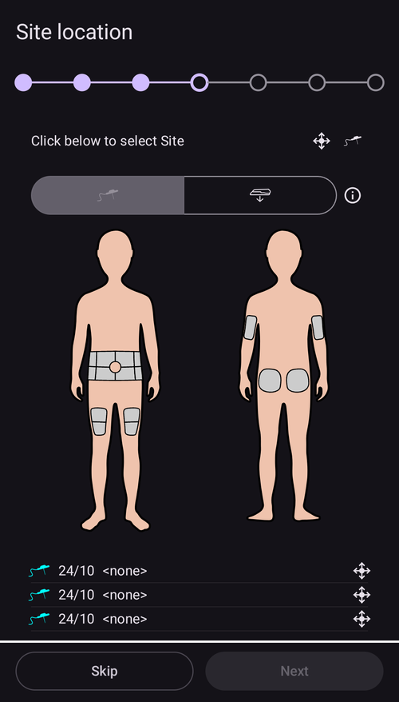

6. 準備輸注部位：洗手，用肥皂和清水或酒精棉片清潔外觀，並讓它完全乾燥。

   在**裝上藥量**步驟中，取下藥量的針頭保護帽。如果套管或其他任何物品突出藥量，請**停止**：按下**取消**，並改用新的藥量重新開始。如果一切看起來正常，請撕下黏著劑背紙，將藥量貼在選定的位置。按下 **下一步**。

   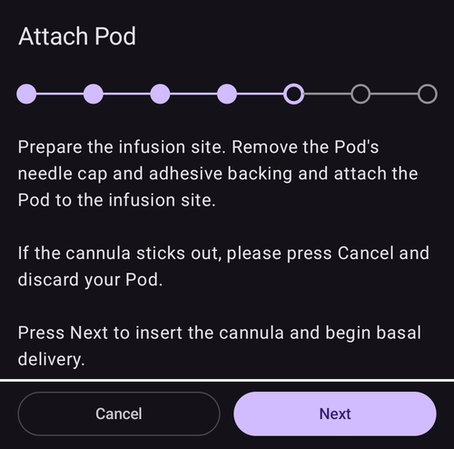

7. 對話方塊會要求您確認：*按下「確定」後，套管就會插入。* **只有在藥量已貼在身上時，才按下「確定」。**

   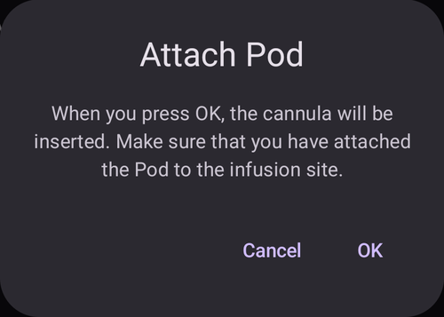

8. 在 **插入套管** 步驟中，**AAPS** 會設定您的基礎率時程，並由藥匣插入套管。這可能需要 1-2 分鐘。套管插入後，畫面上會出現**下一步**按鈕。按下 **下一步**。

   ***注意：**插入套管前，在藥量附近捏起外觀，有助於套管順利插入。*

   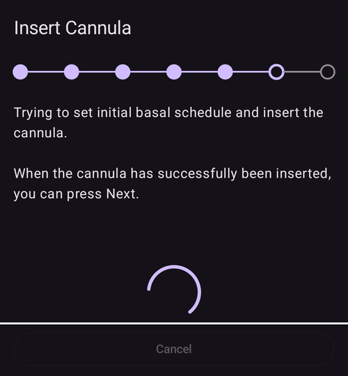    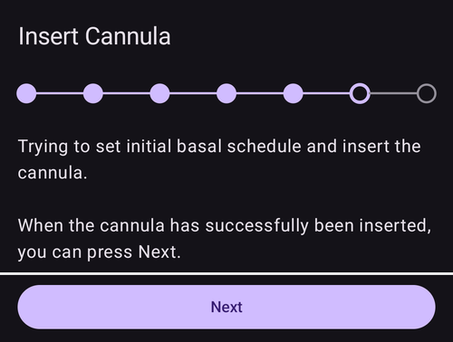

9. 畫面會顯示 **藥匣已啟用** 步驟。確認套管已正確插入。如果您認為套管沒有正確插入，請更換藥量。按下 **完成**。

   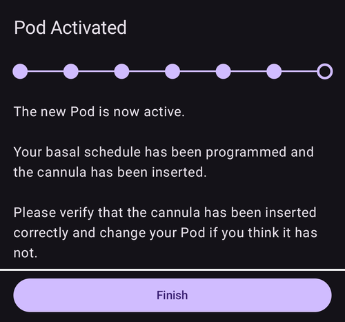

10. 幫浦畫面現在會顯示正在使用的藥量，且**藥量狀態**為*執行中*。**註冊藥量**會改為**停用藥量**：您必須先停用目前使用中的藥量，才能註冊新的藥量。

    ***注意：**每次註冊藥量後，請匯出您的設定，並將檔案複製到手機以外的安全位置（請參閱[匯出設定](../Maintenance/ExportImportSettings.md)）。*

如果藥量完成預充後註冊程序中止，按下**註冊藥量**即可從**裝上藥量**步驟繼續。

(omnipod5-daily-use)=
## 停用藥量、警示與藥量歷程

這些功能的運作方式與 DASH 相同：

- [停用藥量](#omnipod-dash-deactivate-pod)，以及在藥量不再回應時[棄置藥量](#omnipod-dash-discard-pod)。
- 如果在**設定檔切換**後輸注仍處於暫停狀態，請[恢復胰島素輸注](#omnipod-dash-resuming-insulin-delivery)。
- 針對到期與儲液槽液量不足警示，請[將藥量警示靜音](#omnipod-dash-silencing-pod-alerts)。
- [查看藥量歷程](#omnipod-dash-view-pod-history)，其中包含由驅動程式自動發送的小量*基礎率校正注射*。

藥量在註冊後 72 小時到期（**藥量到期**）。藥量會在 8 小時寬限期內持續輸注胰島素，並在註冊後 80 小時的**藥量強制停止時間**停止輸注。

(omnipod5-settings)=
## Omnipod 5 設定

在 Omnipod 5 幫浦畫面上點選**設定**（齒輪）圖示，或在**組態** > **幫浦**中的**Omnipod 5**卡片上點選**設定**，即可開啟設定。

設定與 DASH 設定相同，分為三個區段：

- [確認嗶聲](#omnipod-dash-settings)：藥量會在注射、基礎率、**SMB** 和 **TBR** 時發出嗶聲。
- **警示**：到期提醒、到期警示和儲液槽液量不足警示。藥量使用期間變更警示設定時，**AAPS** 會將新的警示設定傳送至藥量。
- **通知**：當**AAPS**不確定**TBR**、**SMB**或注射是否已送出，以及輸注暫停時，是否播放音效。

沒有**進階設定**區段：Omnipod 5 不支援藍牙配對。

(omnipod5-troubleshooting)=
## 問題排除

大多數問題與 DASH 相同：請參閱[疑難排解](#omnipod-dash-troubleshooting)和[藍牙疑難排解](../GettingHelp/BluetoothTroubleshooting.md)。以下是 Omnipod 5 特有的問題。

### 憑證問題

- *無法連線。需要連線至網際網路才能取得 Omnipod 5 憑證。*：請讓手機連線至網際網路，然後按下**重試**。
- GitHub 拒絕登入：請確認您的 GitHub 帳號電子郵件地址已驗證，且帳號已建立至少 7 天。
- *匯入憑證時發生錯誤*或*無法匯入憑證。請重試。*：返回幫浦畫面，再次按下**註冊藥量**。
- *此裝置的 WebView 不支援憑證橋接。*：請從 Google Play 商店更新**Android System WebView**，然後重試。

### 命令狀態不確定

傳送命令時，如果手機與藥量失去連線，**AAPS**可能無法確定命令是否已執行。接著會顯示通知，例如 *無法確認 SMB 注射（0.55 U）是否成功。重新整理 Pod 狀態，以確認或否認此指令。*

Pod 進入範圍內後，請在 Omnipod 5 幫浦螢幕上按下 **重新整理**。在確認或否認這項不確定的指令之前，**AAPS** 不會傳送新的注射或**臨時基礎率**（*無法向 Pod 確認先前的劑量，因此沒有傳送新的劑量。*）。

### Pod 故障

Pod 故障時會停止輸注胰島素並發出嗶聲。 **AAPS** 會顯示包含故障代碼的通知。幫浦螢幕上的 **PDM 通知**欄位會告訴您發生了什麼事，就像 Omnipod 5 App 一樣，例如 *偵測到阻塞。胰島素輸送已停止。請立即更換 Pod。檢查血糖。*

請先測量血糖，接著[停用 Pod](#omnipod-dash-deactivate-pod)，並啟用新的 Pod。故障的 Pod 無法再次使用。

(omnipod5-help)=
## 如何尋求協助

Omnipod 5 驅動程式由志工製作。請先閱讀本頁和 [Omnipod DASH 頁面](../CompatiblePumps/OmnipodDASH.md)。接著在 **Discord** 的 *#AAPS* 頻道中詢問（[邀請連結](https://discord.gg/4fQUWHZ4Mw)），或參閱[「哪裡可以取得協助」](../GettingHelp/WhereCanIGetHelp.md)。如要回報錯誤，請在 [GitHub 問題回報](https://github.com/nightscout/AndroidAPS/issues)中附上您的[記錄檔](../GettingHelp/AccessingLogFiles.md)。
