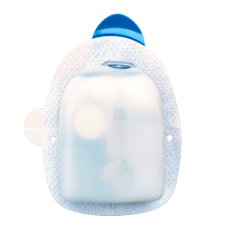
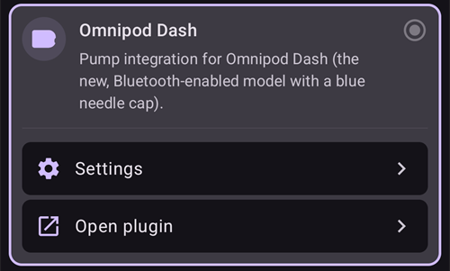
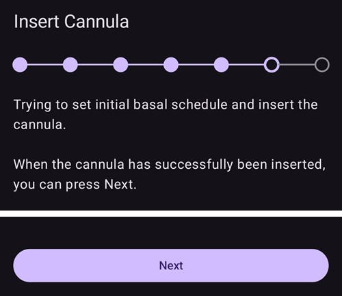
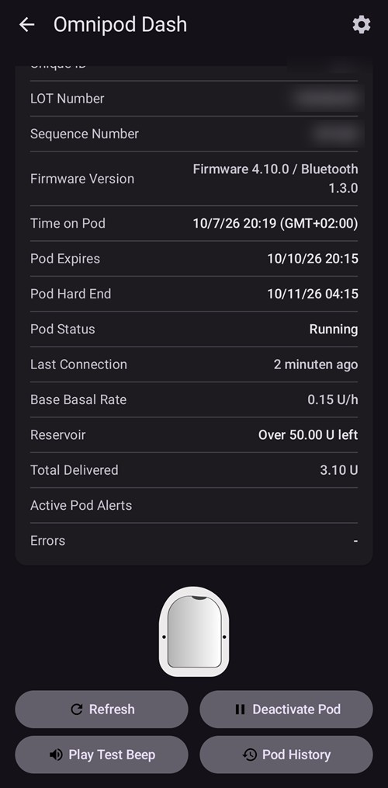
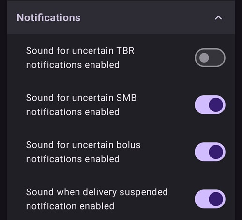

# Omnipod DASH

These instructions are for configuring the **Omnipod DASH** generation pump **(NOT Omnipod Eros)**. The DASH driver is a well-established way to loop with Omnipod.

```{contents} Table of contents
:depth: 1
:local: true
```

## Omnipod DASH 規格

Key characteristics of the **Omnipod DASH** ('DASH'):

- The DASH pods are identified by a **blue needle cap** (the older EROS pod has a clear needle cap). 這兩種 Pod 在物理尺寸上是相同的。
- DASH 不需要 BLE 連結/橋接設備（無需 RileyLink、OrangeLink 或 EmaLink）。
- DASH 的藍牙連線僅在傳送指令時（例如進行注射）使用，並會在發出指令後立即中斷連線。
- **AAPS**將等候 Pod 的可讀取性以發送指令。
- Pod 啟動時，**AAPS**將尋找並連接到新的DASH Pod 。
- 與手機的預期連線距離：5–10 公尺（實際情況可能不同）。

(omnipod-dash-constraints)=

## Omnipod DASH 已知的 AAPS 限制／問題
- General advice is to run **AAPS** on Android 14 or 16. Android 15 has many reported [issues](https://github.com/nightscout/AndroidAPS/issues/3471) from the community. However, if you do run on Android 15 you will likely need to turn on **Bluetooth bonding** (in the **Advanced Settings** section of the [Dash settings](#omnipod-dash-advanced-settings)) to successfully activate and use Pods, see [General Troubleshooting](../GettingHelp/GeneralTroubleshooting.md) for more info on the Bonding settings.
- DST and timezone changes are not applied automatically. After a clock change you must update the pod manually: press **Refresh** on the DASH pump screen, then press **Set time** (shown when the pod and phone time zones differ) or perform a **Profile Switch** (see [Timezone change for Omnipod Dash](#timezone-traveling-with-pumps)).
- Dash 僅支援以 0.05 U/h 步階設定的基礎率。如果你嘗試在 **AAPS 設定檔** 中以 0.01 的步階設定基礎率，AAPS 不會提出警告，儘管 Pod 會將該速率進位到 0.05 的步階。 If you open **Pod History** on the DASH pump screen, it will display that 0.05 basal was set. 這也表示在 AAPS 中，DASH 允許的最低基礎率為 0.05 U/h。
- The settings file contains the active Pod session. Export your settings after each Pod activation, and see [Export and import settings](#omnipod-dash-export-import) before importing settings.
- 當設定新的基礎率設定檔時，DASH 會先暫停輸注，然後再設定新的基礎率設定檔。若通訊中斷或發生錯誤，基礎率設定檔不會自動重新開始。詳細內容請參閱 [恢復胰島素輸注](#omnipod-dash-resuming-insulin-delivery) 章節。
- 如果已設定警示，且 Pod 即將到期，Pod 會持續發出嗶聲，直到將警示靜音為止；詳情請參閱 [靜音 Pod 警示](#omnipod-dash-silencing-pod-alerts)。
- 有多項已知的藍牙問題可能導致 Pod 註冊異常。請參閱 [藍牙疑難排解](../GettingHelp/BluetoothTroubleshooting.md)，以了解已知問題與對應的解決方案。

(hardware-software-requirements)=

(omnipod-dash-hardware-software-requirements)=
## 硬體和軟體需求

- Omnipod DASH 可透過藍色的針頭蓋辨識。



- **一支相容的 Android 手機**且具備低功耗藍牙（BLE）（更多資訊請見[Phones](../Getting-Started/Phones.md)），另外，下列資訊可協助您在相容手機上順利註冊與使用 DASH 時的其他關鍵注意事項：
    -  **AAPS** 的 Omnipod Dash 驅動程式會透過藍牙與 DASH Pod 連線。  
      **AAPS** 會在每次需要傳送指令（例如注射）時，自動與 Pod 建立新的藍牙連線；在傳送完成後，會立即中斷連線。
       - **注意：**
         - 在執行 **AAPS** 的手機上，其他已連結的藍牙裝置（例如耳機等）可能會干擾或中斷藍牙連線。這類裝置在某些手機型號上可能導致連線錯誤或 Pod 註冊問題。 It's a good idea to review the [tested hardware setups](https://docs.google.com/spreadsheets/u/1/d/e/2PACX-1vScCNaIguEZVTVFAgpv1kXHdsHl3fs6xT6RB2Z1CeVJ561AvvqGwxMhlmSHk4J056gMCAQE02sAWJvT/pubhtml?gid=683363241&single=true) list for known working configurations when choosing the phone for an Omnipod DASH setup.
         - 有多項已知的藍牙問題可能導致 Pod 註冊異常（其他藍牙問題的建議請見 [問題排除](#troubleshooting)），特別是[藍牙相關問題](#omnipod-dash-bluetooth-related-issues)章節。
    - The phone must run **Android 12 or newer**, with **AAPS** built and installed using the [**Build APK**](../SettingUpAaps/BuildingAaps.md) instructions. Always run the latest released version.
- 一個受支援的[**連續式血糖監測（CGM）**](../Getting-Started/CompatiblesCgms.md)

以下說明如何使用 **AAPS** 註冊新的 Pod 工作階段。建議等目前的 Pod 接近到期時再進行，因為您需要使用 **AAPS** 註冊新的 Pod。 Pod 一旦停用後便無法重複使用或再次註冊，此動作為最終狀態。

## 開始之前

請確定您已完整閱讀並理解本指南、**開始前**章節，以及 **[Omnipod 與 AAPS 的限制與問題](#omnipod-dash-constraints)**，以避免遇到已知問題。

### **安全第一**—在無法取得以下所有項目時，您**不應該**首次嘗試將 **AAPS** 連線到 Pod：
1. 備用 Pod（至少 3 顆）
2. 備用胰島素與 MDI 器材
3. 可正常使用的 Omnipod PDM（以防 **AAPS** 發生異常）
4. 必須使用受支援的手機！（請參閱[硬體／軟體需求](#hardware-software-requirements)）
5. 已建置並安裝正確版本的 AAPS

### 當 AAPS Dash 驅動程式註冊您的 Pod 後，您的 Omnipod Dash PDM 將形同冗餘。
- 在使用 **AAPS** 之前，您或照護者必須使用 Omnipod PDM（或在某些地區使用手機 App）來管理 Pod，並向您的 DASH 傳送指令（例如注射）。
- DASH 一次只能由單一藍牙裝置（例如 PDM 或手機）連線以進行管理與傳送指令。
- 自成功註冊該 Pod 起，只有完成註冊的那台裝置被允許與該 Pod 通訊。也就是說，一旦您使用 **AAPS** 透過 Android 手機註冊了 DASH，**之後將無法再用 PDM 操作該 Pod！**在該 Pod 啟動期間，執行於您 Android 手機上的 **AAPS** Dash 驅動程式即成為該 Pod 的新 PDM。
- **請勿丟棄您的 PDM！**建議保留做為備用與應急之用，例如手機遺失或 **AAPS** 無法正常運作時。

### 您的 Pod 在未連線到 AAPS 時**並不會**停止輸注胰島素。
依照目前啟用中的[**設定檔**](../SettingUpAaps/YourAapsProfile.md)，Pod 會在註冊時被寫入預設基礎率。  
只要 **AAPS** 正常運作，它就會送出最長 120 分鐘的基礎率調整指令。  
若因任何原因 Pod 未收到新指令（例如 Pod 與 手機 距離過遠導致通訊中斷），Pod 會自動回復到您[**設定檔**](../SettingUpAaps/YourAapsProfile.md)中定義的預設基礎率。

### AAPS 的設定檔不支援 30 分鐘為單位的基礎率時間區段
若您是 AAPS 新手並首次建立基礎率[**設定檔**](../SettingUpAaps/YourAapsProfile.md)，請注意：不支援以半小時為起點的基礎率。例如，在你的 Omnipod PDM 上，若你有一個基礎率為 1.1 單位、於 09:30 開始、持續 2 小時並於 11:30 結束，則無法在 **AAPS** 中重現這個完全相同的基礎率 **設定檔**。  
你需要將這個 1.1 單位的基礎率改成 9:00-11:00 或 10:00-12:00 的時間範圍。即使 DASH 硬體本身支援 30 分鐘增量的基礎率**設定檔**，**AAPS** 仍不支援此功能。

### AAPS 不支援 0 U/h 的設定檔基礎率
雖然 DASH 支援零基礎率，**AAPS** 會以使用者**設定檔**的基礎率倍數來決定自動治療；因此無法在零基礎率下運作。  
您可以改用「中斷幫浦連線」功能，或搭配「停用 循環／臨時基礎率」或「暫停 循環／臨時基礎率」來達成暫時的零基礎率。  
**注意：**在 **AAPS** 中，DASH 允許的最低基礎率為 0.05 U/h。

## 在AAPS中選擇DASH

There are **two** ways to select the Omnipod DASH driver in **AAPS**:

### 選項 1：新安裝

When you install **AAPS** for the first time, the **Setup Wizard** guides you through the key features and installation requirements of **AAPS**. When you reach the **Pump** step, select **Omnipod Dash**.


If you are not sure yet, you can select **Virtual Pump** for now and select **Omnipod Dash** later, after setting up **AAPS** (see Option 2).

(omnipod-dash-option-2-config-builder)=
### Option 2: The Configuration screen

On an existing installation you can select the **Omnipod Dash** pump from the **Configuration** screen:

1. Open the **menu** (☰) in the top-left corner of the main screen and select **Configuration**.
2. Tap **Pump** and select the radio button of **Omnipod Dash** (*"Pump integration for Omnipod Dash (the new, Bluetooth-enabled model with a blue needle cap)"*).

3. Once it is selected, the **Omnipod Dash** card shows two buttons:
   - **Settings** opens the [Dash settings](#omnipod-dash-settings).
   - **Open plugin** opens the [DASH pump screen](#omnipod-dash-tab).

   

### 驗證 Omnipod 驅動程式選擇

To check that **Omnipod Dash** is selected, open **Manage** (bottom navigation of the main screen) and tap **Pump**. The DASH pump screen opens, as shown in the next section.

(omnipod-dash-tab)=

## The DASH pump screen

The DASH pump screen is where you manage your pods: activate and deactivate them, refresh the pod status, silence alerts and look at the pod history. Open it with **Manage** > **Pump**, or with **Open plugin** on the **Omnipod Dash** card in **Configuration** > **Pump**.

This is the screen without an active pod:


And this is the screen with an active pod:


The **Settings** (gear) icon in the top-right corner opens the [Dash settings](#omnipod-dash-settings).

***NOTE:** If a field on the pump screen shows (uncertain), press **Refresh** to update the pod status.*

### 欄位

- **Bluetooth Address:** The Bluetooth address of the pod.

- **Connection quality:** How reliably **AAPS** connects to the pod, shown as *successful connections / all connection attempts :: success rate*, for example `412/420 :: 98.10 %`. After more than 50 successful connections, the value turns yellow below 90 % and red below 70 %. A low value points to a Bluetooth problem (see [Bluetooth related issues](#omnipod-dash-bluetooth-related-issues)).

- **Delivery Status:** The raw delivery status reported by the pod. This field is shown only in engineering mode builds.

- **Unique ID:** The unique ID **AAPS** gave to the pod during activation.

- **LOT Number:** The production lot number of the pod.

- **Sequence Number:** The sequence number of the pod.

- **Firmware Version:** The firmware and Bluetooth versions of the pod.

- **Time on Pod:** The current time on the pod, with its time zone. The text turns red when the time zone of the pod is different from the time zone of the phone, and yellow when the pod time is more than 10 minutes off.

- **Pod Expires:** The date and time when the pod expires (72 hours after activation). The text turns yellow in the last 4 hours before this time. It never turns red, because the pod keeps delivering insulin after it.

- **Pod Hard End:** The end of the pod's grace period (8 hours after **Pod Expires**, for a maximum pod life of 80 hours). The text turns yellow when the grace period starts (at **Pod Expires**) and red in the last 4 hours before the hard end. During the grace period it also shows the time left, for example *(17m remaining)*. The pod stops delivering insulin at the hard end and must be changed.

- **Pod Status:** The state of the pod: **No Active Pod**, **Setup in progress**, **Running**, **Suspended** or, after a pod fault, **ALARM**.

- **Last Connection:** How long ago **AAPS** last communicated with the pod.

  - *Moments ago* - less than 10 seconds ago.

  - *Less than a minute ago* - between 10 and 60 seconds ago.

  - *XX minutes ago* - more than 1 minute ago (and *X hours and XX minutes ago* after an hour).

- **Last bolus:** The amount of the last bolus sent to the pod and how long ago it was given. An unconfirmed bolus is marked (uncertain).

- **Base Basal Rate:** The basal rate programmed for the current time in your basal **Profile**.

- **Temp Basal Rate:** The temporary basal rate (TBR) that is currently running, with its start time and duration. This field is only shown while a TBR is running.

- **Reservoir:** Shows *Over 50 U left* when more than 50 units are left in the reservoir. Below 50 units, the exact amount is shown. The value turns red below 20 units.

- **Total Delivered:** The total amount of insulin delivered from the reservoir. This includes the insulin used for priming.

- **Active Pod Alerts:** Alerts that are currently active on the pod, for example *Pod will expire soon* or *Low Reservoir*.

- **Errors:** The pod fault, if the pod has failed, shown in red as *Pod Fault:* followed by the fault code and name, for example *Pod Fault: 020 ALARM_OCCLUDED*. Review the [Pod History](#omnipod-dash-view-pod-history) and the log files for past errors and more detailed information. See [Pod Failures](#omnipod-dash-pod-failures).

- **PDM Notification:** Shown only after a pod fault. It shows the fault the way the Omnipod PDM would have shown it: a title (for example *Occlusion Detected*, *Empty Reservoir* or *Pod Expired*), what happened (for example *Insulin delivery stopped. Change Pod now.*) and a *Ref:* code.

### 按鈕

The buttons at the bottom of the pump screen change with the state of the pod. Only the buttons that make sense at that moment are shown.

- **Refresh:** Asks the pod for its current status.
  - *Use it to update the pod status and to clear fields that show (uncertain).*
  - *See the [Troubleshooting](#omnipod-dash-troubleshooting) section below for more information.*

- **Silence Alerts:** Stops the pod alert beeps (for example pod expiry or low reservoir). Shown only while the pod has an active alert. See [Silencing Pod Alerts](#omnipod-dash-silencing-pod-alerts).

- **Resume Delivery:** Resumes insulin delivery on a suspended pod. Shown only when delivery is suspended. See [Resuming Insulin Delivery](#omnipod-dash-resuming-insulin-delivery).

- **Set time:** Updates the pod to the time zone of your phone by sending your basal **Profile** again. Shown only when the time zone of the pod differs from the time zone of your phone.

- [**啟動 Pod**](#omnipod-dash-activate-pod)：為新的 Pod 預充並註冊。 Shown when no pod is active.

- [**Deactivate Pod**](#omnipod-dash-deactivate-pod): Deactivates the active pod. Shown as soon as a pod is paired with **AAPS**, also when an activation stopped part-way (for example because the pod failed during activation). **AAPS** asks you to confirm before it deactivates the pod.

- **Play Test Beep:** Makes the pod play a single test beep.

- [**Pod History**](#omnipod-dash-view-pod-history): Shows the activity history of the active pod.

- **Discard Pod:** Removes an unfinished pod from **AAPS**. Shown only when a pod activation stopped part-way. **AAPS** asks you to confirm. After discarding, **AAPS** can no longer communicate with that pod: remove it from your body.


```{admonition} Older screenshot
:class: note
The screenshot above is from an earlier **AAPS** version, which had a separate **Pod Management** menu. In **AAPS** 4 all these actions, including **Activate Pod**, **Deactivate Pod**, **Play Test Beep** and **Pod History**, are buttons with text labels directly on the pump screen.
```

(omnipod-dash-activate-pod)=

## 註冊 Pod

1. Open the DASH pump screen (**Manage** > **Pump**) and press **Activate Pod**. The activation wizard opens.

   

   ```{admonition} Older screenshot
   :class: note
   The screenshot above is from an earlier **AAPS** version. In **AAPS** 4 **Activate Pod** is a button directly on the DASH pump screen instead of in the **Pod Management** menu.
   ```

   If you have never activated a **Profile** in **AAPS** before, the wizard first shows the **Profile required** step: select the profile to apply on activation and continue.

2. The **Fill Pod** step is shown. Fill a new pod with enough insulin for 3 days, **at least 80 units**. Listen for two beeps from the pod: they mean the minimum amount of 80 units has been filled. Empty the fill syringe completely, even after hearing the two beeps. Do not remove the pod's needle cap yet.

   ***NOTE:** When you calculate the amount of insulin you need for 3 days, remember that priming the pod uses about 3-10 units.*

   

   

   Make sure that the new pod and the phone running **AAPS** are close to each other and press **Next**.

3. If you use more than one insulin in **AAPS**, the **Select Insulin** step is shown. It shows the **Currently active** insulin. If you filled the pod with a different insulin, press **Change** and select it. **AAPS** applies a **Profile Switch** with this insulin when the activation is finished. Press **Next**.

   

4. On the **Initialize Pod** step, **AAPS** pairs with the new pod and primes it. You hear a click followed by a series of ticking sounds as the pod primes itself. When this has finished successfully, the **Next** button appears. Press **Next**.

       

   ***NOTE**: If an error message such as _Scan failed_ or _'Could not find an available pod for activation'_ appears (this can happen), do not panic. Press **Retry**. In most cases the activation then continues successfully.*

   

   If the pod has failed (for example because its activation time was exceeded), **Deactivate Pod** is shown instead of **Retry**. Use it and start again with a new pod.

   If you press **Cancel** before the activation is finished, **AAPS** asks you to confirm that you want to exit. Press **OK** to leave the wizard, or **Cancel** to stay.

   

5. If you manage pump site rotation in **AAPS** (**Manage pump site rotation** in the [Site Rotation](#Aapsscreens-site-rotation) settings), the **Site location** step is shown. Select where you are going to place the pod on the body diagram and press **Next**, or press **Skip**.

   

6. Next, prepare the infusion site for the new pod. Wash your hands to avoid any risk of infection. Clean the infusion site with soap and water or an alcohol wipe, and let the skin air dry completely before you continue. If the adhesive irritates your skin, consider using a barrier wipe or barrier spray.

   On the **Attach Pod** step, remove the pod's blue plastic needle cap. If the cannula or anything else sticks out of the pod, or it looks unusual, **STOP**: press **Cancel** and start again with a new pod. If everything looks **OK**, take off the white paper backing from the adhesive and stick the pod to the chosen site on your body.

   When finished, press **Next**.

   

7. A confirmation dialog appears: *When you press OK, the cannula will be inserted.* **Press OK ONLY if you are ready to insert the cannula!**

   

8. On the **Insert Cannula** step, **AAPS** sets your basal schedule and the pod inserts the cannula. This can take some time (1-2 minutes maximum). **請耐心等候！**

   ***NOTE:** It is good practice to pinch the skin near the cannula insertion point before the cannula is inserted. This helps the needle go in smoothly and lowers your chance of occlusions (blockages).*

       

9. When the cannula has been inserted successfully, the **Next** button appears. Press **Next**.

   

10. The **Pod Activated** step is shown. Check that the cannula has been inserted correctly, and change the pod if you think it has not.

    Press **Finish**.

    恭喜！你現在已經開始一個新的藥量會話。

    

11. You are back on the DASH pump screen. It now shows the information of your active pod, including the current basal rate, reservoir level, insulin delivered, pod errors and alerts. **Activate Pod** is replaced by **Deactivate Pod**: you cannot activate another pod without deactivating the active pod first.

    ***NOTE:** For more details on the information shown, see [The DASH pump screen](#omnipod-dash-tab).*

    

    ***NOTE:** It is good practice to export your settings AFTER activating the pod. Export your settings after each pod change and once a month. Copy the exported settings file to a cloud storage location (for example Google Drive) or somewhere off your phone in case you lose your phone (see [**Export settings**](../Maintenance/ExportImportSettings.md)).*

If an earlier activation stopped after the pod was primed, pressing **Activate Pod** continues from the **Attach Pod** step.

(omnipod-dash-deactivate-pod)=

## 停用 Pod

Under normal circumstances, a pod lasts three days (72 hours), plus a grace period of 8 hours after the pod expiry warning: 80 hours in total.

To deactivate a pod (either because it expired or because it failed):

1. Open the DASH pump screen (**Manage** > **Pump**) and press **Deactivate Pod**.

   

2. On the **Deactivate Pod** step, press **Next**. A dialog asks *A deactivated Pod can not be used again. Deactivate this Pod now?* Press **OK** to start deactivating the pod, or **Cancel** to keep it. Deactivation suspends all insulin delivery and cannot be undone.

   

3. The **Deactivating Pod** step is shown while **AAPS** deactivates the pod. The pod beeps to confirm that deactivation was successful.

   

   ```{admonition} Older screenshot
   :class: note
   The screenshot above is from an earlier **AAPS** version. In **AAPS** 4 the wizard shows its progress as a row of dots at the top instead of a progress bar.
   ```

   When deactivation has finished successfully, the **Next** button appears. Press **Next**.

   

   If deactivation fails, an error message and a **Discard Pod** button are shown. See [Discarding a pod](#omnipod-dash-discard-pod) below before you use it. You can also press **Cancel** and try **Deactivate Pod** again later.

4. The **Pod Deactivated** step is shown. Remove the pod from your body and press **Finish**.

   

5. You are back on the DASH pump screen. Check that the **Pod Status** field shows **No Active Pod** and that the **Activate Pod** button is shown again.

   

(omnipod-dash-discard-pod)=

### Discarding a pod

Only discard a pod when all communication with it keeps failing. If **AAPS** can still communicate with the pod, use **Deactivate Pod** instead.

- **AAPS** asks you to confirm before it discards the pod.
- After that, **AAPS** can no longer communicate with that pod.
- **Insulin delivery has NOT been suspended**, because the pod was not deactivated properly. **Remove the pod from your body!**
- The **Pod Discarded** step confirms that the pod state has been discarded. Press **Finish**. You can now activate a new pod.

(omnipod-dash-resuming-insulin-delivery)=

## 恢復胰島素輸送

**NOTE**: During **Profile Switches**, like when using the PDM, **AAPS** must suspend delivery on the pod before setting the new basal **Profile**. If communication fails between the suspend and resume commands, delivery can stay suspended. Read [**Delivery suspended**](#omnipod-dash-delivery-suspended) in the troubleshooting section for more details.

When insulin delivery is suspended, you need to tell the pod to resume insulin delivery. When the command has been processed successfully, the pod delivers insulin again using the basal rate for the current time from your active basal **Profile**. The pod again accepts commands for bolus, **TBR** and **SMB**.

1. Open the DASH pump screen and check that the **Pod Status** field shows **Suspended**. Press **Resume Delivery** to tell the pod to resume normal insulin delivery.

   

2. When the command was successful, the **Pod Status** field shows **Running** and the **Resume Delivery** button disappears.

   

   

   ```{admonition} Older screenshot
   :class: note
   The screenshots above are from an earlier **AAPS** version, which showed a confirmation dialog. In **AAPS** 4 you confirm the result on the DASH pump screen: the **Pod Status** field shows **Running** and the **Resume Delivery** button is gone.
   ```

   If the command fails, **AAPS** shows a warning dialog starting with *Failed to resume delivery*. Press **Refresh** and try again.

   

(omnipod-dash-silencing-pod-alerts)=

## 靜音 Pod 警報

This section explains how to stop the pod beeps when the pod approaches the end of its life. When these beeps start depends on the **Alerts** settings (see [Dash Settings](#omnipod-dash-settings)):

- **Reminder at hours before expiry (72 Hours):** how many hours before the 72-hour expiry the pod starts to beep.
- **Alert at hours before shutdown (80 Hours):** how many hours before the 80-hour shutdown the pod beeps again.

The maximum life of a pod is 80 hours (3 days 8 hours). However, the pod manufacturer recommends not going beyond 72 hours (3 days).

***NOTE**: The **Silence Alerts** button is only shown on the DASH pump screen while the pod has an active alert, for example pod expiry or low reservoir. If the **Silence Alerts** button is not shown but you hear the pod beeping, press **Refresh**.*

1. When the reminder time is reached, the pod beeps to tell you that it will expire soon and that you need to change it. On the DASH pump screen, the **Pod Expires (1)** field shows the exact time the pod will expire (72 hours after activation). The text turns yellow 4 hours before this time. After it, **Pod Hard End** turns yellow and shows the time left until the pod stops delivering insulin. The **Active Pod Alerts (2)** field shows **Pod will expire soon**, and the **Silence Alerts (3)** button is shown.

   

2. Press **Silence Alerts**. **AAPS** sends the command to the pod to stop the expiry beeps.

   

   ```{admonition} Older screenshot
   :class: note
   The screenshot above is from an earlier **AAPS** version, where this screen was the **DASH** tab. In **AAPS** 4 the **Silence Alerts** button is on the DASH pump screen (**Manage** > **Pump**).
   ```

3. When the alerts have been silenced, the alert is no longer shown in the **Active Pod Alerts** field, the **Silence Alerts** button disappears, and the pod stops its expiry beeps.

   

   ```{admonition} Older screenshot
   :class: note
   The screenshot above is from an earlier **AAPS** version, which showed a confirmation dialog. In **AAPS** 4 you confirm the result on the DASH pump screen: the alert is gone from the **Active Pod Alerts** field.
   ```

   If the command fails, **AAPS** shows a warning dialog starting with *Failed to silence alerts*. Press **Refresh** and try again.

The low reservoir alert works the same way. When the insulin left in the pod drops to the **Number of units** set in the **Alerts** settings, the pod beeps. The **Reservoir** field shows the amount left, the **Active Pod Alerts** field shows **Low Reservoir**, and the **Silence Alerts** button is shown. Press **Silence Alerts** to stop the beeps, and plan your next pod change.


(omnipod-dash-view-pod-history)=

## 查看 Pod 歷史紀錄

This section explains how to look at the history of your active pod and filter it by type of action. The pod history shows the commands sent to your active pod and their results during its three-day (72 - 80 hours) life.

It is useful to check the boluses, TBRs and basal commands that were sent to the pod. The other categories help with troubleshooting and show the order of events that led up to a failure.

***注意：****只有最後一個指令可能會是未確認狀態**。 New commands *are not sent* until the **last 'uncertain' command becomes 'confirmed' or 'denied'**. To 'fix' an uncertain command, press **Refresh** on the DASH pump screen.*

1. Open the DASH pump screen and press **Pod History**.

   

   ```{admonition} Older screenshot
   :class: note
   The screenshot above is from an earlier **AAPS** version. In **AAPS** 4 **Pod History** is a button directly on the DASH pump screen instead of in the **Pod Management** menu.
   ```

2. The **Pod History** screen opens with the **All** filter selected. It lists every command with its time and result, newest first, grouped by day. Use the filter buttons at the top (for example **Boluses** or **Basals**) to show only one type of command. Press the back arrow to return to the DASH pump screen.

    

   ```{admonition} Older screenshot
   :class: note
   The second screenshot above is from an earlier **AAPS** version, where you picked the type of command from a **Type** list. In **AAPS** 4 you use the filter buttons shown in the first screenshot.
   ```

   For boluses, the amount is followed by the bolus type when it is not a normal bolus, for example *0.05 U (SMB)* or *0.05 U (Basal correction)*. A basal correction is a very small bolus (one pod pulse, 0.05 U) that the driver sends by itself; you did not request it.

   ```{admonition} Why basal corrections happen
   :class: note
   The pod delivers basal insulin in pulses of 0.05 U, timed by an internal clock. Each time the basal rate changes (for example when the loop sets a new **TBR**), the pod restarts this clock, and the pulse it was counting towards is lost. Because the loop changes the basal rate often, especially overnight, the pod can end up delivering less basal insulin than expected.

   **AAPS** compares the basal insulin the pod reports as delivered with what it should have delivered. When the shortfall reaches half a pulse or more, the driver delivers one extra pulse as a basal correction, so you still get the basal insulin your profile and the loop asked for. No correction is sent while the pod is suspended, or while a zero **TBR** is running.
   ```

(omnipod-dash-settings)=

## Dash 設定

There are two ways to open the Dash driver settings:

- Press the **Settings** (gear) icon in the top-right corner of the [DASH pump screen](#omnipod-dash-tab).
- Open the **menu** (☰) in the top-left corner of the main screen and select **Configuration** > **Pump**. On the **Omnipod Dash** card, press **Settings**.

The settings are grouped into four expandable sections: **Confirmation Beeps**, **Alerts**, **Notifications** and **Advanced Settings**. Tap a section to open it:


Most settings are on/off switches.

### Confirmation Beeps


Confirmation beeps from the pod for bolus, basal, SMB and TBR delivery and changes.

**Bolus beeps enabled:**    The pod beeps when a bolus is delivered. On by default.

**Basal beeps enabled:**    The pod beeps when a new basal rate is set, or when the active basal rate is canceled or changed. Off by default.

**SMB beeps enabled:**  The pod beeps when an SMB is delivered. On by default.

**TBR beeps enabled:**  The pod beeps when a TBR is set or canceled. Off by default.

### 警報


```{admonition} Older screenshot
:class: note
The screenshot above is from an earlier **AAPS** version. In **AAPS** 4 these settings are in the expandable **Alerts** section.
```

Pod alerts for pod expiry, shutdown and low reservoir. When you change these settings while a pod is active, **AAPS** sends the new alert settings to the pod.

***NOTE:** An **AAPS** notification is ALWAYS shown for any alert once **AAPS** has communicated with the pod after the alert was triggered. Dismissing the notification does NOT stop the pod alert. To stop the alert, open the DASH pump screen and press **Silence Alerts**.*

**Expiration reminder enabled:**    When this is on, the pod beeps when the reminder time is reached. On by default.

**Reminder at hours before expiry (72 Hours):** How many hours before the 72-hour pod expiry the reminder starts (1 to 24 hours; default 4).

**Expiration alert enabled:**   When this is on, the pod beeps when the alert time is reached, and again 1 hour before shutdown. On by default.

**Alert at hours before shutdown (80 Hours):**  How many hours before the 80-hour pod shutdown the alert starts (1 to 8 hours; default 8).

**Low reservoir alert enabled:**    The pod alerts you when the insulin left in the reservoir drops to the value in **Number of units**. On by default.

**Number of units:**    The number of units at which the low reservoir alert is triggered (5 to 50 units; default 20).

### 通知



Choose whether **AAPS** plays a sound with its notifications when it is uncertain whether a TBR, SMB or bolus was delivered, and when delivery is suspended.

***NOTE:** These are phone notifications only; the pod itself does not beep.*

**Sound for uncertain TBR notifications enabled:**  Plays a sound with the notification when **AAPS** is uncertain whether a TBR was set.

**Sound for uncertain SMB notifications enabled:**  Plays a sound with the notification when **AAPS** is uncertain whether an SMB was delivered.

**Sound for uncertain bolus notifications enabled:**    Plays a sound with the notification when **AAPS** is uncertain whether a bolus was delivered.

**Sound when delivery suspended notification enabled:**     Plays a sound with the notification when insulin delivery is suspended.

(omnipod-dash-advanced-settings)=

### 進階設定


**Bluetooth bonding:**  Bonds the pod with the phone over Bluetooth. Try it only if the pod cannot keep a stable connection, for example on Android 15 (see [Omnipod DASH known AAPS constraints/issues](#omnipod-dash-constraints)). When it is on, the phone shows pairing requests that you must accept. Leave it off if the pod connects fine. It has no effect below Android 15. Off by default.

## Insulin and cannula age

The [status row](#screens-sensor-level-battery) on the main screen shows the age of your insulin and cannula. With Omnipod, these work a little differently than with tube-based pumps.

**AAPS** records a cannula change and an insulin change automatically each time you activate a pod. This resets the **Insulin** and **Cannula** ages to zero after every pod change. You do not need to record them yourself with **Prime/Fill**. This is because the pod inserts the cannula directly into the skin where it is attached: Omnipod does not use a tube.

**Pump battery** age is not reported: the battery and the insulin reservoir are built into each pod, and the battery always lasts longer than the pod itself (maximum 80 hours).


```{admonition} Older screenshot
:class: note
The screenshot above is from an earlier **AAPS** version, where these ages were shown in the **Careportal** section of the **Actions** tab. In **AAPS** 4 they are shown in the status row on the main screen.
```

### 等級

**胰島素等級**

The insulin level shown is the amount reported by the pod. However, the pod only reports the actual reservoir level when it is below 50 units. Until then, *Over 50 U left* is shown. The amount reported is not exact: when the pod reports 'empty', in most cases the reservoir still has a few units of insulin left.

The DASH pump screen shows the level as follows:

  * **Over 50 U left** - The pod reports more than 50 units in the reservoir.
  * **Below 50 units** - The exact amount of insulin left in the reservoir, as reported by the pod.

附加說明：
  * **SMS** - Returns the value, or 50+U when over 50 units, in SMS responses.
  * **Nightscout** - Uploads a value of 50 when over 50 units to Nightscout (version 14.07 and older). Newer versions report a value of 50+ when over 50 units.

(omnipod-dash-troubleshooting)=

## 問題排除

本節涵蓋使用 **AAPS** 搭配 Omnipod DASH 的常見已知問題與解決方案。文件中也有 [一般疑難排解](../GettingHelp/GeneralTroubleshooting.md) 章節，請參閱，因為其中的相關主題也適用於部分 Pod 問題。

---

(omnipod-dash-bluetooth-related-issues)=

## 藍牙相關問題

若遇到藍牙連線、幫浦 / Pods 中斷，或註冊與連線等已知問題，請參閱 [藍牙疑難排解](../GettingHelp/BluetoothTroubleshooting.md)

---

(omnipod-dash-delivery-suspended)=

### 暫停輸送

  - 現在已無暫停按鈕。如果你想要「暫停」藥量，你可以將臨時基礎率設置為零，持續 x 分鐘。
  - 在**設定檔切換**期間，DASH 必須在設置新的基礎**設定檔**之前暫停送藥。如果兩個指令之間的通訊失敗，則輸送可能會保持暫停。當這種情況發生時：
     - 將不會有胰島素輸送，包括基礎率、SMB、手動注射等。
     - 可能會通知某個指令未確認：這取決於失敗發生的時間。
     - **AAPS** 每 15 分鐘嘗試設置新的基礎設定檔。
     - **AAPS** 每 15 分鐘將顯示一則通知，告知送藥已暫停，如果送藥仍然暫停（恢復送藥失敗）。
     - The [**Resume Delivery**](#omnipod-dash-resuming-insulin-delivery) button is shown on the DASH pump screen if you want to resume delivery manually.
     - 如果**AAPS**無法自行恢復送藥（如果藥量無法連線、聲音被靜音等情況會發生），藥量每分鐘將發出 4 次嗶聲，持續 3 分鐘，然後如果送藥暫停超過 20 分鐘將每 15 分鐘重複這個過程。
  - For unconfirmed commands, press **Refresh** on the DASH pump screen to confirm or deny them.

*****注意：** 當您聽到來自 Pod 的嗶聲時，請不要在未檢查手機的情況下就假設輸送會持續進行，輸送可能仍維持暫停狀態，***所以您需要檢查！******

---
(omnipod-dash-pod-failures)=

### Pod 故障

- Pod 會因多種問題偶爾發生故障，包括 Pod 本身的硬體問題。
- 建議不要向 Insulet 提出支援／更換案件，因為 AAPS 並非核准的 Pod 使用方式。
- 一份故障代碼列表可在 [**這裡找到**](https://github.com/openaps/openomni/wiki/Fault-event-codes)，以幫助確定原因。

When a pod fails, it stops delivering insulin and beeps continuously. **AAPS** shows a notification on the main screen with the fault code and name, and the *Ref:* code, for example *Pod Fault: 020 ALARM_OCCLUDED*. Press **Dismiss** to close the notification. This does not stop the pod beeping.


On the DASH pump screen, the **Pod Status** field shows **ALARM**, the **Errors** field shows the pod fault, and the **PDM Notification** field explains it, for example *Occlusion Detected. Insulin delivery stopped. Change Pod now. Check your BG*.


A failed pod cannot be used again. Check your blood glucose, then [deactivate the pod](#omnipod-dash-deactivate-pod) and activate a new one.

---
### 防止 49 號錯誤 Pod 故障

此故障與指令的 Pod 狀態不正確或胰島素輸送指令中的錯誤有關。這是當驅動程式和 Pod 對實際狀態存在分歧時發生的情況。 Pod（出於內建安全措施）隨後對不可恢復的錯誤代碼 49（0x31）作出反應，最終產生所謂的「尖叫聲」：那聲長且令人惱怒的嗶聲，只有在在 Pod 背面適當位置打個洞才能停止。 「49 Pod 故障」的確切原因通常難以追溯。在某些情況下，這種故障可能發生（例如應用程式崩潰、運作開發版本或重新安裝）。

---

### 幫浦無法連線警報

當在預先設定的時間內無法與 Pod 建立連線時，會觸發「幫浦無法使用」警示。 Pump unreachable alerts can be configured by pressing the **Settings** (gear) icon on the top right of the main screen, then selecting **Local Alerts** ➜ **Pump unreachable threshold**. 建議設置的值是**120** 分鐘後提醒。

---
(omnipod-dash-export-import)=
### Export and import settings

Exporting **AAPS** settings lets you restore all your settings and Objectives, for example after reinstalling **AAPS** or on a new phone. **Export your settings right after each Pod activation** and copy the file to a safe place off your phone (for example Google Drive), so the active Pod can be restored too. See [Creating and restoring back-ups](#ExportImportSettings-Settings-Export).

```{admonition} Importing settings can end your active Pod
:class: warning
On the phone that is already running the Pod, leave **Also replace pump settings** unticked: the Pod session is kept and only the other settings are imported. Tick it only on a new phone, with a file exported during the Pod you are wearing now. See [Tubeless pumps](#ExportImportSettings-tubeless-pumps).
```

If the imported settings contain a Pod that is no longer active, see the next section.

---
### 匯入包含非活動 Pod 狀態的設定

當匯入包含已不再啟用的 Pod 資料時，AAPS 將嘗試與其連線，這顯然會失敗。 You cannot activate a new Pod in this situation.

要移除舊的 Pod 工作階段：
1. On the DASH pump screen, press **Deactivate Pod**. The deactivation will most likely fail.
2. When it fails, press **Discard Pod** and confirm (see [Discarding a pod](#omnipod-dash-discard-pod)).
3. Once the old pod is removed, you can activate a new pod.

### 通用錯誤：java.lan.illegalStateException：嘗試將藍牙位址設為 ***，但其已設為 ***。

如果你在嘗試初始化新的 Pod 時收到此錯誤，**AAPS** 將失敗，因為組態中仍保留舊 Pod 的設定。


如果你從備份還原，或 Pod 停用失敗，就可能發生此狀況。

To resolve it, press **Cancel** to leave the activation. On the DASH pump screen, press **Discard Pod** if it is shown. Otherwise press **Deactivate Pod**, and when the deactivation fails, press **Discard Pod** (see [Discarding a pod](#omnipod-dash-discard-pod)).

你現在應該可以註冊新的 Pod。

---
### 重新安裝 AAPS

當解除安裝 **AAPS** 時，您將會遺失所有設定、目標以及目前的 Pod 工作階段。**若要還原它們，請務必備妥最新的匯出設定檔！**

When on an active Pod, use an export made during the current Pod session (see [Export and import settings](#omnipod-dash-export-import)).

1. 請匯出您的設定，並將副本儲存在安全的位置（例如 Google Drive）。
2. 卸載**AAPS**並重新啟動你的手機。
3. 安裝新的**AAPS**版本。
4. 匯入你的設定。
5. 驗證所有偏好設定（選擇性地再次匯入設置）。
6. 啟動新的藥量。
7. 完成後：匯出目前設定。

---
### 更新 AAPS 至新版本

在大多數情況下，無需卸載。你可以透過啟動新版本的安裝進行「就地」安裝。即使目前正處於作用中的 Pod 工作階段，也可以這麼做。

1. 匯出你的設定。
2. 安裝新的**AAPS**版本。
3. 驗證安裝是否成功。
4. 恢復藥量或啟動新的藥量。
5. 完成後：匯出目前設定。

---
### Omnipod 驅動程式警報

The Omnipod Dash driver presents a variety of unique alerts on the **main screen**, most of them are informational and can be dismissed while some provide the user with an action requiring their input to resolve the cause of the triggered alert.

你可能會遇到的主要警報總結如下：

- *Pod Fault: XXX NAME*, followed by *Ref: ...*: the pod has failed and stopped delivering insulin. Change the pod. See [Pod Failures](#omnipod-dash-pod-failures).
- *No Active Pod*: no pod session was found. This notification keeps coming back until you activate a new pod. Once a pod is activated, it disappears automatically.
- *Insulin delivery suspended*: the pod has suspended insulin delivery. See [Resuming Insulin Delivery](#omnipod-dash-resuming-insulin-delivery).
- *Setting basal profile might have failed. 注射可能已暫停！ Please manually refresh the Pod status from the Omnipod tab and resume delivery if needed.* Setting the basal **Profile** on the pod may have failed. Press **Refresh** on the DASH pump screen (the message still says "Omnipod tab"), and press **Resume Delivery** if it is shown.
- *Unable to verify whether SMB bolus (X U) succeeded. Refresh pod status to confirm or deny this command.* **AAPS** could not confirm that the **SMB** was delivered. Press **Refresh** on the DASH pump screen and check the **Last bolus** field.
- *Bolus delivery status uncertain. Refresh pod status to confirm or deny.* The same for a normal bolus: press **Refresh** on the DASH pump screen.
- *Timezone on pod is different from the timezone on phone. Basal rate is incorrect. Switch profile to fix* See the DST and timezone note in [Omnipod DASH known AAPS constraints/issues](#omnipod-dash-constraints).

(omnipod-dash-where-to-get-help-for-dash)=

## 如何尋求協助

所有 DASH 的開發工作都是由社區以**志願者**的身份進行的；請記住這一點，在要求協助之前使用以下準則：

-  **等級 0：** 閱讀此文件的相關部分，以確保你了解遇到困難的功能應如何工作。
-  **等級 1：** 如果你仍然遇到無法解決的問題，請使用[此邀請鏈接](https://discord.gg/4fQUWHZ4Mw)進入**Discord**的*#AAPS* 頻道。也有許多 Facebook 與其他社群可供提問（請參閱 [**Getting Help**](../GettingHelp/WhereCanIGetHelp.md)）。
-  **等級 2：** 搜尋現有問題，以查看你的問題是否已被報告，請在[問題](https://github.com/nightscout/AndroidAPS/issues)中確認/評論/添加有關你的問題的訊息。如果沒有，請建立一個[新問題](https://github.com/nightscout/AndroidAPS/issues)並附上[你的日誌文件](../GettingHelp/AccessingLogFiles.md)。
-  **保持耐心——我們社群中的大多數成員都是善良的志願者，解決問題通常需要使用者和開發者雙方的時間和耐心。**

當您尋求協助時，請先準備以下資訊，以便社群成員更有效地協助解決您的問題與疑問：
- Android 手機的品牌與型號
- Android 作業系統版本（例如 15 或 16）
  - 您最近是否升級了 Android 作業系統版本？
- 您正在執行的 **AAPS** 版本
- 請用簡明的英文描述您遇到的問題，並考量以下事項
   - 之前是否可以正常運作？
   - 從什麼時候開始可以或不可以運作？
   - 您是否變更了任何設定或設定檔的設定？
   - Did you pair a new Bluetooth device?
   - 您是否升級或安裝了新的應用程式？
   - 在停止運作之前，它運作了多久？
