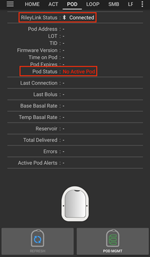
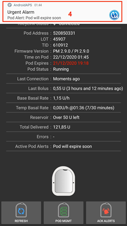

# Omnipod Eros

These instructions are for configuring the Omnipod Eros generation pump (**NOT Omnipod Dash**).

```{admonition} Omnipod Eros is being phased out
:class: note

The [Omnipod System](https://www.omnipod.com/current-podders/resources/omnipod-system) (the original Omnipod, comprising both the Personal Diabetes Manager (PDM) and the Pod) is being discontinued, and the end date varies by country. For example, it will no longer be available in Canada after 30 June 2026. If you rely on the Eros pump, plan ahead for a transition to a supported pump.
```

**此軟體是 DIY 人工胰臟解決方案的一部分，並非產品，你需要閱讀、學習並了解系統，包括如何使用他。你需要對自己使用的結果負完全責任。**

```{contents} Table of contents
:depth: 1
:local: true
```

## 硬體和軟體需求

- **Pod 通訊裝置**

> 將你的 AAPS 啟用手機與 Eros 世代的 Pod 通訊的組件。
> 
> > -   [OrangeLink 官網](https://getrileylink.org/product/orangelink)
> > -  [433MHz RileyLink](https://getrileylink.org/product/rileylink433)
> > -   [Emalink 官網](https://github.com/sks01/EmaLink) - [聯絡資訊](mailto:getemalink@gmail.com)
> > -   DiaLink - [聯絡資訊](mailto:Boshetyn@ukr.net)
> > -   [LoopLink 官網](https://www.getlooplink.org/) - [聯絡資訊](https://jameswedding.substack.com/) - 尚未測試

-   **行動電話裝置**

> 運作 AAPS 並向 Pod 通訊裝置發送控制指令的組件。
> 
> > - Supported [Android phone](#Phones-list-of-tested-phones) with **AAPS** and related components set up.

-   **胰島素輸送裝置**

> 將從 Pod 通訊裝置接收到的指令進行解釋的組件，該指令來自於你的 AAPS 啟用手機。
> 
> > - 新的 Omnipod pod（Eros 世代 - **不包括 DASH**）

These instructions assume that you are starting a new pod session. If this is not the case, please be patient and start this process at your next pod change.

In this page, **RileyLink** means any of the pod communication devices listed above.

## 開始之前

**安全第一** - 不要在無法從錯誤中恢復的環境中嘗試此過程（必備項包括額外的 pod、胰島素、已充電的 RileyLink 和手機設備）。

**當 AAPS Omnipod 驅動程式啟用你的 pod 後，你的 Omnipod PDM 將無法再運作**。以往你使用 Omnipod PDM 向 Omnipod Eros pod 發送指令。 Omnipod Eros pod 只允許單一裝置向其發送通訊。從那時起，成功啟動 Pod 的裝置將是唯一能夠與其通訊的裝置。這意味著你透過 AAPS Omnipod 驅動程式和 RileyLink 啟用了 Omnipod Eros pod，**你將無法再使用你的 PDM 與 pod 通訊**。 AAPS Omnipod 驅動程式與 RileyLink 現在替代你的  PDM。*這並不意味著你應該丟掉你的 PDM，建議保留他作為備用並在 AAPS 運作不正常時使用。*

**Only one RileyLink at a time can communicate with a pod.** **AAPS** remembers one paired RileyLink. If you pair a different one, it replaces the previous one.

**當 RileyLink 超出範圍時，你的 pod 不會關閉。** 當你的 RileyLink 超出範圍或信號被阻擋無法與活動 pod 通訊時，你的 pod 將繼續輸送基礎胰島素。啟用 pod 時，在 AAPS 中定義的基礎設定檔將會被編程到新的 pod 中。如果你失去與 pod 的連線，他會恢復到此基礎設定檔。在 RileyLink 返回範圍並重新建立連線之前，你將無法發出新的指令。

**AAPS 不支援30 分鐘基礎速率設置。** 如果你是 AAPS 新手並且首次設定基礎速率設置，請注意以半小時為間隔的基礎速率設置是不可支援的，你將需要調整基礎速率設置到整點開始。例如，如果你有一個 1.1 個單位的基礎速率，他從 09:30 開始並持續 2 小時，結束於 11:30，這將無法運作。你需要將這 1.1 單位的基礎速率更新為 9:00-11:00 或 10:00-12:00 的時間範圍。儘管 Omnipod 硬件本身支援半小時基礎速率設置，AAPS 目前無法在其演算法中考慮到這些設置。

## 在 AAPS 中啟用 Omnipod 驅動程式

你可以透過 **兩種方法** 在 AAPS 中啟用 Omnipod 驅動程式：

### 選項1：設置嚮導

After installing a new version of AAPS, the **Setup Wizard** starts automatically. If you have already exported your settings from a previous installation, you can import them in the wizard. For new installations, continue below.

Go through the [Setup Wizard](../SettingUpAaps/SetupWizard.md) until you reach the **Pump** step, then select **Omnipod Eros** (the description reads "Pump integration for Omnipod Eros").


The Setup Wizard does not pair your RileyLink. After finishing the wizard, open the Omnipod pump screen and pair it as described in the [RileyLink Setup section](#OmnipodEros-rileylink-setup).

**或者**

### Option 2: The Configuration screen

Open the top-left **menu** (☰) > **Configuration** > **Pump** and select the **radio button** of **Omnipod Eros**.

Once it is selected, the **Omnipod Eros** card shows two buttons, **Settings** and **Open plugin**:


**Settings** opens the settings of the Omnipod driver (see [Omnipod Settings](#OmnipodEros-omnipod-settings)):


**Open plugin** opens the Omnipod pump screen. You can also open it at any time from the main screen with **Manage** > **Pump**. This page calls it the **Omnipod pump screen**. Before a RileyLink is paired and a pod is activated, it looks like this:


### 驗證 Omnipod 驅動程式選擇

To verify that you have enabled the Omnipod driver, open **Manage** > **Pump** from the main screen. You should see the **Omnipod Eros** pump screen shown above. If you have not paired a RileyLink yet, **RileyLink Status** shows **Not Started** and **Pod Status** shows **No Active Pod**.

## Omnipod 配置

All pod and RileyLink functions are buttons on the [Omnipod pump screen](#OmnipodEros-omnipod-pod-tab) (**Manage** > **Pump**). Some buttons only appear in certain situations, for example when a pod is active.

>  重新整理幫浦連線和狀態
> 
>  幫浦管理（啟動，停用，播放測試嗶聲，RileyLink 狀態和幫浦歷史紀錄）

```{admonition} Older screenshot
:class: note
The screenshots above are from an earlier **AAPS** version. In **AAPS** 4 there is no **POD MGMT** button or Pod Management menu: **Refresh** and all pod management actions are buttons on the Omnipod pump screen.
```

(OmnipodEros-rileylink-setup)=

### RileyLink 設定

If you have already paired your RileyLink, continue to the [Activating a Pod section](#OmnipodEros-activating-a-pod) below.

*Note: A good visual indicator that the RileyLink is not connected is that the treatment buttons (QuickLaunch toolbar) on the main screen will be missing. 這亦會發生在 AAPS 開始運作後的約莫30秒鐘，因為他正在積極連線至 RileyLink。*

1. Make sure that your RileyLink is fully charged and powered on.

2. Place the RileyLink [close to your phone](#OmnipodEros-optimal-omnipod-and-rileylink-positioning) (~30 cm away or less).

3. Open the Omnipod pump screen (**Manage** > **Pump**) and press **Pair RileyLink**.

4. The **Pair RileyLink** screen starts scanning for Bluetooth devices right away. Tap your RileyLink in the list of found devices.

   

5. When **RileyLink paired successfully** is shown with the name and address of your device, press **OK**.

6. Back on the Omnipod pump screen, check that **RileyLink Status** changes to **Connected**. **Pod Status** should show **No Active Pod**. If the RileyLink does not connect, press **Reset RileyLink**, or restart **AAPS**.

 

 




```{admonition} Older screenshot
:class: note
The six screenshots above (after step 6) are from an earlier **AAPS** version. In **AAPS** 4 you pair the RileyLink with the **Pair RileyLink** button on the Omnipod pump screen instead of **RileyLink Configuration** in the Omnipod settings, and scanning starts automatically.
```

```{note}
To switch to another RileyLink (for example a backup device), press **Pair RileyLink** again and select the new device. It replaces the one paired before. You do not need to remove the old device first.
```

(OmnipodEros-activating-a-pod)=

### 啟動幫浦

Before you can activate a pod, make sure your RileyLink is paired and **RileyLink Status** shows **Connected**. The **Activate Pod** button stays disabled until the RileyLink is ready.

*提醒：幫浦的配對通訊範圍有限，是由於安全保護措施所致。配對前幫浦無線電信號較弱，但在成功配對後他將以全信號功率運作。 During these procedures, make sure that your pod is* [within close proximity](#OmnipodEros-optimal-omnipod-and-rileylink-positioning) *(~30 cm away or less) but not on top of or right next to the RileyLink.*

01. Open the Omnipod pump screen (**Manage** > **Pump**) and press **Activate Pod**.

    If you have never activated a profile, a **Profile required** step appears first. Select the profile to apply on activation.

    >   
    > 
    > ```{admonition} Older screenshot
    >     :class: note
    >     The screenshots above are from an earlier **AAPS** version. In **AAPS** 4 **Activate Pod** is a button on the Omnipod pump screen instead of in the **POD MGMT** menu.
    > ```

02. 顯示**填充 Pod**畫面。 Fill a new pod with enough insulin for 3 days and listen for two beeps. They mean that the minimum amount of 80 units has been filled. Empty the fill syringe completely, even after hearing the two beeps. 計算你3天所需的總胰島素量時，請考慮灌裝幫浦將使用12到15個單位。 Do not remove the pod's needle cap yet.

    > 
    > 
    > Ensure the new pod and RileyLink are within close proximity of each other (~30cm or less) and press **Next**.

03. **Select Insulin** (only shown if you have more than one insulin configured): select the insulin you are filling the pod with and press **Next**. A profile switch with this insulin is applied after activation.

04. 在 **初始化 Pod** 畫面上，Pod 將開始排空（你會聽到點擊聲，接著是連續的滴答聲，表明 Pod 正在自我排空）。如果 RileyLink 超出啟動幫浦的範圍，你會收到一條錯誤訊息 **幫浦無回應**。 If this occurs, [move the RileyLink closer](#OmnipodEros-optimal-omnipod-and-rileylink-positioning) (~30 cm away or less) to but not on top of or right next to the Pod and press **Retry**.

    >  

05. When priming is successful, a green checkmark is shown and the **Next** button becomes enabled. Press **Next**.

    > 

06. **Site location** (only shown if **Manage pump site rotation** is enabled in [Site Rotation](#Aapsscreens-site-rotation)): select where you place the pod on your body and press **Next**.

07. The **Attach Pod** screen is displayed. Prepare the infusion site of the new pod. Remove the pod's plastic needle cap and white paper backing from the adhesive and apply the pod to your chosen site on your body. If the cannula sticks out, press **Cancel** and discard the pod. When finished, press **Next**.

    > 

08. A confirmation dialog appears: "When you press OK, the cannula will be inserted". **ONLY press OK if you are ready to deploy the cannula**.

    > 

09. On the **Insert Cannula** screen, it may take some time before the Omnipod responds and inserts the cannula (1-2 minutes maximum), so be patient.

    > 如果 RileyLink 超出啟動幫浦的範圍，你會收到一條錯誤訊息 **幫浦無回應**。 If this occurs, move the RileyLink closer (~30 cm away or less) to but not on top of or right next to the Pod and press **Retry**.
    > 
    > 如果 RileyLink 超出藍牙範圍或未與手機有活動連線，你會收到一條錯誤訊息 **RileyLink 無回應**。 If this occurs, move the RileyLink closer to the phone and press **Retry**.
    > 
    > *注意：在插入針管之前，最好輕捏針管插入點附近的皮膚。這有助於針頭順利插入，並減少堵塞的機會。*
    > 
    > 
    > 
    >  

10. 針管成功插入後會顯示綠色勾號，並且 **下一步** 按鈕將變為可用狀態。 Press **Next**.

    > 

11. The **Pod Activated** screen is displayed. Check that the cannula has been inserted correctly, and change your pod if you think it has not. Press **Finish**. 恭喜！你已經開始了新的 Pod 使用階段。

    >  
    > 
    > ```{admonition} Older screenshot
    >     :class: note
    >     The screenshots in steps 2 to 11 are from an earlier **AAPS** version and may look different in **AAPS** 4. The **Select Insulin** and **Site location** steps are not pictured.
    > ```

12. You are returned to the Omnipod pump screen. The **Activate Pod** button is replaced by **Deactivate Pod**, because you cannot activate another pod without deactivating the active one first.

    The pump screen now shows information about your active pod, including the current basal rate, reservoir level, insulin delivered, pod errors and alerts. For more details, see the [Omnipod pump screen](#OmnipodEros-omnipod-pod-tab) section.

     

    ```{admonition} Older screenshot
    :class: note
    The screenshots above are from an earlier **AAPS** version. In **AAPS** 4 there is no Pod Management menu: you return directly to the Omnipod pump screen, where **Deactivate Pod** replaces **Activate Pod**.
    ```

```{note}
If activation was interrupted after priming (for example the app was closed), press **Activate Pod** again. The wizard continues from the cannula insertion steps.
```

### 停用幫浦

在正常情況下，幫浦的壽命應為三天（72 小時），並在提示幫浦過期警告後額外持續8小時，總計80小時的幫浦使用。

要停用 Pod（不論是過期還是 Pod 故障）：

1. Open the Omnipod pump screen (**Manage** > **Pump**) and press **Deactivate Pod**.

   >   
   > 
   > ```{admonition} Older screenshot
   >    :class: note
   >    The screenshots above are from an earlier **AAPS** version. In **AAPS** 4 **Deactivate Pod** is a button on the Omnipod pump screen instead of in the **POD MGMT** menu.
   > ```

2. On the **Deactivate Pod** screen, first make sure the RileyLink is in close proximity to the pod but not on top of or right next to the pod. Then press **Next**. A dialog asks *A deactivated Pod can not be used again. Deactivate this Pod now?* Press **OK** to start deactivating the pod, or **Cancel** to keep it. Deactivation suspends all insulin delivery and cannot be undone.

   > 

3. The **Deactivating Pod** screen appears, and you will receive a confirmation beep from the pod that deactivation was successful.

   > 
   > 
   > **IF deactivation fails** and you do not receive a confirmation beep, you may receive a **No response from RileyLink** or **No response from Pod** message. Press **Retry** to attempt deactivation again. If deactivation keeps failing, press **Discard Pod** and confirm. **AAPS** then forgets the pod. Insulin delivery has **not** been suspended, so remove the pod from your body. If your pod has a screaming alarm, you may need to silence it manually (using a pin or a paperclip), because **Discard Pod** does not silence it.
   > 
   > >   

4. A green checkmark appears when deactivation is successful. Press **Next** to display the **Pod Deactivated** screen. 你現在可以移除 Pod，該使用階段已停用。

   > 

5. Press **Finish** to return to the Omnipod pump screen.

   >  
   > 
   > ```{admonition} Older screenshot
   >    :class: note
   >    The screenshots in steps 2 to 5 are from an earlier **AAPS** version and may look different in **AAPS** 4.
   > ```

6. On the Omnipod pump screen, check that **RileyLink Status** shows **Connected** and **Pod Status** shows **No Active Pod**.

   >    
   > 
   > ```{admonition} Older screenshot
   >    :class: note
   >    The screenshots above are from an earlier **AAPS** version. In **AAPS** 4 **Finish** returns you directly to the Omnipod pump screen; there is no Pod Management menu or **Omnipod (POD)** tab.
   > ```

### 暫停與恢復胰島素輸送

The process below shows you how to suspend and resume insulin delivery.

*NOTE - if you do not see a **Suspend** button*, it is hidden by default. Enable **Show Suspend Delivery button in Omnipod tab** in the [Omnipod settings](#OmnipodEros-omnipod-settings) under **Other**.

#### 暫停胰島素投放

使用此指令將啟用的 POD 暫停。在暫停狀態下， POD 將不再輸送任何胰島素。此指令模擬原始 Omnipod PDM 發送給啟用 POD的暫停功能。

1. Open the Omnipod pump screen (**Manage** > **Pump**) and press **Suspend**. The suspend command is sent through the RileyLink to the active pod.

2. When the pod has suspended all insulin delivery, **Pod Status** shows **Suspended** and the **Suspend** button is replaced by **Resume Delivery**.

   >  
   > 
   > 
   > 
   >  
   > 
   > ```{admonition} Older screenshot
   >    :class: note
   >    The screenshots above are from an earlier **AAPS** version. In **AAPS** 4 these steps take place on the Omnipod pump screen instead of the **Omnipod (POD)** tab, and the result is shown in **Pod Status**.
   > ```

If the command fails, a **Warning** dialog shows "Failed to suspend delivery" with the reason. Check the RileyLink connection and try again.

#### 恢復胰島素輸送

使用此指令指示目前暫停的活動 Pod 恢復胰島素輸送。指令成功處理後，胰島素將根據目前時間並使用活動基礎率設定檔恢復正常輸送。 Pod 將再次接受注射、TBR 和 SMB 的指令。

1. Open the Omnipod pump screen and check that **Pod Status** shows **Suspended**. Press **Resume Delivery**.

2. When the command succeeds, **Pod Status** shows **Running** again and the **Resume Delivery** button disappears (the **Suspend** button is shown again if you have enabled it).

   >  
   > 
   > 
   > 
   >  
   > 
   > ```{admonition} Older screenshot
   >    :class: note
   >    The screenshots above are from an earlier **AAPS** version. In **AAPS** 4 these steps take place on the Omnipod pump screen instead of the **Omnipod (POD)** tab, and the result is shown in **Pod Status**.
   > ```

If the command fails, a **Warning** dialog shows "Failed to resume delivery" with the reason. Check the RileyLink connection and try again.

### 靜音 Pod 警報

*NOTE - The **Silence Alerts** button is only shown on the Omnipod pump screen while the pod has an active alert (for example the pod expiration or low reservoir alert), and only if **Automatically silence Pod alerts** is disabled.*

The process below shows you how to silence pod beeps that start when the pod reaches the warning time before it expires. This warning time is set with **Alert at hours before shutdown (80 Hours)** in the Omnipod **Alerts** settings. POD 的最長使用壽命為 80 小時（3 天 8 小時），然而 Insulet 建議不要超過 72 小時（3 天）限制。

*NOTE - If you have enabled **Automatically silence Pod alerts** in the Omnipod **Alerts** settings, **AAPS** silences the alert automatically at the next communication with the pod, and you do NOT need to do it manually.*

1. When the warning time is reached, the pod beeps to tell you that it will soon expire and needs to be changed. On the Omnipod pump screen, **Pod Expires** shows the exact time the pod expires (72 hours after activation); it turns **yellow** 4 hours before. **Pod Hard End** shows when the pod stops delivering insulin. **Active Pod Alerts** shows **Pod will expire soon**, and the **Silence Alerts** button appears. **AAPS** also shows a notification about the upcoming pod expiration.

   >   
   > 
   > ```{admonition} Older screenshot
   >    :class: note
   >    The screenshots above are from an earlier **AAPS** version. In **AAPS** 4 the **ACK ALERTS** button is called **Silence Alerts** and is on the Omnipod pump screen.
   > ```

2. Press **Silence Alerts**. The RileyLink sends the command to the pod to stop the expiration warning beeps.

   >  
   > 
   > ```{admonition} Older screenshot
   >    :class: note
   >    The screenshot above is from an earlier **AAPS** version. In **AAPS** 4 the button is called **Silence Alerts**.
   > ```

3. When the alerts are silenced, the pod beeps twice. **Active Pod Alerts** no longer shows the warning, the **Silence Alerts** button disappears and the pod stops its expiration warning beeps.

   >  
   > 
   > ```{admonition} Older screenshot
   >    :class: note
   >    The screenshot above is from an earlier **AAPS** version. In **AAPS** 4 the result is shown on the Omnipod pump screen: the warning disappears from **Active Pod Alerts**.
   > ```

If the command fails (for example the RileyLink is out of range of the pod), a **Warning** dialog shows "Failed to silence alerts" with the reason. Move the RileyLink closer to the pod and try again.


```{admonition} Older screenshot
:class: note
The screenshot above is from an earlier **AAPS** version. In **AAPS** 4 the **Warning** dialog shows "Failed to silence alerts" with the reason.
```

(OmnipodEros-view-pod-history)=

### 查看 Pod 歷史紀錄

本節將向你展示如何查看你的活動 Pod 歷史紀錄，並根據不同的操作類別進行篩選。 POD 歷史工具允許你查看目前啟用 POD在其三天（72 - 80 小時）壽命期間執行的動作和結果。

此功能對於驗證注射、TBR 和已完成的基礎變更很有用，但你可能不確定他們是否完成。其餘類別對於一般問題排除問題和確定故障前發生的事件順序也很有幫助。

*注意：* **不確定的**指令將出現在 POD 歷史中，但由於其性質，你無法保證其準確性。

1. Open the Omnipod pump screen (**Manage** > **Pump**) and press **Pod History**.

   >   
   > 
   > ```{admonition} Older screenshot
   >    :class: note
   >    The screenshots above are from an earlier **AAPS** version. In **AAPS** 4 **Pod History** is a button on the Omnipod pump screen instead of in the **POD MGMT** menu.
   > ```

2. The **Pod History** screen lists all pod actions and their results, newest first, grouped by day. By default **All** is selected. Tap one of the filter buttons at the top to show only one category. Use the back arrow at the top left to return to the Omnipod pump screen.

   > 

   >  
   > 
   > ```{admonition} Older screenshot
   >    :class: note
   >    The second screenshot is from an earlier **AAPS** version and may look different in **AAPS** 4.
   > ```

### 查看 RileyLink 設定和歷史紀錄

The **RileyLink Stats** screen shows the settings of your RileyLink and active pod, and the communication history of both. It has two tabs: **Settings** and **History**.

The **RileyLink Stats** button is hidden by default. To show it on the Omnipod pump screen, enable **Show RileyLink Stats button in Pod Management menu** in the [Omnipod settings](#OmnipodEros-omnipod-settings) under **Other**.

#### 手動重新建立 POD 通訊設備的藍牙通訊

If your pod communication device was out of Bluetooth range of your phone for a while, **RileyLink Status** may report **RileyLink unreachable** on the Omnipod pump screen. **AAPS** normally reconnects by itself when the device is back in range. If it does not:

1. Make sure the RileyLink is powered on, charged and close to your phone.

2. On the Omnipod pump screen, press **Reset RileyLink**. A message confirms **RileyLink configuration reset**. See the [Reset RileyLink notes](#OmnipodEros-reset-rileylink-config-notes) below.

3. 如果**藍牙連線**無法重新建立，請嘗試手動關閉然後重新開啟手機上的**藍牙功能**。

4. If it still does not reconnect, press **Pair RileyLink** and select your RileyLink again.

5. After a successful reconnection, **RileyLink Status** shows **Connected**. You can also check **Connection Status** on the **Settings** tab of the **RileyLink Stats** screen. 恭喜，你現在已將配置的 POD 通訊設備重新連線到 AAPS！

 


```{admonition} Older screenshot
:class: note
The screenshots above are from an earlier **AAPS** version. In **AAPS** 4 you reconnect with **Reset RileyLink** or **Pair RileyLink** on the Omnipod pump screen instead of the refresh button on the RileyLink Settings screen.
```

#### POD 通訊設備和啟用 POD設定

This screen shows information and status for both the currently paired pod communication device and the currently active Omnipod Eros pod. The information refreshes automatically.

1. Open the Omnipod pump screen (**Manage** > **Pump**) and press **RileyLink Stats**. The **Settings** tab shows your currently paired **RileyLink** and the active pod (**Device**).

   >   
   > 
   > ```{admonition} Older screenshot
   >    :class: note
   >    The screenshots above are from an earlier **AAPS** version. In **AAPS** 4 **RileyLink Stats** is a button on the Omnipod pump screen instead of in the **POD MGMT** menu.
   > ```

   > 

##### RileyLink fields

> - **Address:** MAC address of the paired pod communication device.
> - **Name:** Bluetooth name of the paired pod communication device.
> - **Battery Level:** The current battery level of the connected pod communication device. Only shown when **Show battery level reported by OrangeLink/EmaLink/DiaLink** is enabled.
> - **連線狀態：** POD 通訊設備與運作 AAPS 的手機之間藍牙連線的目前狀態。
> - **Connection Error:** If there is an error with the pod communication device Bluetooth connection, details are displayed here.
> - **韌體版本：**目前連線的 POD 通訊設備上安裝的韌體版本。

##### Device fields - With an Active Pod

> - **Device Type:** The type of device communicating with the pod communication device (Omnipod (Eros)).
> - **Configured Device Model:** The model of the device configured to communicate with the pod communication device.
> - **Connected Device Model:** The model of the device currently communicating with the pod communication device.
> - **Pump Serial Number:** Serial number of the currently activated pod.
> - **Pump Frequency:** Radio frequency used to communicate with the pod.
> - **Last Used Frequency:** Last known radio frequency the pod used to communicate with the pod communication device.
> - **Last Device Contact:**  POD 最後一次與通訊設備接觸的日期和時間。

(omnipod-eros-rileylink-and-active-pod-history)=
#### RileyLink 和啟動 Pod 歷史

This tab lists, newest first, each state or action of the RileyLink or the currently connected pod. The history is only available for the currently active pod. After a pod change, this history is erased and only events from the newly activated pod are recorded and shown.

1. Open the Omnipod pump screen (**Manage** > **Pump**), press **RileyLink Stats** and then tap the **History** tab.

   >   
   > 
   > ```{admonition} Older screenshot
   >    :class: note
   >    The screenshots above are from an earlier **AAPS** version. In **AAPS** 4 **RileyLink Stats** is a button on the Omnipod pump screen instead of in the **POD MGMT** menu.
   > ```

   > 

##### 欄位

Each entry shows:

> - **Device:** The device to which the action or state refers.
> - **Time:** The time of the event.
> - **State or Action:** The state of the device or the action it performed.

(OmnipodEros-omnipod-pod-tab)=

## Omnipod pump screen

Below is an explanation of the status fields and buttons on the **Omnipod pump screen** (**Manage** > **Pump**, or **Configuration** > **Pump** > **Open plugin**).

The gear icon at the top right opens the [Omnipod settings](#OmnipodEros-omnipod-settings).

*NOTE: If any status field shows (uncertain), press **Refresh** to refresh the pod status and clear it.*


```{admonition} Older screenshot
:class: note
The screenshot above is from an earlier **AAPS** version, where this screen was the **Omnipod (POD)** tab. In **AAPS** 4 it is the Omnipod pump screen, and some field names and buttons differ.
```

### 欄位

- **RileyLink Status:** Displays the current connection status of the RileyLink. Errors are shown in red.

- *Not Started* - no RileyLink is paired yet, or the connection has not started.
- *RileyLink unreachable* - pod communication device is either not within Bluetooth range of the phone, powered off or has a failure preventing Bluetooth communication.
- *RileyLink ready* - pod communication device is powered on and actively initializing the Bluetooth connection.
- *已連線* - 幫浦連線裝置已開啟電源、連線並能夠透過藍牙進行通訊。

- **Unique ID:** Displays the address of the active pod.

- **LOT Number:** Displays the LOT number of the active pod.

- **Sequence Number:** Displays the serial number (TID) of the pod.

- **韌體版本：**顯示啟動幫浦的韌體版本。

- **幫浦上的時間：**顯示啟動幫浦上的目前時間。 It is highlighted when it differs from the phone time by more than 5 minutes.

- **Pod Expires:** Displays the date and time when the active pod will expire. The text turns yellow in the last 4 hours before this time. It never turns red, because the pod keeps delivering insulin after it.

- **Pod Hard End:** Displays the end of the pod's grace period (8 hours after **Pod Expires**, for a maximum pod life of 80 hours). The text turns yellow when the grace period starts (at **Pod Expires**) and red in the last 4 hours before the hard end. During the grace period it also shows the time left, for example *(17m remaining)*. The pod stops delivering insulin at the hard end and must be changed.

- **Pod Status:** Displays the status of the active pod (for example **No Active Pod**, **Running** or **Suspended**).

- **Last Connection:** Displays the last time communication with the active pod was achieved. The text turns red when the [pump unreachable threshold](#OmnipodEros-troubleshooting) is exceeded.

- *片刻前* - 少於 20 秒前。
- *不到一分鐘前* - 超過 20 秒但少於 60 秒前。
- *1 分鐘前* - 超過 60 秒但少於 120 秒（2 分鐘）。
- *XX 分鐘前* - 超過 2 分鐘，具體由 XX 的值定義。

- **Last Bolus:** Displays the dosage of the last bolus sent to the active pod and how long ago it was issued in parenthesis.

- **Base Basal Rate:** Displays the basal rate programmed for the current time from the basal rate profile.

- **Temp Basal Rate:** Only shown while a Temporary Basal Rate is running. Displays it in the following format:

- 單位 / 小時 @ 發出 TBR 時（已執行的分鐘 / 總共執行的 TBR 分鐘）
- *示例：* 0.00U/h @18:25 ( 90/120 分鐘)

- **Reservoir:** Displays **Over 50 U left** when more than 50 units are left in the reservoir. Below this value the approximate number of units is displayed. The text turns red below the low reservoir threshold set in the [Alerts settings](#OmnipodEros-omnipod-settings).

- **Total Delivered:** Displays the total number of units of insulin delivered from the reservoir. *注意，這是一個近似值，因為幫浦啟動和填充過程並不精準。*

- **Active Pod Alerts:** Reserved for currently running alerts on the active pod. 通常在幫浦到期超過 72 小時且原生幫浦嗶聲警告運作時使用。

- **Errors:** Displays the last error encountered (shown in red). 檢查[藥囊歷史](#OmnipodEros-view-pod-history)、[RileyLink 歷史](#omnipod-eros-rileylink-and-active-pod-history)及日誌文件，以了解過去的錯誤及更多詳細訊息。

### 按鈕

The buttons at the bottom of the pump screen change depending on the situation. Buttons that cannot be used right now are greyed out, for example while the RileyLink is not connected.

**Pod status buttons** (shown when a pod is active):

- **Refresh:** Sends a refresh command to the active pod to update its status. Use it to refresh the pod status and clear status fields that contain the text (uncertain). 請參閱下面的[問題排除部分](#OmnipodEros-troubleshooting)以獲取額外訊息。

  

  ```{admonition} Older screenshot
  :class: note
  The screenshot above is from an earlier **AAPS** version. In **AAPS** 4 this is a text button named **Refresh** on the Omnipod pump screen.
  ```

- **Silence Alerts:** Silences the pod expiration and low reservoir beeps and notifications. Only shown when the pod has an active alert and **Automatically silence Pod alerts** is disabled. After the alerts are silenced, the button disappears.

  

  ```{admonition} Older screenshot
  :class: note
  The screenshot above is from an earlier **AAPS** version. In **AAPS** 4 this button is called **Silence Alerts**.
  ```

- **Set time:** Updates the time on the pod with the current time on your phone. Only shown when the time on the pod differs from the phone time by more than 5 minutes.

  

  ```{admonition} Older screenshot
  :class: note
  The screenshot above is from an earlier **AAPS** version. In **AAPS** 4 this is a text button named **Set time** on the Omnipod pump screen.
  ```

- **Suspend:** Suspends insulin delivery on the active pod. Only shown if enabled in the settings (**Show Suspend Delivery button in Omnipod tab**).

  

  ```{admonition} Older screenshot
  :class: note
  The screenshot above is from an earlier **AAPS** version. In **AAPS** 4 this is a text button named **Suspend** on the Omnipod pump screen.
  ```

- **Resume Delivery:** Resumes insulin delivery on the currently suspended, active pod. Only shown while the pod is suspended.

  

  ```{admonition} Older screenshot
  :class: note
  The screenshot above is from an earlier **AAPS** version. In **AAPS** 4 this is a text button named **Resume Delivery** on the Omnipod pump screen.
  ```

**Pod and RileyLink management buttons:**


```{admonition} Older screenshot
:class: note
The screenshot above is from an earlier **AAPS** version. In **AAPS** 4 there is no Pod Management menu: these actions are buttons directly on the Omnipod pump screen.
```

- **Activate Pod:** Primes and activates a new pod. Shown when no pod is active. It is enabled only when the RileyLink is connected.

  

  ```{admonition} Older screenshot
  :class: note
  The screenshot above is from an earlier **AAPS** version. In **AAPS** 4 **Activate Pod** is a button on the Omnipod pump screen instead of in the Pod Management menu.
  ```

- **Deactivate Pod:** Deactivates the currently active pod. Shown as soon as a pod is paired, also when an activation stopped part-way (for example because the pod failed during activation). It is enabled only when the RileyLink is connected. **AAPS** asks you to confirm before it deactivates the pod.

- 使用此指令停用發出錯誤 49 嚴重警告音的幫浦。
- If deactivation fails, the deactivation wizard offers a **Discard Pod** option.

  

  ```{admonition} Older screenshot
  :class: note
  The screenshot above is from an earlier **AAPS** version. In **AAPS** 4 **Deactivate Pod** is a button on the Omnipod pump screen instead of in the Pod Management menu.
  ```

- **Play Test Beep:** Plays a single test beep on the pod when pressed. Shown when a pod is paired.

  

  ```{admonition} Older screenshot
  :class: note
  The screenshot above is from an earlier **AAPS** version. In **AAPS** 4 **Play Test Beep** is a button on the Omnipod pump screen instead of in the Pod Management menu.
  ```

- **Pod History:** Displays the active pod activity history. See [View Pod History](#OmnipodEros-view-pod-history).

  

  ```{admonition} Older screenshot
  :class: note
  The screenshot above is from an earlier **AAPS** version. In **AAPS** 4 **Pod History** is a button on the Omnipod pump screen instead of in the Pod Management menu.
  ```

- **Pair RileyLink:** Scans for your pod communication device and pairs it. See [RileyLink Setup](#OmnipodEros-rileylink-setup).

- **RileyLink Stats:** Opens the RileyLink Stats screen with two tabs. Only shown if enabled in the settings (**Show RileyLink Stats button in Pod Management menu**).

- **設置** - 顯示 RileyLink 和啟動幫浦的設置資訊
- **歷史** - 顯示 RileyLink 和幫浦連線歷史

  

  ```{admonition} Older screenshot
  :class: note
  The screenshot above is from an earlier **AAPS** version. In **AAPS** 4 **RileyLink Stats** is a button on the Omnipod pump screen instead of in the Pod Management menu.
  ```

- **Reset RileyLink:** Resets the configuration of the currently connected pod communication device. When communication is started, specific data is sent to and set in the RileyLink:

- Memory Registers are set
- Communication Protocols are set
- Tuned Radio Frequency is set
  > 
  > See [additional notes](#OmnipodEros-reset-rileylink-config-notes) below.

  

  ```{admonition} Older screenshot
  :class: note
  The screenshot above is from an earlier **AAPS** version. In **AAPS** 4 this button is called **Reset RileyLink** and is on the Omnipod pump screen.
  ```

- **Discard Pod:** Discards the pod state of an unresponsive pod, after a confirmation. Only shown when a pod has been started but not fully paired, as proper deactivation is no longer possible:

- 當 **幫浦未完全配對** 且因此忽略停用指令時。
- A **pod is stuck** during the pairing process between steps.
- 當 **幫浦完全無法配對。**
  > 
  > After you discard a pod, **AAPS** can no longer communicate with it. Remove the pod from your body.

  

  ```{admonition} Older screenshot
  :class: note
  The screenshot above is from an earlier **AAPS** version. In **AAPS** 4 **Discard Pod** is a button on the Omnipod pump screen instead of in the Pod Management menu.
  ```

(OmnipodEros-reset-rileylink-config-notes)=

#### *Reset RileyLink Notes*

- 此功能的主要用途是當目前啟動的幫浦連線裝置無法響應且通訊處於卡住狀態時使用。
- If the pod communication device is turned off and then back on, press **Reset RileyLink** so that these communication parameters are set again in the pod communication device.
- 若未完成此步驟，則 AAPS 需要在幫浦連線裝置電源循環後重新啟動。
- This button **DOES NOT** need to be pressed when switching between different pod communication devices.

(OmnipodEros-omnipod-settings)=

## Omnipod 設置

To open the Omnipod driver settings, either:

- press the gear icon at the top right of the Omnipod pump screen (**Manage** > **Pump**), or
- open the top-left **menu** (☰) > **Configuration** > **Pump** and press **Settings** on the **Omnipod Eros** card.


```{admonition} Older screenshot
:class: note
The screenshot above is from an earlier **AAPS** version. In **AAPS** 4 you open the settings with **Settings** on the **Omnipod Eros** card or the gear icon on the Omnipod pump screen, instead of the settings gear in **Configuration** or the 3-dot menu.
```

The settings are grouped as listed below. Tap a group to expand it. Most entries are switches you can enable or disable:


*注意：星號（\*）表示預設設置為啟用狀態。*

### RileyLink

Settings for the pod communication device. You pair the device itself with the **Pair RileyLink** button on the pump screen (see [RileyLink Setup](#OmnipodEros-rileylink-setup)).

- **Use Scanning:** Scans before connecting to the OrangeLink. This can improve connections. It can also be used with other RileyLink clones if needed.

- **Show battery level reported by OrangeLink/EmaLink/DiaLink:** Reports the actual battery level of the OrangeLink/EmaLink/DiaLink. 強烈建議所有 OrangeLink/EmaLink/DiaLink 使用者啟用此設置。

- 此設置**不支援**原始 RileyLink。
- 可能不支援 RileyLink 的替代品。
- 啟用 - 報告支援的幫浦連線裝置的目前電池電量。
- 停用 - 報告值為 n/a。

- **Enable battery change logging in Actions:** Only available when the battery reporting setting above is enabled. Some pod communication devices can use regular batteries that you can change. With this setting enabled, you can record a **Pump Battery Change** [careportal entry](#aaps-screens-careportal) to note the change and reset the battery age.

### Confirmation Beeps

提供來自藥筒的確認聲音提示，用於注射、基礎輸注、超微劑量(SMB)以及臨時基礎率(TBR)輸送和變更。

- **\*注射嗶聲啟用：**啟用或停用在注射送達時的確認嗶聲聲。
- **Basal beeps enabled:** Enable or disable confirmation beeps when a new basal rate is set, active basal rate is canceled or current basal rate is changed.
- **\*SMB 嗶聲啟用：**啟用或停用在送達 SMB 時的確認嗶聲聲。
- **啟用 TBR 嗶聲：** 啟用或停用設置或取消 TBR 時的確認嗶聲。

### 警報

根據設定的門檻值單位，提供 AAPS 警告和 Nightscout 通知以提示幫浦到期、關閉或低庫存。

*請注意，Pod 觸發警報後，AAPS 通知將始終發出。 Dismissing the notification will NOT silence the alert UNLESS **Automatically silence Pod alerts** is enabled. To silence the alert MANUALLY, open the Omnipod pump screen and press **Silence Alerts**.*

- **\*Expiration reminder enabled:** When enabled, the pod beeps when the time set below is reached.
- **Alert at hours before shutdown (80 Hours):** The number of hours before the pod shuts down (80 hours after activation) at which the expiration reminder is triggered (1 to 8 hours, default 8).
- **\*低庫存警告啟用：**啟用或停用當幫浦剩餘單位的低庫存門檻值被觸發時的警告，門檻值定義於單位數欄位。
- **Number of units:** The number of units at which to trigger the pod low reservoir alert (5 to 50, default 20).
- **Automatically silence Pod alerts:** When enabled, a notification is still issued, but the alert is silenced automatically at the next communication with the pod after the alert started.

### 通知

當不確定 TBR、SMB 或注射事件是否成功時，提供 AAPS 通知和手機警報。

*注意：這些僅是通知，沒有嗶聲警報。*

- **\*Sound for uncertain TBR notifications enabled:** Enable or disable this setting to trigger an audible alert and visual notification when AAPS is uncertain if a TBR was successfully set.
- **\*不確定 SMB 通知聲音啟用：**啟用或停用此設置以在 AAPS 不確定 SMB 是否成功送達時觸發警報聲和視覺通知。
- **\*不確定注射通知聲音啟用：**啟用或停用此設置以在 AAPS 不確定注射是否成功送達時觸發警報聲和視覺通知。

### 其他

提供進階設定以協助除錯。

- **Show Suspend Delivery button in Omnipod tab:** Hide or display the **Suspend** button on the Omnipod pump screen.
- **Show Pulse Log button in Pod Management menu:** This setting is still listed, but the current version of the pump screen has no **Pulse Log** button.

- **Show RileyLink Stats button in Pod Management menu:** Hide or display the **RileyLink Stats** button on the Omnipod pump screen.
- **\*DST/Time zone detection enabled:** Allows time zone changes to be automatically detected if the phone is used in an area where DST is observed.

### 切換或移除啟動幫浦連線裝置 (RileyLink)

With many alternative models to the original RileyLink available (such as OrangeLink or EmaLink), or the need to have multiple or backup versions of the same pod communication device, you may need to switch to another device.

To switch, open the Omnipod pump screen (**Manage** > **Pump**), press **Pair RileyLink** and select the new device, as described in [RileyLink Setup](#OmnipodEros-rileylink-setup). The new device replaces the previously paired one.

 


 

```{admonition} Older screenshot
:class: note
The screenshots above are from an earlier **AAPS** version. In **AAPS** 4 you add a device with **Pair RileyLink** on the Omnipod pump screen instead of **RileyLink Configuration** in the Omnipod settings, and scanning starts automatically.
```

There is no separate button to remove a paired device. If you stop using a RileyLink, simply pair the new one when you need it.


```{admonition} Older screenshot
:class: note
The screenshots above are from an earlier **AAPS** version. In **AAPS** 4 there is no **Remove** button: pairing a new RileyLink replaces the previous one.
```

## Status row and careportal

There are a few items that are specific to how the Omnipod pod differs from tube based pumps, especially after applying a new pod.

The **insulin** and **cannula** ages in the [status row](#screens-sensor-level-battery) of the main screen are **reset** to 0 days and 0 hours **after each pod change**. 這是根據 Omnipod 幫浦的設計和運作方式所設。每個 Pod 內都包含 **幫浦電池** 和 **胰島素儲液器**。由於 Pod 直接將套管插入應用 Pod 的皮膚上，因此 Omnipod 幫浦不使用傳統的管路。*因此，在更換 Pod 後，這些數值的時間將自動重置為零。* **幫浦電池時間** 不會被報告，因為 Pod 中的電池壽命始終比 Pod 的最大壽命（80 小時）長。


```{admonition} Older screenshot
:class: note
The screenshot above is from an earlier **AAPS** version, where these ages were shown in the **Careportal** section of the **Actions (ACT)** tab. In **AAPS** 4 they are shown in the status row of the main screen.
```

### 層級

**胰島素等級**

Omnipod Eros 幫浦中的胰島素量報告並不精準。 This is because it is not known exactly how much insulin was put in the pod, only that when the 2 beeps are triggered while filling the pod at least 80 units have been filled. 一個幫浦最多可容納 200 單位。 Priming can also introduce variance as it is not an exact process. 考慮到這些因素，Omnipod 驅動程式已經編寫為盡可能準確地估算幫浦內剩餘的胰島素量。

> - **超過 50 單位** - 當幫浦中有超過 50 單位時，報告值為 50+ 單位。
> - **少於 50 單位** - 報告幫浦中剩餘胰島素的近似計算值。
> - **SMS** - 短訊回報數值為 50+ 單位。
> - **Nightscout** - 當超過 50 單位時，向 Nightscout 上傳數值為 50（版本 14.07 及更早版本）。更新版本將在超過 50 單位時報告數值為 50+。

**電池電量**

電池電量報告是一個可以啟用的設置，當啟用時，將返回幫浦連線裝置（如 OrangeLink、EmaLink 或 DiaLink）的目前電池電量。  RileyLink 硬體無法報告其電池電量。電池電量是在每次與幫浦連線後報告的，因此在充電時，可能不會觀察到線性的增長。手動重新整理將更新目前電池電量。當支援的幫浦連線裝置已中斷連線時，會報告 0% 的電量值。

> - **RileyLink 硬體無法報告電池電量**
> - **Omnipod 設置中**必須啟用** "顯示 OrangeLink/EmaLink/DiaLink 報告的電池電量" 設定才能報告電池電量值**
> - **電池電量報告**僅**適用於 OrangeLink、EmaLink 和 DiaLink 裝置**
> - **電池電量報告**可能**適用於其他裝置（不包括 RileyLink）**
> - **SMS** - 當有實際電量時，返回目前電池電量，否則將不返回 n/a 值
> - **Nightscout** - 當有實際電量時，報告電池電量，否則不會報告 n/a 值

(OmnipodEros-troubleshooting)=

## 問題排除

### Pod 故障

Pod 會因多種問題偶爾發生故障，包括 Pod 本身的硬體問題。最佳做法是不要向 Insulet 報告，因為 AAPS 並非經過認證的使用情況。你可以在[這裡](https://github.com/openaps/openomni/wiki/Fault-event-codes)找到錯誤代碼列表，以幫助確定原因。

### 防止 49 號錯誤 Pod 故障

此故障與指令的 Pod 狀態不正確或胰島素輸送指令中的錯誤有關。 We recommend that you set Nightscout synchronization to *upload only*: keep all the "Receive ... from NS" options disabled in the synchronization settings of the Nightscout client (see [Nightscout](../SettingUpAaps/Nightscout.md)) to prevent possible failures.

### 幫浦無法連線警報

We recommend setting pump unreachable alerts to **120 minutes**. Press the **Settings** (gear) icon at the top right of the main screen, select **Local alerts** > **Pump unreachable threshold** and set it to **120**.

(OmnipodEros-import-settings-from-previous-aaps)=
### 從先前的 AAPS 匯入設定

```{admonition} Importing settings can end your active Pod
:class: warning
On the phone that is already running the Pod, leave **Also replace pump settings** unticked: the Pod session is kept and only the other settings are imported. Tick it only with a file exported during the Pod you are wearing now. See [Tubeless pumps](#ExportImportSettings-tubeless-pumps).
```

The safest way to reinstall **AAPS** is between two Pods:

1. 停用你的幫浦會話。確認你沒有啟動的幫浦會話。
2. 匯出你的設定並將副本存儲在安全的地方。
3. 卸載舊版本的 AAPS 並重新啟動手機。
4. 安裝新版本的 AAPS 並確認你沒有啟動的幫浦會話。
5. 匯入你的設定並註冊你的新幫浦。

### Omnipod 驅動程式警報

Please note that the Omnipod driver presents a variety of unique alerts on the **main screen**, most of them are informational and can be dismissed while some provide the user with an action to take to resolve the cause of the triggered alert. 你可能會遇到的主要警報總結如下：

#### 沒有啟動幫浦

未偵測到啟動的幫浦會話。按下**稍後提醒**可以暫時忽略此警報，但只要未啟動新 Pod，他就會持續觸發。當此警報啟動後，會自動靜音。

#### 幫浦已暫停

此訊息警告幫浦已暫停。

#### 設置基礎率失敗。注射可能已暫停！ Please manually refresh the Pod status from the Omnipod tab and resume delivery if needed.

Informational alert that the Pod basal profile setting has failed. Open the Omnipod pump screen and press **Refresh**, then **Resume Delivery** if needed.

#### 無法確認 SMB 注射是否成功。如果你確定注射未成功，應手動從治療中刪除 SMB 項目。

Alert that the SMB bolus success could not be verified. Check the **Last Bolus** field on the Omnipod pump screen to see if the SMB succeeded. If it did not, remove the entry from the treatments.

#### 不確定「任務注射/TBR/SMB」是否完成，請手動確認是否成功。

由於 RileyLink 和 Omnipod 通訊的方式，可能會出現某些指令**不確定**是否已成功處理的情況。因此，有必要通知使用者此不確定性。

以下是一些可能出現不確定通知的例子。

- **注射** - 不確定的注射無法自動驗證。該通知將保持，直到下一次注射，但手動幫浦重新整理可清除訊息。*預設情況下，針對此類通知類型啟用了警報嗶聲，因為使用者需要手動確認他們。*
- **TBR、幫浦狀態、設定檔切換、時間變更** - 手動幫浦重新整理可清除訊息。
- **Pod Time Deviation -** When the time on the pod and the time on your phone differ too much, it is difficult for the AAPS loop to function and make accurate predictions and dosage recommendations. If the time difference between the pod and the phone is more than 5 minutes, a **Set time** button appears on the Omnipod pump screen. Press **Set time** to synchronize the time on the pod with the time on the phone. If **Pod Status** shows **Suspended** afterwards, press **Resume Delivery** to continue normal pod operations.

## 最佳實踐

(OmnipodEros-optimal-omnipod-and-rileylink-positioning)=

### 最佳的Omnipod與RileyLink定位

RileyLink上用來與Omnipod通訊的天線是一個433 MHz的螺旋天線。由於其結構特性，他會發射全向信號，形狀類似三維甜甜圈，而 z 軸則代表垂直站立的天線方向。這意味著在特定的操作中，特別是啟動和停用幫浦時，RileyLink應放置於最佳位置。


> *(圖1。螺旋天線在全向模式下的圖示*)

基於安全性與保全的考量，幫浦*註冊*必須在距離較近的範圍內完成（大約30公分內），比起其他操作如注射、設定臨時基礎率（TBR）或只是重新整理幫浦狀態。由於RileyLink天線的信號傳輸特性，建議不要將幫浦直接放置在RileyLink的頂部或太靠近。

下方的圖片展示了在幫浦註冊和停用時如何將RileyLink放置於最佳位置。幫浦可能會在其他位置啟動，但最好的成功率是使用下圖中的位置。

*注意：若在最佳位置下仍無法通訊，這可能是由於RileyLink的低電量，導致天線傳輸距離縮短。為避免此問題，請確保RileyLink已充飽電或在此過程中直接連線至充電線。*


## 如何尋求協助

所有Omnipod驅動的開發工作皆由社群志願者完成；當你請求協助時，請遵循以下指導原則：

- **等級 0：** 閱讀此文件的相關部分，以確保你了解遇到困難的功能應如何工作。
- **第一層：**如果你仍遇到無法解決的問題，請前往**Discord**上的*#androidaps*頻道，使用[此邀請連結](https://discord.gg/4fQUWHZ4Mw)。
- **等級 2:** 搜尋現有問題，以查看你的問題是否已經報告；如果沒有，請建立新的[問題](https://github.com/nightscout/AndroidAPS/issues)並附上[你的日誌文件](../GettingHelp/AccessingLogFiles.md)。
- **保持耐心——我們社群中的大多數成員都是善良的志願者，解決問題通常需要使用者和開發者雙方的時間和耐心。**
