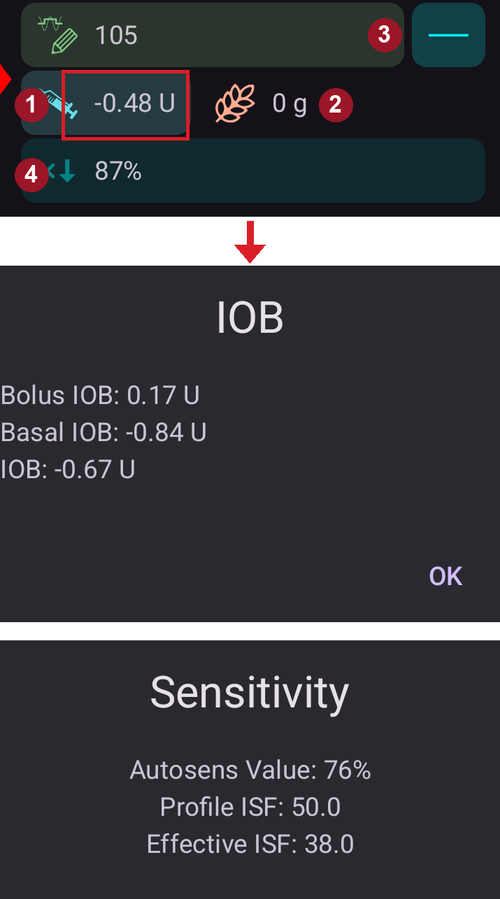
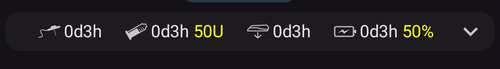
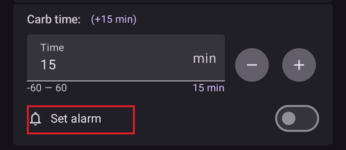
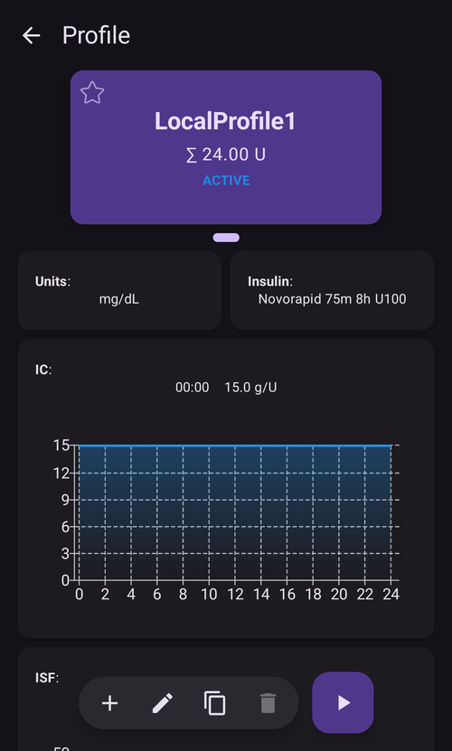

# AAPS 螢幕畫面

```{contents}
:backlinks: entry
:depth: 2
```

(the-homescreen)= (AapsScreens-the-homescreen)=

## The main screen


這是你打開**AAPS**後會看到的第一個螢幕，裡面包含了你每天所需的大部分資訊。

### Section A - Top bar

* The **menu** (☰) on the left opens the navigation drawer with **Treatments history**, **History browser**, **Statistics**, **Profile helper**, **Maintenance**, **Setup Wizard**, **Configuration** and more.
* The **search bar** finds settings, dialogs and documentation — just start typing (see [Global search](../DailyLifeWithAaps/GlobalSearch.md)).
* The **Settings** (gear) icon on the right opens all [settings](../SettingUpAaps/Preferences.md).

(aaps-screens-profile--target)=

### Section B - Status block

#### 目前血糖值

The latest blood glucose reading from your CGM is shown in the big circle on the left, together with the difference to the previous reading (delta) and the age of the reading.

血糖值的顏色反映了對定義的[範圍](#Preferences-range-for-visualization)的狀態。

* green = in range
* red = below range
* yellow = above range

  

(loop-status)= (AapsScreens-loop-status)=

#### 循環狀態


Next to the BG circle, an icon shows the running mode of the loop (from top to bottom in the picture):

1. 綠色圓圈 = [封閉循環](#KeyAapsFeatures-ClosedLoop)，循環執行中
2. 紫色虛線圓圈 = [低血糖暫停（LGS）](#KeyAapsFeatures-LGS)
3. 藍色虛線圓圈 = [開放循環](#KeyAapsFeatures-OpenLoop)
4. Red circle with cross = loop disabled (not working permanently)
5. Red pause icon = loop suspended (temporarily paused but basal insulin will be given) - remaining time is shown next to the icon
6. Grey circle with plug = pump disconnected (temporarily no insulin dosage at all) - remaining time is shown next to the icon

Press the icon to open the Loop dialog. The dialog's content depends on the current state:

* While the loop is **running** (closed, open or LGS), you can switch the running mode (Closed Loop, Low Glucose Suspend, Open Loop or Disable loop), **suspend** the loop or **disconnect** the pump for a chosen duration.
* While the loop is **disabled**, you can re-enable it by selecting a running mode, or disconnect the pump.
* While the loop is **suspended**, you can **resume** it, disconnect the pump, or pick a new duration under **Suspend loop** to extend the suspension.
* While the pump is **disconnected**, you can **reconnect** the pump, or pick a new duration under **Disconnect pump** to extend the disconnection.

When you extend a suspension or a disconnection, the new duration **starts from now**: it replaces the remaining time, it is not added to it. You do not have to resume or reconnect first.

The dialog while the loop is running in closed loop:


The dialog while the loop is suspended, with **Resume** and the durations to extend the suspension:


The dialog while the pump is disconnected, with **Reconnect Pump** and the durations to extend the disconnection:


The dialog in Low Glucose Suspend, in open loop and while the loop is disabled only differs in the running modes it offers:


This is how the main screen looks in each mode. The color band at the top of the graph changes at the time of the switch.

Low Glucose Suspend:


Open loop:


Loop disabled:


Loop suspended — the remaining time is shown next to the icon:


Pump disconnected — the remaining time is shown next to the icon. The treatment buttons stay in the QuickLaunch toolbar, so you can still record insulin given with a pen or carbs:


A validation is required after each selection.

```{admonition} Alarm: the pump did not accept the zero temp basal :class: warning While the pump is disconnected, **AAPS** keeps a zero temporary basal on the pump and sets it again if it is missing. If this still fails after 10 minutes, **AAPS** raises an urgent alarm: *"The pump did not accept the zero temp basal. It may still be giving basal insulin. Check the pump."* The alarm repeats every 15 minutes until the zero temporary basal is set or the disconnection ends. If you see it, check your pump: it may be delivering basal insulin although **AAPS** shows it as disconnected.

    <br />Note: the modes offered depend on your progress in the [Objectives](../SettingUpAaps/CompletingTheObjectives.md) — Closed Loop and LGS only become available as you complete them.
    
    (aaps-screens-bg-warning-sign)=
    #### BG warning sign
    
    If **AAPS** detects a problem with the BG readings it receives, a shortcut to your BG source (named after it, for example **xDrip+ BG**) appears in the bottom bar of the main screen, with a red warning badge. Tap it to open the [BG source screen](#aaps-screens-bg-source).
    
    ##### Duplicate BG data
    
    The red warning sign is signaling you to get active immediately: You are receiving **duplicate BG data**, which prevents the loop from doing its work right. **AAPS** cannot calculate your BG trend reliably from duplicated readings, so it stops correcting.
    
    If your loop was closed, **AAPS** switches it to [Low Glucose Suspend (LGS)](#KeyAapsFeatures-LGS) mode: the loop icon turns purple.
    
      
    
    Press the loop icon: the **Constraints** card at the top tells you why: "BgQualityCheck: LGS mode due to doubled values in BG source".
    
      
    
    ```{admonition} Your loop is running in Low Glucose Suspend
    :class: note
    Your loop keeps running, but only to protect you against lows: **AAPS** can still reduce or suspend your basal, and it will not give any correction insulin until you solve this issue !
    

你需要找出為什麼會收到重複的血糖資料：

* 你的 Nightscout 網站上是否啟用了 Dexcom 橋接？通過進入 Nightscout 實例的管理面板，編輯 "enable" 變數並刪除其中的 "bridge" 來停用橋接。（有關 heroku 的[詳細資訊可以在此找到](https://nightscout.github.io/troubleshoot/troublehoot/#heroku-settings)。）
* 是否有多個來源將你的血糖上傳到 Nightscout？ If you use the BYODA app, enable the upload in **AAPS** but do not enable it in xDrip, if you use that.
* 你是否有任何會接收你的血糖，並再次上傳到你的 Nightscout 網站的追蹤者？
* Last resort: In [NSClient settings](#Preferences-nsclient), select the Synchronization settings and disable the "Receive CGM data from NS" option.

To remove the warning immediately and get your loop correcting again, delete the duplicate entries from the BG source screen: tap the shortcut in the bottom bar. The duplicate reading is highlighted in red. Long press a reading to start selecting, tick the duplicates and tap the trash icon at the top right.


然而，當有很多重複項目時，下面的作法也許更容易排除警告

* [備份你的設定](../Maintenance/ExportImportSettings.md)，
* 在維護選單中重置你的資料庫，然後
* [再次匯入你的設定](../Maintenance/ExportImportSettings.md)

    {admonition} Switch back to Closed Loop yourself
    :class: important
    **AAPS** does not return to **Closed Loop** on its own once the duplicates are gone. Press the loop icon on the main screen and select **Closed Loop** again.

##### Flat BG data

With some BG sources (Libre 1, AiDEX, Glutec, Medtronic and sources that do not report their sensor type), **AAPS** also checks for readings that do not change: if your BG has changed by less than 2 mg/dL (0.1 mmol/L) for 45 minutes, the data is considered wrong. The BG source shortcut then shows a red flat-trend badge, and the loop stops any high temporary basal and gives no correction insulin until the readings change again. Check your sensor and the app that sends the readings.

##### Irregular BG data

When readings arrive at irregular intervals or some are missing, **AAPS** recalculates 5-minute values from the readings it has. This happens for example after a sensor change, or with Libre sensors, whose timing slips a minute or two every few hours. The loop keeps working and you do not have to take any action. **AAPS** 4 no longer shows a yellow warning sign for this.

#### 目前的設定檔

The current profile is displayed next to the star icon.

Tap the profile name to open the [Profile screen](#aaps-screens-profile), where you can view the profile details and [switch between different profiles](../DailyLifeWithAaps/ProfileSwitch-ProfilePercentage.md).

To **change the profile percentage** (and its duration), tap the profile name, then tap the round **▶** (Activate) button at the bottom right of the Profile screen. In **AAPS** 3.x this screen opened with a long press on the profile name; in **AAPS** 4 a long press does nothing. Step by step: [Change the Profile Percentage](#ProfileSwitch-change-percentage).


1. 平時顯示已啟用的標準設定檔。
2. Profile switch with a specific percentage of 90% and a remaining duration of 9 minutes — the profile name turns yellow while a temporary profile switch is running.
3. Profile switch with a time shift of 1 hour and a remaining duration of 9 minutes.

#### 目標


The current target blood glucose level is displayed below the profile name.

Short press the target to open the **[Temporary Target](../DailyLifeWithAaps/TempTargets.md)** screen.

1. Regular display: the target range defined in your profile.
2. If a temp target is set, the target turns yellow/orange with the icon of the used preset, and the remaining time in minutes is shown in brackets.

(AapsScreens-visualization-of-dynamic-target-adjustment)=

#### 動態目標調整的可視化

當使用[SMB 演算法](#Config-Builder-aps)和[自動感應](#Open-APS-features-autosens)功能時，**AAPS**可以根據敏感度動態調整你的目標。

Enable either one or both of the following options in [OpenAPS SMB settings](#Preferences-openaps-smb-settings):

* "Sensitivity raises target" and/or
* "Resistance lowers target"

If **AAPS** detects resistance or sensitivity, the target will change from what is set from profile, and the displayed target changes color to indicate the adjustment.

(aaps-screens-iob-cob-basal-sens)=

#### IOB, COB, basal and sensitivity



1. **Syringe**: insulin on board (IOB) - amount of active insulin inside your body  
    The insulin on board figure would be zero if just your standard basal was running and there was no insulin remaining from previous boluses. 
    * 如果最近有減少的基礎率，IOB 可能為負值。
    * Press the chip to see the split of bolus and basal insulin (first dialog in the picture — here with a negative IOB after a period of reduced basal)
2. **Grain**: [carbs on board (COB)](../DailyLifeWithAaps/CobCalculation.md) - yet unabsorbed carbs you have eaten before
3. The teal button on the right reflects the **current basal delivery**: a flat line when the profile basal is running, a changed icon while a temporary basal rate is active
4. The **percentage row** shows the current sensitivity ([Autosens](#Open-APS-features-autosens) / [DynamicISF](../DailyLifeWithAaps/DynamicISF.md)). When the loop changes your ISF, the row also shows the profile ISF, an arrow and the ISF the loop uses now, for example "80% 2.0 ↗ 2.5". Press it to see the Autosens value and the effective ISF (second dialog in the picture). If the loop works with a different value than the last Autosens result (for example because a temp target changes your sensitivity), the dialog also shows that value as **Autosens in algorithm**. When Autosens is off, the loop keeps your profile ISF and no effective ISF is shown.

The IOB dialog, opened by pressing the IOB chip:


Press the teal button to see the temporary basal rate that is running, when it started and how long it has been running:


(aaps-screens-carbs-required)=

#### 需要碳水化合物


當系統偵測到需要碳水化合物時，會提供碳水化合物建議。

當 oref 演算法認為無法透過零基礎補救時，你需要碳水化合物來修正。

碳水化合物的通知會比注射計算機的通知更為精準。 You might see a carbs suggestion while the bolus calculator does not show missing carbs.

如果有需要，碳水化合物需求通知可以推送到 Nightscout，屆時會顯示並廣播公告。

### Section C - Status row



The status row gives a visual warning for

* 針頭的使用時間
* Insulin age (days reservoir is used) and reservoir level (units)
* 傳感器使用時間
* Pump battery age and level (%)

如果超過警告門檻值，數值將顯示為黃色。

如果超過危急門檻值警告，數值將顯示為紅色。

Thresholds can be changed via the small **Settings** icon shown when the status row is **expanded** (chevron on the right) — see [Status lights](#Preferences-status-lights).

The expanded status panel also has a button at the end of some rows to record a change, which resets the corresponding age: **Add** on the **Sensor** row records a sensor insertion. If your pump supports it, **Prime/Fill** appears on the **Cannula** (or **Patch pump**) and **Insulin** rows, and **Add** on the **Pump battery** row.


根據你使用的幫浦，你可能不會擁有所有這些圖示。

(screens-sensor-level-battery)=

#### 傳感器電量（電池）

適用於具有額外發射器的 CGM，例如 MiaoMiao 2。 (Technically sensor has to send battery level information to xDrip.)

Thresholds can be set in [Status lights](#Preferences-status-lights).

(aaps-screens-main-graph)=

### Section D - Main graph


圖表顯示你的血糖 (BG)，從你的血糖傳感器 (CGM) 讀取。

Use scroll and pinch-zoom gestures on the graph to change the visible time frame.

綠色區域反應你的目標範圍。

此資訊也會顯示在此圖表上：

* Manual boluses: blue triangle just above the BG curve, pointing down at the reading of that moment, with the insulin amount
* Carbs entries: orange triangle just below the BG curve, pointing up at the reading, with the carb amount. A meal entered with its bolus looks like one marker, split by the reading.
* The triangles come in three sizes (small, medium, large), following the amount compared with the largest of the day. If there is no BG reading at that time (sensor gap), the triangle is drawn at the bottom of the graph.
* BG checks and calibrations: drawn at their own measured value, so you can compare them with the sensor curve
* 目標（依設定檔定義，或被臨時目標調整）：綠色線
* Profile switches: star icons at the top of the graph
* Loop status: color band at the top of the graph when the [running mode](#AapsScreens-loop-status) is anything else than closed loop: blue = open loop, purple = LGS, red = loop disabled, yellow = loop suspended, grey = pump disconnected, orange = superbolus (in the screenshot: purple, then yellow). The history of these changes is listed in [Running mode](#AapsScreens-running-mode)
* [SMBs](#Open-APS-features-super-micro-bolus-smb) are not drawn on the BG graph (there would be one every few minutes): they are shown on the [IOB graph](#aaps-screens-iob).

Tap a **BG check** in the graph to see its value, and its note if you wrote one.

(aaps-screens-graph-press-and-hold)=

#### See the values at a given time

**Press and hold** the BG graph for a moment to see the values at one reading. A dot marks the nearest reading, a dashed line is drawn at that time in all the graphs, and a pop-up at the top of the graph shows:

* the time and the BG value
* IOB, COB (only when it is above 0 g) and the basal rate at that time — the basal icon shows whether a temporary basal rate was running, as on the main screen
* any bolus, SMB or carbs at that time, with the same triangles as in the graphs

Keep your finger on the screen and move it left or right to go from one reading to the next. You feel a light tick at each reading, and the graph does not scroll while you do this. The pop-up stays for 2 seconds after you lift your finger.

This works the same way on the [additional graphs](#aaps-screens-additional-graphs) below the BG graph (IOB, COB...): press and hold any of them.


(AapsScreens-activate-optional-information)=

#### 啟用可選資訊

Press the **pencil** icon in the top-right corner of the graph to open the graph settings:


* **Graph height** adjusts how tall the graph is drawn.
* **ACT** overlays the insulin activity curve: a solid yellow-green line <span style="background:#141218;color:#D3F166;padding:0 0.3em;border:1px solid #141218;border-radius:4px">━━━━</span> (not to be confused with the dotted yellow UAM prediction)
* **PRED** overlays the [prediction lines](#aaps-screens-prediction-lines) (see below)

(aaps-screens-prediction-lines)=

#### 預測線

When **PRED** is on, AAPS draws its predictions as **dotted lines** to the right of the "now" line. Each prediction has its own color. The dark theme uses lighter shades of the same colors, and a line inside the green target range can look slightly greener.

| Line                   | Light theme                                                                                                                       | Dark theme                                                                                                                         | What it predicts            |
| ---------------------- | --------------------------------------------------------------------------------------------------------------------------------- | ---------------------------------------------------------------------------------------------------------------------------------- | --------------------------- |
| **IOB** (blue)         | <span style="background:#FFFFFF;color:#1E88E5;padding:0 0.3em;border:1px solid #CCCCCC;border-radius:4px">●●●●</span>             | <span style="background:#141218;color:#64B5F6;padding:0 0.3em;border:1px solid #141218;border-radius:4px">●●●●</span>              | insulin only                |
| **COB** (orange)       | <span style="background:#FFFFFF;color:#FB8C00;padding:0 0.3em;border:1px solid #CCCCCC;border-radius:4px">●●●●</span>             | <span style="background:#141218;color:#FFB74D;padding:0 0.3em;border:1px solid #141218;border-radius:4px">●●●●</span>              | carbs on board              |
| **UAM** (yellow)       | <span style="background:#FFFFFF;color:#C9BD60;padding:0 0.3em;border:1px solid #CCCCCC;border-radius:4px">●●●●</span>             | <span style="background:#141218;color:#E6D39A;padding:0 0.3em;border:1px solid #141218;border-radius:4px">●●●●</span>              | unannounced meal            |
| **ZT** (cyan)          | <span style="background:#FFFFFF;color:#00D2D2;padding:0 0.3em;border:1px solid #CCCCCC;border-radius:4px">●●●●</span>             | <span style="background:#141218;color:#4DD4D4;padding:0 0.3em;border:1px solid #141218;border-radius:4px">●●●●</span>              | zero-temp (insulin stopped) |
| **aCOB** (pale orange) | <span style="background:#FFFFFF;color:rgba(251,140,0,0.5);padding:0 0.3em;border:1px solid #CCCCCC;border-radius:4px">●●●●</span> | <span style="background:#141218;color:rgba(255,183,77,0.5);padding:0 0.3em;border:1px solid #141218;border-radius:4px">●●●●</span> | older AMA algorithm only    |

When two predictions give the same values, their dots overlap and you only see one of the colors (for example, UAM on top of IOB when BG is flat).

* **COB** line (orange): [carbs on board](CobCalculation) (orange is used throughout AAPS for COB and carbs)
    
    此預測線顯示了在目前**設定檔**下，假設碳水吸收的偏差保持不變，你的血糖（而非碳水本身）將會走向的趨勢。此線僅在有輸入 COB 時才會顯示。

* **IOB** line (blue): insulin on board (blue is used throughout AAPS for IOB and insulin)
    
    此預測線顯示在僅受胰島素影響下會發生什麼。例如，如果你調整了一些胰島素，然後沒有吃任何碳水化合物。

* **ZT** line (cyan): zero-temp (predicted BG if temporary basal rate at 0% would be set)
    
    此預測線顯示如果幫浦停止所有胰島素輸送（0% TBR），血糖軌跡線將如何改變。 The line stops once it rises above your target.
    
    *這條線僅在使用[SMB](#Config-Builder-aps)算法時顯示。*

* **UAM** line (yellow): [unannounced meals](#SensitivityDetectionAndCob-sensitivity-oref1)
    
    未輸入的餐點(UAM)表示偵測到由於用餐、腎上腺素或其他影響導致的血糖顯著上升。預測線類似於**橘色的 COB 線**，但它假設偏差會以恆定速率減少（延長當前減少的速率）。
    
    *This line appears only when the [SMB](#Config-Builder-aps) algorithm is used, **Enable UAM** is on in the OpenAPS SMB settings, and BG is rising more than insulin alone explains.*

* **aCOB** line (pale, see-through orange): accelerated carbohydrate absorption
    
    Similar to COB, but assuming a static 10 mg/dL/5m (-0.555 mmol/L/5m) carb absorption rate. 因實用性有限，所以已棄用。
    
    *這條線僅在使用較舊的[AMA](#Config-Builder-aps)算法時顯示。*

通常你的實際血糖曲線會落在這些線的中間，或者接近某一條最符合你目前狀況的線

(aaps-screens-how-predictions-become-a-dosing-decision)=

#### How AAPS turns predictions into a dosing decision

AAPS doesn't dose insulin based on your current BG alone — every loop cycle (roughly every 5 minutes) it looks at all of the prediction lines above together and works out the safest course of action.

The core rule is **safety first**: if *any* prediction line, in any time frame, dips below your low safety threshold, AAPS issues a zero-temp (0% temporary basal rate) and withholds further insulin, even if your current BG is high. Only once every prediction line stays above that threshold will AAPS consider giving more insulin.

When it is safe to give more insulin, AAPS looks at where BG is ultimately predicted to end up (the **eventual BG**) across the blended predictions, and works out how much correction is needed to bring that eventual BG back to target — delivered either as an increased temporary basal rate, or (if the oref1/[SMB](#Open-APS-features-super-micro-bolus-smb) algorithm is enabled) as a small immediate bolus. If BG is high now but is already trending down enough on its own, AAPS will hold off, or may even reduce the basal rate, rather than add insulin that would only push a later low even lower.

For worked examples of this decision logic with real screenshots, see the [dosing scenarios in the Clinician's guide](#clinicianguide-dosing-scenarios) — they were written for a clinician audience but apply to any AAPS user.

*For the full technical treatment of how these predictions and the resulting dosing decision are calculated, see [OpenAPS's determine-basal documentation](https://openaps.readthedocs.io/en/latest/docs/While%20You%20Wait%20For%20Gear/Understand-determine-basal.html).*

#### 基礎率

一條**實心藍色**線顯示你的幫浦基礎胰島素輸送，並反應實際的輸送時間。

一條**虛線藍色**線顯示如果沒有暫時的基礎率調整（TBR），基礎率會是什麼。

當提供標準基礎率時，曲線下方的區域以深藍色顯示。當基礎率臨時調整（增加或減少）時，曲線下方的區域會以淺藍色顯示。

#### 活動

一條**細黃色**線顯示胰島素的活動。

這是基於你體內胰島素預期降低血糖的效果，假設沒有其他因素（如碳水化合物）影響。

(AapsScreens-section-g-additional-graphs)= (aaps-screens-additional-graphs)=

### Section E - Additional graphs

You can activate additional graphs below the main graph. When in [Simple Mode](#preferences-simple-mode), additional graphs are preset and cannot be changed. 如果要設定自己的額外圖表組態，請關閉 **簡單模式**。

The additional graphs follow the main graph: when you scroll or zoom the BG graph, they move with it. A sideways drag on an additional graph also scrolls all the graphs. They have no time labels of their own — read the time on the BG graph.

To configure an additional graph, press the **pencil** icon in its top-right corner:


Select the chips corresponding to the data you want to see on this graph; the **Remove** button deletes the graph.

To create one more graph, press **Add graph** below the last graph and select its chips in the same way:


The new graph is added below the others — here a second additional graph with **SENS%** and **DEV**:


大多數使用者發現以下附加圖表配置足夠：

* 圖表 1 包含 IOB、COB、敏感度變更
* 圖表 2 包含偏差和 BGI。

#### Absolute insulin (ABS)

活動中的胰島素，包括注射**和基礎率**。

(aaps-screens-iob)=

#### Insulin on board (IOB)

顯示你體內的胰島素（= 體內的活動胰島素）。包括注射胰島素和臨時的基礎率（**但不包括你設定檔中的基礎率**）。

如果在DIA期間沒有任何[SMB](#Open-APS-features-super-micro-bolus-smb)、沒有額外注射並且沒有臨時基礎率(TBR)的情況下，這個值會為零。

SMBs are shown on this graph as blue triangles, in three sizes following the amount compared with the largest SMB of the day.

如果沒有剩餘的劑量，且長時間處於零或低臨時基礎速率，則體內胰島素活性（IOB）可能會變為負值

Decaying depends on your [DIA and insulin type settings](#Config-Builder-insulin-dia).

#### Carbs On Board (COB)

顯示你體內的碳水化合物（= 活動中的，但尚未衰減的碳水化合物）。

衰減取決於 [演算法檢測的偏差](../DailyLifeWithAaps/CobCalculation.md)。

如果他偵測到碳水化合物吸收率高於預期，將注射胰島素，這將增加 IOB（多或少，取決於你的安全設置）。

#### Sensitivity change (SENS%)

顯示[自動敏感度調整](#Open-APS-features-autosens)檢測到的敏感度。

敏感度是運動、荷爾蒙等導致的對胰島素的敏感度計算結果。

請注意，你需要在[目標 8](#objectives-objective8)中，以便讓敏感度檢測/[自動敏感調整](#Open-APS-features-autosens)所提供的胰島素量。在達到該目標之前，你的圖表中的線條僅顯示為資訊。

### Variable sensitivity (VSENS)

顯示由 [DynamicISF](../DailyLifeWithAaps/DynamicISF.md) 計算出的敏感度。僅在您使用此功能時填入。

(screen-heart-rate-steps)=

#### Heart rate (HR) & Steps

當使用 [Wear 智慧型手錶](../WearOS/WearOsSmartwatch.md) 時，這些資料可能會可以顯示。可在**AAPS** Wear 應用程式中啟用它們並授權健康資料。

#### Deviations (DEV)

* **灰色**條顯示因碳水化合物引起的偏差。
* **綠色**條顯示血糖高於演算法預期的範圍。綠色條用來增加[自動敏感度調整](#Open-APS-features-autosens)的抵抗力。
* **紅色**條顯示血糖低於演算法預期的範圍。紅色條用來增加[自動敏感度調整](#Open-APS-features-autosens)的敏感度。
* **黃色**條顯示因用餐而引起的偏差。
* **黑色**條顯示未考慮敏感度的小偏差

#### Blood Glucose Impact (-BGI)

這條線顯示基於胰島素活動，血糖應該上升或下降的程度。


將此線與偏差條一起顯示是個不錯的組合。它們共用相同的刻度，但這個刻度與其他可選資料不同，因此建議將它們顯示在單獨的圖表上，如上所示比較血糖影響(BGI)線和偏差條是另一種暸解**血糖(BG)**波動的方式。 Here, at the time marked **1**, the Deviation bars are well above the BGI line: BG rises more than insulin activity alone explains (for example after carbs). At the time marked **2**, the Deviation bars are below zero (red): BG is lower than the algorithm expected.

### Section F - QuickLaunch toolbar


The floating toolbar at the bottom of the screen holds your **[QuickLaunch](../DailyLifeWithAaps/QuickLaunch.md)** actions. The small **gear** opens the QuickLaunch configuration where you choose which buttons are shown (treatments, careportal entries, CGM actions, the screens of the **Manage** sheet, [Quick Wizard](../DailyLifeWithAaps/QuickWizards.md) buttons, [Scenes](../DailyLifeWithAaps/Scenes.md) and more).

A typical configuration is shown above: **Insulin**, **Carbs** and the **Bolus wizard**.

While the pump is **disconnected**, the treatment buttons stay in the toolbar, for example to record insulin given with a pen (see [Insulin](#aaps-screens-buttons-insulin) below). The same actions are also available in the [Treatments sheet](#aaps-screens-treatments-sheet) of the bottom navigation.

(aaps-screens-buttons-insulin)=

#### 胰島素


要在不使用[注射計算器](#aaps-screens-bolus-wizard)的情況下給予特定的胰島素量。

By enabling **Start Eating soon TT**, you can automatically start your [eating soon temp target](#TempTargets-eating-soon-temp-target).

If you do not want to bolus through the pump but record an insulin amount (i.e. insulin given by pen) enable "**Bolus will be recorded only**". An additional **Time** row, set to **Now**, lets you record an insulin injection made in the past: use **-** / **+** to change it, or tap the chevron to type the minutes or pick a date and time.

 

You can use the **+0.5 / +1.0 / +2.0** buttons to quickly increase the insulin quantity. The increment values can be changed in the [Bolus wizard settings](#Preferences-deliver-this-part-of-bolus-wizard-result).

The insulin dialog can be used when the pump is suspended or disconnected as well, e.g. to record insulin injected with a pen. In this case, "**Bolus will be recorded only**" is forced on (shown in red) and additional fields appear to select the insulin type and a **Time** offset for an injection made in the past:


#### 碳水化合物


紀錄碳水化合物而不進行注射。

Certain [pre-set temporary targets](#TempTargets-hypo-temp-target) (Hypo, Eating soon, Activity) can be started directly with the switches on top.

**Carb time**: When will you / have you been eating carbs.

**Duration**: To be used for ["extended carbs"](ExtendedCarbs). This row is folded, so that you do not type the grams into it by mistake: use **-** / **+** to change it, or tap the chevron to open it and type a value.

You can use the **+5 / +10 / +20** buttons to quickly increase the carb amount.

#### 快速嚮導

Easily enter amount of carbs and set calculation basics with a single pre-configured button.

Details are set up in [Quick Wizard](../DailyLifeWithAaps/QuickWizards.md).

(aaps-screens-treatments-sheet)=

### Section G - Bottom navigation

The bottom navigation bar gives access to:

* **Treatments** — a quick-actions sheet with your treatment actions:
    
    

* **Scenes** — shown only when you have at least one [scene](../DailyLifeWithAaps/Scenes.md) or an **Automation** rule marked as **User action**. It opens a sheet from which you can start them; a badge shows how many you can start right now. The **pencil** at the top of the sheet opens **Manage → Scenes**.

* **Manage** — the hub for everything you manage in **AAPS**: Profile, Insulin settings, Temp Target, QuickWizard, Scenes, Automation, Food, Site Rotation, Pump and Authorized clients. Below them are device and basal actions such as Sensor Insert and Temp Basal. Some items only appear when they apply to your setup — for example Prime/Fill and battery change depend on your pump, and Temp Basal, Extended Bolus and the Careportal entries are hidden in [Simple Mode](#preferences-simple-mode):
    
    

* **Objectives** — your progress through the [Objectives](../SettingUpAaps/CompletingTheObjectives.md); a badge shows how many are completed. This item disappears once all objectives are finished, and is not present on **AAPSClient**.

(aaps-screens-notifications)=

#### 通知

A **notification bubble** may appear above the bottom bar, on the right. It collects the active notifications of **AAPS**; the small number shows how many there are. Its color follows the most important one: red for an urgent message, green for a simple information.


Tap the bubble to open the **Notification** panel. Each message shows the time it was raised. Press **Dismiss** below a message to remove it; some messages have another button instead, to take you to the setting that needs your attention.


(bolus-wizard)= (aaps-screens-bolus-wizard)=

## 注射嚮導


當你想要進行餐前注射時，通常會從此處發起。

### I 區

The **Calculation** header shows the calculated bolus. 如果活性胰島素（IOB）的量已超過計算出的注射劑量，那麼他只會顯示仍然需要的碳水化合物數量。

The bolus calculator can be used whatever your current **BG**, including when it is too high or too low. If **BG** is above target, a correction is added to the meal bolus. If **BG** is below target, the bolus is reduced and, if the insulin already on board is more than needed, the calculator tells you how many carbs are still required instead of proposing insulin.

The icon row below the header shows which inputs enter the calculation (BG, trend, IOB, temporary target, COB). Pressing an icon enables / disables this entry from the calculation; the **(i)** icon shows the detailed numbers behind the calculation.

#### COB 和 IOB 的組合及其含義

* For safety reasons, the IOB input cannot be disabled when COB is enabled as you might run the risk of too much insulin as **AAPS** is not accounting for what’s already given.
* If you enable COB and IOB, unabsorbed carbs that are not already covered with insulin + all insulin that has been delivered as TBR or SMB will be taken into account.
* If you enable IOB without COB, **AAPS** takes account of already delivered insulin but won’t cover that off against any carbs still to be absorbed. 這會導致出現“缺少碳水化合物”的提示。
* If you bolus for **additional food** shortly after a meal bolus (i.e. additional desert) it can be helpful to **disable all inputs**. 這樣只會加入新增的碳水化合物，因為主餐不一定會立刻被吸收，所以餐後追加的 IOB 和 COB 可能會對應不太起來。
* For safety reasons, a **temporary target** is only included in the calculation if you enable its input manually.

(AapsScreens-section-j)=

### Section J - Entry fields

In the **Carbs** field, you add your estimate of the amount of carbs, **in grams**, that you want to bolus for; the **+** buttons below it add carbs quickly. **AAPS** only works with grams: if you count in bread units or exchanges (*e.g.* DAFNE "CHO" exchanges), convert them to grams before entering them. See the [note about bread units](#your-aaps-profile-insulin-to-carbs-ratio) on the profile page.

#### Carbs type: bread, cake or pizza

Below the **Carbs** field, the **Bread**, **Cake** and **Pizza** buttons tell **AAPS** how fast the meal is absorbed. With **Cake** and **Pizza**, the bolus covers only a part of the carbs now and the rest is added later as eCarbs. See [Carbs type: bread, cake or pizza](#AapsScreens-carbs-type) on the Extended carbs page for the percentages and timing.

The **Correction** row is if you want to modify the end dosage for some reason.

Only the **Carbs** field is always open. The other rows (**Correction**, **Carb time**, **BG** and **Use percentage**) are folded: they show their value with **-** / **+** buttons, so you can change it in small steps. Tap the chevron to open a row and type a value, and tap it again to close the row. This avoids typing grams into the **Correction** field by mistake.


Tap anywhere on the **Profile** row to open the list of your profiles, then tap a name to use that profile for this calculation.


**碳水化合物時間**欄位用於預先注射，讓系統知道在預期碳水化合物之前會有延遲。如果你是為之前的碳水化合物進行注射，你可以在此欄位中輸入負數。

**Set alarm** (eating reminder): when a carb time in the future is entered, a "**Set alarm**" switch appears so that you are reminded at the given time, when to eat the carbs you have input into **AAPS**:



The reminder rings as an **AAPS** alarm. It does not create a timer in your phone's clock app, and it also works when the bolus was entered from **AAPSClient** while **AAPS** was running in the background.

The **BG** field is normally already populated with the latest reading from your CGM. 如果你沒有使用中的 CGM，則該欄位顯示空白。 When the reading is recent, the **BG** row stays folded.

The result button at the bottom shows the proposed bolus; pressing it asks for confirmation before any insulin is delivered.

Good to know:

* If the calculated bolus is above your **[Maximum bolus](#Preferences-maximum-bolus)**, it is reduced to the max bolus, and the confirmation shows the warning "Bolus constraint applied". A [QuickWizard](../DailyLifeWithAaps/QuickWizards.md) is refused instead.
* When the bolus is only recorded (for example while the pump is disconnected), the "**Bolus will be recorded only**" warning stays at the top of the dialog, also when you scroll.
* A bolus you give by hand has priority over an [SMB](#Open-APS-features-super-micro-bolus-smb) that is waiting to be delivered: the SMB is dropped and the loop calculates again. If an SMB is being delivered right now, your bolus is refused with the message "An SMB is being delivered right now. Try again when it has finished." No insulin is given, and carbs entered with that bolus are not saved: wait a moment and enter them again.

(AapsScreens-wrong-cob-detection)=

#### 錯誤的 COB 偵測


如果你在使用注射嚮導後看到上述警告，**AAPS** 已檢測到計算的 COB 值可能是錯誤的。因此，如果你想在之前的進食後再次注射 COB，你應該小心注射過量！

有關詳細訊息，請參見[COB計算頁面](#CobCalculation-detection-of-wrong-cob-values)上的提示。

Looking for the **Actions** tab of **AAPS** 3.x? Its functions moved to the main screen, the **Manage** sheet and the QuickLaunch toolbar: see [Where did the Actions tab go?](#screens-action-tab).

(aaps-screens-careportal)=

## Careportal entries

The ages and levels shown in the [status row](#screens-sensor-level-battery) (sensor, insulin, cannula, pump battery) are based on careportal entries: **Prime/Fill** (records pump site and insulin cartridge changes), **Sensor Insert** and **Pump Battery Change**.

You can record them from the expanded status panel on the main screen, from the **Manage** sheet, or with [QuickLaunch](../DailyLifeWithAaps/QuickLaunch.md) buttons.

**Prime/Fill** records a pump site change and/or an insulin cartridge change, and can deliver a prime amount:


**Sensor Insert** and **Pump Battery Change** only ask for the time of the event:


 Exercise, announcement, question and note entries reflect the Nightscout careportal and are special forms of notes.

In the **Manage** sheet, scroll down and press **Careportal** to show these entries: **BG Check**, **Note**, **Exercise**, **Question** and **Announcement**.


**BG Check**, **Question** and **Announcement** let you enter a glucose value (from a meter, the sensor or another source), a note and the time of the event. In **Question** and **Announcement**, the glucose row is folded and shows the meter type next to the value: if you change the value, the type changes from **Sensor** to **Meter**.


**Note** and **Exercise** let you enter a duration (a folded row: use **-** / **+**, or tap the chevron to type it), a note and the time of the event:


In all these dialogs (**Prime/Fill**, **Sensor Insert**, **Pump Battery Change** and the careportal entries), the time of the event uses the same **Time** row as the [insulin dialog](#aaps-screens-buttons-insulin) and the bolus wizard: use **-** / **+** to move the time in 5-minute steps (up to one week back and 12 hours ahead), or tap the chevron to pick any date and time.

## 部位輪替

**Manage → Site Rotation** records where each cannula and sensor was placed on a body map, so you can rotate your sites: see [Site Rotation](#Aapsscreens-site-rotation) on the Pumps and cannulas page.

**TDD** (total daily dose) and the basal/bolus ratio rule of thumb are explained with the [Statistics Insulin tab](#reviewing-tdd).

(AapsScreens-insulin-profile)=

## 胰島素


**Manage → Insulin settings** shows and manages your insulin configurations. Each configuration is shown on a card with its **peak time** and **[DIA](#Config-Builder-insulin-dia)**; the one in use is marked **ACTIVE**. Below the card you see the activity curve. You can edit the nickname, peak and DIA of any configuration except the active one: to change the insulin you are using, [add a new configuration and activate it](#Config-Builder-insulin-change-active).

See [Duration of insulin action](#Config-Builder-insulin-dia) to learn more about what it is and how to set it.

## 幫浦狀態


**Manage → Pump** (or **Configuration → Pump → Open plugin**) shows the status of your pump: last connection, base basal rate, battery, reservoir...

* 顯示的資訊取決於你的幫浦型號。
* 詳情請參見[幫浦頁面](../Getting-Started/CompatiblePumps.md)。

## 閉環、AMA / SMB

**Configuration → Loop → Open plugin** (and **Configuration → APS → Open plugin**) show details about the algorithm's calculations and why **AAPS** acts the way it does: last run, the resulting request, and the constraints. The **Loop** screen lists only the constraints that actually limited the delivered temp basal rate or SMB (and why closed loop is not allowed, if that is the case); the **APS** screen lists every constraint that went into the calculation.

每次系統從 CGM 獲取新讀取值時，計算都會運行。

For more details see the [APS section of the Configuration page](#Config-Builder-aps).

(aaps-screens-profile)=

## 設定檔



**Manage → Profile** (or a tap on the profile name on the main screen) opens the Profile screen: your profiles as a swipeable card carousel, with buttons to add, edit, clone, delete and **activate** a profile.

設定檔包含你個別糖尿病設定的資訊，請參閱詳細的**[設定檔](../SettingUpAaps/YourAapsProfile.md)**頁面以獲取更多資訊。

## 自動化


**Manage → Automation** lists your automation rules. 請參閱專門的頁面 [這裡](../DailyLifeWithAaps/Automations.md)。

## NSClient


**Configuration → Communication → NSClientV3 → Open plugin** displays the status of the connection with your Nightscout site: URL, websocket status, queue and a log of the synchronization activity.

Settings can be changed in [NSClient settings](#Preferences-nsclient).

如遇故障，請參閱此[頁面](../GettingHelp/TroubleshootingNsClient.md)。

(aaps-screens-bg-source)=

## BG Source - xDrip, BYODA...


**Configuration → BG Source → Open plugin** shows the history of CGM readings and offers the option to remove readings in case of failure (i.e. compression low) or duplicate readings.

## Treatments history

Open the **menu** (☰) and select **Treatments history** to view, check and correct everything **AAPS** has recorded: carbs and boluses, temp basals, temporary targets, profile switches, careportal entries, loop mode changes and user entries. See [Treatments history](#aaps-screens-treatments) on the Reviewing your data page.

## 歷史瀏覽器


Open the **menu** (☰) and select **History browser**.

允許你查詢在 **AAPS** 中的歷史紀錄。請參閱專門頁面 [檢視你的資料 > 歷史瀏覽器](../Maintenance/Reviewing.md)。

(aaps-screens-statistics)=

## 統計資料


Open the **menu** (☰) and select **Statistics**.

Gives you statistics about your Total Daily Dose, Time In Range, your glucose profile over the day (AGP) and your insulin cycle pattern, on four tabs. 請參閱專門頁面 [檢視你的資料 > 統計資料](#reviewing-statistics)。

(aaps-screens-profile-helper)=

## 設定檔助手

Open the **menu** (☰) and select **Profile helper**.


The Profile helper lets you compare profiles and generate starting profiles for children. See [Your AAPS Profile](../SettingUpAaps/YourAapsProfile.md) — sections [Build a Profile from scratch for a kid](#your-aaps-profile-profile-from-scratch-for-a-kid) and [Compare two Profiles](#your-aaps-profile-compare-profiles).

(aaps-screens-widgets)=

## Home screen widgets

**AAPS** provides five widgets that you can add to your phone's home screen, to see your data without opening the app. See the dedicated page [Home screen widgets](../DailyLifeWithAaps/Widgets.md).

