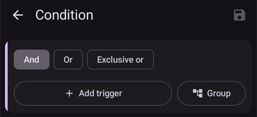
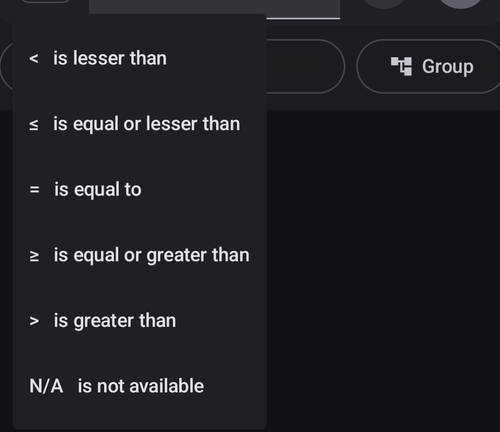

# 自動化

```{contents} In this page
:backlinks: entry
:depth: 2
```

## 什麼是自動化？

"**Automation**" is a feature which can automate tasks in AAPS.

Automation performs specific actions based on one or more conditions or triggers. 觸發可以包括不規則事件，如低或高血糖 (BG) 水準，或設定的負胰島素量 (IOB)。 Automations can also handle recurring events, such as meals or exercise at certain times of day, or when the user is within a specific distance of a GPS location or a Wi-Fi SSID area. 自動化可以根據時間表或每次 Pod 變更執行 AAPS 設定備份。

Automation rules are created and modified from the **Automation** screen (**Manage → Automation**). 每個規則由兩個屬性定義：

- 一個或多個開始行動的條件或“觸發”。

    思考某個時間表、一個事件或 AAPS 中的屬性值

- 一個或多個要執行的動作。

    例如鬧鐘、設定設定檔百分比或在 Pod 變更時匯出 AAPS 設定。


有各種各樣的自動化選項，鼓勵用戶在 AAPS 應用中的自動化進行研究。你也可以在 [**Facebook**](https://www.facebook.com/groups/AndroidAPSUsers) 與 [**Discord**](https://discord.gg/4fQUWHZ4Mw) 上的 AAPS 用戶社團搜尋其他使用者的自動化範例。

## 自動化如何幫助你

1. **Automate recurring tasks:** Automatically executing programmed actions without user interaction.

1. **減少決策疲勞：****自動化**的主要好處是使用戶免於在 **AAPS** 中進行手動干預的負擔。[研究](https://www.ncbi.nlm.nih.gov/pmc/articles/PMC6286423/#ref4)估計，1型糖尿病患者每天需要做出額外的180個決策。**自動化**可以減輕心理負擔，釋放使用者的精神能量來處理生活中的其他事務。

1. **潛在改善血糖控制：** 例如，即使在繁忙的行程或忘記時，**自動化**可以確保在需要時候設置 **臨時目標**。例如，如果一位糖尿病兒童在每週二上午 10 點和每週四下午 2 點有校內體育活動，需要在活動前 30 分鐘執行高**臨時目標**('TT')，則可以通過**自動化**來啟動**臨時目標</0>。 </p></li>

1

**Enabling AAPS to be highly customized** to be more or less aggressive in specific situations, according to a user's preference. 例如，在半夜出現負 **IOB** 時觸發一個暫時降低的 **設定檔** %，表示現有的 **設定檔** 可能過強。 </ol>

以下範例說明了如何透過**自動化**來簡化步驟。

用戶每天早上六點鍛鍊：他需要在早上五點在 AAPS 中手動設置 “臨時目標-活動”。


用戶已設置一個**自動化**，以在早上五點觸發“臨時目標-活動”，確保他們的**血糖**和**體內胰島素**處於最佳狀態，以備下午六點的鍛鍊：


## 開始使用自動化前的關鍵考慮因素

1. 在設置某些自動化之前，你應該對**BG**擁有合理的控制。自動化不應用於彌補不理想的基礎胰島素量、**ISF** 或 **CR** 設置（稍後將進一步討論）。避免設置自動**設定檔切換**來補償， _例如_ 食物引起的**血糖**升高，這些應透過其他策略處理（如 SMBs 等）。

1. 與任何技術一樣，**CGM**'s、**幫浦** 和手機都可能故障：技術問題或傳感器錯誤可能會干擾 **自動化** 動作，並可能需要手動干預。

1. **自動化的要求可能會隨著例行活動而變化**。當在工作/學校/假期之間變換時，請在日曆中設置提醒，以便查看目前哪些**自動化**活動（這些活動易於啟用和停用）。 For example, if you go on holiday, and no longer need an Automation set up for school sports or daily exercise, or need to adjust the timings.

1. **自動化** 之間可能會互相衝突，建議在安全的環境中仔細檢查任何新的**自動化**設定，並瞭解為什麼某個**自動化**可能未如你預期的方式觸發。

1. 如果使用 Autosens，請嘗試使用 **臨時目標** 而不是 **設定檔切換**。**臨時目標**不會將 Autosens 重置為 0，而**設定檔切換**會重置 Autosens。

1. 大多數**自動化**應僅設置為**有限時間**，之後 **AAPS** 可以重新評估並在必要時重複 **自動化**，如果條件仍然滿足。 For example, "start temp target of 7.0 mmol/L for 30 min" or "start **Profile** 110% for 10 min" _and_ "start temp target of 5.0 mmol/L for 10 min". 使用**自動化**來創造永久變更（例如強化的 % 設定檔）有導致低血糖的風險。

## 何時可以開始使用自動化？

通過**目標 10** 後，你將可以啟用**自動化**。

## AAPS 中的自動化在哪裡？

Open **Manage** in the bottom navigation of the main screen and select **Automation**.

## 如何設置自動化？

To set up an **Automation**, press the **+** button on the Automation screen to create a ‘rule’:


* give your ‘rule’ a title (Task name);
* press "**EDIT**" under **Condition**. On the **Condition** screen, choose how the triggers are combined (**And**, **Or**, **Exclusive or**) and press "**Add trigger**":



* add at least one trigger:


* press "**ADD**" under **Action** and select one action:


* save the rule with the **Save** button, and make sure the checkbox left of the rule name is ‘ticked’ to activate the **Automation**:


要停用**自動化**規則，請取消勾選**自動化**名稱左側的框。 The example below shows an **Automation** as either activated (‘ticked') or deactivated (‘unticked’):


在設置 **自動化** 時，你可以先透過在「動作」裡的啟用「通知」選項進行測試。這會觸發**AAPS**顯示通知，而不是自動執行動作。當你確認通知在正確的時間/條件下觸發時，可以更新**自動化**規則，將「通知」替換為「動作」。


```{admonition} Important note
:class: note

**自動化**在循環關閉時仍然是有效的!
```


## When rules are checked

**AAPS** checks all **Automation** rules each time a new glucose reading has been processed, so rules are evaluated at the pace of your CGM, also while the phone screen is off. Rules are also checked when the phone starts charging, when the network or location changes, and when a Bluetooth device connects. Only one check runs at a time, so a rule whose actions take a while (for example a pump command) cannot be executed twice.

## 安全限制

針對**自動化**設置了安全限制：

* A **Temp Target** set by an **Automation** has to be between 72 and 180 mg/dL (or 4 and 10 mmol/L).
* The **Profile Percentage** has to be between 50% and 130%.
* 自動化執行間隔必須至少 5 分鐘（包括首次執行）。

## 正確使用負值

```{admonition} Warning
:class: warning

在**自動化**中選擇負值時小心
```

在**自動化**中的「條件」選擇‘小於’這類負值時，請務必謹慎。例如：



**Example 1:** Creating a Condition **"is lesser than"** "-0.1mmol/L" (or "-2mg/dL") will:

對於任何小於 -0.1（-2）的數字觸發**自動化**。這包括像 -0.2、-0.3、-0.4（-4、-6、-8）等數字。請記住，-0.1（-2）本身**並不**包含在此條件內。 (The condition "is equal or lesser than -0.1mmol/L (-2 mg/dL)" _would_ include -0.1 mmol/L or -2 mg/dL).

**Example 2:** Creating a Condition "is greater than" -0.1mmol/L (-2mg/dL) will:

Trigger an **Automation** for any number which is **greater than** -0.1mmol/L (-2mg/dL). This includes numbers like 0, 0.2, 0.4mmol/L, (0, 4, 8mg/dL) and any other positive number.

在選擇這些條件和數值時，仔細考慮你的**自動化**的具體意圖非常重要。

(automations-automation-triggers)=
## 自動化觸發器


Scroll down to see the rest of the list:


用戶可以選擇各種“觸發”。觸發是執行自動化所必須滿足的條件。以下列表並不完整：

**觸發：** 連接條件

**選項：**

多個條件可以透過以下方式鏈接：
* “和”
* “或”
* “互斥或”（這意味著如果只有一個條件成立，動作將會發生）

**觸發：** 時間 vs. 重複時間

**選項：**

* 時間 = 單次事件
* 循環時間 = 經常發生的事件（例如每週一次、每個工作日等）

**觸發：** 位置

**選項：**

* in [Settings > Automation](#preferences-maintenance-settings), the user can select their required location service.

**觸發：** 位置服務

**選項：**

* 使用被動位置：**AAPS** 只會在其他應用程式請求位置時獲取位置。
* 使用網路位置：你的 Wi-Fi 位置。
* 使用 GPS 定位（注意！這可能會導致過多的電池消耗！

**觸發器：** 幫浦和傳感器資料

* 插管時間觸發：所有幫浦均可用
* 胰島素時間觸發：支援幫浦可用
* 電池時間觸發：支援幫浦可用
* 傳感器時間觸發：始終可用
* Pod 註冊觸發：僅限貼片幫浦可用

請注意，對於所有與時間相關的觸發，平等比較不太可能觸發，因此在這種情況下需要兩個觸發來創建範圍

* 儲備液位觸發：所有幫浦均可用，且比較 "NOT\_AVAILABLE" 不適用於此觸發，因為值始終填入**AAPS**
* 幫浦電池電量觸發：支援幫浦可用，且比較 "NOT\_AVAILABLE" 不適用於此觸發，因為值始終填入**AAPS**

(automations-automation-action)=
## 動作


Scroll down to see the rest of the list:


**動作：**啟動**臨時目標**

**選項：**

* **BG** must be between 72 mg/dL and 180 mg/dL (4 mmol/L and 10 mmol/L)
* **TT** works only if there is no previous Temp Target — **AAPS** adds this automatically as a "**Preconditions: Temp target not exists**" line to the rule

**動作：**停止**臨時目標**

**選項：**

無

**操作:** **設定檔百分比**

**選項：**

* **Profile** must be between 50% and 130%
* 僅在目前設定檔百分比為100%時有效

**Actions:** **Change smoothing**

**選項：**

* select the [smoothing method](../CompatibleCgms/SmoothingBloodGlucoseData.md) to switch to
* runs only if that smoothing method is not already active — **AAPS** adds this automatically as a "**Preconditions: Smoothing … is not active**" line to the rule. Once the selected smoothing is active, the rule is skipped silently.
* Example: combined with the **Sensor age** trigger, switch to **Average smoothing** during the first day of a new sensor and back to **No smoothing** afterwards.

**Actions:** **Note** (in the **Alerts** group of the list)

**選項：**

* select the event to record: **Note**, **Exercise**, **Question**, **Announcement** or **Pump Site Change**, and an optional note. The name of the action changes to the event you select.
* **Duration**: used for **Note**, **Exercise** and **Pump Site Change**. **Question** and **Announcement** have no duration: they record your current BG instead.
* **Pump Site Change** resets the cannula age, as if you had recorded a site change by hand. Example: some pumps (like the Combo) record a reservoir change by themselves, but not the site change. If you always change both together, a rule with **Insulin age** less than 1 hour and **Cannula age** more than 24 hours can record the site change for you.

 

**Actions:** **Send SMS** (in the **Alerts** group)

**選項：**

* enter the text of the message. It is sent to all the phone numbers allowed in the [SMS Communicator](../RemoteFeatures/SMSCommands.md) settings. The SMS Communicator plugin must be enabled.

**Actions:** **Change profile to** (in the **Profile** group)

**選項：**

* select the **Profile** to activate. It is activated at 100%, without timeshift. If this profile is already active, the action does nothing.

**Actions:** **Enable/disable SMB** (in the **Loop & insulin** group)

**選項：**

* choose **On** or **Off**. This changes the **Enable SMB** setting of OpenAPS SMB, exactly as if you had changed it in **Settings**, and stays until you or another rule change it back.

**Actions:** **Autotune profile** (in the **Loop & insulin** group)

**選項：**

* select the profile to tune and the number of days: see [Run Autotune with an automation rule](#autotune-run-autotune-with-an-automation-rule).

**Actions:** **Stop processing** (in the **Loop & insulin** group)

**選項：**

* none. When a rule with this action runs, **AAPS** does not check the rules below it in the list during that run. Add it to a rule that must take priority over the rules below it (see [the order of the Automations](#Automations-the-order-of-the-automations-in-the-list-matters)).

**Actions:** **Run scene**, **Enable scene**, **Disable scene** (in the **Scenes** group)

**選項：**

* select the [scene](Scenes.md) to run, enable or disable.

添加了「動作」後，應透過點擊並調整預設值，將預設數值更改為所需的數字。


(Automations-the-order-of-the-automations-in-the-list-matters)=
## 列表中**自動化**的順序非常重要
 **AAPS**將根據偏好的順序，由**自動化**列表由上往下開始執行規則。例如，如果‘低血糖’ **自動化** 是最重要的**自動化**，高於所有其他規則，那麼這**自動化**應該在用戶的**自動化**列表中出現在最上方，如下所示：


To reprioritize the **Automation** rules, touch and hold the **=** handle on the right side of the rule. 透過移動規則上下來重新排序**自動化**。


## 如何刪除自動化規則

要刪除**自動化**規則，請點擊垃圾桶圖示。


## 自動化範例

以下是**自動化**範例。在 Facebook 討論群組或 Discord 上，可以找到更多有關**自動化**的討論，以及用戶如何個性化他們的**自動化**。以下範例不應被複製，除非使用者對**自動化**的運作方式有充分暸解。

(automations-low-glucose-temp-target)=
### 低血糖臨時目標

This **Automation** triggers an automatic **Temp Target** when **BG** falls below a certain threshold — here, when glucose is lesser than 70 mg/dL, a target of 110 mg/dL is started for 30 minutes:


### 午餐時間臨時目標（包含「位置」）


這個**自動化**是為一名每天在工作時於相同時間吃午餐的用戶設置的，僅僅在用戶位於設定的‘位置’時才觸發。  So if the user is not at work one day, this **Automation** will not activate.

This **Automation** will set a low **Temp Target** (Eating Soon) at 13:00 to drive BG to 90 mg/dL (or 5 mmol/L) in preparation for lunch.

The ‘Trigger’ location has a name, a position (tap **Pick from map**, or use your current location) and a radius in metres, and fires when you are inside (or outside) the area:


由於‘和’連線，只有在‘選擇的時間’並且使用者位於設定位置時，**自動化**才會發生。

The **Automation** will not be triggered on any other time at this location or at this time outside the 50-metre radius around the chosen position.

### Wi-Fi SSID Location Automation

Using a Wi-Fi SSID is a good option to trigger an **Automation** while within range of a specific Wi-Fi network (compared with GPS): it is fairly precise, uses less battery, and works in enclosed spaces where GPS and other location services might not be available.

這裡有另一個範例，設定工作日早餐前的**臨時目標**。


The **Automation** will trigger at 05:30am only on Monday-Friday(2)  
and while being connected to a home Wi-Fi network (3).


It will then set a **Temp Target** of 75 mg/dL for 30 minutes (4). One of the advantages of including the location is that it will not trigger if the user is traveling on vacation, for instance.


Scroll down to see the action: a **Temp Target** of 75 mg/dL for 30 minutes (4).


以下是詳細說明**自動化**觸發條件的截圖：

1) Under the main “AND” (both conditions need to be met to trigger) 1) Recurring time = M,T,W,T,F At 5:30am  
1) Wi-Fi SSID = My_Home_WiFi_Name


(automating-preference-settings-export)=

## 自動化偏好設定匯出

### 不需人員監控的匯出：排程（每日）

顯示自動化觸發條件的截圖：

1) 條件：重複時間 = 週一、週二、週三、週四、週五 上午 8:00 1) 操作：設定匯出（在「治療中的文字」中輸入「每日」）


注意：匯出執行將記錄在照護入口上

### 不需人員監控的匯出：Pod 註冊（僅限修補版幫浦）

顯示自動化觸發條件的截圖：

1) 條件：Pod 註冊 1) 操作：設定匯出（在「治療中的文字」中輸入「Pod 註冊：設定匯出」）


注意：匯出執行將記錄在照護入口上. 注意：如果你在此之前未執行手動設定匯出，自動化將**完全不會**觸發。 See [Settings → Maintenance](#preferences-maintenance-settings) for proper activation of unattended settings export.


## 自動化日誌

**AAPS** shows a log of the most recent **Automation** events at the bottom of the **Automation** screen, below the rules. Use it to verify that your rules triggered when you expected them to.

In the example below, the **Low glucose temp target** rule (1) (see [Low Glucose Temp Target](#automations-low-glucose-temp-target) above) is enabled. The log (2) shows that at 03:09 PM, glucose fell below 70 mg/dL and the rule triggered:
* the action was "Start temp target: 110mg/dL@30 min": a **Temp Target** of 110 mg/dL for 30 minutes;
* **OK** at the end means that the action was carried out successfully.


(automations-troubleshooting)=

## 問題排除

* 問題：__我的自動化沒有被 AAPS 觸發嗎？__

Check that the box left of the **Automation** name is ‘ticked’ to ensure the rule is activated:


* 問題：__我的自動化順序不正確的觸發。__

Check your rule prioritization order as discussed above here.

* Problem: __A condition shows "Unknown trigger … - never true".__

The rule contains a trigger that this version of **AAPS** cannot read, for example after you went back to an older version or imported settings from a newer one. Such a trigger is never true, so the rule does not run. It is kept unchanged, so a newer version can still use it. Edit the rule and replace the trigger, or update **AAPS**.

## 自動化的替代方案

對於進階使用者，還有其他選擇，例如使用 IFTTT 或第三方 Android 應用程式 Automate 來自動化任務。 
