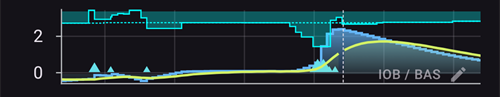

# AAPS 的主要功能

## 循環模式

循環狀態會在主畫面以下列其中一個圖示顯示。

**AAPS** offers several loop modes, such as Closed Loop (1), Low Glucose Suspend (LGS - 2) and Open Loop (3).

See [AAPS screens > The main screen > Loop status](#AapsScreens-loop-status) for information on how to select the loop mode and on the other icons in the picture (4 to 6).

(KeyAapsFeatures-OpenLoop)=

### 開放循環

**AAPS**持續評估所有可用資料（IOB、COB、BG...）並在必要時提供治療建議（臨時基礎率），告訴你如何調整治療。

這些建議不會自動執行（如封閉迴路）。建議必須由使用者手動輸入到幫浦中（如果使用虛擬幫浦）或透過按鈕輸入，如果**AAPS**連接到真實幫浦。

When **AAPS** has a suggestion, a **Loop** entry with a badge appears in the bottom navigation of the main screen. Press it to read the suggestion ("Accept new temp basal") with its rate, duration and reason, then press **Perform** to carry it out:

A suggestion is only valid for a few minutes. If it is older than about 9 minutes, or if the loop has been suspended or the pump disconnected in the meantime, **AAPS** refuses it and nothing is sent to the pump (*"This suggestion is too old. Nothing was sent to the pump. Wait for the next one."*). Wait for the next suggestion.

此選項是用於了解**AAPS**的運作方式或如果你使用不支援的幫浦。無論你在這裡做出什麼選擇，直到**[目標5](#objectives-objective5)**結束之前，你都將處於開放迴路中。

(KeyAapsFeatures-LGS)=

### 低血糖暫停 (LGS)

在此模式中，[maxIOB](#Open-APS-features-maximum-total-iob-openaps-cant-go-over) 設定為零。

這意味著如果血糖下降，**AAPS** 可以為你減少基礎胰島素。但是，如果血糖上升，則不會進行自動校正。你的基礎率將保持在你當前**設定檔**中定義的值。只有當 IOB（來自先前的低血糖暫停）為負值時，才會額外注射胰島素來降低**血糖**。

此模式自 **[目標 6](#objectives-objective6)** 起可用。

Besides selecting it yourself, **AAPS** can also switch to this mode on its own: while you are working on **[Objective 6](#objectives-objective6)**, and whenever it detects duplicate BG readings (see [BG warning sign](#aaps-screens-bg-warning-sign)).

(KeyAapsFeatures-ClosedLoop)=

### 閉合循環

**AAPS** 持續評估所有可用的資料（IOB、COB、血糖……）並在必要時自動調整治療（*即* 無需你進一步干預）以達到設定的 [目標範圍或數值](#profile-glucose-targets) （注射給藥、臨時基礎率、停用胰島素以避免低血糖等）。

閉環系統在多個安全限制內運行，可以個別設置。

閉環系統僅在你達到 **[目標 7](#objectives-objective7)** 或更高時，並使用支援的幫浦時才能使用。

(autosens)= (Open-APS-features-autosens)=

## 自動敏感度調整 (Autosens)

- Autosens 是一種算法，可以觀察血糖的偏差（正/負/中性）。
- 他會根據這些偏差，試圖找出你對胰島素的敏感度或抗性。
- 在 **OpenAPS** 中的 oref 實作，基於過去 24 小時和 8 小時的資料運作。他會使用其中較敏感的資料來進行調整。
- 如果用戶曾經使用過 oref1，他們可能會注意到系統對變化的反應可能不如預期動態，這是由於 24 小時或 8 小時敏感度的不同。
- 更換套管或更改設定檔時，會將 Autosens 比例重置回 100%（設定檔持續時間切換不會重置 Autosens）。
- Autosens 會調整你的基礎胰島素和胰島素敏感因子（ISF），模仿設定檔切換的效果。
- 如果在一段延長的時間內不斷攝取碳水化合物，Autosens 在該期間的效果會較差，因為碳水化合物不包括在**BG**變化量的計算中。
- The deviations are converted into a **sensitivity ratio** (a percentage): a ratio below 100% means AAPS thinks you're more sensitive to insulin than your **Profile** assumes (so it lowers effective basal and ISF), while a ratio above 100% means you're more resistant (so it raises them).
- By default this ratio is kept between 0.7 (70%, more sensitive) and 1.2 (120%, more resistant), so a run of unusual data can't push your dosing too far from your **Profile**. These bounds can be adjusted in Sensitivity Detection's advanced settings.
- Autosens and [Autotune](../AdvancedOptions/Autotune.md) address the same underlying problem on different timescales: Autosens nudges your *live* dosing minute-to-minute based on the last 8-24h, while Autotune slowly rewrites your *Profile* itself based on weeks of history. Running both is normal and expected — they complement rather than duplicate each other.

*For the full technical treatment of the autosens algorithm, see [OpenAPS's Autosens documentation](https://openaps.readthedocs.io/en/latest/docs/Customize-Iterate/autosens.html).*

(Open-APS-features-super-micro-bolus-smb)=

## 超微量注射 (Super Micro Bolus, SMB)

**SMB**，**超微量注射**的簡稱，是自 2018 年起於 Oref1 算法中引入的 OpenAPS 功能。與**AMA**不同，**SMB**並不使用臨時基礎率來控制葡萄糖水平，而主要使用**小型超微量注射**。在**AMA**會使用臨時基礎率添加 1.0 IU 胰島素的情況下，**SMB**則會以**5 分鐘的間隔**在小步驟中提供多次超微量注射，例如 0.4 IU、0.3 IU、0.2 IU 和 0.1 IU。同時（為了安全），實際基礎率會在一段時間內設為 0 IU/h，以防止過量注射（稱為 **“零臨時基礎率”**）。這使得系統能夠比**AMA**中的臨時基礎率增加更快速地調整血糖。

感謝 SMB，對於僅含“緩慢”碳水化合物的餐點，可能只需通知系統計畫中的碳水化合物量，並將其餘的留給**AAPS**。然而，這可能會導致餐後血糖高峰，因為無法提前注射。或者如果有必要的話，你可以進行預先注射，給予**開始注射**，此注射**僅部分**覆蓋碳水化合物（例如預估量的 2/3），並讓**SMB**提供其餘的胰島素。

SMBs are shown on the [IOB graph](#aaps-screens-iob) with blue triangles. [Press and hold](#aaps-screens-graph-press-and-hold) the graph at a triangle to see how much insulin was delivered, or use the [Treatments history](#aaps-screens-treatments).

**SMB 的** 功能包含一些安全機制：

1. **單次最大的 SMB 劑量**  
  單次最大的 SMB 劑量只能是以下最小值：
  
        * value corresponding to the current basal rate (as adjusted by autosens) for the duration set in "Max minutes of basal to limit SMB to", e.g. basal quantity for the next 30 minutes, or
        * half the amount of insulin currently required, or
        * the remaining portion of your maxIOB value in the settings.
      

2. **低臨時基礎速率**  
  低臨時基礎速率（稱為「低臨時」）或臨時基礎速率為 0 U/h（稱為「零臨時」）在 **SMB** 中會更常被啟動。這是出於安全理由的設計，若 **設定檔** 正確設定，則沒有任何負面影響。在主圖上，IOB 曲線（黃色細線）比臨時基礎速率的變化更有意義。

3. **未通報的餐點**  
  額外計算以預測血糖的變化，例如透過 **UAM**（未通報的餐點）。即使用戶未手動輸入碳水化合物，**UAM** 也能自動檢測因餐點、腎上腺素或其他影響導致的血糖水平顯著上升，並嘗試透過 **SMB** 進行調整。為了安全起見，這也能反向運作，如果血糖意外快速下降，系統可以提前停止 SMB。這就是為什麼 UAM 應該在 SMB 中始終處於啟用狀態的原因。

SMB doesn't decide on its own that insulin is needed — it draws on the same blended BG predictions (eventual BG, zero-temp, COB, UAM) described in [how AAPS turns predictions into a dosing decision](#aaps-screens-how-predictions-become-a-dosing-decision). SMB and zero-temping are simply the two tools AAPS uses to act on that decision.

**你必須開始使用[目標 9](#objectives-objective9)來使用 SMB。**

See also [OpenAPS's oref1/SMB documentation](https://openaps.readthedocs.io/en/latest/docs/Customize-Iterate/oref1.html#understanding-super-micro-bolus-smb) for the full technical treatment, or [Tim's info on SMB](https://www.diabettech.com/artificial-pancreas/understanding-smb-and-oref1/) for a community write-up.

OpenAPS SMB 的設定如下。

(Open-APS-features-max-u-h-a-temp-basal-can-be-set-to)=

### 臨時基礎可以設置的最大 U/h

此安全設定決定了胰島素幫浦所能提供的最大臨時基礎率。這也被稱為 **最大基礎**。

該值以每小時單位（U/h）測量。建議將此設為合理的數值。設置此參數的良好建議為：

**MAX-BASAL = 最高基礎速率 × 4**

例如，如果你的設定檔最高基礎率為0.5 U/h，你可以將他乘以4得到2 U/h的值。

**AAPS** limits this value as a 'hard limit' according to [Settings > Safety > Patient age](#preferences-patient-type). 規定上限如下：

- 兒童：2
- 青少年：5
- 成人：10
- 胰島素抗性成人：12
- 孕婦：25

*請參閱 [規定上限總覽](#Open-APS-features-overview-of-hard-coded-limits)。*

(Open-APS-features-maximum-total-iob-openaps-cant-go-over)=

### 最大總 IOB 是 OpenAPS 不可超過的上限

這個數值決定了**體內胰島素**（基礎與注射的體內胰島素）在運行閉環模式下**AAPS**所維持的最大值。這也被稱為**maxIOB**。

如果當前的體內胰島素（例如在用餐注射後）高於定義的值，循環將停止給藥胰島素，直到體內胰島素限制低於設定的值。

設置此參數的一個好做法是：

      maxIOB = 平均餐前注射 + 3倍最大每日基礎量
    

當調整你的**max-IOB**時，要小心和耐心。每個人的情況都不同，這也可以依賴於平均每日總劑量（TDD）。

**AAPS** limits this value as a 'hard limit' according to [Settings > Safety > Patient age](#preferences-patient-type). 規定上限如下：

- Child: 7
- Teenager: 13
- Adult: 22
- Insulin resistant adult: 30
- Pregnant: 70

*請參閱 [規定上限總覽](#Open-APS-features-overview-of-hard-coded-limits)。*

注意：使用**SMB**時，**max-IOB**的計算方式與AMA不同。在**AMA**中，maxIOB是基礎**體內胰島素**的安全參數，而在SMB模式中，它也包括注射的體內胰島素。

### Use dynamic sensitivity

這是[動態胰島素敏感度](../DailyLifeWithAaps/DynamicISF.md)功能。啟用後，新的設定將可用。設定在[動態胰島素敏感度](#dyn-isf-preferences)頁面上說明。

### Use Autosens

這是[自動敏感度調整](#Open-APS-features-autosens)功能。 When using DynamicISF, Autosens cannot be used, since they are two different algorithms altering the same variable (sensitivity).

Autosens 會觀察血糖的偏差（正向/負向/中性）。它會根據這些偏差來判斷你對敏感度的適應力，並根據這些偏差調整基礎率和 ISF。

啟用後，新的設定將可用。

#### 敏感度提升目標

如果啟用此選項，當偵測到敏感度（低於 100%）時，敏感度檢測（autosens）可以提高目標。在這種情況下，您的目標將根據檢測到的敏感度百分比而提高。

If the target is modified due to sensitivity detection, it will be displayed with a green background on your main screen.

This setting is available when one of "Use dynamic sensitivity" or "Use Autosens" are enabled.

#### 抗性降低目標

如果啟用此選項，當偵測到抗性（超過 100%）時，敏感度檢測（autosens）可以降低目標。在這種情況下，您的目標將根據檢測到的抗性百分比而降低。

This setting is available when one of "Use dynamic sensitivity" or "Use Autosens" are enabled.

### 啟用 SMB

啟用此功能以使用 SMB 功能。如果停用，將不會給予**SMBs**。

啟用後，新的設定將可用。

(Open-APS-features-enable-smb-with-high-temp-targets)=

#### Enable SMB with high temp target

If this setting is enabled, **SMBs** will still be delivered even if the user has selected a high **Temp Target** (defined as 100 mg/dL or 5.6 mmol/L and above, regardless of **Profile** target). Use caution when enabling it: **SMBs** can become overly aggressive if your settings are not well tuned or if your **Profile** is subject to frequent variation (for example, with children).

此選項旨在當設定被停用時，停用 SMBs。 For example, if this option is disabled, **SMBs** can be disabled by setting a **Temp Target** of 100 mg/dL or 5.6 mmol/L and above. This option will also disable **SMBs** regardless of what other condition is trying to enable SMB — apart from a low **Temp Target** such as **Eating Soon** (or any **Temp Target** of 98 mg/dL or 5.4 mmol/L and below), which may still deliver **SMBs** to drive **BG** towards the target.

If this setting is enabled, **SMB** will only be enabled with a high temp target if **Enable SMB with low temp target** is also enabled.

(Open-APS-features-enable-smb-always)=

#### 始終啟用 SMB

If this setting is enabled, SMB is always enabled (independent of COB, temp targets or boluses). 如果啟用此設定，以下的其他啟用設定將不會生效。然而，如果**Enable SMB with high temp targets**被停用，並設定高溫目標，則 SMBs 將被停用。

此設定僅在**AAPS**檢測到您正在使用[可靠的血糖來源](#GettingStarted-TrustedBGSource)且具有高級過濾時可用。由於在傳感器故障的情況下存在無限重複舊血糖數據的風險，FreeStyle Libre 1 不被視為可靠來源。

吵雜的資料可能會導致**AAPS**認為血糖在快速上升，結果會施用不必要的 SMBs。有關雜訊和數據平滑的更多信息，請參閱[此處](../CompatibleCgms/SmoothingBloodGlucoseData.md)。

#### 啟用具有 COB 的 SMB

如果啟用此設定，在 COB 大於 0 時會啟用 SMB。

如果“啟用 SMB 始終”開啟，則此設定將不可見。

#### Enable SMB with low temp target

If this setting is enabled, SMB is enabled when a temp target is set (eating soon, activity, hypo, custom). If this setting is enabled but **Enable SMB with high temp target** is disabled, SMB will be enabled when a low temp target is set (98 mg/dL or 5.4 mmol/L and below) but disabled when a high temp target is set.

如果“啟用 SMB 始終”開啟，則此設定將不可見。

#### 啟用碳水後的 SMB

如果啟用，在宣告碳水化合物後的 6 小時內，SMB 將被啟用，即使 COB 達到 0。

出於安全原因，此設定僅在**AAPS**檢測到您正在使用可靠的血糖來源時可用。如果“啟用 SMB 始終”開啟，則此設定將不可見。

此設定僅在**AAPS**檢測到您正在使用[可靠的血糖來源](#GettingStarted-TrustedBGSource)且具有高級過濾時可用。由於在傳感器故障的情況下存在無限重複舊血糖數據的風險，FreeStyle Libre 1 不被視為可靠來源。

吵雜的資料可能會導致**AAPS**認為血糖在快速上升，結果會施用不必要的 SMBs。有關雜訊和數據平滑的更多信息，請參閱[此處](../CompatibleCgms/SmoothingBloodGlucoseData.md)。  
如果“啟用 SMB 始終”開啟，則此設定將不可見。

#### SMB interval

此功能限制 SMB 的頻率。此數值決定 SMB 之間的最小時間。注意，每次接收到葡萄糖值時循環將運行（通常是 5 分鐘）。減去 2 分鐘以為循環提供額外時間來完成。例如，如果您希望每次循環運行時給予 SMB，將其設定為 3 分鐘。

預設值：3 分鐘。

(Open-APS-features-max-minutes-of-basal-to-limit-smb-to)=

#### Max minutes of basal to limit SMB

這是一項重要的安全設定。此數值決定在設定的時間內，由於 COB 覆蓋的基礎胰島素的量可以給予多少 SMB。

增加此數值將使 SMB 更積極。您應先從 30 分鐘的預設值開始。經過一段時間的體驗後，按 15 分鐘的增量增加數值，並觀察多次用餐的效果。

建議不要將數值設定高於 90 分鐘，因為這會導致演算法無法調整低至 0 U/h 基礎率的血糖（即“零臨時目標”）。您還應設置警報，特別是在測試新設定時，這樣可以在低血糖之前提前警告您。

預設值：30 分鐘。

#### UAM max minutes of basal to limit SMB

This setting allows you to adjust the strength of SMB during UAM, when there are no more carbs.

Default value : the same as **Max minutes of basal to limit SMB**.

此設定只有在「啟用 SMB」和「啟用 UAM」開啟的情況下可見。

(enable-uam)=

### 啟用 UAM

啟用此選項後，SMB 演算法可以識別未通知的餐點。如果您忘記告訴 **AAPS** 您的碳水化合物或錯誤估算您的碳水化合物，並且輸入的碳水化合物數量不正確，或者如果餐點中含有大量脂肪和蛋白質，持續時間超過預期，這將很有幫助。如果沒有輸入任何碳水化合物，UAM 可以識別由碳水化合物、腎上腺素等引起的快速葡萄糖上升，並試圖使用 SMB 來調整。這也以相反的方式運作：如果出現快速葡萄糖下降，可以更早停止 SMB。

**因此，在使用 SMB 時，應始終啟用 UAM。**

(key-aaps-features-minimal-carbs-required-for-suggestion)=

### Carbs required threshold

顯示碳水化合物建議警示所需的最小克數。當參考設計檢測到需要碳水化合物時，將建議額外攝入碳水化合物。在這種情況下，您將收到通知，該通知可以延遲 5、15 或 30 分鐘。

如果有需要，碳水化合物需求通知可以推送到 Nightscout，屆時會顯示並廣播公告。

In any case, the required carbs will be displayed in the COB section on your main screen.

### 進階設定

For the full parameter reference (including settings not covered here), see [OpenAPS's preferences and safety settings documentation](https://openaps.readthedocs.io/en/latest/docs/While%20You%20Wait%20For%20Gear/preferences-and-safety-settings.html).

**始終使用短期平均變化量而不是簡單資料** 如果您啟用此功能，**AAPS**將使用過去 15 分鐘的短期平均變化量/血糖，這通常是最近三個數值的平均值。 This helps **AAPS** to be steadier with noisy data sources like xDrip and Libre.

**每日安全乘數上限** 這是一個重要的安全限制。預設設定（不太需要調整）為 3。這代表著 **AAPS** 永遠無法設定臨時基礎率超過使用者在其幫浦和/或個人設定中編程的每小時最高基礎率的 3 倍。例子：如果您的最高基礎率為 1.0 U/h，且每日安全乘數上限為 3，則 **AAPS** 可以設置的最大臨時基礎率為 3.0 U/h（= 3 x 1.0 U/h）。

預設值：3（除非您真的需要並且知道自己在做什麼，否則不應更改）

**當前基礎安全乘數** 這是另一個重要的安全限制。預設設定（同樣不太需要調整）為 4。這代表著 **AAPS** 永遠無法設定臨時基礎率超過使用者在其幫浦和/或個人設定中編程的目前每小時基礎率的 4 倍。

預設值：4（除非您真的需要並且知道自己在做什麼，否則不應更改）

* * *

(Open-APS-features-auto-isf)=

## Auto ISF

**Auto ISF** is an **experimental** algorithm for advanced users. It is built on OpenAPS SMB and adds rules that make the insulin sensitivity factor (ISF) stronger or weaker depending on how your glucose behaves.

It is a development feature: it can only be switched on in a [dev build](../AdvancedOptions/DevBranch.md) with **Engineering Mode** enabled. In a regular release build it stays forced off and is therefore not shown in **Configuration → APS**. Completing the [Objectives](../SettingUpAaps/CompletingTheObjectives.md) does not unlock it.

After selecting it, its **Settings** contain the OpenAPS SMB settings plus an **AutoISF settings** group:

- **Enable AutoISF**: turns the ISF adjustments on. Without it, the algorithm behaves like OpenAPS SMB.
- **AutoISF min** and **AutoISF max**: how weak and how strong the ISF is allowed to become, in the same way as the Autosens limits. With the default value 1.0 the effect is switched off.
- **Weights**: each one drives one rule, and the default value 0.0 switches the rule off. 
  - while glucose **accelerates**, ISF is strengthened (more insulin);
  - while glucose **decelerates**, ISF is weakened (less insulin);
  - while glucose is **below target**, ISF is weakened;
  - while glucose is **above target**, ISF is strengthened;
  - a **post-prandial** weight and a **duration** weight act after meals and when glucose stays high for a long time.
- **SMB delivery ratio** (with a minimum, a maximum and a BG range): what share of the insulin required can be delivered as SMB.
- **SMB max range extension**: by what factor the usual SMB size limit ([max minutes of basal](#Open-APS-features-max-minutes-of-basal-to-limit-smb-to), normally 120 minutes) may be exceeded. The default value 1 changes nothing; up to 5 is possible. Increase this experimental value slowly and with caution.
- **IOB threshold percent**: the percentage of max IOB above which SMBs are disabled.

    {admonition} Only for experienced users
    :class: danger
    With its default values Auto ISF changes nothing. Every value you raise makes **AAPS** more aggressive. Change one value at a time, in small steps, and watch the result for several days. Be extremely careful with an **AutoISF max** above 2.5.

(Open-APS-features-advanced-meal-assist-ama)=

## 進階餐食輔助 (AMA)

AMA，"進階餐點輔助" 的簡稱，是 2017 年的 OpenAPS 功能（oref0）。 OpenAPS 進階餐點輔助（AMA）允許系統在進餐注射後更快地進行高溫控制，如果您可靠地輸入碳水化合物。

您可以在 [OpenAPS 文件](https://newer-docs.readthedocs.io/en/latest/docs/walkthrough/phase-4/advanced-features.html#advanced-meal-assist-or-ama) 中找到更多資訊。

### 臨時基礎率的最大 U/h (OpenAPS "最大基礎率")

此安全設定幫助 **AAPS** 永遠不會給予危險的高基礎率，並將臨時基礎率限制在 x U/h。建議將此設為合理的數值。一個好的建議是將您設定檔中的最高基礎率乘以 4，最低乘以 3。例如，如果您設定檔中的最高基礎率為 1.0 U/h，您可以將其乘以 4 獲得 4 U/h，並將 4 設為您的安全參數。

您不能選擇任何值：出於安全原因，存在一個「固定限制」，這取決於患者年齡。在 AMA 中的 maxIOB 固定限制低於 SMB。對於兒童，這個值是最低的，而對於胰島素抵抗的成年人，則是最高的。

在 **AAPS** 中固定編碼的參數是：

- 兒童：2
- 青少年：5
- 成人：10
- 胰島素抗性成人：12
- 孕婦：25

*請參閱 [規定上限總覽](#Open-APS-features-overview-of-hard-coded-limits)。*

### OpenAPS 可注射的最大基礎 IOB [U]（OpenAPS "最大 IOB"）

這個參數限制了 **AAPS** 仍然運行時的最大基礎 IOB。如果 IOB 更高，則停止給予額外的基礎胰島素，直到基礎 IOB 降低到限制以下。

預設值為 2，但您應該慢慢提高這個參數，以觀察其對您的影響以及適合的值。這因人而異，並且還取決於每日總劑量（TDD）的平均值。出於安全原因，存在一個限制，這取決於患者年齡。在 AMA 中的 maxIOB 固定限制低於 SMB。

- 兒童：3
- 青少年：5
- 成人：7
- 胰島素抗性成人：12
- 孕婦：25

*請參閱 [規定上限總覽](#Open-APS-features-overview-of-hard-coded-limits)。*

### Use Autosens (AMA)

在這裡，您可以選擇是否要使用 [敏感度檢測](../DailyLifeWithAaps/SensitivityDetectionAndCob.md) 的自動敏感度調整功能。

### Autosens adjust targets

如果您啟用此選項，自動敏感度調整也可以調整目標（除了基礎和 ISF）。這使得 **AAPS** 的工作更「積極」或否。實際目標可能會更快達成。

### 進階設定

- Normally you do not have to change the settings in this dialog!
- If you want to change them anyway, make sure you understand what you are doing — see the full parameter reference in [OpenAPS's preferences and safety settings documentation](https://openaps.readthedocs.io/en/latest/docs/While%20You%20Wait%20For%20Gear/preferences-and-safety-settings.html).

**始終使用短期平均變化量而不是簡單資料** 如果您啟用此功能，**AAPS**將使用過去 15 分鐘的短期平均變化量/血糖，這通常是最近三個數值的平均值。 This helps **AAPS** to work more steady with noisy data sources like xDrip and Libre.

**每日安全乘數上限** 這是一個重要的安全限制。預設設定（不太需要調整）為 3。這表示 **AAPS** 永遠不會被允許設定一個臨時基礎速率，其數值超過使用者幫浦中所設定的最高每小時基礎速率的 3 倍。例子：如果您的最高基礎率為 1.0 U/h，且每日安全乘數上限為 3，則 **AAPS** 可以設置的最大臨時基礎率為 3.0 U/h（= 3 x 1.0 U/h）。

預設值：3（除非您真的需要並且知道自己在做什麼，否則不應更改）

**當前基礎安全乘數** 這是另一個重要的安全限制。預設設定（同樣不太需要調整）為 4。這表示 **AAPS** 永遠不會被允許設定一個臨時基礎速率，其數值超過使用者幫浦中當前每小時基礎速率的 4 倍。

預設值：4（除非您真的需要並且知道自己在做什麼，否則不應更改）

**注射延遲 DIA 除數** 「注射延遲」（bolus snooze）功能會在餐前注射後發揮作用。 **AAPS** 不會在進餐後的 DIA 期間設置低臨時基礎率，該期間由「注射延遲」參數劃定。預設值為 2。這代表著在 DIA 為 5 小時的情況下，「注射延遲」將為 5 小時 : 2 = 2.5 小時。

預設值：2

* * *

(Open-APS-features-overview-of-hard-coded-limits)=

## 固定限制總覽

|                     | 兒童  | 青少年 | 成人  | 胰島素抗性成人 | 孕婦  |
| ------------------- | --- | --- | --- | ------- | --- |
| 最大注射量 (MAXBOLUS)    | 5   | 10  | 17  | 25      | 60  |
| 最小作用時間 (MINDIA)     | 5   | 5   | 5   | 5       | 5   |
| 最大作用時間 (MAXDIA)     | 9   | 9   | 9   | 9       | 10  |
| 最小碳水比 (MINIC)       | 2   | 2   | 2   | 2       | 0.3 |
| 最大碳水比 (MAXIC)       | 100 | 100 | 100 | 100     | 100 |
| 最大 IOB (MAXIOB_AMA) | 3   | 5   | 7   | 12      | 25  |
| 最大 IOB (MAXIOB_SMB) | 7   | 13  | 22  | 30      | 70  |
| 最大基礎率 (MAXBASAL)    | 2   | 5   | 10  | 12      | 25  |