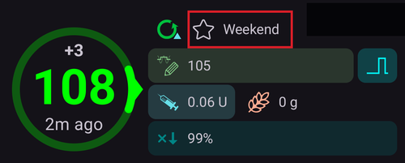

# 設定檔切換及設定檔百分比

本節將解釋什麼是**設定檔切換**和**設定檔百分比**。 You can learn how to create a **Profile** in [Your AAPS Profile](#your-aaps-profile-create-and-edit-profiles).

在開始你的**AAPS**之旅時，你需要創建一個**設定檔**，了解如何執行**設定檔切換**，並學習**AAPS**中**設定檔百分比**的影響。**設定檔切換**或**設定檔百分比**的功能對於以下情況特別有益：

- 月經週期 - 可以在**自動化**中設定百分比調整，以便**AAPS**適應不同階段的荷爾蒙週期和預期的胰島素抗性。

- 運動 - 可以在**自動化**中設定百分比調整以減少基礎胰島素攝入。

- 夜班或輪班工作者 - 透過更改設定檔中的小時數來調整設定檔，以符合使用者晚睡或早起的時間變化。

為什麼使用**設定檔百分比**而非臨時基礎率調整？為了更有效地應用，**設定檔百分比**會對基礎率、ISF 和 I:C 進行比例減少或增加。這確保**AAPS**在調整使用者的胰島素攝入時計算出平衡的方式。如果僅僅降低基礎率，但演算法繼續應用相同的 ISF 和 I:C 比率，對使用者的**設定檔**幾乎無益。

(ProfileSwitch-change-percentage)=

## Change the Profile Percentage from the main screen

You need at least one saved **Profile**. A **Profile Percentage** is always applied through a **Profile Switch**: you activate a **Profile** again, this time with a percentage.

```{admonition} Coming from AAPS 3? :class: note A long press on the profile name no longer opens the profile switch dialog. **Tap** the profile name, then tap the round **▶** button at the bottom right: it opens the same settings (percentage, duration, Activity temp target).

    <br />1. On the main screen, **tap the profile name** (next to the star icon). The [Profile screen](#ProfileSwitch-manage-v4) opens on the card of the running **Profile**, marked **ACTIVE**.
    
       
    
    2. To keep the same **Profile**, leave the **ACTIVE** card selected. To change **Profile** at the same time, swipe to another card.
    3. Tap the round **▶** button (**Activate**) at the bottom right. The **Activate** screen opens.
    4. Set the **Percentage** with **−** / **+** (steps of 5 %), or type it in (30 to 250 %). The field always starts at **100 %**: it does not show the percentage that is running now. For example, enter **80** for 20 % less insulin, or **120** for 20 % more.
    5. Set the **Duration** in minutes:
       * **0** keeps the new percentage until you make another **Profile Switch**;
       * any other value ends the switch after that time, and **AAPS** goes back to the **Profile** that was running before.
    
       
    
    6. Tap **▶ Activate** at the bottom of the screen. Check the summary in the **Profile switch** dialog and tap **OK**.
    
       
    
    Back on the main screen, the profile name shows the percentage and the remaining time, for example *Normal (80%) (59')*, and turns yellow while a switch with a duration is running. A star marks the switch on the glucose graph. See [the main screen](#aaps-screens-profile--target).
    
    
    
    To **go back to 100 %** before the end, repeat the steps and keep **Percentage** at 100 and **Duration** at 0.
    
    ```{admonition} One-tap percentages
    :class: tip
    If you often use the same percentage (sport, illness), add a [Profile shortcut](#profile-shortcuts) to the Quick Launch bar, or create a [scene](Scenes.md). Both apply a profile with a preset percentage and duration in one tap.
    

(ProfileSwitch-manage-v4)=

## Managing and activating profiles (Manage → Profile)

In **AAPS** v4 profiles are managed and activated from the **Manage** screen (bottom navigation) → **Profile** (*“Manage and activate profiles”*).

The Profile screen shows your profiles as a **swipeable card carousel**. The card of the running profile is marked **ACTIVE** and shows its total daily basal (e.g. *∑ 30.15 U*). Below the selected card you see that profile's details — **Units**, **Insulin** type, and the **IC**, **ISF**, **basal** and **target** schedules with graphs.


The buttons at the bottom act on the **selected** profile: **➕ Add**, **✏️ Edit**, **⧉ Clone** and **‘️ Delete**, and the round **▶ Activate** button on the right. For how to fill in the four schedules in the editor (IC / ISF / BAS / TARG), see [Create and edit Profiles](#your-aaps-profile-create-and-edit-profiles).

**⧉ Clone** uses the two-squares icon often used for *copy*, but there is nothing to paste: it makes the duplicate in one step. Confirm *Clone profile "Normal"?* and a new profile named *Normal copy* is added at the end of the carousel and selected, ready for **✏️ Edit** (where you can also rename it). This is not the same as cloning a past **Profile Switch** from the Treatments history, which creates a new profile *with the percentage and time shift applied*. See [Keep a profile switch for later use](#ProfileSwitch-keep-for-later).

(ProfileSwitch-read-only-mode)= **Only the ▶ Activate button?** Your settings are protected, so the screen opens read-only. Tap the **✏️ pencil** in the top bar and enter your settings password. See [Settings protection now also locks the management screens](#v4changes-read-only-management).

### Reordering profiles

If you have more than one profile you can choose their order in the carousel: tap the **Reorder** icon (⇅, two arrows pointing up and down) in the top bar. The page indicator is replaced by **◀ / ▶ move buttons** with a *position / total* readout — step the centred card earlier or later, then confirm with **✓** (or discard with **✕**). The new order is saved once, when you confirm.


### Activating a profile

Select a profile and tap **▶ Activate**. The **Activate** screen lets you tailor how the **Profile Switch** is applied:


- **Percentage** (30–250 %, starts at 100 % every time) — scale the whole profile. 100 % uses it as-is; for example 70 % reduces basal and the calculated insulin dose (both meal boluses and corrections) by 30 %. It does not change your glucose targets or carb absorption. See [Profile Percentage](#profile-percentage) for the full effect.
- **Duration** (0–10080 minutes, that is up to 7 days) — how long the switch lasts. **0 = indefinite** (until you switch again); a non-zero value reverts to the previous profile when it ends.
- **Temporary target / Activity** — appears only when you set a **Duration** and a **Percentage** below 100 %. Switch it on to also start an [Activity temp target](#TempTargets-activity-temp-target) for the same duration, as you would before exercise.
- **Time shift** — shows *0h*; tap **Change** to move the schedule forward or back by up to 23 hours (useful for shift work or travel). See [Time shift](#ProfileSwitch-ProfilePercentage-time-shift-of-the-circadian-percentage-profile).
- **Reuse** — appears when the running switch has a percentage other than 100 % or a time shift, for example **Reuse 80% 0h**. Tap it to fill in the same percentage and time shift, for instance to prolong a switch that is about to end.
    
    

- **Time** — *Now* by default. You can pick another time, up to 24 hours before or after now. A switch set in the future starts at that time; an Activity temp target set with it then also starts at that time.
    
    

- **Notes** — only shown if [Show notes in dialogs](#Preferences-show-notes-field-in-treatments-dialogs) is on.

If the basal rates at the chosen percentage are not compatible with your pump, a warning appears at the top and **▶ Activate** stays disabled: choose another percentage.

Tap **▶ Activate**, then **OK** in the confirmation dialog. The running profile then carries the **ACTIVE** badge on its card.

```{admonition} Your pump may round the basal rates :class: note Each pump can only give basal rates in its own steps (for example 0.05 U/h), so it rounds the rates of your **Profile**. **AAPS** then uses the basal the pump really gives, so IOB and TDD stay correct. If the pump gives a little more or less insulin per day than your **Profile**, the notice *"Basal profile in pump updated"* tells you how much, for example *"it gives 10.00 U per day instead of 10.12 U"*.

If the pump reports a basal that is far from your **Profile**, **AAPS** keeps the **Profile** basal and asks you to check the basal rates in the pump.

    <br />```{admonition} Percentage and time shift make one profile go a long way
    :class: note
    Rather than building many similar profiles, keep one base profile and apply it at a different **percentage** or **time shift** for recurring situations (illness, exercise, travel). This is exactly what [scenes](Scenes.md) automate.
    

A profile switch is not limited to this screen. The same switch can also be triggered from a **Wear OS watch**, a paired **client** (see [Master ↔ Client control](../RemoteFeatures/ClientMasterControl.md)), a **[scene](Scenes.md)**, or an **Automation** rule.

## 設定檔百分比

使用者暸解**設定百分比**的重要功能是很關鍵的。透過對**設定切換**應用百分比增減，這將同樣比例地提高或降低使用者在**設定**中設定的參數。

例如：將**設定切換**設為130%（表示使用者對胰島素的抵抗增加了30%），將指示**AAPS**進行以下操作：

- **提高**基礎率30%； 
- **降低** **ISF**：將其除以1.3；
- **降低** **I:C**：將其除以1.3。

記住，降低**ISF**或**I:C**意味著更強的比例，並會施打更多的胰島素。對**AAPS**的新使用者來說，這一事實可能很容易被忽略。

選擇後，**AAPS**會重新調整預設基礎率，並且**AAPS**（開啟或關閉）將在選擇的百分比**設定**上運作。

**設定檔**百分比的影響在以下表格中總結：

| 設定檔切換  
百分比 |   影響   | Insulin to Carbs Ratio  
g/UI | 示例  
15g |         ISF  
mmol/L/UI  
mg/dL/UI         | UI to lower  
2mmol/L  
40mg/dL |
|:-----------:|:------:|:-----------------------------:|:--------:|:------------------------------------------:|:-------------------------------:|
|     90%     |   較弱   |       5/0.9  
=**5.55**       |  2.7 UI  | 2.2/0.9  
=**2.4**  
  
40/0.9  
=**44.4** |             0.8 UI              |
|  **100%**   | **標準** |             **5**             | **3 UI** |                **2.2  
40**                |           **0.9** UI            |
|    130%     |  更強大   |       5/1.3  
=**3.85**       |  3.9 UI  | 2.2/1.3  
=**1.7**  
  
40/1.3  
=**30.8** |             1.2 UI              |

(設定檔切換-個人設定比例-生理時鐘比例的時間偏移)=

## 日夜節律設定百分比的時間調整

使用者的**設定**功能中的「時間調整」將把使用者的**設定**根據輸入的時數在日常作息（「日夜節律」）中移動。這對以下情況很有幫助：

- **夜班或輪班工作者**：透過調整時數來改變**設定**中就寢或起床的時間； 
- **跨時區旅行的使用者**；或
- **1型糖尿病孩童的使用者**：他們有固定的就寢時間表及在設定內處理的胰島素抗性。如果出於任何原因預測孩童會晚睡，照護者可以對孩童的**設定**應用「時間調整」，讓**AAPS**在使用者設定的特定時間處理胰島素抗性。

問題始終是哪些小時的**設定**應取代目前時間的設定。這次時間必須調整為提前或延後 x 小時請留意以下範例中描述的指引：

- 目前時間：12:00
- **正** 時間調整 
    - 2:00 **+10 小時** -> 12:00
    - 由於正向時間調整，將使用2:00的設定來取代通常在12:00使用的設定。
- **負** 時間調整 
    - 22:00 **-10 小時** -> 12:00
    - 由於負向時間調整，將使用22:00（晚上10點）的設定來取代通常在12:00使用的設定。


透過紀錄**設定**快照的機制，能夠更精準地計算過去的資料，並追蹤**設定**變更的可能性。

(ProfileSwitch-keep-for-later)=

## 保留設定檔切換以供日後使用

一旦你以百分比和/或時間偏移進行了設定檔切換，你可以將此臨時設定檔的複製製作成新的設定檔。

To do this, open the menu (☰) → **Treatments** and go to the **Profile switch** tab, see [Clone a Profile switch to a new Profile](#your-aaps-profile-clone-profile-switch).