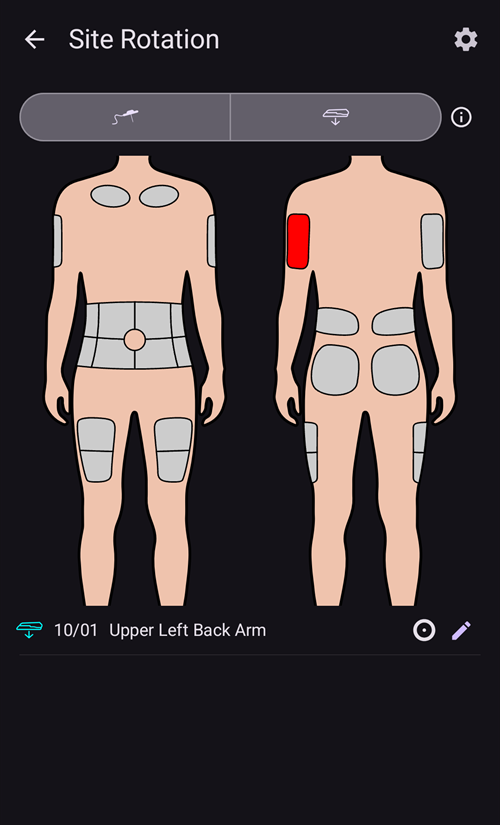

# Pumps and cannulas

## 更換注射組件：胰島素儲存罐和套管

以下描述的程序僅適用於有管幫浦，不適用於像 Omnipod、Medtrum Nano、Accu-Chek Solo 等無管幫浦。 This procedure is sometimes referred to as a "set change", with a "full" set change including the insulin reservoir and cannula, and a "partial" set change referring to a change of cannula only.

Patch pumps fill and prime themselves in their own activation wizard, and their cannula is already in the body. **AAPS** does not offer a prime for them: **Prime/Fill** is not shown in the **Manage** sheet or in QuickLaunch. See the page of your pump in [Compatible pumps](../Getting-Started/CompatiblePumps.md).

物理藥匣/儲液罐的更換無法通過 **AAPS** 完成，必須直接在幫浦上進行。這些需要在完成後手動記錄在**AAPS**中。

(pumps-cannulas-changing-reservoir-and-cannula)=
### 更換幫浦儲存罐和套管的指南

1. In **AAPS**, disconnect the pump: press the [loop icon](#AapsScreens-loop-status) on the main screen and select **Disconnect pump** for 1 hour. The icon changes to a grey plug icon, indicating that the pump is disconnected.

2. 實體更換胰島素儲存罐：從身體上中斷幫浦連線，並按照製造商的說明更換儲存罐/卡匣和套管。

3. 注射/填充輸液管和套管：這可以直接在幫浦上進行。請確保消除輸液管中的所有氣泡。

4. 將新的套管附著在身體上。當套管插入並移除針頭後，已附著的套管會有一個小的空氣間隙，這也需要進行注射。 To announce this in **AAPS** and prime the site: open **Prime/Fill** (in the expanded status panel on the main screen, in the **Manage** sheet, or as a [QuickLaunch](QuickLaunch.md) button) and tick **Pump site change** and/or **Insulin cartridge change** as appropriate to record the change. Now press the default insulin cannula prime amount (it is usually around 0.3 U, but check this value is correct for your cannula) and select **OK**. Read the summary message, and confirm to execute the priming by tapping **OK**.

   


5. Reconnect the pump in **AAPS**: press the grey plug icon and select **Reconnect pump** to continue looping.

### 有關胰島素/套管更換的有用資訊

* Logging a pump site change resets Autosens to 100%. It also resets the corresponding cannula/insulin status lights and ages on the **AAPS** main screen.

* You can set/adjust the default prime amounts in the **Prime/Fill** settings — type "prime" in the main screen search bar to open them (see [Preferences](../SettingUpAaps/Preferences.md)). 請參閱你的套管包裝內的使用說明書，以了解根據針頭長度和輸液管長度應注射多少單位。

* Insulin delivered using the prime function is not taken into account by **AAPS** when calculating insulin on board (IOB), and is marked in the [Treatments history](#aaps-screens-treatments) as "Prime".

* Any insulin bolused from the pump during a pump disconnection will also not be taken into account by **AAPS**. If you happen to bolus directly from the pump while **AAPS** is disconnected, once you reconnect the pump you can announce this insulin (without bolusing it) in the **Insulin** dialog (see [To announce delivered insulin without actually bolusing](#pumps-cannulas-announce-insulin) below).

### 套管、注射部位、輸液管和/或幫浦問題

If you are confident that you haven't received any insulin for a period of time, despite **AAPS** recording that you have, and you know exactly when the issue started (_e.g._ you remove the cannula and see that the cannula was kinked during the insertion process) you can correct this in **AAPS**, while being aware that the insulin may in fact have been delivered but may be slow to act for some reason.

```{admonition} Caution - Risk of Hypoglycemia
:class: danger
只有在極端謹慎的情況下，才從 **AAPS** 中刪除胰島素輸送紀錄，以防實際已輸送了胰島素，並在接下來的 24 小時內密切監測血糖。
```

To remove boluses and SMBs which you know have not been delivered, open the **menu** (☰), select [Treatments history](#aaps-screens-treatments) and, on the **Carbs and bolus** tab, conservatively delete the logged boluses starting from the point the incident happened. This will correct the "insulin on board" (IOB) value which is key for **AAPS**' calculations; if you now return to the main screen you will see that the IOB has reduced. 請注意，你無法刪除**AAPS**計算已經交付的基礎胰島素，因此這將仍然被**AAPS**納入計算。

In less obvious cases of insulin delivery problems _e.g._ leakages, occlusions or tunneling where either you are not sure when the issue started, or think some of the insulin was delivered, you need to be careful. You may detect these issues either by "smelling" the insulin, seeing a wet adhesive, encountering high glucose values or by getting an alarm. As you will never know how much insulin you got into your skin (which might be starting to work after a while) it will be hard to determine the correct amount of insulin which needs to be deducted from the current "insulin on board" (IOB) value. 一種策略是解決胰島素輸送問題後暫停循環 5 小時（或你的胰島素作用時間），然後恢復循環。這將確保你在重新開始循環時，IOB 是正確的。

(pumps-cannulas-disconnecting)=
## 中斷幫浦連線來進行洗澡或活動

如果你在淋浴、洗澡、游泳、接觸性運動或其他活動時取下幫浦，你必須告訴**AAPS**，以便保持 IOB 正確。 The pump can be disconnected using the [loop icon](#AapsScreens-loop-status) on the main screen: press it and select **Disconnect pump** with the duration you need. If the activity takes longer than planned, open the same dialog again and pick a new duration under **Disconnect pump**: the disconnection is extended and the new duration starts from now. You do not need to reconnect first.

由於幫浦中斷連線期間你無法獲得任何胰島素，應每兩小時重新連線一次，以補上缺失的基礎胰島素。你可以這樣操作：先連接設備，注射缺少的基礎胰島素量（_例如_過去兩小時的劑量），然後再斷開連接這將有助於避免嚴重缺乏胰島素，導致糖尿病酮酸中毒（DKA）。如果在活動期間重新連接幫浦不方便（導管位置被濕衣服覆蓋_等_），請考慮使用針管注射。 This manual injection can be logged in **AAPS**, and doesn't have to be logged at the time of injection (just make a note of the time of injection) since you can announce the insulin and backdate the time the insulin was actually given when you reconnect the pump.

(pumps-cannulas-announce-insulin)=
## 如何紀錄已輸送的胰島素但實際上不進行注射

To announce insulin delivered from the pump either while **AAPS** was disconnected, or from pen injections: open the [Insulin dialog](#aaps-screens-buttons-insulin) (**Treatments** in the bottom navigation, or a QuickLaunch button), enter the amount in units and enable **Bolus will be recorded only**. A **Time** row (set to **Now**) then lets you record the actual time of the injection: you can ignore it if the injection was given recently. If the bolus was given some time ago, use **-** to move the time back (_e.g._ -30 min), or open the row with the chevron to pick the exact date and time. **AAPS** 接著會考慮胰島素的作用時間，並相應計算系統中剩餘的胰島素量。

If you are using **AAPS** as a caregiver, you can remotely disconnect (and reconnect) the pump very easily by [SMS command](../RemoteFeatures/SMSCommands.md) using commands such as "pump disconnect 120" and "pump connect 120". 遠端斷線的持續時間範圍為 1 - 120 分鐘（此範例為 120 分鐘）。這在**AAPS** 手機不方便讓你進入的情況下非常有用，像是藏在快速運動的孩子身上的幫浦腰帶中，或者被青少年密切守護（或正在使用）。

## 活動後重新連線幫浦

長時間中斷（1 - 2小時）後，**AAPS** 計算你現在擁有負的 IOB 是相當常見的。當你重新連線幫浦時，根據偏好設定/目前血糖值/計劃的食物或後續活動，你可以選擇：

a) 只需在**AAPS**中重新連接幫浦（灰色到綠色，適用於關閉環），並讓**AAPS**重新開始交付胰島素。

_或者_

b) If you want to be more aggressive (for example, you are heading for hyperglycemia), you can open the [Bolus wizard](#aaps-screens-bolus-wizard) and bolus for zero carbs, to immediately deliver the calculated missing insulin as a bolus.

你比較喜歡哪種策略是很看個人的選擇，最好的方法就是自己多試幾次，找到最適合的。


(Aapsscreens-site-rotation)=
## 部位輪替

**Manage → Site Rotation** opens the Site Rotation Dialog in View mode:

- With the two buttons at the top (cannula icon and sensor icon), you can show Cannula sites only, Sensor sites only, or both
- All Cannula change and Sensor change event since the past 45 days are available.
- Click on a Site area, or in one entry in the list below to filter the list with only entries in selected area. The selected area will be highlighted in light green color.
- Tap the **pencil** icon next to an entry to open the Edit view and update its Site location, Arrow or Note



- The **cog** icon (upper right) opens the settings: **User profile for site rotation** opens a dialog where you choose **Man**, **Woman** or **Child**, and the **Manage pump site rotation** and **Manage CGM site rotation** switches select which sites you manage.


*Note: this setting will be used to automatically open or not Site Rotation Dialog (Edit mode) when a new entry is done from "Prime/Fill button" or "CGM Sensor Insert button"*

- For Site change done directly from Pump, you have to open the View Mode and Edit the new entry to select Location and Arrow

Edit Mode allows you to select Location, Arrow, and Note associated to selected Entry:

- The entry being edited is shown below the body images, with its type icon (cannula or sensor)
- Front and back views are shown side by side: tap the area where you placed it
- Once a Site selected (highlighted in green), you will see in the list below the list of all entries done in the pas 45 days in this site


- You can add an optional arrow by tapping the arrow icon at the right of the entry: the **Select Arrow** dialog lets you specify a sub-location or the pod orientation


- You can also add a **Note** about the selected site
- Tap the **save** icon (upper right) to record the site

Filtering can be done graphically on the image, or clicking a therapy event in the list To remove filtering, just click on the image outside any sites


