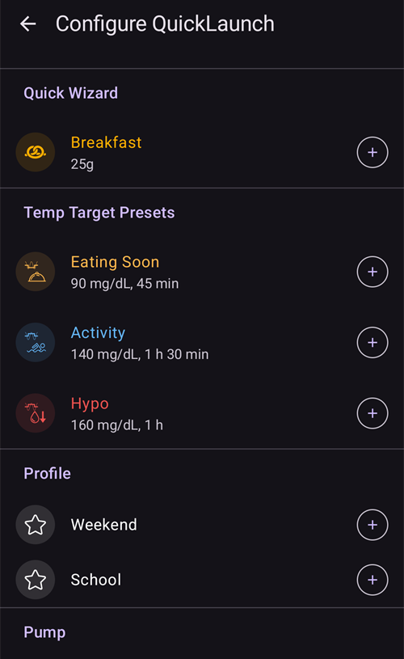

(快速啟動)=
# QuickLaunch（總覽快速操作工具列）

**QuickLaunch** 是一列小型的**快速操作工具列**，浮動在 **AAPS** 總覽畫面底部、底部導覽列的上方。這是一列可自訂的單擊按鈕：您可以選擇要放入哪些操作，以及排列順序，讓您最常使用的功能在主畫面上都能一鍵開啟。

```{contents} Table of contents
:depth: 2
:local: true
```


---

## 使用工具列

工具列位於**總覽**畫面上，介於圖表與底部導覽列之間：


- **點選**圖示即可執行對應操作，就像從一般畫面開啟該功能一樣（注射或治療仍會先顯示原有的確認畫面）。
- **長按**圖示可查看**工具提示**，其中會顯示操作名稱與簡短說明。
- 如果您加入的**按鈕超過螢幕可顯示的數量**，多出的按鈕會移至**溢位選單**（工具列末端的 **⋮** 按鈕）。
- 每個圖示都會保留對應操作的**顏色**（例如胰島素、碳水化合物、臨時目標），方便您一眼辨識。

```{admonition} The toolbar is always there
:class: note
最後一個按鈕固定為 **設定 QuickLaunch**（**⚙️** 齒輪圖示）。此按鈕無法移除，因此您隨時都能直接從工具列前往設定畫面。預設的工具列只有兩個按鈕：**注射嚮導**和齒輪圖示。
```

---

## 設定 QuickLaunch

點選工具列上的 **⚙️** 齒輪圖示（或開啟 **[組態設定工具](../SettingUpAaps/ConfigBuilder.md) → … → 設定 QuickLaunch**），即可開啟**設定 QuickLaunch**畫面（*「自訂總覽畫面的快速操作按鈕」*）。


此畫面分為兩個部分：

- **已選取的操作**（上方）— 目前顯示在工具列上的按鈕，順序與工具列相同。
- 下方是**操作清單**，列出所有可新增的操作，並依類別分組。每個清單項目都有**➕**按鈕，可將該操作新增至工具列。

### 已選取的操作 — 重新排序、編輯、移除

每個已選取的操作都有：

- 一個 **⠿ 拖曳控制點** — 按住並拖曳即可**重新排序**按鈕（此處的順序就是工具列上的順序），
- 一個 **−** 按鈕 — 可將該操作**從工具列移除**，
- 此外，只有**設定檔**捷徑會有 **✏️** 按鈕，可編輯其百分比／持續時間（請參閱[設定檔捷徑](#profile-shortcuts)）。

變更會**立即生效**，不需要另外按*儲存*。新增的操作會出現在工具列末端；您可以再重新排序。

---

## 操作類別

操作清單會依照以下順序，將所有可新增的操作分成不同類別。沒有可用項目的類別（例如您沒有場景）不會顯示。

### 治療

日常治療與 CGM 對話框：

- **胰島素** — 手動注射胰島素。
- **碳水化合物** — 記錄碳水化合物，不注射胰島素。
- **注射嚮導** — 開啟注射計算機。
- **治療** — 同時記錄胰島素與碳水化合物。
- **CGM** — 開啟您的 CGM 應用程式（例如 xDrip）。
- **校正** — 校正 CGM 傳感器。

### 照護入口

照護入口事件與裝置維護記錄：

- **血糖檢查**、**備註**、**運動**、**問題**、**公告**，
- **安裝傳感器**、**更換幫浦電池**、**更換幫浦部位**、**預充／填充**、**輪替部位**。

只有在您的幫浦有使用相關功能時，才會提供**預充／填充**和**更換幫浦電池**。例如，貼片式幫浦會在各自的註冊步驟中完成填充與更換電池，因此不會顯示這些項目（與**管理**工作表中的情況相同）。


這些項目與您原本可透過**[治療](#v4changes-treatments)**和**[管理](#v4changes-manage)**工作表開啟的項目相同。QuickLaunch 只是將您常用的項目放到總覽畫面上。

### 管理

**[管理](#v4changes-manage)**工作表中的畫面，順序相同，讓您可以從工具列開啟最常使用的項目：

- **設定檔**、**胰島素設定**（管理及註冊胰島素組態；名稱刻意與**胰島素**不同，因為「胰島素」按鈕是用來注射胰島素）、**臨時目標**、**QuickWizard**、**場景**、**自動化**、**食物**，
- **執行模式** — 關閉或啟動循環、暫停循環，或中斷幫浦連線，
- **已授權的用戶端** — 僅限主機或已配對的用戶端。

這些按鈕會開啟畫面；按下按鈕本身不會啟動任何功能。如要一鍵啟動場景或 QuickWizard，請從下方的 **場景** 或 **Quick Wizard** 類別新增。

 

### 快速嚮導

你可以將每個 **[QuickWizard](QuickWizards.md)** 預設項目新增為按鈕，讓你在總覽畫面一鍵啟動常用餐點。按鈕會顯示預設項目的名稱，以及碳水化合物／胰島素劑量；點選後會以平常的確認流程執行 QuickWizard。

設定為僅在手錶上顯示的 QuickWizard 不會列出。工具列上的 QuickWizard 按鈕遵循與 **治療**清單相同的規則：在[有效時間範圍](#quickwizard_validity)之外，以及使用後短時間內，按鈕會隱藏。按鈕仍會保留在工具列設定中，等到 QuickWizard 再次可用時便會重新顯示。

### 情境

每個已啟用的 **[場景](Scenes.md)**都可以新增為按鈕。點選按鈕後，系統會要求你確認，接著啟動場景（也就是執行你在「場景」畫面中會執行的同一組動作）。只有在你至少有一個場景時，才會顯示此類別。

工具提示和目錄會顯示與 **管理 → 場景** 相同的摘要，例如 *「3 個動作，2 小時 → Cooldown」*；箭頭後方是接續執行的場景名稱。

### 自動化

你可以將 **使用者動作**自動化規則（也就是手動觸發的規則）新增為按鈕。點選按鈕後，系統會要求你確認，接著執行該規則的動作。

```{admonition} Automation buttons run on the master
:class: note
自動化功能會在<strong>主機</strong>上執行，因此自動化捷徑只會在主機上顯示並執行。已配對的<strong><a href="../RemoteFeatures/ClientMasterControl.md">用戶端</a></strong>無法使用這些捷徑。
```

### 臨時目標預設

你可以將每個 **[臨時目標](TempTargets.md)**預設項目新增為按鈕（按鈕會顯示名稱、目標值和持續時間，例如 *「即將用餐 — 5.0 mmol/L，45 分鐘」*）。點選按鈕後，系統會要求你確認，接著啟動該臨時目標。



(profile-shortcuts)=
### 設定檔

每個 **[設定檔](ProfileSwitch-ProfilePercentage.md)**都可以新增為**捷徑**，讓你一鍵**切換設定檔**。與大多數捷徑不同，設定檔捷徑有自己的**百分比**和**持續時間**。新增捷徑後，點選**✏️**按鈕即可設定：

- **百分比**（30–250%，每次遞增 5%）— 套用設定檔時使用的倍率。 100% 代表直接套用設定檔，不調整倍率。
- **持續時間**（0–10080 分鐘，也就是最多 7 天，每次遞增 10 分鐘）— 設定檔切換的持續時間。 **0 = 永久**（直到你再次切換設定檔為止）。


這樣一來，你可以為**同一個**設定檔建立多個不同倍率的按鈕，例如 *「設定檔 100%」*和 *「設定檔 70%，持續 2 小時」*，並一鍵套用其中一個。（你可以使用不同設定，將同一個設定檔新增多次。）

### 外掛


最後，任何有獨立畫面的**已啟用外掛**，都可以新增為捷徑，直接開啟該畫面。這些捷徑會依外掛類型分組 — **幫浦**、**血糖來源**、**APS**、**循環**、**敏感度偵測**、**平滑處理**、**校正**、**限制條件**、**通訊**和**一般** — 讓你能從總覽畫面直接前往幫浦或循環畫面。

---

## QuickLaunch 與主機／用戶端

與大多數設定不同，**QuickLaunch 工具列是依裝置個別設定**的 — 設定會**儲存在本機，不會在主機與已配對的用戶端之間同步**，因此每台裝置都會保留自己的按鈕組合。（工具列設定**會**包含在設定**備份／匯出**中，因此在同一台裝置上還原時會一併還原。）

每台裝置可加入工具列的項目，仍取決於該裝置上有哪些內容：QuickWizard、場景、臨時目標預設項目和設定檔都會同步，因此用戶端目錄中會有相同項目 — 你只需要在每台裝置上分別選擇要加入的項目。請留意以下幾點：

- 如果按鈕指向的項目已不存在（例如已刪除的 QuickWizard、場景或預設項目，或已停用的規則），系統會**自動略過**該按鈕。
- **自動化**捷徑只會在**主機**上顯示並執行（自動化功能會在主機上執行）。用戶端可以使用場景、QuickWizard、臨時目標和設定檔按鈕。
- 如果你在用戶端點選必須由主機執行的按鈕（注射、臨時目標、設定檔切換或場景），會由**主機**執行，並由主機處理確認流程。請參閱[主機 ↔ 用戶端控制](../RemoteFeatures/ClientMasterControl.md)。

---


<!-- =====================================================================
     Screenshots captured from a real master device:
       - quicklaunch_toolbar.png    (cropped close-up of the overview toolbar pill)
       - quicklaunch_overview.png   (full overview showing the toolbar in place)
       - quicklaunch_config.png     (Configure QuickLaunch: Selected actions + Treatment + start of Manage)
       - quicklaunch_dynamic.png    (catalog: Quick Wizard / Scenes / Automation / Temp Target Presets)
       - quicklaunch_categories.png (catalog: Profile shortcuts + plugin categories)
     No QuickLaunch action was actually run (nothing delivered; only scrolled).
     Maintainers: relocate page + images and fix cross-links as needed.
     ===================================================================== -->
