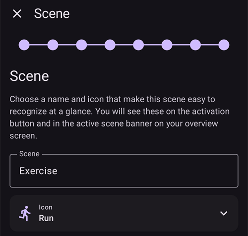

(scenes)=
# 情境（情境預設組合）

**情境**是具名的預設組合，可**一次套用一組操作**。例如「*睡眠*」、「*運動*」或「*生病日*」預設組合，可透過點選一次來切換設定檔、設定臨時目標、切換 SMB，並新增照護入口備註；您也可以選擇設定套用時間。

```{contents} Table of contents
:depth: 2
:local: true
```

---

## 什麼是情境

每次遇到重複發生的情況時，不必手動變更好幾項設定；只要先將它們設定成一個場景，之後輕點一下即可啟動。場景可以包含以下任意動作：

- **切換設定檔** — 切換設定檔及／或依百分比調整設定檔（例如 70 %）。
- **臨時目標** — 設定臨時目標（例如 *活動*、*即將用餐*，或自訂數值）。
- **開啟／關閉 SMB** — 在場景啟動期間，啟用或停用超微量注射。
- **循環模式** — 變更目前的運作模式（例如切換為較保守的模式）。
- **照護入口備註** — 記錄事件（例如 *運動*、*生病*），讓事件顯示在圖表和 Nightscout 中。

場景也有**持續時間** — 可設定固定時間（分鐘／小時／天），或選擇*無限期（手動結束）*；此外還有**結束動作**，會在場景結束時執行：可以是**通知**，也可以**串接**到另一個場景（例如 *生病日 → 運動*）。

---

## 管理場景

開啟**管理 → 場景**，即可查看、建立、編輯、啟用／停用及重新排序場景。


每張場景卡片會顯示：

- 用來啟用／停用場景的**核取方塊**，
- **圖示**和**名稱**，
- 摘要 — *「N 個動作，持續時間」*，以及串接到其他場景時顯示的**→ 串接場景**，
- 還有 3 個按鈕：**▶ 啟動**、**✏️ 編輯**、**🗑️ 刪除**。

輕點**+**按鈕即可建立新場景。

---

## 建立或編輯場景

### 從範本開始

若要**建立**場景，請輕點「場景」畫面上的**+**按鈕。第一個步驟是**從範本開始**：選擇適用於常見情況的現成場景 — *運動*、*生病日*、*生病日 — 嘔吐*、*睡眠*、*運動後夜間*、*餐前*、*飲酒*、*開車*、*洗澡*、*黃體期*、*炎熱天氣*、*醫療處置*，或從*空白*場景開始。每個範本都會**預先填入建議的動作**，您可以在接下來的步驟中調整所有設定。


選擇範本後，繼續操作前會先說明範本的用途 — *何時*以及*為什麼*使用：


### 逐步設定動作

編輯器的其餘部分是一個簡短的**逐步**設定嚮導。每個步驟都會設定一種動作，並提供「*在場景中加入……*」開關 — 只開啟您希望此場景執行的動作，其餘則保持關閉。


使用**下一步**／**上一步**依序完成設定：*切換設定檔*、*臨時目標*、*SMB*、*循環模式*、*照護入口備註*，接著設定**持續時間**、**結束動作**（發送通知或串接到另一個場景），最後設定場景的**名稱和圖示**。完成後請儲存。（若要**編輯**現有場景，請輕點該場景的**✏️**按鈕 — 系統會直接帶您進入這些設定步驟。）

每個步驟一開始都會簡短說明該動作的用途。以下以*運動*範本為例，說明各個步驟：

**臨時目標** — 選擇其中一個臨時目標預設值：


**SMB** — 設定場景啟動期間是否啟用 SMB：


**運作模式** — 可選擇變更循環模式：


**照護入口** — 要記錄的事件類型和備註：


**持續時間** — 場景保持啟動的時間；0 代表持續啟動，直到您手動結束：


**後續場景** — 可選擇在目前場景結束時啟動的場景：


**場景** — 設定名稱和圖示。按下**完成**即可儲存：



---

## 啟動場景

從 **場景**清單（**▶** 按鈕）或底部導覽列中的 **場景**項目啟動場景。在底部導覽列的 **場景**面板中，每個場景都會顯示與場景清單相同的摘要。面板頂端的 **鉛筆**圖示會開啟 **管理 → 場景**，讓您建立或編輯場景。


If [bolus protection](#Preferences-protection) is on, **AAPS** asks for it before a scene starts or ends. Changing a scene needs the [settings protection](#Preferences-settings-protection) instead.

套用任何內容之前，系統會先顯示**確認畫面**，清楚列出場景將執行的所有動作，方便您檢查：


如果場景會接續另一個場景，確認畫面最後會顯示 **→** 和接續場景的名稱，呈現方式與場景清單相同。

從底部導覽列中的 **場景**項目啟動場景時，系統會以較簡單的對話方塊顯示相同的動作清單。按下 **確定**即可啟動：


確認後，系統會套用這些動作，並在總覽頂端顯示**使用中的場景**及 **結束場景**按鈕。如果場景會接續另一個場景，橫幅也會顯示接續場景的名稱：


場景中的動作會持續生效，直到：

- 場景的**持續時間**結束（系統會執行**結束動作**，例如顯示通知或接續下一個場景）；或
- 您點選 **結束場景**，手動結束場景。如果場景會接續另一個場景，您可以選擇 **跳至**接續場景（結束目前場景並立即啟動接續場景），或選擇 **結束場景**（結束目前場景，但不啟動接續場景）。

沒有接續場景的場景只會要求您確認：


結束場景時，系統會**還原**場景所做的變更（例如切換設定檔和啟動臨時目標）。

場景啟動期間，如果場景設定了主畫面上的設定檔和目標，兩者旁邊都會顯示小型場景圖示。您仍可使用底部導覽列中的 **場景**面板來啟動其他場景：


場景持續時間自然結束時，系統會立即還原變更，並將橫幅更新為 **場景已結束**，同時顯示 **關閉**按鈕。關閉按鈕只會清除畫面上的橫幅；場景本身已經結束，因此自動化規則和接續場景會繼續執行，不必等您關閉橫幅。

---

## 從自動化觸發場景

場景不一定要手動啟動，您也可以讓 **自動化**替您執行。在自動化規則中新增動作（**管理 → 自動化**）時，動作選擇器中會有 **場景**類別：

- **執行場景** — 在規則觸發條件成立時啟動場景（例如到了指定時間、抵達某個地點，或血糖超過某個門檻）。
- **啟用場景** / **停用場景** — 開放（或停用）場景，但不啟動場景。


自動化也可以**回應**場景：觸發條件清單中包含**場景**觸發條件，因此規則可以只在特定場景啟動期間執行。搭配場景的**結束動作**（還原、通知或接續另一個場景），即可讓場景自動啟動、接續執行並結束。

---

## 搭配 Master／Client 和手錶使用場景

所有已配對裝置上的**使用中場景會保持同步** — 在一支手機上啟動場景，其他裝置也會顯示該場景。

已配對的**用戶端**（**AAPSClient**）也可以啟動或結束場景：系統會將要求傳送給**主控端**，由主控端建立確認畫面，並在主控端套用場景。運作方式請參閱 [主控端 ↔ 用戶端控制](../RemoteFeatures/ClientMasterControl.md)。

(scenes-from-watch)=
### 使用 Wear OS 手錶

您可以在 **Wear OS 手錶**上使用場景，並透過**場景資訊方塊**操作。在手錶的資訊方塊輪播中滑動至 **場景**資訊方塊，然後點選要啟動的場景（如果輪播中還沒有場景資訊方塊，請先從資訊方塊清單新增）：


資訊方塊有四個位置。根據預設，每個位置都會依照場景在手機上的排列順序，**自動**填入下一個已啟用的場景。若要自行選擇，請**長按資訊方塊**並開啟設定：您可以為四個位置分別保留**自動**選項、固定**特定場景**，或選擇**無**以留空。如果固定在某個場景的位置所選的場景已遭刪除或停用，該位置會顯示**無法使用** — 請為該位置選擇其他場景。

接著，手錶會顯示確認畫面 — 點選 **✓**即可啟動，或向後滑動以取消：


和用戶端的情況一樣，**主控端會建立確認畫面並執行場景**；手錶只會轉送要求（如果手錶與用戶端配對，則透過用戶端手機轉送）。

場景執行期間，或手機上仍顯示**場景已結束**橫幅時，資訊方塊會顯示**結束**按鈕，按鈕下方則會顯示場景名稱。點選按鈕即可從手腕上結束使用中的場景，或清除尚未關閉的橫幅。

如果目前執行的場景接續另一個場景，磁磚上也會顯示 **略過** 按鈕，下方會列出後續場景的名稱。這和手機上的兩個選項相同：

- **結束** — 結束目前執行的場景。確認訊息會告知您後續場景不會啟動。
- **略過** — 結束目前執行的場景，並立即啟動後續場景。確認訊息會列出這兩個場景的名稱。

手錶的 [循環狀態螢幕](#WearOsSmartwatch-loop-status)也會顯示目前執行的場景、剩餘時間，以及後續場景。

---


<!-- =====================================================================
     Screenshots captured from a real master device:
       - scenes_list.png        (Manage → Scenes management list)
       - templates_picker.png   (create: "Start from template" picker)
       - template_explanation.png (create: chosen template's explanation)
       - scene_editor.png       (scene editor, Profile switch step)
       - scene_confirmation.png (scene activation confirmation — also used on the Client/Master page)
       - scene_active_banner.png (overview active-scene banner with the End Scene button)
       - automation_scene_action.png (Automation action picker — Scenes category)
       - scene_watch_tile.png    (Wear OS Scene tile)
       - scene_watch_confirm.png (Wear OS scene confirmation)
     Maintainers: relocate page + images and fix cross-links as needed.
     ===================================================================== -->
