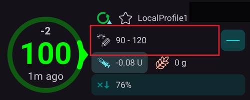

# 臨時目標(Temp-Targets)

## 什麼是臨時目標，並且我可以在哪裡設置和配置他們？

一個 **臨時目標**（簡稱 **TT**）是 **AAPS** 的一項功能，允許用戶根據計畫活動更改其 [**血糖** 目標範圍](#profile-glucose-targets)。這是透過 **AAPS** 操控使用者的胰島素使用來實現的。

一個血糖目標，尤其是如果它僅僅是短期的（持續少於 4 小時），並不需要是你預期或希望血糖水平達到的*實際數值*，而是指示**AAPS**在保持血糖水平在範圍內的同時，應更積極或較不積極的一個好方法。

臨時目標可以在這些範圍內定義：

|    | 臨時目標                   |
| -- | ---------------------- |
| 最小 | 4 mmol/L or 72 mg/dL   |
| 最大 | 10 mmol/L or 180 mg/dL |

**AAPS** provides three built-in **Temp-Target** presets suitable for exercise (**Activity**), meals (**Eating Soon**) and predicted hypoglycemia (**Hypo**). They live on the **Temp Target** screen (**Manage** → **Temp Target**), which you can also open by simply tapping the **target chip** on the main screen.

使用者在**AAPS**中選擇臨時目標時，應對能達到的結果保持合理的期望。達到預期**血糖**目標的成功率取決於多種因素，包括使用者的**AAPS**設置、整體**血糖**控制、胰島素庫存量、胰島素敏感度、胰島素抵抗力、運動期間的活動量等等。

一個**臨時目標**可能需要大約30分鐘甚至更長時間才能達到預期的**血糖**目標。 **AAPS** 無法立即達到**血糖**目標，因此使用者在選擇**臨時目標**時應注意這一點。

The sections below summarize the features of **Temp-Target- Activity**, **Temp-Target- Eating soon**, and **Temp-Target-Hypo**. The values shown are the shipped defaults — you can [adjust each preset](#TempTargets-change-preset-defaults) to your own needs.

### 臨時目標 - 活動


**BG Target (default preset, adjustable)**

AAPS will aim to reach 140 mg/dL or 7.8 mmol/L for 1 h 30 min

**用戶在選擇時可能希望考慮的其他因素**：

根據 **血糖**數值，**AAPS** 將「減少」胰島素的使用以達到 **血糖** 目標。如果 **血糖** 目標不在範圍內（即高於用戶 **設定檔** 選定的 **血糖** 目標），則 **AAPS** 可能會保持基礎胰島素。

在閉環模式下，**SMB**：

- *可能會* 停用（進一步討論如下）；和/或
- 如果 **AAPS** 在負的 **IOB** 狀態，基礎胰島素可能會被啟用或 <0.

用戶可能也希望考慮：

- *選擇* 此 **臨時目標** 在計劃運動前 1–2 小時進行，以確保降低體內胰島素量(IOB) (此 **臨時目標** 的正確時機將因人而異)
- *選擇*一個臨時設定檔（降低），在活動中持續使用，以確保降低 **體內胰島素量 (IOB)**；
- *ensuring* **TT** is timed to be *deactivated* shortly before the exercise as reduced **IOB** as some users experience a rapid rise in **BG** post exercise.

### 臨時目標 - 即將用餐


**BG Target (default preset, adjustable)**

AAPS will aim to reach 90 mg/dL or 5.0 mmol/L for 45 minutes

**用戶在選擇時可能希望考慮的其他因素**：

在閉環模式下，**SMB**：

- 將保持啟用；和/或
- 基礎胰島素也可能根據用戶的 **設定檔** 進行啟用。

根據 **血糖**數值，**AAPS** 會在用戶的 **AAPS** 設置參數內「增加」胰島素使用，以達到期望的 **血糖** 目標。

### 臨時目標 - 低血糖


**BG Target (default preset, adjustable)**

AAPS will aim to reach 160 mg/dL or 8.9 mmol/L for 1 hour

**用戶在選擇時可能希望考慮的其他因素**：

在閉環模式下，**SMB**：

- *可能會* 停用（進一步討論如下）；和/或
- 如果 **AAPS** 在負的 **IOB** 狀態，基礎胰島素可能會被啟用或 <0.

(TempTargets-manage-v4)=

## Setting and managing temporary targets (Manage → Temp Target)

In **AAPS** v4 you manage your TT **presets** and start a temporary target from the **Manage** screen (bottom navigation) → **Temp Target** (*“Manage and set temporary targets”*).


The screen has three parts:

1. **Preset carousel** (top) — swipe through your TT presets. Each card shows the preset's **name**, **target** and **duration**; the currently running TT is highlighted.
2. **Editor** (middle) — the **Temporary target** and **Duration** that will actually be applied, plus an **Activation** date/time.
3. **Action bar** (bottom) — **➕ add**, **‘️ delete** and the **▶ activate** button.

Selecting a preset card loads its **target** and **duration** into the editor.

```{admonition} Built-in vs custom presets :class: note The built-in presets — **Eating Soon**, **Activity** and **Hypo** — always exist and **cannot be deleted** (you can change their values and save, though). Any presets you create yourself are **custom** and can be edited or deleted freely.

    <br />### Activating a temporary target
    
    Swipe to the preset you want (its values load into the editor), optionally adjust the **target**/**duration** in the editor, then tap **▶ Activate**. A confirmation shows the exact target, duration and reason before anything starts:
    
    
    
    After you confirm, the temporary target starts immediately (or at the chosen **Activation** time) and runs for the set **duration**.
    
    ```{admonition} Editing the numbers is a one-off — it does not change the preset
    :class: important
    The **target** and **duration** in the editor are the values **Activate** will use *right now*. If you change them, that change is **temporary**: it applies only to this activation and **does not modify the saved preset**. This lets you "tweak and activate" a one-off TT (for example activate *Activity* at a slightly different target today) without permanently altering the preset.
    

### Saving changes to a preset

If you *do* want to keep an edited value, **Save** it: when the editor differs from the selected preset, a **Save** icon appears in the top toolbar. Tapping it stores the current **target** and **duration** (and name, for custom presets) back into the selected preset. For the built-in presets, a **Revert to defaults** button (↺) also appears in the action bar: it brings back the preset's default values.


So the rule of thumb is:

- **Activate** → use the numbers **once** (preset unchanged).
- **Save** → make the numbers the preset's **new defaults**.

To put a built-in preset back the way it shipped, select it and tap the **↺ Revert** button — it appears in the action bar only for a **built-in** preset whose values currently differ from its factory defaults, and it restores that preset's original **target** and **duration**.

### Adding and removing presets

- **➕ Add** — create a **new custom preset** from the current editor values. The new card appears in the carousel.
- **‘️ Delete** — remove the selected **custom** preset. Built-in presets (*Eating Soon*, *Activity*, *Hypo*) cannot be deleted.

Once you have at least two **custom** presets, you can also change their order in the carousel: tap the **Reorder** icon (⇅) in the top bar, step the centred card with the **◀ / ▶ move buttons**, then confirm with **✓**. The built-in presets keep their places — only custom presets can be moved. (The controls look the same as [reordering profiles](ProfileSwitch-ProfilePercentage.md).)

Your presets are part of the synced configuration, so they are shared across your master and paired clients.

### Other ways to set a temporary target

A temporary target can also be set without opening this screen:

- with the **TT toggles in the Carbs dialog** — see [below](#TempTargets-carbs-dialog),
- with a **preset button on the [QuickLaunch toolbar](QuickLaunch.md)** — the *Temp Target Presets* category in *Configure QuickLaunch* offers a one-tap button for each of your presets,
- from a **Wear OS watch** (the **Temp Target** menu item / tile),
- from a paired **client** — see [Master ↔ Client control](../RemoteFeatures/ClientMasterControl.md),
- as part of a **[scene](Scenes.md)** (the *Temporary target* action), or
- from an **Automation** rule (*Start temp target* / *Stop temp target*).

* * *

(TempTargets-where-can-i-select-a-temp-target)=

## 我可以在哪裡選擇臨時目標？

The quickest way is to tap the **target chip** on the main screen (it shows your current target range):



This opens the **Temp Target** screen described above — swipe to a preset and tap **▶ Activate**. The same screen is also reachable via **Manage** → **Temp Target**.

(TempTargets-carbs-dialog)= When entering carbs, you don't need to open the **Temp Target** screen at all: the **Carbs dialog** (**Treatments** → **Carbs**) has **Start Hypo TT**, **Start Eating soon TT** and **Start Activity TT** toggles at the top. Switch one on and the corresponding preset is activated together with the carb entry:


    {admonition} Automatic Hypo TT
    :class: note
    If you open the **Carbs dialog** while your glucose is below 72 mg/dL (4 mmol/L), **AAPS** pre-selects the **Start Hypo TT** toggle for you (unless a higher temporary target with a longer remaining duration is already running).

(TempTargets-change-preset-defaults)=

## 我可以在哪裡更改預設的**臨時目標**，並根據個人偏好進行覆蓋？

Each preset's **target** and **duration** are edited directly on the **Temp Target** screen — there is no separate preferences entry for this anymore:

1. Open the **Temp Target** screen (tap the target chip, or **Manage** → **Temp Target**).
2. Swipe to the preset you want to change.
3. Adjust **Temporary target** and/or **Duration** in the editor.
4. Tap the **Save** icon that appears in the top toolbar.


While the editor differs from a built-in preset's factory values, a **↺ Revert** button also appears in the action bar — tap it to restore the preset's original target and duration.

## 如何取消一個正在運作的**臨時目標**？

While a temporary target is running, the target chip on the main screen shows the target and its remaining time. Tap it — on the **Temp Target** screen the running preset is highlighted as **ACTIVE**, and a red **✗ Cancel** button appears at the end of the toolbar at the bottom, just left of the **▶ Activate** button. Tap it and confirm:


A running temporary target can also be stopped from a **Wear OS watch**, from a paired **client**, or by an **Automation** rule (*Stop temp target*).

(臨時目標-低血糖臨時目標)=

## 低血糖臨時目標

**臨時目標-低血糖**可幫助**AAPS**透過減少胰島素攝入來防止使用者經歷低血糖。如果使用者預測**血糖**會下降，通常**AAPS**會處理他，但很大程度上取決於使用者的**AAPS**設置是否穩定。一個**臨時目標-低血糖**允許使用者提前應對預測的低血糖，並更新**AAPS**以減少胰島素。

有時候當食用了治療低血糖的碳水化合物時，使用者的**血糖**會迅速上升，**AAPS**會透過啟用**SMB**來應對快速上升的**血糖**。

一些使用者希望在**臨時目標-低血糖**期間避免**SMB**的給藥。 This is achieved by deactivating *'Enable SMB with high temp target'* in **Settings** → **OpenAPS SMB** (see further below):

- In (Advanced, objective 9): the user can enable *“High temp target raises sensitivity”* for **Temp-Targets** of 100 mg/dL (5.6 mmol/L) or higher in OpenAPS SMB, **AAPS** will be more sensitive.

- In (Advanced, objective 9): the user can deactivate *“Enable SMB with high temp target”*, so that even if **AAPS** has COB > 0, “Enable SMB with low temp target” or “Enable SMB always” enabled and OpenAPS SMB active, **AAPS** will not give SMBs while high temp targets are active.

Note: if you open the **Carbs dialog** while your blood glucose is less than 72 mg/dL or 4 mmol/L, **AAPS** pre-selects the **Start Hypo TT** toggle automatically.

(臨時目標-活動臨時目標)=

## 運動臨時目標

在運動前和運動期間，使用者可能需要更高的目標來防止運動期間的低血糖。

為了簡化**臨時目標-運動**的設定，使用者可以配置一個預設的**臨時目標-運動**，透過減少胰島素使用來提高**血糖**數值，以減緩**血糖**下降並避免低血糖。

New users to **AAPS** may need to experiment and personalize their **Temp-Target Activity** default settings in order to optimize this feature to work best for them. 每個人在運動期間達到穩定**血糖**控制的情況各不相同。另請參閱常見問題中的[運動部分](#FAQ-sports)。

一些使用者還喜歡在啟用**臨時目標-運動**之前和期間啟動一個**設定切換**（即設定降至100%以下以減少**AAPS**的胰島素給藥）。 You can start both in one step: tap the profile name on the main screen, tap the round **▶** button, set a **Percentage** below 100 % and a **Duration**, then switch on **Temporary target / Activity**. See [Change the Profile Percentage](#ProfileSwitch-change-percentage).

Advanced, objective 9: users can enable *'High temp target raises sensitivity'* for **Temp-Targets** of 100 mg/dL (5.6 mmol/L) or higher in OpenAPS **SMB**. A target of 99 mg/dL (5.5 mmol/L) is a normal target, neither high nor low. 此外，如果停用*「高臨時目標時的SMB」*，即使**COB**大於0，並且**SMB**已啟用，且**OpenAPS SMB**處於活動狀態，**AAPS**也不會在高臨時目標期間進行**SMB**。

Additionally, if *'Enable SMB with high temp target'* is deactivated, **AAPS** will not deliver **SMBs**, even with COB > 0, *'Enable SMB with low temp target'* or *'Enable SMB always'* enabled and OpenAPS **SMB** active.

(臨時目標-即將用餐臨時目標)=

## 即將用餐臨時目標

**臨時目標-即將用餐**可以幫助實現緩和的血糖下降，並確保在用餐前有充足的**胰島素庫存量**。

這對於那些不進行餐前注射的使用者來說是一個重要工具，然而**臨時目標-即將用餐**的效果將取決於多種因素，包括使用者的設置、是否採用低碳水化合物飲食以及是否使用快效胰島素（如 Fiasp 或 Lyjumjev），以消除餐前注射的需求。通常，除非使用者對**AAPS**有一定的經驗，否則在使用**臨時目標-即將用餐**時應該預期進行餐前注射，特別是在進食高碳水化合物飲食時。

你可以在文章[「如何啟用‘即將用餐模式’」](https://diyps.org/2015/03/26/how-to-do-eating-soon-mode-diyps-lessons-learned/)或[這裡](https://diyps.org/tag/eating-soon-mode/)了解更多關於「即將用餐模式」的訊息。

進階設定，[目標9](#objectives-objective9)：如果你使用 OpenAPS SMB 並啟用了*「低臨時目標降低敏感度」*，**AAPS**會更加積極地運作。 For this option there is a requirement for **Temp-Target** to be 98 mg/dL (5.4 mmol/L) or lower.

## 如何在臨時目標期間關閉**SMB**？

To action this open **Settings** → **OpenAPS SMB** and deactivate *'Enable SMB with high temp target'*.


This will ensure **AAPS** will not give **SMBs**, even with COB > 0, *'Enable SMB with low temp target'* or *'Enable SMB always'* enabled and OpenAPS SMB active.