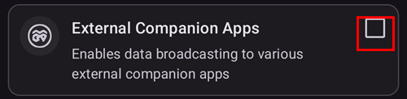

# 智慧型手錶與 AAPS

各種智慧型手錶可以用來顯示 **AAPS** 中可用的一些資訊或執行遠端操作。

讓智慧型手錶直接控制 **AAPS**（幫浦和傳感器）需要使用完整的 Android 手錶（被視為小型 [智慧型手機](./Phones.md)）。

某些智慧型手錶可以讓你輸入治療方案或更多，但手機本身仍然管理 **AAPS**。

智慧型手錶越來越多地與 **AAPS** 結合使用，_無論是_ 對於患有糖尿病的成年人還是兒童的照護者/父母。

## 使用智慧型手錶搭配 **AAPS** 的一般優勢


根據不同的型號，智慧型手錶可以以多種不同的方式與 **AAPS** 結合使用。他們可以用來完全或部分控制 **AAPS**，或者只是遠端查看血糖值、胰島素剩餘量（IOB）及其他參數。

在很多情況下，將智慧型手錶與 **AAPS** 整合非常有用，包括開車或騎車時，以及進行運動時。 Some people feel that looking at a watch (in a meeting, party, dinner table etc.) is more discreet than looking at a phone. From a security perspective, a smartwatch can also be beneficial while on the move, enabling the user to keep their **AAPS** phone stored out of sight (like inside a bag), while still using the smartwatch for remote control.

## 父母/照護者使用 **AAPS** 的具體優勢

對於孩子來說，如果他們的 **AAPS** 手機在附近，照護者可以使用智慧型手錶進行監控或修改，而無需使用 **AAPS** 手機。例如，當 **AAPS** 手機藏在幫浦腰帶中時，這會很有用。

智慧型手錶可以作為[僅關注](../RemoteFeatures/FollowingOnly.md)的選擇，或作為{em x-id="4">額外</em>的手機遠端控制選項。

此外，與依賴移動網路或 Wi-Fi 連線的父母/照顧者追蹤手機不同，藍牙連接的智慧型手錶在遠端地點（如洞穴、船上或山腰）也可以非常有用。 If both devices (**AAPS** phone and smartwatch) are on the same Wi-Fi network, they can also use Wi-Fi.

## 不同類型的智慧型手錶與 AAPS 的互動方式

目前有五種主要方式可將智慧型手錶與 **AAPS** 結合使用。這些方式在下表中顯示： 

| 手錶設定   | 功能                                             | 需求                                                                                                                                                                                                                                                                                                                  |
| ------ | ---------------------------------------------- | ------------------------------------------------------------------------------------------------------------------------------------------------------------------------------------------------------------------------------------------------------------------------------------------------------------------- |
| 獨立運作   | 無需手機的 AAPS                                     | 完整 Android 智慧型手錶（檢查最小 Android 版本）</br>運行 **app-fullRelease**                                                                                                                                                                                                                                                        |
| 完全遠端控制 | 大部分 AAPS 功能                                    | Android **Wear OS** 手錶（檢查 Android /API）</br>運行 **wear-fullRelease**                                                                                                                                                                                                                                                 |
| 遠端控制   | AAPSClient 功能                                  | Android **Wear OS** 手錶（檢查 Android/API）</br>運行 **[wear-aapsclientRelease](https://github.com/nightscout/AndroidAPS/releases)**                                                                                                                                                                                       |
| 遠端控制   | 部分 AAPSClient 功能                               | Garmin watches</br>(older Samsung Tizen and Fitbit setups only, not recommended)</br>See below.                                                                                                                                                                                                                     |
| 顯示     | Glucose, trend, IOB, COB, loop and pump status | Many smartwatches, through a companion app on the **AAPS** phone fed by the [External Companion Apps](#watches-external-companion-apps) broadcast: [WatchDrip+](https://bigdigital.home.blog/) (Xiaomi, Amazfit), [GlucoDataHandler](https://github.com/pachi81/GlucoDataHandler) (Wear OS), G-Watch</br>See below. |

## 在購買智慧型手錶之前……

你購買的智慧型手錶具體型號取決於你所需的功能。 You may find useful information on the [Phones page](#Phones-list-of-tested-phones), including a list of tested phones that also contains some smartwatches.

Popular watch brands include Samsung Galaxy, Garmin, Fossil and Mi band. 上面表格中不同選項的摘要將在下面詳細說明，幫助你決定哪款智慧型手錶最適合你的情況。

如果你打算將智慧型手錶與**AAPS** 手機結合使用並遠端操作**AAPS**，你還需要考慮這兩個設備是否相容，尤其是如果你的手機較舊或比較特殊。

一般來說，如果你只想要追蹤血糖資料而不與**AAPS** 進行互動，有更多價格實惠且簡單的手錶可供選擇。

選擇智慧型手錶的最佳方式是搜尋 Discord 或 Facebook**AAPS** 群組中的“手錶”相關帖子。 Have a read of others' experiences, and post any specific questions if your query isn't answered by older posts.

## 完整簽章

這聽起來像是一個很有吸引力的選項，對嗎？然而，目前只有少數愛好者正在嘗試在獨立手錶上運作 **AAPS**。 There are a limited number of smartwatches with a reasonable interface which also work well with standalone use of **AAPS** and your CGM app. Popular models include the LEMFO LEM 15 Pro and 16. 你需要在手錶上載入 **AAPS** 的“完整” apk（通常安裝在智慧型手機上的 apk），而不是 **AAPS** 的“wear” apk。

雖然目前沒有明確的規範告訴你哪款手錶適合獨立使用 **AAPS**，但以下參數會有所幫助：

1)  Android 12 或更新版本。 2)  能夠將錶盤從“方形”模式移除，以使文本更大、更易讀。 3)  非常好的電池續航能力。 4) 良好的藍牙範圍。

大多數在獨立手錶上運作 **AAPS** 的挫折來自於與小螢幕的互動，並且目前 **AAPS** 完整應用程式的界面並非為手錶設計。由於螢幕大小受限，你可能會更願意使用觸控筆來編輯 **AAPS** 設定，並且某些 **AAPS** 按鈕可能無法在手錶螢幕上顯示。

額外的挑戰包括很難獲得足夠的電池續航能力，並且擁有足夠電池容量的手錶通常體積龐大且厚重。用戶反映，他們在使用手錶時遇到以下問題：需要花很多功夫調整作業系統和省電設定、啟動傳感器困難、藍牙範圍不足（難以同時維持與傳感器及幫浦的連線），以及防水性能令人存疑。示例顯示在下面的照片中。


如果你有興趣設置獨立手錶，請閱讀 **AAPS** Facebook 群組中的帖子和評論（好的搜尋詞是“standalone”和“Lemfo”）以及 Discord 獲取更多資訊。

## Wear OS

**AAPS** 程式碼包含一個應用外掛，可安裝在[**Wear OS** 智慧型手錶](https://wearos.google.com/#oem-carousel)上。


驗證你的智慧型手錶是否滿足 **AAPS** [前置條件](#maintenance-android-version-aaps-version)。

### 什麼是 _Wear OS_？

前三個智慧型手錶選項要求智慧型手錶安裝 **Wear OS**。

**Wear OS** 是運作在部分現代 Android 智慧型手錶上的作業系統。如果智慧型手錶的描述僅指示與 Android 和 iOS 相容，則並不意味著他運作的是 **Wear OS**。他可能運作的是其他供應商專用的作業系統，這些系統不與 **AAPS** 相容。 To support installation and use of any version of **AAPS** or **AAPSClient**, a smartwatch must be running **Wear OS 3.0, 3.2 or 3.5** (Android 11, API level 30) **or newer**. Each Wear OS release follows the Android version it is based on: **Wear OS 3** is Android 11 (API level 30), **Wear OS 4** is Android 13 (API level 33), **Wear OS 5** is Android 14 (API level 34) and **Wear OS 6** is Android 16 (API level 36). Watches on Wear OS 2 cannot run **AAPS**.

如果你在 **Wear OS** 手錶上安裝 **AAPS** wear.apk，將可以選擇不同的自訂 **AAPS** 錶盤。或者，你可以使用標準的智慧型手機錶盤，並在錶盤上包含稱為“小工具”的小方塊，顯示你的 **AAPS** 資訊。複雜功能是指除了時間之外，顯示在錶盤上的任何功能。

```{note}
Recent **Wear OS** changes progressively break the custom **AAPS** watchfaces (the higher the Wear OS version, the more severe), although **complications** keep working. Before buying or updating a watch, read [Wear OS watch face changes](#wearos-watchface-changes).
```


### 我的智慧型手錶會長什麼樣子？

在 [安裝 **AAPS** 到你的手錶後](../WearOS/WearOsSmartwatch.md)，你將自動能選擇你喜歡的錶盤，這些都是專為 **AAPS** 設計的錶盤。在大多數手錶上，你只需長按主畫面，直到畫面縮小，然後向右滑動以選擇另一個畫面：


這些是嵌入在 **AAPS** 中的基本畫面，還有[更多的錶盤](#WearOS_changing-to-AAPS-watchface)，並且你也可以使用[複雜功能](#Watchfaces-complications)。

### 如何在日常操作中使用 Wear OS 手錶？

有關錶盤的更多細節和日常使用，包括如何製作（和分享）自己的自訂錶盤，請參閱[在智慧型手錶上操作 Wear AAPS](../WearOS/WearOsSmartwatch.md)的部分。

(Watchfaces-tizen)= (watches-external-companion-apps)=

## External Companion Apps

**AAPS** can broadcast its status to other apps installed on the same phone: glucose and trend, IOB, COB, basal and temp basal, profile name, loop status, phone and pump battery, reservoir level and bolus progress. Several watch companion apps read this broadcast and display the data on watches that **AAPS** does not support directly. To send the data, enable **External Companion Apps** in **Configuration** > **Communication** (see [External Companion Apps](#external-companion-apps) on the Configuration page). The broadcast is sent with each new reading and cannot be requested: a refresh button in the companion app has no effect on **AAPS**.



Companion apps known to use this broadcast:

- [WatchDrip+](https://bigdigital.home.blog/) for Xiaomi and Amazfit watches, see [Xiaomi and Amazfit watches](#watches-xiaomi-amazfit) below.
- [GlucoDataHandler](https://github.com/pachi81/GlucoDataHandler) for Wear OS watches, as a complication or a widget. It is a useful fallback on Wear OS versions where the **AAPS** watchfaces are unreliable, see [Set up AAPS on your Wear OS watch](../WearOS/WearOsSmartwatch.md). Its companion app GlucoDataAuto shows the same data in a car with Android Auto.
- [G-Watch app](https://play.google.com/store/apps/details?id=sk.trupici.g_watch) for Samsung Tizen watches, and its later Wear OS port. In earlier **AAPS** versions the plugin was named **Samsung Tizen** after this app.

```{warning}
The **G-Watch app** and its **Wear OS** port are no longer maintained, and Samsung has moved its smartwatches from Tizen to Wear OS. G-Watch is only relevant for existing, older setups and is not recommended for a new installation. Check the dedicated [Facebook group](https://www.facebook.com/groups/gwatchapp) for the latest news.
```

(Watchfaces-garmin)=

## Garmin

There are some watch faces for Garmin that integrate with [AAPS](https://apps.garmin.com/search?keywords=androidaps), on the Garmin ConnectIQ store.


[AAPS Glucose Watch](https://apps.garmin.com/apps/3d163641-8b13-456e-84c3-470ecd781fb1) 直接與 **AAPS** 整合。它除了顯示血糖數值外，還顯示循環狀態資料（體內胰島素、臨時基礎）並將心率數值傳送至 **AAPS**。 It is available in the ConnectIQ store; enable the **Garmin** plugin in **Configuration → Communication**. 

1. Highest and lowest glucose values on the graph
2. Glucose change per minute
3. Insulin on board (IOB)
4. Time since the last glucose reading (minutes:seconds)
5. Temporary basal rate, as a percentage of the profile basal rate
6. Glucose graph of the last 2 hours
7. 目前血糖值


## Fitbit

```{warning}
Google is moving Fitbit into Google Health and is removing third-party apps and watch faces from Fitbit watches in the EU. Fitbit watchfaces are therefore **no longer a recommended option**, and buying a Fitbit for use with **AAPS** is not recommended.
```

For existing Fitbit watches, the [Nightscout webpages](https://nightscout.github.io/nightscout/wearable/#fitbit) list some monitoring-only options, such as [Glance](https://glancewatchface.com/). These are third-party watchfaces too, so the same EU restriction applies.

## 僅跟隨

這些智慧型手錶會顯示一些**AAPS** 的資訊，其中一些需要其他應用程式。

還有各種經濟實惠的智慧型手錶可供顯示資料使用。如果你使用 Nightscout，那麼這裡有關所有選項的一個不錯的總覽 [這裡](https://nightscout.github.io/nightscout/wearable/#)

以下是一些受到 **AAPS** 用戶喜愛的僅跟隨手錶選項：

(watches-xiaomi-amazfit)=
### 小米和 Amazfit 手錶

**WatchDrip+** is a community-developed companion app that displays glucose and loop data on various smartwatch models, mostly Xiaomi (_e.g._ Mi Band) and Amazfit brands:


Since version 0.5, **WatchDrip+** reads its data directly from **AAPS**, without xDrip+ as a relay. On the **AAPS** phone:

1. Enable **External Companion Apps** in **Configuration** > **Communication**, see [above](#watches-external-companion-apps). It provides the current glucose, delta, trend arrow, IOB and pump status.
2. Enable the **xDrip** plugin in **Configuration** > **Communication** and turn on **Send status to xDrip+** in its settings. It provides the IOB/COB status line, and the glucose graph on the watch fills in after a few readings.
3. If xDrip+ is installed on the phone, disable its **Broadcast Service API** (xDrip+ > Settings > Inter-app settings) so that the watch does not receive the data twice. If xDrip+ was only relaying data to the watch, you can uninstall it.

The refresh button of WatchDrip+ has no effect with **AAPS**: the data arrives with each new reading.


You can read more about them, including how to set them up, on the [WatchDrip+ website](https://bigdigital.home.blog/). 這些手錶的優勢在於它們小巧且相對實惠。他們是兒童和手腕較小的人們一個不錯的選擇。

### Pebble 手錶


Pebble 手錶（[現已停產](https://en.wikipedia.org/wiki/Pebble_(watch))）從 2013 年到 2016 年一般出售，可能仍有二手產品可供購買。 Fitbit 接管了 Pebble 的資產。 Pebble 用戶可以使用 Urchin 表盤查看 Nightscout 資料。顯示的資料選項包括 IOB、目前的臨時基礎速率和預測值。如果使用開放循環，你可以使用 IFTTT 建立一個應用程式，如果收到來自**AAPS**的通知，則發送 SMS 或 pushover 通知。

### [Bluejay 手錶](https://bluejay.website/)


這些是獨特的技術產品，可以直接從 Dexcom 發射器接收血糖資料。 It is not widely known that Dexcom G6/G7 transmitters actually broadcast the current glucose data on _two_ separate channels, a phone channel and a medical channel. The Bluejay watches can be set to receive glucose data on either channel, so if **AAPS** is using the phone channel, then the Bluejay watches can use the medical channel.

The key advantage is that the watch is independent of both the phone and the looping system. 所以，例如，如果您在海灘或主題公園中斷掉幫浦和 **AAPS** 手機的連線，並且超出了 **AAPS** 手機的範圍，您仍然可以直接從您的 Dexcom 獲取讀數到 Bluejay 手錶。

The original **Bluejay GTS** is discontinued and cannot read the Dexcom G7. The later models (U1, then the current **U3**, sold as early access at the time of writing) are full Android watches running xDrip, which collect from the Dexcom G6 and G7 directly. The vendor describes the watch as a research tool, not for medical use. Reported disadvantages are that it does not always pick up a reading every 5 minutes and that the battery needs frequent charging. Check the [Bluejay website](https://bluejay.website/) for the current model and availability.

### Apple 手錶

查看[手錶上的 Nightscout](https://nightscout.github.io/nightscout/wearable/#)。

Apple 手錶現在支援 G7 直接連接，並且可以和 **AAPS** 同時使用。

