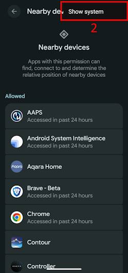

(bluetoothtroubleshooting-bluetooth-related-issues)=

# 藍牙相關問題

有些使用者遇到與藍牙相關的 Omnipod DASH 註冊失敗、Medtrum Nano 連線問題，以及其他 Pod 錯誤。其中許多問題可追溯到以下其中一項原因。

其中部分問題也可能適用於其他藍牙胰島素幫浦；Medtrum Nano 與 Omnipod DASH 一樣，已知會受「Nearby devices」權限影響。

---

(bluetoothtroubleshooting-cannot-start-omnipod-with-android-16)=

## 無法在 Android 16 上啟動 Omnipod
- Android 16 needs at a minimum **AAPS** version 3.3.2.1 for the Omnipod DASH to work correctly, as this version has fixes added to specifically address known problems introduced in Android 16 for Omnipod.

---

(bluetoothtroubleshooting-bluetooth-battery-optimisation)=

## 藍牙 電池優化

較新版的 Android 已為系統藍牙 App 啟用電池最佳化。這已知會對藍牙幫浦與 CGM 造成一些問題。

如果您已按照[設定精靈](../SettingUpAaps/SetupWizard.md)的指示操作，並依照[藍牙電池最佳化](#setup-wizard-bluetooth-battery-optimisation)一節中的設定完成設定，這項設定應該就是正確的。不過，如果您參考的是較舊版本的指南，可能還沒有變更這項設定。

如果幫浦和 CGM 發生連線中斷，請確認這項設定是否正確。

---

(bluetoothtroubleshooting-apps-using-nearby-device-permission)=

## 使用 Android 權限「Nearby devices」的應用程式，可能導致連線中斷與 Pod 註冊問題

Android 透過權限模型讓你控制每個應用程式在手機上能做什麼、能存取什麼。您可以為每個已安裝的 App 選擇允許或拒絕特定權限，例如讀取裝置上的檔案、使用藍牙，以及掃描附近的裝置等。

**AAPS** 需要多項特定權限才能運作，其中一項是 Pod 正常運作所需的「附近裝置」權限。也有許多其他應用程式需要此權限；社群發現，當某些應用被授予此權限時，可能會在部分裝置上導致新 Pod 的啟用發生問題。

(bluetoothtroubleshooting-apps-using-nearby-device-permission-known-apps)=

### 使用「附近裝置」權限且已知會引發問題的應用程式：

社群中多處討論過，以下清單中的應用程式會對 Omnipod DASH 裝置造成問題，有些情況下也會影響 Medtrum Nano。

```{admonition} Updating the list
:class: note
在 #omnipod-dash 的 Discord 頻道 ping @XiTatiON，討論要加入此清單的應用程式。
```

- **myBMW** MyBMW 會干擾 Medtrum Nano 與 Omnipod DASH。 MyBMW App 對「尋找附近裝置」權限只會提示一次；即使不授權，仍可正常運作。

- **Amazon Alexa**  Removing "Nearby devices" for Alexa app resolved problem for some people but will break the ability to pair Matter IoT devices

- **MINI App** 看起來是以 myBMW App 為基礎，因此可能會有類似的行為。

- **BM2** Solar Battery Monitoring app, used in some camper van and camping solar setups: when the app was running, it prevented activation of a new Pod. Force Stopping the app while activating a new pod is a workaround to the issue. 之後再執行該 App，似乎不會干擾 Dash 的功能（在執行 Android 16 的 Pixel 8 Pro 上）。

(bluetoothtroubleshooting-revoke-nearby-device-permission)=

### 如何撤銷其他應用程式的「附近裝置」權限：
如果您無法註冊新的 Pod，且使用的 **AAPS** 版本符合您 Android 版本的支援需求，註冊新 Pod 時可能需要撤銷其他 App 的權限。

請按照以下步驟，撤銷所有 App 的「附近裝置」權限，但保留 **AAPS** 的權限：

```{admonition} Menus and settings
:class: note${NEW_LINE>本指南中的螢幕擷取畫面與說明，來自 Google Pixel 8 Pro 的原生 Android 16 安裝。 Other manufacturers and devices will likely not exactly match these menus and settings descriptions, adjust the steps to suit the device you have and if you are stuck see [Where to get help for dash](#omnipod-dash-where-to-get-help-for-dash) section on how to reach out to the community for support.
```

1. 打開手機上的 Android 設定，向下捲動並點選**安全與隱私 (1)**。

    

2. 向下捲動並點選**隱私控制 (1)**。

   

3. 點選**權限管理員 (1)**。

   

3. 向下捲動並點選**附近裝置 (1)**。

   

4. 瀏覽應用程式清單，點選你要撤銷**附近裝置**權限的應用程式。

   在本指南中，我們以**Android Auto (1)** 作為撤銷權限的示範 App。

   為避免讓更多 Pod 變磚，我們建議一開始先對除 **AAPS** 之外的所有應用程式撤銷該權限。

```{admonition} Which app to select?
:class: tip
若不確定是哪個 App 造成問題，請先全部停用（也別忘了檢查已知問題 App 清單，並從那些開始）。在你能承受可能報廢幾個 Pod 的前提下，每次註冊新 Pod 前只對一個新的 App 啟用該權限，如此逐步縮小範圍，找出特定導致 Pod 問題的 App。如果你確定了新的問題應用程式，請在 Discord 的 #omnipod-dash 頻道告訴我們。
```

   

5. 若要撤銷該權限，請點選 **Don't allow (1)**，然後點選 **Don't allow anyway (2)**。若操作正確，您應會看到 **Don't allow (3)** 為已選取的切換選項。現在您可以按下 **Back arrow (4)** 返回 **Nearby device** 選單；如有需要，也可在其他應用程式上變更此設定。

      

(bluetoothtroubleshooting-re-enable-nearby-device-permission)=

### 如何為系統應用程式與其他應用程式重新啟用「Nearby device」權限：

1. If required Reference the **"How to revoke 'Nearby device' permissions for other apps"** section on how to get to the app privacy settings, then once in the **Nearby device** configuration proceed to 2.

2. 瀏覽應用程式清單，點選您希望允許 **Nearby devices** 權限的應用程式。

   在本指南中，**Android Auto (1)** 是我們要允許該權限的應用程式。

   您會注意到在撤銷權限後，應用程式清單中找不到 **Android Auto (1)**。這是因為 **Android Auto** 應用程式是 **系統應用程式**，而系統應用程式在預設情況下會被隱藏。

   

3. 若要顯示隱藏的系統 App，請按右上角的**三點選單（⋮）（1）**，再按**「顯示系統 App」（2）**。現在您應該可以在清單中看到先前隱藏的系統應用程式 **Android Auto (3)**。

```{admonition} Find your app
:class: tip
如果某個 App 的權限已被撤銷，你需要往下捲動，直到在清單較下方看到「已撤銷的 App」清單。
```

     

5. Follow the guidance in **"How to revoke 'Nearby device' permissions for other apps"** in reverse to re-enable permissions for each app.

---

(bluetoothtroubleshooting-android-15-bluetooth-connection-problems)=

## Android 15 經常性藍牙連線問題

升級 Android 或更換到近期手機後，**AAPS**經常會失去與幫浦的藍牙連線。重新啟動手機後，這個問題會暫時消失。如果您使用 **Omnipod DASH**，且手機搭載 Android 15，開啟**藍牙配對**設定可能有助於提升藍牙連線的穩定性。開啟方式如下：

```{admonition} Android 16
:class: warning
只有在 Android 15 上，且遇到連線問題時，才開啟**藍牙配對**。請勿在 Android 16 上開啟藍牙配對。
```

1. 開啟[Dash 設定](#omnipod-dash-settings)：在 DASH 幫浦畫面中，按**管理** > **幫浦**，再按右上角的**設定**（齒輪）圖示。

   

2. 開啟**進階設定**區段，然後開啟**藍牙配對**。

   

3. 如果手機顯示配對要求，請接受。

4. 重新啟動您的手機。
