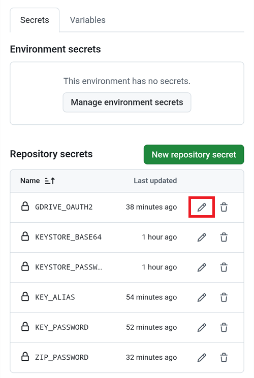

(aaps-ci-troubleshooting)=

# 瀏覽器建置：疑難排解

```{note}
本頁彙整 [瀏覽器建置](../SettingUpAaps/BrowserBuild.md) 的疑難排解提示。

正在使用 **AAPS Builder**？請先從其專屬的[疑難排解章節](#aaps-builder-troubleshooting)開始。下方有關 Google Drive 的章節同樣適用。
```

## AAPS-CI 問題排除

(aaps-ci-read-the-logs)=
### First: find out what went wrong

When a build fails, GitHub keeps a log of every step. The log tells you which step failed and why. Read it before you try anything else: the error message is what you look for on this page, and what helpers will ask for.

1. In your GitHub copy of AndroidAPS, open **Actions**. A failed build has a red cross. Tap its name.

   

2. The run summary shows **Failure** and, below, the job that failed (**Build AAPS**, with a red cross).

   

3. Scroll down to **Annotations** and tap the red **Build AAPS** line.

   

4. The job opens. Steps with a grey tick worked. The step with the red cross is the one that failed: GitHub opens it for you. The steps after it were skipped (grey circle).

   

5. Read the lines just above `Error: Process completed with exit code 1.`: they explain the problem. In this example, the step **Retrieving Google Drive access token** failed with `invalid_grant` and `Token has been expired or revoked.`, see [Google Refresh Token Expired](#aaps-ci-google-token-expired).

   

```{tip}
Asking for help? Share the name of the failed step and the error lines (a screenshot like the one above is fine). Never share the content of your secrets.
```

(aaps-ci-update-secret)=
#### Update a secret

Many fixes mean replacing the value of a secret. In your GitHub copy of AndroidAPS, go to **Settings** → **Secrets and variables** → **Actions** and tap the pencil next to the secret.



Enter or paste the new value and tap **Update secret**. GitHub never shows the old value: the field is always empty.


(aaps-ci-rerun)=
#### Run the build again after a fix

Once you have fixed the cause, you do not need to start from scratch: open the failed run, tap **...** (top right), then **Re-run failed jobs**.


Tap **Re-run jobs**. You can also start a new build from **Run workflow** as usual.


(aaps-ci-preparation-web)=
### aaps-ci-preparation 網頁
  - The preparation page is displayed by a temporary local server (for example Simple Web Server on a computer), which also receives the Google refresh token.
  - If you see the screen below, the local server has stopped or is not reachable.
  - Close the preparation page, check that the local server is running, then reopen aaps-ci-preparation.html the same way as in Step 2 and complete the remaining steps. 這在設定期間建立初始的 Google 連線時特別需要。

  

(aaps-ci-google-token-expired)=
### Google 重新整理權杖已過期
  - 如果 Google OAuth2 重新整理權杖連續 6 個月未使用就會過期，並且在其他情況下也可能失效（例如：您變更了 Google 帳號密碼，或手動撤銷了存取權）。如需更多詳細資訊，請參閱 [Google OAuth2 說明文件](https://developers.google.com/identity/protocols/oauth2)。
  - In the [build log](#aaps-ci-read-the-logs), the step **Retrieving Google Drive access token** fails with `invalid_grant` and `Token has been expired or revoked.`:

  

  - If your build fails due to an expired or revoked Google refresh token, you will need to redo the [Google Drive Auth](#aaps-ci-google-drive-auth) steps to obtain a new `GDRIVE_OAUTH2` token, [update the secret](#aaps-ci-update-secret) in your GitHub repository, then [re-run the build](#aaps-ci-rerun).
  - 若授權再次失敗，或 Google 不再要求你同意，請先從你的 Google 帳戶移除既有的 AAPS 存取權，請參閱[下方](#aaps-ci-google-remove-access)。

(aaps-ci-google-remove-access)=
### 從你的 Google 帳戶移除 AAPS 存取權，並重新開始授權
  - 如果 Google Drive 授權持續失敗，或你想從乾淨狀態重新開始，請先移除你先前授予 AAPS 的存取權，然後重新執行授權。
  - 在你的手機上開啟 [https://myaccount.google.com](https://myaccount.google.com)，點選 **Security**，向下捲動至 **Your connections to third-party apps & services** 並開啟已連結應用程式的清單。你也可以直接前往 [https://myaccount.google.com/connections](https://myaccount.google.com/connections)。
  - 在清單中點選 **AAPS**。

  

  - 此頁會顯示你授予 AAPS 的存取權（應用程式使用的 Google Drive 檔案）。點選 **Delete all** 以移除連線，或先點選 **See details** 檢視詳情。

  

  - On the details page, tap **Remove all access**.

  

  - Tap **Confirm**.

  

  - Google confirms that AAPS no longer has access. AAPS 不會再出現在已連結的應用程式清單中。

  

  - 現在乾淨地重新開始授權：請關閉 **兩者**（準備頁面與檔案管理器應用程式），從檔案管理器重新開啟 aaps-ci-preparation.html，並重新執行 [Google Drive Auth](#aaps-ci-google-drive-auth) 步驟。 Google 會再次要求你授權，且該頁會提供新的 `GDRIVE_OAUTH2` 權杖。
  - [Update the `GDRIVE_OAUTH2` secret](#aaps-ci-update-secret) in your GitHub repository with the new token, then [re-run the build](#aaps-ci-rerun).

(aaps-ci-disable-software)=
### 停用可能會影響 OAUTH2 授權的軟體
  - 在嘗試獲取 OAUTH2 金鑰之前，請停用電話上的任何 VPN 或安全應用程式（防火牆、反惡意軟體等）。

(aaps-ci-actions-permission)=
### 檢查 GitHub Actions 權限設定
  - 請確保 GitHub Actions 政策設置為「Allow all actions and reusable workflows」（Settings → Actions → General）。 If you change it, press **Save** below the options.

  

`actions/checkout@v4` 和 `actions/setup-java@v4` 不允許在 `xxxxx/AndroidAPS` 中使用。此工作流程中的操作必須位於 `xxxxx` 擁有的儲存庫內

(aaps-ci-workflow-permissions)=
### 檢查 GitHub 工作流程權限設定
  - 若建置立即失敗並出現如下所示的「Invalid workflow file」錯誤，表示你的儲存庫預設的工作流程權限過於嚴格：

```
Invalid workflow file
The workflow is not valid. .github/workflows/aaps-ci.yml (Line: 361, Col: 3):
Error calling workflow 'xxxxx/AndroidAPS/.github/workflows/cleanup-workflow-runs.yml@...'.
The nested job 'cleanup' is requesting 'actions: write', but is only allowed 'actions: none'.
```

  - 請確認工作流程權限已設為「Read and write permissions」（Settings → Actions → General → Workflow permissions），然後儲存並重新執行建置工作流程。

  

(aaps-ci-password-special-characters)=
### Build Fails Checking The Keystore Password
  - In the [build log](#aaps-ci-read-the-logs), the step **Validating keystore, alias and password** fails with `Either KEYSTORE_BASE64, KEYSTORE_PASSWORD, KEY_PASSWORD, or KEY_ALIAS is incorrect`, followed by `Keystore was tampered with, or password was incorrect`. The build stops there: the keystore and passwords are checked before AAPS is built.

  

  - The build workflow keeps every character of your passwords intact. Enter `KEYSTORE_PASSWORD` and `KEY_PASSWORD` exactly as they are, without adding a backslash or any other escape character. If you added backslashes, [update the secrets](#aaps-ci-update-secret) with the password exactly as it is. The example below is wrong: the password is `Example2026`, the backslash was added.

  

  - If the build still fails when signing the APK although your password is correct, and the password contains `$`, a backtick, `"` or `\`, the workflow file in your fork is older than September 2026 and still parses these characters. [Sync your fork](#Update-to-new-version-update-your-repo) with the latest dev, then re-run the build workflow.
  - 豎線 `|` 是特殊情況。 「[Option 1](#aaps-ci-option1)」的準備頁會將金鑰庫、密碼與別名合併為一個以 `|` 分隔的 `KEYSTORE_SET` Secret，工作流程會依該字元進行分割。準備頁所產生的密碼僅包含英文字母與數字，因此使用 Option 1 不會發生此情況。只有在你自行以含有 `|` 的密碼組合出 `KEYSTORE_SET` Secret 時，才可能發生。此時請刪除 `KEYSTORE_SET`，改為依照「[Option 2](#aaps-ci-option2)」輸入個別的 Secrets。
