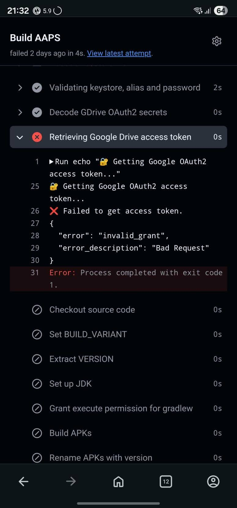

(aaps-ci-troubleshooting)=

# 瀏覽器建置：疑難排解

```{note}
本頁彙整 [瀏覽器建置](../SettingUpAaps/BrowserBuild.md) 的疑難排解提示。

正在使用 **AAPS Builder**？請先從其專屬的[疑難排解章節](#aaps-builder-troubleshooting)開始。下方有關 Google Drive 的章節同樣適用。
```

## AAPS-CI 問題排除

(aaps-ci-preparation-web)=
### aaps-ci-preparation 網頁
  - 當你使用「檔案管理器」打開 aaps-ci-preparation.html 時，它會在你的手機上啟動一個臨時本地伺服器來顯示網頁並接收 Google Refresh token。
  - 此本機伺服器大約 10 分鐘後會逾時。如果你看到下方這個畫面，代表檔案管理器已經關閉了本機伺服器。
  - 請關閉 **兩者**（準備頁面與檔案管理器應用程式），然後從檔案管理器重新開啟 aaps-ci-preparation.html，並完成剩餘步驟。這在設定期間建立初始的 Google 連線時特別需要。

  

(aaps-ci-google-token-expired)=
### Google 重新整理權杖已過期
  - 如果 Google OAuth2 重新整理權杖連續 6 個月未使用就會過期，並且在其他情況下也可能失效（例如：您變更了 Google 帳號密碼，或手動撤銷了存取權）。如需更多詳細資訊，請參閱 [Google OAuth2 說明文件](https://developers.google.com/identity/protocols/oauth2)。
  - 您會看到一則錯誤，指出存取權杖無效，如下所示：

  

  - 如果您的建置因 Google 重新整理權杖過期或被撤銷而失敗，您需要重新執行 [Google Drive 驗證](#aaps-ci-google-drive-auth) 的步驟以取得新的 `GDRIVE_OAUTH2` 權杖，並在您的 GitHub 儲存庫中更新該機密，然後重新執行建置工作流程。
  - 若授權再次失敗，或 Google 不再要求你同意，請先從你的 Google 帳戶移除既有的 AAPS 存取權，請參閱[下方](#aaps-ci-google-remove-access)。

(aaps-ci-google-remove-access)=
### 從你的 Google 帳戶移除 AAPS 存取權，並重新開始授權
  - 如果 Google Drive 授權持續失敗，或你想從乾淨狀態重新開始，請先移除你先前授予 AAPS 的存取權，然後重新執行授權。
  - 在你的手機上開啟 [https://myaccount.google.com](https://myaccount.google.com)，點選 **Security**，向下捲動至 **Your connections to third-party apps & services** 並開啟已連結應用程式的清單。你也可以直接前往 [https://myaccount.google.com/connections](https://myaccount.google.com/connections)。
  - 在清單中點選 **AAPS**。

  

  - 此頁會顯示你授予 AAPS 的存取權（應用程式使用的 Google Drive 檔案）。點選 **Delete all** 以移除連線，或先點選 **See details** 檢視詳情。

  

  - 在詳細資料頁面，點選 **Remove all access** 並確認。 AAPS 不會再出現在已連結的應用程式清單中。

  

  - 現在乾淨地重新開始授權：請關閉 **兩者**（準備頁面與檔案管理器應用程式），從檔案管理器重新開啟 aaps-ci-preparation.html，並重新執行 [Google Drive Auth](#aaps-ci-google-drive-auth) 步驟。 Google 會再次要求你授權，且該頁會提供新的 `GDRIVE_OAUTH2` 權杖。
  - 以新權杖更新你在 GitHub 儲存庫中的 `GDRIVE_OAUTH2` Secret，然後重新執行建置工作流程。

(aaps-ci-disable-software)=
### 停用可能會影響 OAUTH2 授權的軟體
  - 在嘗試獲取 OAUTH2 金鑰之前，請停用電話上的任何 VPN 或安全應用程式（防火牆、反惡意軟體等）。

(aaps-ci-actions-permission)=
### 檢查 GitHub Actions 權限設定
  - 請確保 GitHub Actions 政策設置為「Allow all actions and reusable workflows」（Settings → Actions → General）。

  

`actions/checkout@v4` 和 `actions/setup-java@v4` 不允許在 `xxxxx/AndroidAPS` 中使用。此工作流程中的操作必須位於 `xxxxx` 擁有的儲存庫內

(aaps-ci-workflow-permissions)=
### 檢查 GitHub 工作流程權限設定
  - 若建置立即失敗並出現如下所示的「Invalid workflow file」錯誤，表示你的儲存庫預設的工作流程權限過於嚴格：

```
Invalid workflow file
The workflow is not valid. .github/workflows/aaps-ci.yml (Line: 361, Col: 3):
Error calling workflow 'xxxxx/AndroidAPS/.github/workflows/cleanup-workflow-runs.yml@...'.
The nested job 'cleanup' is requesting 'actions: write', but is only allowed 'actions: none'.
```

  - 請確認工作流程權限已設為「Read and write permissions」（Settings → Actions → General → Workflow permissions），然後儲存並重新執行建置工作流程。

  

(aaps-ci-password-special-characters)=
### 密碼包含特殊字元時，建置會在簽署步驟失敗
  - 即使密碼正確、但在簽署 APK 時建置仍失敗，請檢查你的 `KEYSTORE_PASSWORD` 或 `KEY_PASSWORD` 是否包含 `$`、反引號、`"` 或 `\`。建置工作流程會解析這四個字元，並變更或截斷密碼。
  - 請在 GitHub 編輯 Secret，且僅在這四個字元前各加上一個反斜線 `\`。例如，若密碼為 `abc$def"ghi`，請輸入 `abc\$def\"ghi`。
  - 其他所有字元（包含 `%`、`*`、`#` 與 `!`）都必須原封不動。在它們前面加上反斜線會成為密碼的一部分。
  - 重新執行建置工作流程。
  - 豎線 `|` 是特殊情況。 「[Option 1](#aaps-ci-option1)」的準備頁會將金鑰庫、密碼與別名合併為一個以 `|` 分隔的 `KEYSTORE_SET` Secret，工作流程會依該字元進行分割。準備頁所產生的密碼僅包含英文字母與數字，因此使用 Option 1 不會發生此情況。只有在你自行以含有 `|` 的密碼組合出 `KEYSTORE_SET` Secret 時，才可能發生。此時請刪除 `KEYSTORE_SET`，改為依照「[Option 2](#aaps-ci-option2)」輸入個別的 Secrets。
