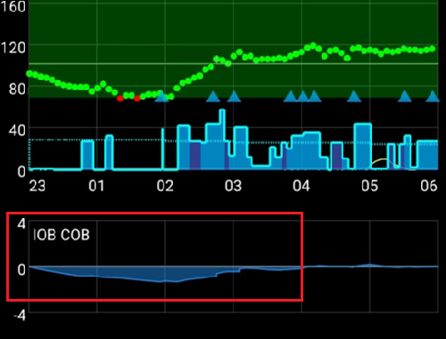
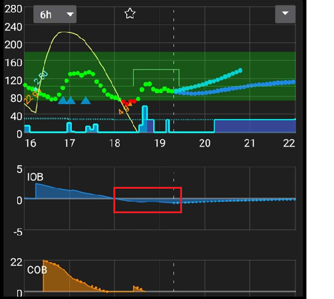

# Tweaking the AAPS' Profile

```{admonition} This is NOT a medical advice
:class: warning
請與你的醫療團隊合作，獲得糖尿病管理方面的支援與建議。</br>
僅在你已[正確設定你的 **設定檔**](https://androidaps.readthedocs.io/en/latest/SettingUpAaps/YourAapsProfile.md)，並遵循所有 **AAPS** 的目標之後，才使用本指南。
```

This guide explains the logic of the OpenAPS algorithm results with a given __Profile__, and provides information about which values in **AAPS** may be adjusted when certain situations or patterns are observed. The suggestions about basal testing below may diverge from what your care team advises.

Using **closed loop** may make basal testing easier and may significantly reduce the hypo risk if your __Profile__ basal is too strong.

## Changing profile's settings, how to proceed

1. 請先閱讀並理解下列__AAPS__ 建議的設定與說明。 Not following this advice may make the adjusting process problematic and less likely to get a well tuned __Profile__
2. 請在**數天的時間**內，仔細觀察並比較你的__血糖__與__IOB__ 的變化。
3. Keep an eye out for patterns with **AAPS** that happen around the same time (almost) everyday.
4. 持續數天進行這件事很重要。只用單日觀察到的資料來決定如何調整__設定檔__，通常會得到不佳的結果。
5. 當你觀察到可重複的模式後，例如在下午 1 點出現__血糖__飆升，或__IOB__ 為負，再開始對你的__設定檔__做小幅調整。
6. 一次只更動一項設定很重要。例如：將下午 1 點左右的基礎率提高 10%。
7. 每次更動之後，請在接下來幾天監測對你的__血糖__與__IOB__ 的影響。
8. 重複此流程：觀察、判斷，如有需要再微調。

不要急，慢慢來！

## Recommended settings and advice while tweaking basal

- 請在[啟用循環](#AapsScreens-loop-status)的情況下完成所有測試。
- **將<u>關閉</u>所有[自動化](../DailyLifeWithAaps/Automations.md)功能**
- **Turn <u>OFF</u> [DynISF](#Open-APS-features-DynamicISF), [AutoISF](#Open-APS-features-auto-isf), [AutoSens](#Open-APS-features-autosens)** so that they will not try to adapt your profile.
- 測試期間請勿進行手動操作（手動注射、臨時目標等…）：讓系統僅使用**設定檔**中的設定。
- 就[額外圖表](#AapsScreens-section-g-additional-graphs)而言：在圖表 1 中，使用活性胰島素（IOB）、活性碳水化合物（COB）（以及敏感度變化）。在圖表 2 中，使用偏差與血糖影響。需要尋求建議時，截圖請一併包含上述圖表。
- COB=0[*](#profiletuning-cob-zero)

Other considerations that should ideally be avoided, as they influence the data and can lead to poor conclusions:
- 不進行任何體能活動。
- 沒有壓力。
- 沒有生病。
- 沒有極端天氣（例如酷熱或嚴寒）。
- No failed pump or CGM sessions.
- No unannounced carbs.

Also note:
- If your [basal rate profile](#your-aaps-profile-basal-rates) is correct, when you are on target with COB=0[*](#profiletuning-cob-zero) and IOB=0, you will remain constantly on target whatever your **ISF** (**ISF** is only used when you are higher than your **BG** target).
- You need to check the actual **IOB** but also the **IOB** chart, to observe how the **IOB** evolved during the past few hours.

(profiletuning-cob-zero)=

***COB = 0**

表示餐點已消化，體內已無碳水化合物。

**AAPS** might indicate [COB=0 while you still have carbs on board](../DailyLifeWithAaps/CobCalculation.md).

## [設定檔](../SettingUpAaps/YourAapsProfile.md)定義

過**強的設定檔**是由以下幾項因素造成：

- [ISF](#your-aaps-profile-insulin-sensitivity-factor) number is too small.
- The [basal](#your-aaps-profile-basal-rates) number is too big.
- [I:C](#your-aaps-profile-insulin-to-carbs-ratio) number is too small.

## IOB 觀察

*注意：你也可以在 Nightscout 報表中使用 Loopalyzer 的 IOB 圖表，查看多天的 IOB。*

If you observe the following patterns after a few days, consider the following changes:

### IOB 為正

- **設定檔**的基礎率可能不夠強（也可能是因未回報的用餐、生病、注射部位吸收不良等原因）。


### IOB 為負

- Default basal too strong.
- May be the effect from past exercise/physical activity.



- 先前餐點：注射過多（導致非常長時間的 零臨時基礎率）



## 血糖目標觀察

### 長時間偏高

- __ISF's__ number is high and not strong enough (calculated insulin is too weak)


- __Profile__ basal might not be strong enough (**SMBs** do not have enough "basal stock" to use)
- 某項安全限制（[MaxIOB](#Open-APS-features-maximum-total-iob-openaps-cant-go-over)？）可能已啟動，正在限制胰島素注射。 Verify in the **APS** plugin screen (**Configuration → APS → Open plugin**); see [SMB](#Open-APS-features-super-micro-bolus-smb).
- 技術問題：注射點吸收、輸注組等。

### 長時間偏低

- __ISF__ 過強，數值需要調高。
- __設定檔__ 的基礎率過強（若同時出現負 IOB）

### 雲霄飛車（忽高忽低）

- **ISF** 過強？請參閱你的 [AAPS 設定檔](#your-aaps-profile-insulin-sensitivity-factor)


## 餐後血糖觀察

### 快速上升且血糖變高

- Food contains fast carbs (like fruit juice).
- Consider doing a pre-bolus or a slightly earlier pre-bolus.
- Bolus (IC or injected %) not strong enough.


### 快速上升後血糖轉為偏低

- Consider doing a pre-bolus, your **Profile** might be too aggressive (over correction of the raise)
- Bolus too strong.


## [如何計算你的 I:C](#your-aaps-profile-insulin-to-carbs-ratio)

1. 首先，你需要在 **設定檔** 中正確設定預設基礎率。
2. 從目標值開始，最好沒有負 IOB。
3. Record the total insulin given in **Manage → Pump** (or pump history) and call it Start insulin C4. 非常精準地量測已知份量的碳水，並記錄開始時間與 Start IOB。 Then enter carbs and bolus information into **AAPS** using the wizard (with the current configured CI). 別忘了把碳水吃掉 ;)
4. 幾個小時後，當 COB=0[*](#profiletuning-cob-zero) 且你回到目標值時，記錄結束時間，並記下 End IOB；像先前一樣檢查總注射胰島素，並將其稱為 End insulin。*注意：只要長於你的消化時間，時間範圍並不重要*
5. 從 Start 與 End 胰島素用量的差額中，再減去/加上 End IOB - Start IOB 的差異。 Then subtract the basal insulin calculated from your **Profile's** settings.
6. 若 __血糖__ 在目標範圍內，你將得到用於「消化」碳水的總胰島素用量。計算你的 **I:C**。

### I:C 計算說明

- 在 **設定檔** 中設定正確的預設基礎率後，於任何時間範圍內，你應該能維持在目標值，且 IOB 接近 0。你只會得到 **設定檔** 的基礎率。
- 接著加入碳水與注射。等待身體消化完所有碳水並回到 **血糖** 目標。你的胰島素用量將是基礎量加上處理碳水所需的胰島素。你計算基礎所用的胰島素（依 **設定檔**），剩餘部分就是用來消化碳水的胰島素。
- 若時間範圍太短，將有碳水尚未消化，因此「碳水所需的胰島素」會不正確。
- 若時間範圍太長，不會有不良影響。你會用完所有碳水，並得到較多的基礎用量。最後，你會從總胰島素用量中扣除基礎量；時間範圍延長（基礎用量較多）不會影響結果。

Originally written up by @Robby (Discord) on tips and tricks to help tune your **AAPS Profile**, reviewed and edited by the community (thank you!).
