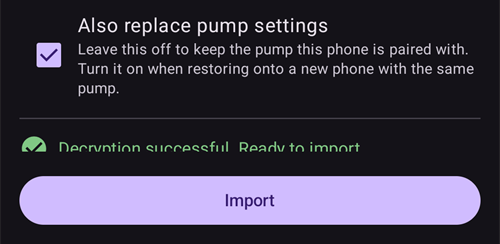

(reinstall-aaps)=
# 使用新的金鑰庫重新安裝 AAPS

每個 **AAPS** apk 都會使用**金鑰庫**簽署。只有使用**相同金鑰庫**簽署的更新，才能安裝在目前的 **AAPS** 上；這樣就能保留所有設定和資料。因此，建議您將金鑰庫及其密碼存放在安全的地方。

如果您嘗試安裝使用不同金鑰庫簽署的 apk，系統會顯示錯誤訊息，說明安裝失敗！

(reinstall-aaps-when)=
## 什麼時候需要重新安裝？

如果新的 apk 使用不同的金鑰庫簽署，您就必須先解除安裝，再重新安裝 **AAPS**。例如：

- 您找不到舊的金鑰庫或其密碼。
- 您建立了新的金鑰庫，例如使用[瀏覽器建置方式的選項 1](../SettingUpAaps/BrowserBuildKeystore.md)，或在 [AAPS Builder](../SettingUpAaps/BrowserBuildAapsBuilder.md) 中選擇**建立新金鑰**。
- 您在新電腦上進行建置，卻沒有將金鑰庫複製到新電腦。

如果您還保有金鑰庫，就不需要閱讀本頁：請沿用原本的金鑰庫，並直接[更新 **AAPS**](../Maintenance/UpdateToNewVersion.md)。

(reinstall-aaps-before)=
## 開始之前

- 解除安裝 **AAPS** 會刪除所有設定、您的[目標](../SettingUpAaps/CompletingTheObjectives.md)，以及目前的幫浦連線。您可以匯入**設定檔**來還原這些內容，因此請確認您有近期的設定檔。
- 設定檔不包含您的治療和血糖歷史記錄。如果您有上傳資料到 [Nightscout](../SettingUpAaps/SettingUpTheReportingServer.md)，重新安裝後即可將資料載回（步驟 8）。
- 您需要[**主密碼**](#Preferences-master-password)：設定檔是使用該密碼加密的。
- **Omnipod 和 Medtrum 使用者：**請先閱讀[無管路幫浦](#ExportImportSettings-tubeless-pumps)。您的設定檔必須是在您目前佩戴的 pod 或貼片使用期間匯出的。
- 如有需要，請在開始前[設定 CGM/血糖來源接收器](../Getting-Started/CompatiblesCgms.md)。

(reinstall-aaps-steps)=
## 步數

圖片顯示從 **AAPS** 3.4（步驟 1 到 3）升級至 **AAPS** 4（步驟 6 到 8）的流程。其他版本的畫面會稍有不同。

(reinstall-aaps-export)=
### 1. 匯出你的設定

使用目前安裝在手機上的 **AAPS** 匯出設定。詳細資訊請參閱[設定匯出](#ExportImportSettings-Settings-Export)。

在 **AAPS** 3.4 中：開啟**維護**，然後點選**匯出選項**。在**使用者設定**下方，勾選**本機儲存**，然後點選**確定**。

*注意：您也可以使用[雲端儲存](#preferences-maintenance-cloud)來保留一份備份，這是個不錯的做法；但請保留本機儲存，以便快速還原設定。*

按鈕現在會顯示**匯出設定（本機）**。點選該按鈕。

**AAPS** 會顯示即將建立的檔案名稱。點選**確定**，輸入主密碼，再點選**確定**。

在 **AAPS** 4 中：開啟**維護**，選取**匯出設定**旁的**本機**標籤，然後點選**匯出設定**。

(reinstall-aaps-copy)=
### 2. 將設定檔從手機複製出來

檔案位於 [**AAPS** 目錄](#SetupWizard-StoragePermission)中的 **preferences** 資料夾，檔名格式如下：`2026-10-13_222735_full.json`。將檔案複製或上傳到外部位置（例如電腦或雲端儲存服務）。解除安裝後，檔案通常仍會留在手機上，但建議另外備份一份，以防萬一。

(reinstall-aaps-nightscout-before)=
### 3. 與 Nightscout 同步

這個步驟並非必要，但如果您使用 [DynISF](#Open-APS-features-DynamicISF)，建議執行此步驟：如此一來，您就能直接沿用目前的設定，不必等待 5 天來累積外掛所需的資料。 NSClient V3 必須先[啟用並完成設定](../SettingUpAaps/SettingUpTheReportingServer.md)。

解除安裝前，請確認 Nightscout 已取得您的所有資料。

開啟 **NSClient**，點選螢幕底部的**完整同步**按鈕，然後點選**確定**。

*注意：所需時間取決於您的 Nightscout 主機服務。*

接著，**AAPS** 會詢問您是否要清理資料庫。點選**確定**會從手機移除 3 個月以前的資料，讓同步速度大幅提升。點選**取消**則會在不清理資料的情況下進行同步。反正解除安裝時會刪除手機中的資料庫，因此選哪個選項都可以。

同步完成前，請保持 **AAPS** 開啟。

(reinstall-aaps-build)=
### 4. 建置新的 apk

使用新的金鑰儲存庫[建置](../SettingUpAaps/BuildingAaps.md)已簽署的新 apk，並將它傳送到手機。

(reinstall-aaps-uninstall)=
### 5. 解除安裝 AAPS

在手機的**設定** > **應用程式** > **AAPS** 中，點選**解除安裝**，再點選**確定**確認。

(reinstall-aaps-install)=
### 6. 安裝並啟動新的 AAPS

[安裝](../SettingUpAaps/TransferringAndInstallingAaps.md)新的 apk，然後啟動 **AAPS**。[設定嚮導](../SettingUpAaps/SetupWizard.md)會要求授予 **AAPS** 所需的權限：請逐一點選**授予**。這也會再次關閉[電池最佳化](#setup-wizard-bluetooth-battery-optimisation)。

在**AAPS 目錄**的設定中，選取先前使用的同一個 **AAPS** 資料夾（內含**preferences** 資料夾），點選**使用這個資料夾**，再點選**允許**。

當 **AAPS** 找到您匯出的設定時，設定嚮導會顯示「[找到已儲存的設定](#setup-wizard-import-settings)」畫面，您可以在此匯入設定。您也可以關閉嚮導，並依照下方說明，從 **維護** 匯入設定。

(reinstall-aaps-import)=
### 7. 匯入你的設定。

如果設定檔已不在手機上，請將檔案複製回 **AAPS** 目錄中的 **preferences** 資料夾。

開啟選單 (☰) > **維護**，選取 **匯入設定** 旁的 **本機** 標籤，然後點選 **匯入設定**。

清單會列出每個檔案的 **AAPS** 版本和檔案建立時間。選取您在步驟 1 匯出的檔案。

您不需要先在新的 **AAPS** 中設定主密碼。在 **解密密碼** 欄位輸入您匯出設定時使用的主密碼，然後點選 **解密**。出現「**檔案是使用不同的密碼加密**」是正常的：新的 **AAPS** 尚未取得您的密碼。匯入時，密碼會和其他設定一起還原。

勾選 **同時取代幫浦設定**：如果未勾選，幫浦及其設定就不會還原。 Omnipod 和 Medtrum 使用者：只有在目前使用的 pod 或貼片期間匯出檔案時，才勾選此選項（請參閱 [無導管幫浦](#ExportImportSettings-tubeless-pumps)）。

點選 **匯入**，再點選 **確定** 套用設定，然後在「**設定已套用**」畫面再次點選 **確定**。

(reinstall-aaps-nightscout-after)=
### 8. 從 Nightscout 取回歷史資料

開啟選單 (☰) > [**組態設定**](../SettingUpAaps/ChangeAapsConfiguration.md) > **通訊**，然後點選 **NSClientV3** 下方的 **開啟外掛**。確認狀態顯示為 **已連線**。如果不是，請參閱 [NSClient 疑難排解](TroubleshootingNsClient.md)。

點選螢幕底部的 **完整同步** 按鈕，然後點選 **確定**。由於這是新的資料庫，清除資料的提示您可以選擇任一選項。

**AAPS** 會從 Nightscout 載入您的資料。同步完成後，記錄中會顯示 **完整同步已完成**。

(reinstall-aaps-check)=
### 9. 確認設定並繼續循環

確認幫浦已連線，且 CGM 讀取值正常傳入，然後繼續使用循環。

(reinstall-aaps-afterwards)=
## 後續事項

從現在起，請務必使用新的金鑰庫，並將金鑰庫及其密碼妥善儲存在手機以外的安全位置。請參閱 [建立備份](../Maintenance/ExportImportSettings.md)。
