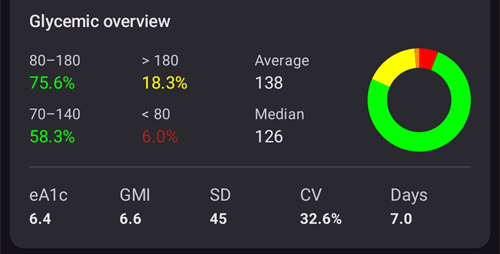

# 資料檢視

## AAPS 歷史瀏覽器

**AAPS** 會將所有歷史紀錄（**血糖**、治療紀錄、基礎率、目標、**設定檔切換**等）儲存在手機的本機資料庫中。此資料庫不包含在[設定匯出](../Maintenance/ExportImportSettings.md)中。您可以在 **AAPS** 中透過下方介紹的 **歷史紀錄瀏覽器**和**統計資料**畫面查看資料庫內容。如需長期檢視和報告，請將資料上傳至 [Nightscout](../SettingUpAaps/Nightscout.md) 或 [Tidepool](../SettingUpAaps/Tidepool.md)。

您可以在 **歷史紀錄瀏覽器**中查看 **AAPS** 的歷史紀錄：開啟**選單**（☰），然後選取**歷史紀錄瀏覽器**。

- 點選**日期卡片**，選取要查看的日期。
- 圖表開啟時會縮小顯示，呈現**所選日期的完整資料**。用雙指縮放即可查看其中一段資料。
- 使用 **<** 和 **>** 箭頭往前或往後切換一天；點選 **現在**則可返回當天。
- 圖表顯示的資料與主畫面圖表相同（血糖、治療紀錄、基礎率、IOB、COB、活動、偏差等）。

(reviewing-statistics)=
## AAPS 統計

**AAPS**提供基本的監控統計資料。

大多數值是根據 ADA 2023 [建議](https://diabetesjournals.org/care/article/46/Supplement_1/S97/148053/6-Glycemic-Targets-Standards-of-Care-in-Diabetes)引用的。

若要開啟統計資料，請開啟**選單**（☰），然後選取**統計資料**。

**統計資料**畫面有四個分頁：**胰島素**、**目標範圍內時間**、**血糖**和**週期**。點選分頁，或向左、向右滑動，即可切換分頁。

(reviewing-tdd)=
### 胰島素分頁：每日總劑量

**每日總劑量**卡片會逐日顯示過去幾天（最多一週）的每日數值，只列出 **AAPS** 有胰島素資料的日期；接著顯示這些日期的**平均值**，最後顯示**今天**截至目前的數值。安裝 **AAPS** 後，畫面一開始只會顯示 **今日**。欄位如下：

- **基礎胰島素**：僅顯示基礎胰島素。
- **注射**：注射治療與 SMB 的總和。
- **TDD 總量**：胰島素每日總量（**TDD**），也就是當天注射的基礎胰島素與注射胰島素總和。
- **碳水化合物**：已申報的碳水化合物與 eCarbs 治療。

開啟頁面時會計算 **TDD** 區塊，計算需要幾秒鐘。點選 **重新計算**，即可再次計算。

**TDD** 是每天注射的注射胰島素與基礎胰島素總量。有些醫師（尤其是初次使用幫浦的人）採用 50:50 的基礎－注射胰島素比例：基礎胰島素總量（**TBB**，也就是 24 小時內各基礎胰島素速率的總和）應約為 TDD 的一半。也有些醫師認為，TBB 應占 TDD 的 32% 到 37%。

和大多數經驗法則一樣，這個比例在實際上的參考價值有限。每個人的糖尿病狀況都可能不同！

### 目標範圍內時間分頁

目標範圍內時間（**TIR**）：70-180 mg/dL 或 3.9-10 mmol/L。

**TIR**資訊在7天和30天內可用，取決於**AAPS**資料庫中可用資料的多少。

下方提供嚴格目標範圍內時間（TITR）的統計資料，範圍為 70-140 mg/dL 或 3.9-7.8 mmol/L（螢幕上顯示的範圍為 70-141）。

**與你的內分泌醫生討論目標**

你的糖尿病情況可能會有所不同。任何建議的目標應與內分泌醫生或支援醫療團隊討論。如果正確使用，AAPS的統計資料會是追蹤__血糖__趨勢及監測進度的好工具。

下方的 **Dexcom TIR** 卡片會顯示 14 天的詳細 **TIR** 統計資料。

**SD**: 標準差，是**[血糖](https://www.ncbi.nlm.nih.gov/pmc/articles/PMC3125941/)**變異性的指標（值越高，情況越差）。

HbA1c: 根據CGM測量的平均計算出的糖化血紅蛋白估計值。這是一個指標性值，可能不符合血液HbA1c測試結果。

(reviewing-statistics-agp)=
### 血糖分頁：動態血糖概況（AGP）

**動態血糖概況**（**AGP**）會顯示你一天中血糖通常的變化情形。使用上方的按鈕選擇期間：**今日**、**24 小時**、**7 天**、**30 天**或**90 天**。

- **圖表**：從午夜到午夜的一天。線條代表**中位數**（該時段有一半的讀取值較低，另一半較高）。線條周圍的色帶涵蓋讀取值中間的一半（**25–75%**），較寬的色帶則涵蓋大部分讀取值（**10–90%**）。色帶越窄，表示你在該時段每天的血糖越相近。虛線標示你的**低血糖標記**、140 mg/dL（7.8 mmol/L）以及**高血糖標記**。
- **血糖概況**：顯示你處於目標範圍內、嚴格目標範圍內（70–140 mg/dL 或 3.9–7.8 mmol/L）、高於目標範圍及低於目標範圍的時間，接著顯示血糖的**平均值**與**中位數**。你的目標範圍是「**低血糖標記**」和「**高血糖標記**」的設定值，設定位置在[視覺化範圍](#Preferences-range-for-visualization)。
- **eA1c** 和 **GMI**：根據你的 CGM 讀取值計算出的兩種 HbA1c 估算值。和上方的 HbA1c 一樣，這些數值可能與血液檢查得出的 HbA1c 不一致。
- **SD**（標準差）和 **CV**（變異係數）：表示血糖的變化幅度。數值越低，表示血糖越穩定。
- **天數**：計算時使用的 CGM 資料天數。

 

AGP 下方的**血糖五角圖（CGP）**卡片會將過去 14 天的五項血糖指標繪製成五角圖。五角圖越小，表示血糖控制越好。

### 週期分頁：TDD 週期模式

**TDD 週期模式**會以 28 天為一個週期，疊加顯示每日胰島素總量，協助你找出重複出現的模式。每個週期都會以一條線表示（**個別週期**），並一併顯示各週期的平均值。

- **原始 TDD**／**清理後的 TDD**：選擇使用實際注射的每日總劑量，或扣除用於碳水化合物的胰島素後的 TDD。
- **週期偏移**：調整週期的起始日（0 到 27 天）。

至少需要 56 天的資料（2 個週期）。資料不足時，卡片會顯示**資料不足（至少需要 56 天的資料，才能顯示 2 個週期）**。只有在開啟**週期**分頁時才會計算模式，因為計算時會讀取 168 天的資料。

(aaps-screens-treatments)=
## 治療紀錄

開啟主畫面左上角的**選單**（☰），然後選取**治療紀錄**。在此畫面中，你可以查看及修改下列治療紀錄。每種治療紀錄各有一個分頁（左右滑動分頁列即可查看所有分頁）：

* 碳水化合物與注射
* [延長注射](#Extended-Carbs-extended-bolus-and-switch-to-open-loop-dana-and-insight-pump-only)
* 臨時基礎
* [臨時目標](../DailyLifeWithAaps/TempTargets.md)
* [設定檔切換](../DailyLifeWithAaps/ProfileSwitch-ProfilePercentage.md)
* Careportal：備註和 Careportal 項目
* 執行模式：循環狀態的歷史紀錄
* 用戶輸入：其他未發送至 Nightscout 的筆記

每行結尾的小圖示會顯示資料的來源或傳送目的地：
* **Nightscout** 圖示（Nightscout 標誌）：資料來自 Nightscout，或已記錄到 Nightscout
* **幫浦** 圖示：資料來自幫浦紀錄（資料已由幫浦處理）
* **垃圾桶** 圖示：此項目已刪除（只有在您點選右上角的**眼睛**圖示，顯示已刪除的項目時才會出現）

(screens-bolus-carbs)=
### 碳水化合物與注射

在此標籤中，你可以查看注射和碳水化合物的紀錄。每筆注射（第 **1** 行）旁邊都會顯示剩餘的相關活性胰島素（IOB）和胰島素劑量。注射的來源可以是：
* 餐前（通過胰島素、快速嚮導或注射嚮導按鈕手動輸入）
* 當使用 SMB 功能時的 SMB

碳水化合物項目（第 **2** 行）會以克為單位顯示份量。

如果您使用[注射嚮導](#aaps-screens-bolus-wizard)計算胰島素劑量，可以按一下注射那一行中的「Calc」文字，查看注射劑量的計算明細。

根據使用的幫浦，胰島素和碳水化合物可以顯示在一行中，或者會導致多行顯示：一行顯示計算詳細訊息，一行顯示碳水化合物，一行顯示注射本身。

您可以在治療紀錄中更正錯誤的碳水化合物項目（_也就是_高估或低估碳水化合物份量）。請注意，無法編輯現有的輸入，你需要遵循以下過程：

1. 請在主畫面確認並記下目前的活性碳水化合物（COB）和活性胰島素（IOB）。
2. 視幫浦而定，碳水化合物可能會與胰島素一起顯示在同一行，也可能會另列一筆（例如 Dana RS）。
3. 移除碳水化合物份量錯誤的項目：按一下垃圾桶圖示，選取要移除的行，再按一下垃圾桶圖示確認。
4. 再次查看主畫面上的 COB，確認碳水化合物項目已成功移除。
5. 如果碳水化合物和胰島素列在同一行，請對 IOB 執行相同操作。

   → 如果碳水化合物未按照預期移除，並且您如這裡所述（6.）添加額外碳水化合物，COB 將過高，這可能導致胰島素給藥過量。

6. 重新輸入正確的碳水化合物份量（點選底部導覽列中的 **治療 → 碳水化合物**，或使用 [QuickLaunch](#quicklaunch) 的 **碳水化合物**按鈕），並確認事件時間正確。
7. 如果碳水化合物和胰島素列在同一行，也必須輸入胰島素劑量。請確認事件時間正確，並在確認新增項目後查看主畫面上的 IOB。

### 臨時基礎

循環應用的**臨時基礎**在此顯示。如果某筆項目仍對 IOB 有影響，相關資訊會顯示在速率旁邊（第 **1** 行）。它可以是：
* 如果臨時基礎率高於設定檔中的基礎率，IOB 會是正值。
* 如果設定了零臨時基礎率（如第 **1** 行），或臨時基礎率低於設定檔中的基礎率，IOB 會是負值。

刪除輸入僅影響你在 Nightscout 的報告，並可能影響你的實際 IOB - 不建議這樣做。

在行的左側，紅色 S 代表「暫停」：當基礎目前未給藥時會發生。例如，這在更換藥囊過程中是一個正常情況。

### 臨時目標

臨時目標的歷史可以在這裡查看。

### 設定檔切換

設定檔切換的歷史可以在這裡查看。每次切換設定檔時，可能會看到多筆項目：同時儲存在 NS 和幫浦紀錄中的第 **1** 行，代表實際發生的切換。儲存在 Nightscout、但未記錄於幫浦紀錄中的第 **2** 行，代表使用者提出的設定檔切換要求。

刪除輸入僅影響你在 Nightscout 的報告，永遠不會實際更改當前的設定檔。

您可以使用第 **2** 行中的**複製**按鈕，複製一筆**設定檔切換**紀錄。如需更多資訊，請參閱[您的 AAPS 設定檔 > 管理設定檔](#your-aaps-profile-clone-profile-switch)。

### 照護入口

此分頁會顯示所有記錄在 Nightscout 中的備註和照護入口項目。

(AapsScreens-running-mode)= (aaps-screens-running-mode)=
### 運行模式

此分頁會顯示[循環狀態](#AapsScreens-loop-status)的變更紀錄：開啟、關閉、LGS、暫停、中斷連線。

### 使用者輸入

此分頁會列出使用者或**自動化**在 **AAPS** 中執行的操作（循環模式變更、設定檔切換、治療、匯出設定等）。這些項目不會傳送到 Nightscout。

------

## Nightscout與Tidepool之間有什麼區別？

Nightscout可以幫助使用者儲存**AAPS**的資料，並提供多種[報告工具](https://nightscout.github.io/nightscout/reports/)。

而Tidepool則允許使用者[檢視他們的資料](https://www.tidepool.org/viewing-your-data)，並提供[與內分泌團隊的簡單分享](https://www.tidepool.org/providers/how-it-works#tidepool-data-platform)。