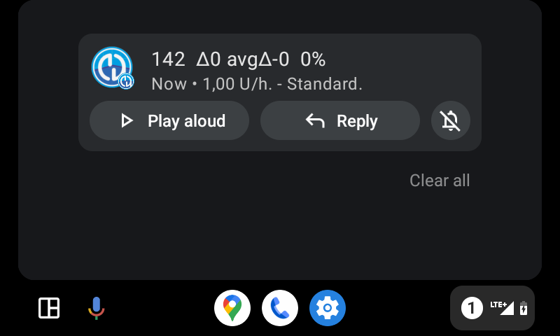

# Android Auto

**AAPS** 能夠將你的目前狀態以訊息形式直接發送到車內的 Android Auto。

## 需求

**AAPS** 使用了 Android Auto 的一個功能，允許來自手機應用的訊息傳輸到車載音響顯示。

這意味著：

* Android must allow **AAPS** to show notifications and
* 由於**AAPS** 是非官方應用，需允許 Android Auto 使用「未知來源」。

## Check that AAPS can show notifications

**AAPS** always shows a status notification with your current glucose, IOB and COB. This is the notification that Android Auto displays in the car. There is nothing to switch on in **AAPS**, but Android must allow **AAPS** to show notifications.

On your phone, open **Settings** > **Apps** > **AAPS** > **Notifications** and make sure **All AAPS notifications** is on.

Scroll down and make sure **Ongoing status** is on: this is the channel of the status notification.

Please check now that you see the **AAPS** status notification on the phone before you walk to your car!

## 允許 Android Auto 使用「未知來源」。

由於**AAPS**不是官方的 Android Auto 應用，因此需要在 Android Auto 中啟用「未知來源」的通知。這是透過使用開發者模式來完成的，我們將在此為你展示。

前往你的車輛並將手機連線到車載音響系統。

你現在應該會看到類似於此螢幕的畫面。

點擊**設置**圖示以開始配置。

向下滾動到頁面底部並選擇**在手機上查看更多**。

現在我們將在手機上啟用開發者模式。

第一個畫面看起來是這樣的。向下滾動到頁面底部。

你會看到列出的 Android Auto 版本。連續點擊 Android Auto 版本 10 次。透過此隱藏的組合操作，你現在已啟用了開發者模式。

在彈出的對話框「允許開發設置？」中確認你希望啟用開發者模式。

在**開發者設置**中啟用「未知來源」。

如果你願意，現在可以退出開發者模式。點擊右上角的三點選單來執行此操作。

## 在車上顯示通知

在車內的 Android Auto 中，點擊右下角的**數字圖示**。

你的 CGM 資料將顯示如下：

(android-auto-troubleshooting)=

## 問題排除：

* If you don't see the notification, check if you [allowed AAPS to show notifications](#check-that-aaps-can-show-notifications) in Android and if [Android Auto has access rights to notifications](#allow-the-use-of-unknown-sources-with-android-auto).