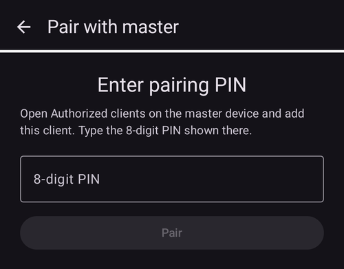
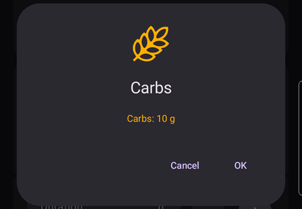

(client-master-control)=
# 主控端 ↔ 用戶端控制（簽章式遠端控制）

從 **AAPS** 4 版開始，執行 **AAPSClient** 的跟隨手機不只能透過 Nightscout *通報*治療資料：與主手機**配對**後，便能傳送**簽章指令**。主手機（**主控端**）會檢查、確認並執行這些指令，包括透過主控端的幫浦**注射胰島素**。

本頁將說明其運作方式，以及如何設定和使用。

```{contents} Table of contents
:depth: 2
:local: true
```

```{admonition} Wording used on this page
:class: note
- **主控端** = 持有幫浦並執行循環的主要 **AAPS** 手機（`full` App）。
- **用戶端** = 沒有幫浦的 **AAPSClient** 手機；它會跟隨主控端，現在也能*控制*主控端。
- 兩支手機都必須連線至<strong>同一個 Nightscout</strong>網站。所有通訊仍會透過 Nightscout 傳輸，不需要讓兩支手機直接連線。
```

---

## 運作方式

```{admonition} Coming from AAPS v3?
:class: note
在 **AAPS** v3 中，**AAPSClient** 只能將未簽章的照護入口治療寫入 Nightscout，且無法注射。現在必須先完成一次[配對](#client_master_master_setup)，才能使用遠端控制。另請參閱 [AAPS v4 的變更](#v4changes-remote-control)。
```

**AAPS** v4 使用專用的**用戶端控制**通道。這個通道仍透過你的 Nightscout 網站運作（位於 `settings` 集合中），但每則訊息都會使用只有兩支手機知道的密鑰進行**加密簽章**。配對時會傳送一次密鑰，接著立即更換為新的密鑰，因此密鑰不會以明文傳輸。

核心原則是**由主控端決定**：

1. 用戶端會傳送一項*操作要求*（「注射 2 U」、「啟動運動情境」、「設定這個臨時目標」等）。
2. **主控端**會根據**自身**的即時資料（設定檔、IOB、COB、目前的臨時目標、幫浦）重新計算並**限制**操作，並**產生使用者將看到的確切確認內容**。
3. 用戶端（或手錶）會顯示**主控端**產生的確認文字，不會自行產生確認內容。
4. 確認後，主控端會**執行一次**操作，並將結果回報給用戶端。

這對你來說代表：

- **指令皆經簽章**：只有已配對的用戶端才能傳送指令（每個用戶端都有自己的配對密鑰和簽章）。舊指令或重複傳送的指令都會遭到拒絕。
- **可為每個用戶端設定角色**：你可以決定各用戶端可執行的操作，從*唯讀*到*管理員*皆可，請參閱[用戶端角色](#client-master-control-roles)。
- **可從用戶端注射胰島素**：主控端會透過自己的幫浦執行注射，用戶端則會顯示注射進度。
- **由主控端決定**：主控端會依據自身的限制來限制每項操作，並產生用戶端上顯示的確認內容。
- **只有已配對的用戶端可以變更治療**：啟用用戶端控制時，主控端不再接收透過 Nightscout 直接輸入的治療或變更，請參閱[強化模式](#client-master-control-hardened-mode)。
- **每個用戶端都有自己的 Nightscout 權杖**，且只具備用戶端所需的權限，請參閱[用戶端專用的 Nightscout 權杖](#client-master-control-own-token)。
- **主控端離線時**：操作會遭到封鎖，並顯示清楚的訊息。
- **撤銷用戶端權限**：只需點一下即可撤銷個別用戶端的權限，也可以使用主控端的開關停用所有用戶端。

可從用戶端執行的操作包括：**注射**、**碳水化合物／eCarbs**、**臨時目標**（設定及取消）、**切換設定檔**、**循環／執行模式**變更、**臨時基礎率**（設定及取消）、**延長注射**（設定及取消）、**胰島素選擇</strong)，以及**[情境](../DailyLifeWithAaps/Scenes.md)**。主控端與用戶端之間也會同步部分**偏好設定**。</p>

---

## 角色與先決條件

```{admonition} Before you start
:class: important
- **主控端**使用一般的 `full` **AAPS** 版本，並已連線至你的幫浦。
- **主控端**使用 **NSClientV3** 連線至你的 Nightscout，且顯示為*已連線*。請提供 Nightscout 的<strong>管理員權杖</strong>：主控端會使用此權杖，為每個用戶端建立專屬權杖，並以 QR Code 顯示給用戶端。
- **用戶端**使用 **[AAPSClient](AapsClient.md)**（或供其他病患使用的 **AAPSClient2**／**AAPSClient3**，請參閱[關於 AAPSClient、AAPSClient2 和 AAPSClient3](#remotecontrol-aapsclient-versions)）。用戶端必須使用<strong>同一個</strong> Nightscout。如果使用主控端的 QR Code 進行設定，用戶端會從主控端取得 Nightscout 位址和權杖；否則，請先在用戶端自行設定 **NSClientV3**。
- 兩支手機都必須啟用 **WebSockets**：指令只能透過 WebSocket 連線傳送至主控端。啟用用戶端控制時，**AAPS** 會在主控端和已配對的用戶端上保持 WebSockets 啟用。
```

配對和同步是兩件不同的事：

- **同步**（資料：血糖、治療、設定檔）的設定方式與以往相同，請參閱[同步](#RemoteControl_aapsclient)。你可以使用主控端的 QR Code，在用戶端上完成同步設定。
- **配對**（控制：本文介紹的簽章指令通道）則是新增的步驟，請參閱下方說明。

---

## 設定方式

(client_master_master_setup)=
### 1. 在主控端啟用控制功能並新增用戶端

在主控端開啟**管理**畫面，然後選擇**已授權的用戶端**。

開啟**允許用戶端控制**（預設為**關閉**）。這是主控端的緊急停止開關：關閉時，任何用戶端都無法傳送指令，但已配對的用戶端仍會保留，方便你日後重新啟用。開啟此功能時也會啟用[強化模式](#client-master-control-hardened-mode)，畫面會顯示「*強化模式已開啟*」，旁邊的**(i)** 圖示會提供相關說明。在[簡易模式](#preferences-simple-mode)中，用戶端控制一律保持啟用，因此不會顯示此開關。


點選右下角的**+** 按鈕以新增用戶端。在**新增用戶端**對話方塊中：

1. 輸入**裝置名稱**，方便你在清單中辨識。
2. 選擇**手機的設定方式**（請參閱下方表格）。
3. 選擇**[角色](#client-master-control-roles)**。系統不會替你選擇：適合的角色取決於手機的使用者。


| 方式                         | 新手機會取得的內容                                     | 適用時機                                   |
| -------------------------- | --------------------------------------------- | -------------------------------------- |
| **QR Code：Nightscout 與配對** | Nightscout 位址、專屬的 Nightscout 權杖和配對資訊，一次掃描即可完成 | 新手機有相機：最快的方式，不必輸入任何內容                  |
| **QR Code：僅 Nightscout**   | Nightscout 位址和專屬的 Nightscout 權杖，不含配對資訊        | 手機只需要**顯示**資料，不會傳送指令                   |
| **PIN**                    | 只有配對資訊；保留手機原有的 Nightscout 設定                  | 手機沒有相機（或主控端無法建立權杖）；手機必須已連線至 Nightscout |

兩種 QR Code 方式都需要在主控端的**NSClientV3**設定中設定**管理員權杖**，因為主控端會在 Nightscout 中建立用戶端的權杖。若未設定管理員權杖，畫面仍會顯示 QR Code 選項，但無法選取，對話框也會說明原因；**PIN 碼**則一定可以使用。

#### 使用 QR Code

點選**確定**：主控端會建立用戶端的 Nightscout 權杖，並顯示**QR Code**。包含配對資訊的代碼約**兩分鐘**內有效；畫面會倒數，並在用戶端完成配對後自動關閉。依照[在用戶端上](#client_master_client_setup)的說明，在新手機上掃描 QR Code。

```{admonition} The QR code is a secret
:class: warning
任何看得到 QR Code 的人都能讀取你的 Nightscout 資料；包含配對資訊的代碼也包含配對資訊。只將它顯示給新手機。代碼顯示在螢幕上時，**AAPS** 會禁止擷取螢幕畫面。
```


#### 使用 PIN 碼

點選**確定**：主控端會顯示 8 位數的**配對 PIN 碼**，並分成兩組、每組 4 位數（例如 `1234 5678`）。此 PIN 碼**只能使用一次**，並且**約兩分鐘後就會失效**。


```{admonition} The pairing PIN is a secret
:class: warning
PIN 碼可保護透過 Nightscout 傳送的配對密鑰。只將 PIN 碼分享給要配對的裝置，請勿公開發布；若不使用，請讓它自然失效。再次點選 **+**，隨時都能產生新的 PIN 碼。
```

(client_master_client_setup)=
### 2. 在用戶端上 — 與主控端配對

#### 掃描 QR Code

你可以在以下兩個位置掃描主控端的 QR Code：

- 在用戶端的**設定嚮導**中，選擇 Nightscout 步驟之前的「**從主控端設定**」步驟。掃描一次即可設定 Nightscout；若代碼包含配對資訊，也會同時完成配對，整個設定流程便告完成：嚮導會關閉並開啟主畫面；
- 之後也可以隨時前往**管理 → 與主控端配對 → 掃描 QR Code**。

首次使用時，**AAPSClient** 會要求**相機**權限。如果你拒絕授權，畫面會說明需要使用相機；你可以點選**再試一次**來授權，或改用 PIN 碼配對。

將相機對準 QR Code。用戶端會顯示代碼的內容 — Nightscout 位址，以及代碼包含配對資訊時的配對主控端 — 並詢問「**要使用此代碼嗎？**」。點選**使用**：用戶端會啟用**NSClientV3**，以代碼中的 Nightscout 位址和權杖取代原有設定，並啟用 WebSocket。若代碼包含配對資訊，也會將手機與主控端配對；手機連線至 Nightscout 後，就會立即向主控端打招呼。


```{admonition} Scanning is available on Android
:class: note
iOS 目前尚未提供掃描器，桌上型電腦也沒有相機：請改用 PIN 碼。
```

#### 輸入 PIN 碼

在用戶端開啟**管理 → 與主控端配對**（或在 Nightscout 步驟之後，選擇嚮導中的**與主控端配對**步驟），**輸入主控端顯示的 8 位數 PIN 碼**，再點選**配對**。用戶端會使用 PIN 碼，透過 Nightscout 安全地取得配對邀請，接著詢問「**要與此主控端配對嗎？**」，並顯示主控端的識別碼。點選**配對**確認（螢幕截圖請參閱[與主控端配對](#aapsclient-pairing-with-the-master)）。



#### 配對完成後

用戶端完成配對後，會向主控端傳送 **Hello**，並以 **啟動** 狀態顯示在主控端的 **已授權的用戶端** 清單中，並附上 *「上次連線時間」*。用戶端會根據配對資訊得知自己的[角色](#client-master-control-roles)，因此會立即顯示適用的按鈕。在設定嚮導中完成配對後，嚮導也會隨之結束。在同一個步驟中，兩支手機會將配對密鑰替換成新的密鑰，且新密鑰不曾傳輸過（請參閱[安全性注意事項](#client-master-control-security)）。若用戶端是透過 PIN 碼設定，系統也會為它建立專屬的 Nightscout 權杖（請參閱[用戶端專屬的 Nightscout 權杖](#client-master-control-own-token)）。一個用戶端同一時間只能與**一個**主控端配對；若要改與其他主控端配對，請先**取消配對**。


### 3. 管理用戶端

在主控端的**已授權的用戶端**畫面中，您隨時可以：

- 使用用戶端名稱下方的四個按鈕，**變更用戶端角色**。新角色會立即生效，不必重新配對。
- **查看用戶端使用哪個 Nightscout 權杖**寫入資料：「*專屬的 Nightscout 權杖*」就是您要使用的權杖。如果看到紅色文字「*使用的 Nightscout 權杖……權限高於用戶端所需*」，表示用戶端仍在使用權限過高的權杖，通常是您的管理員權杖。請參閱[用戶端專屬的 Nightscout 權杖](#client-master-control-own-token)。
- **撤銷**單一用戶端的授權：點選它旁邊的**垃圾桶**圖示。用戶端必須重新配對後，才能再次傳送指令。用戶端專屬的 Nightscout 權杖也會一併刪除，因此它也無法再讀取您的 Nightscout。
- 若要停止所有控制功能，但保留配對資訊，請關閉**允許用戶端控制**。

透過**QR Code：僅限 Nightscout**完成設定的手機，會列在用戶端清單下方的「**僅讀取 Nightscout**」區域。您可以再次顯示每支手機的 QR Code（以便重新設定同一支手機），也可以刪除它的權杖，藉此終止它對您 Nightscout 的存取權。


---

(client-master-control-roles)=
## 用戶端角色

每個已配對的用戶端都有一個**角色**。主控端會檢查每個指令的角色權限，而用戶端只會顯示該角色允許使用的功能。新角色會立即生效，不必重新配對。各角色的權限逐步增加：每個角色都能執行前一個角色可執行的所有操作。

| 角色      | 用戶端可以                                                                                            |
| ------- | ------------------------------------------------------------------------------------------------ |
| **唯讀**  | 僅顯示資料。用戶端會維持配對狀態，因此提高角色後即可使用更多功能。                                                                |
| **餐點**  | 注射、使用注射嚮導和 QuickWizard、輸入碳水化合物，以及停止正在進行的注射。在此輸入的碳水化合物可能會使循環系統增加胰島素注射量。                           |
| **照護者** | 執行使用者在 **AAPS** 中可執行的所有操作：設定臨時目標、切換設定檔和胰島素、切換循環模式、設定臨時基礎率、延長注射、管理情境、照護入口事件、校正，以及移除紀錄。無法變更設定或預設值。 |
| **管理員** | 執行所有操作，包括變更設定和預設值（QuickWizard、臨時目標預設值、情境、設定檔、自動化、胰島素）。                                           |

**已授權的用戶端**畫面上方的 **(i)** 會顯示相同的說明。在用戶端上，前往**管理 → 與主控端配對**，即可查看這支手機的角色。

---

(client-master-control-hardened-mode)=
## 強化模式

開啟**允許用戶端控制**後，主控端會進入**強化模式**：只會接受已配對用戶端傳來的變更。主控端**不會**接受直接在 Nightscout 中進行的治療、臨時目標、設定檔變更、運作模式變更或刪除操作，例如在 Nightscout 網站或其他應用程式中進行的操作。

- 強化模式開啟時，會隱藏接受 Nightscout 資料的設定（**NSClientV3 → 同步**）；**AAPS** 會將這些設定視為已關閉。
- 主控端仍會將所有資料（包括血糖）**上傳**至 Nightscout，並保持**網頁通訊端**開啟。
- 如果主控端的**血糖資料來自 Nightscout**，仍會從 Nightscout 取得血糖資料。
- 若要在**新的**主控端載入歷史資料，請在 **NSClientV3** 中使用**完整同步**：這會載入 Nightscout 中的所有資料，包括設定檔。
- [簡訊指令](SMSCommands.md)不受影響。

已配對的用戶端會遵循主控端的強化模式：保持網頁通訊端開啟，並隱藏相同的 Nightscout 設定。未配對的用戶端會保留自己的設定。

[簡易模式](#preferences-simple-mode)一律會開啟強化模式。若要關閉強化模式，請退出簡易模式，並在主控端關閉**允許用戶端控制**。

```{admonition} Why hardened mode
:class: note
已配對用戶端傳送的所有內容都會由主控端簽章、檢查並確認。在 Nightscout 網站輸入治療資料並不代表只有你能新增：任何擁有 Nightscout 寫入權限的人都能新增治療資料。在強化模式中，只有經過簽章的指令才能變更主控端的操作。
```

---

(client-master-control-own-token)=
## 用戶端專屬的 Nightscout 權杖

用戶端不需要管理員權杖。用戶端只會讀取你的 Nightscout，並透過 Nightscout 將指令傳送給主控端；用戶端本身不會上傳任何資料。因此，主控端會為每個用戶端提供一組專屬的 Nightscout 權杖，且只授予以下權限：

- 讀取所有資料；
- 寫入 `settings` 集合（用來與主控端通訊的管道）；
- 延後 Nightscout 警報。

這組權杖屬於 Nightscout 中名為 **`aaps-client`** 的角色，主控端第一次需要時會建立這個角色。你可以在 Nightscout 網站的**管理工具**中查看這個角色，以及權杖（名稱為 `aaps-` 加上用戶端名稱）。如果你在那裡變更角色設定，主控端會在下次建立權杖，或你開啟**已授權的用戶端**時，將設定還原。

用戶端如何取得權杖：

- **透過 QR Code 設定**：權杖會包含在 QR Code 中。
- **使用 PIN 配對**（或在此功能推出前已完成配對）：配對後，主控端會透過已配對的通道，以加密方式將用戶端專屬的權杖傳送給用戶端。用戶端會先確認使用這組權杖可以成功登入，接著改用這組權杖取代原本的權杖。這需要主控端有管理員權杖；如果沒有，用戶端會保留原本的權杖，而主控端上的用戶端卡片會顯示紅色提示線。

**用戶端會保留自己的權杖。**主控端一旦偵測到用戶端使用自己的權杖寫入資料，就只會接受該用戶端使用這組權杖傳送的指令。如果指令是使用其他權杖寫入（例如之後在用戶端輸入的管理員權杖，或其他用戶端的權杖），主控端會拒絕，即使用戶端已完成配對也一樣。用戶端會顯示「*主控端拒絕了這項操作：這支手機使用的 Nightscout 權杖不是自己的權杖*」。主控端上的用戶端卡片也會以紅色顯示這項狀況。用戶端仍會顯示為線上狀態，方便你查看問題所在。若要解決問題，請在主控端移除該用戶端，再重新新增。

主控端絕不會刪除或變更不是由它建立的 Nightscout 權杖（也就是屬於其他角色，而非 `aaps-client` 的權杖）：這些權杖屬於你。移除用戶端時，主控端會刪除該用戶端專屬的權杖。

---

## 使用遠端控制

### 從用戶端觸發操作

使用用戶端的方式與直接使用手機完全相同：開啟**碳水化合物**、**胰島素**、**臨時目標**、**設定檔**、**場景**、**管理**面板等，然後輸入數值。

確認後，用戶端會短暫顯示**「正在聯絡主控端……」**。接著，**主控端**會計算並限制操作數值，然後用戶端會顯示**主控端產生的確認畫面**——包含主控端在自己的螢幕上會顯示的相同文字、數值和顏色。確認內容後，點選**確定**以繼續。


簡單的碳水化合物輸入也相同——確認畫面顯示的數量是由主控端計算得出：



確認後，主控端會執行一次操作，並將結果傳回用戶端顯示。

### 從用戶端注射胰島素

這是 v4 的主要新功能。在用戶端啟動的注射會**由主控端透過自己的幫浦執行**；主控端會依照自身限制調整注射量，而用戶端會在注射進行期間**即時顯示注射進度**（如果幫浦回報故障，也會發出警報）。

```{admonition} Boluses are always confirmed and capped on the master
:class: note
用戶端絕不會自行決定實際注射量。主控端會重新計算並限制注射量；你確認主控端產生的注射量後，才會開始注射。
```

(clientmastercontrol-when-the-master-is-offline)=
### 主控端離線時

如果無法連線至主控端（例如主控端手機已關機或進入睡眠狀態、未連線至 Nightscout，或 WebSocket 連線中斷），用戶端會在傳送任何內容前**封鎖控制操作**，並顯示清楚的訊息。不會發生操作只套用一部分的情況。


用戶端會自動重新檢查主控端是否可連線，並在主控端恢復線上後重新啟用控制功能。

(clientmastercontrol-wear-os-on-a-client)=

### 用戶端上的 Wear OS（手錶）

與**用戶端**手機配對的手錶，會透過用戶端將操作傳送給主控端（手錶 → 用戶端 → 主控端）。手錶會像手機一樣顯示**主控端**的確認內容和實際結果。手錶的設定方式不變——請參閱 [Wear OS](../WearOS/WearOsSmartwatch.md)。


<!-- 📷 SCREENSHOT NEEDED (optional): watch confirmation screen relayed from the master,
     and/or the "Contacting master" state on the watch. Requires a paired Wear OS device. -->

---

(client-master-config-prefs)=
## 變更組態與偏好設定

配對不只會轉送一次性的操作，也會讓主控端與用戶端之間的**組態**和許多**偏好設定**保持一致。

### 組態（啟用哪些外掛）

啟用的**外掛**（APS 演算法、敏感度、平滑處理等）會在**主控端**選擇，並**同步複製**到所有已配對的用戶端。在用戶端的[組態](#configuration_sync_icon)畫面中，這些選項旁會標示一個小型**手機圖示**。只要在主控端變更，用戶端就會自動同步，反之亦然。

在用戶端中，*平滑處理*、*校正*、*敏感度偵測*和*APS*旁會顯示手機圖示（從主控端同步），但*通訊*旁不會顯示：


各裝置專屬的連線詳細資料，尤其是**NSClient Nightscout URL／存取權杖**，*不會*同步。每支手機都有自己的連線詳細資料；用戶端上的資料會來自主控端的 QR Code，也可以自行設定。

### 設定檔

您的**設定檔清單**也會在主控端與已配對的用戶端之間保持同步。在已配對的用戶端上，**管理 → 設定檔**會顯示與主控端相同的設定檔；您可以**編輯**設定檔或**註冊**設定檔。和其他指令一樣，變更會傳送到**主控端**並在主控端套用，之後再同步回來。

在新安裝的用戶端上首次註冊設定檔時，畫面可能會顯示「*目前尚未使用任何胰島素*」，並要求您**選擇胰島素**。請選擇主控端目前使用的胰島素（在主控端的**管理 → 胰島素設定**中可以查看）。

尚未**配對**的用戶端仍可使用設定檔畫面，但只能**檢視**：用戶端會顯示透過 Nightscout 接收的設定檔（用戶端需要這些設定檔進行自己的計算），但沒有編輯或註冊按鈕，因為沒有主控端可接收變更。

### 偏好設定

部分**偏好設定**會**雙向同步**：您可以在**主控端或已配對的用戶端**上變更，變更內容會同步到另一端。您在用戶端變更這類偏好設定時，變更會透過簽章通道傳送到主控端並套用，接著主控端會傳回正式的設定值。因此，用戶端顯示的內容永遠會與主控端儲存的內容一致。如果在兩台裝置上幾乎同時變更相同的偏好設定，會以**較晚的變更為準**。如果設定使用滑桿，放開手指時才會傳送新數值。

在設定畫面中，同一個小型**手機圖示**會標示個別會同步的偏好設定。以下範例中，*吸收截斷值*會同步（旁有手機圖示）；沒有圖示的設定則只適用於該裝置：


```{admonition} The master must be online to change synced settings from a client
:class: note
由於儲存的設定值以主控端為準，因此從用戶端編輯由主控端控制的組態項目或雙向同步的偏好設定時，主控端必須<strong>可讀取</strong>。主控端離線時，用戶端上的這些控制項會停用（請參閱[主控端離線時](#clientmastercontrol-when-the-master-is-offline)）。
```

---

(client-master-control-security)=
## 安全性注意事項

```{admonition} How the channel is protected
:class: tip
- **配對密鑰**：主控端只會將密鑰交給用戶端一次，並透過 Nightscout 文件中的 PIN 碼或 QR Code 加以保護；兩端都會以加密方式儲存密鑰。
- **配對後立即產生新密鑰**：用戶端配對後傳送的第一則訊息會啟動金鑰交換，之後兩支手機就會使用從未在傳輸過程中暴露的新密鑰。即使有人看過某個密鑰（例如拍下 QR Code，或讀取 Nightscout 上提供的 PIN 碼），之後也無法再利用它。在此功能推出前已配對的手機，也會在更新後進行一次相同的操作。
- **每個指令都會簽章**（HMAC）。如果簽章與已配對的用戶端不符，主控端就會拒絕該指令。
- **透過每個用戶端專屬的遞增計數器防止重播攻擊**，而且每個指令都會在短時間後<strong>逾時</strong>。
- **在 Nightscout 中採用最低權限**：每個用戶端都有自己的<a href="#client-master-control-own-token">Nightscout 權杖</a>，只能讀取及寫入用戶端控制通道。主控端使用該用戶端的指令時，只會接受使用這個權杖傳送的指令。移除用戶端時，也會刪除該用戶端的資料。
- **只接受已簽章的變更**：在[強化模式](#client-master-control-hardened-mode)中，主控端會忽略直接輸入 Nightscout 的治療變更。
- **主控端會為分享的內容簽章**：主控端放在 Nightscout 上、供用戶端使用的設定、用戶端清單和「主控端仍在運作」標記，都會帶有主控端的簽章。用戶端只會接受帶有主控端簽章的內容，因此其他用戶端的權杖無法變更這些內容。用戶端會在配對時取得主控端的金鑰；如果手機只讀取 Nightscout，則會透過 QR Code 取得金鑰。遭拒的文件會在 NSClient 記錄中顯示為「*✕ SETTINGS … refused*」。
- **您可以自行掌控**：為每個用戶端指定所需的[角色](#client-master-control-roles)，只要點一下即可撤銷用戶端，或停用<strong>允許用戶端控制</strong>來關閉所有控制功能。
```

```{admonition} After restoring a backup
:class: warning
如果用戶端從備份還原後，指令計數器回到較小的數值，主控端會將該用戶端接下來的指令視為重播而拒絕。只要<strong>取消配對後再重新配對</strong>即可恢復。
```

---

(client-master-control-troubleshooting)=

## 問題排除

| 症狀                                                  | 檢查項目                                                                                                                                                |
| --------------------------------------------------- | --------------------------------------------------------------------------------------------------------------------------------------------------- |
| 用戶端顯示**主控端離線**                                      | 確認主控端手機已喚醒並正在執行**AAPS**；兩支手機都已連線至**NSClientV3**；兩端都已啟用**websocket**；且使用相同的 Nightscout 網站。                                                           |
| 用戶端顯示**尚未配對**                                       | 請前往**管理 → 與主控端配對**重新配對。確認用戶端在主控端的**已授權的用戶端**清單中顯示為**啟用中**。                                                                                          |
| 主控端**拒絕**指令                                         | 主控端會依據目前狀態重新驗證，例如選擇的設定檔已不存在，或幫浦類型不符。請在主控端重新檢查。                                                                                                      |
| 指令可以正常運作，但**速度很慢**                                  | 請在兩支手機上啟用**WebSocket**（否則應用程式會改用速度較慢的輪詢方式）。                                                                                                         |
| 配對遭取消，並顯示 *「無法儲存配對密鑰」*                              | 沒有任何變更。請重新開始配對；如果仍持續失敗，請重新啟動**AAPSClient**後再試一次。                                                                                                    |
| 配對後沒有任何反應                                           | 確認主控端已開啟**允許用戶端控制**，且主控端已連線至 Nightscout。                                                                                                            |
| 在**新增用戶端**對話框中，無法選擇 QR Code 選項                      | 對話框會說明原因。*不是管理員權杖*：請在主控端設定 Nightscout 管理員權杖，或使用**PIN**新增用戶端。*未連線*：請等到主控端在**NSClientV3**中顯示*已連線*。                                                    |
| *「Nightscout 中已有名稱相同但權限不同的權杖」*                      | 您自己的其中一個 Nightscout 權杖名稱為 `aaps-` 加上此名稱。請為用戶端選擇其他名稱。                                                                                                |
| *「清單中已有名稱相同的用戶端」*                                   | 請選擇其他名稱，或先移除該用戶端。                                                                                                                                   |
| 用戶端顯示*「此代碼來自其他 AAPS 版本」*                            | 主控端與用戶端必須使用**相同**版本的**AAPS**。請更新較舊的版本。                                                                                                              |
| 用戶端顯示*「此代碼已逾期」*                                     | 可用於配對的代碼約兩分鐘後就會失效。請在主控端重新新增用戶端，以取得新代碼。                                                                                                              |
| 用戶端顯示*「此手機已配對」*                                     | 請先取消配對（**管理 → 與主控端配對 → 取消配對**），再重新掃描。已配對的手機也可以使用**僅供 Nightscout 使用**的代碼。                                                                            |
| 用戶端顯示*「主控端拒絕此要求：此手機使用的 Nightscout 寫入權杖與自己的權杖不同」*    | 用戶端先前使用自己的 Nightscout 權杖，現在卻改用其他權杖寫入資料，例如在用戶端的 Nightscout 設定中輸入了其他權杖。請在主控端移除用戶端，再重新新增（請參閱[用戶端自己的 Nightscout 權杖](#client-master-control-own-token)）。 |
| 用戶端的 NSClient 記錄顯示 *「✕ SETTINGS … 已拒絕」*，而且設定不再跟隨主控端 | 其他人寫入了主控端的設定文件，或主控端有新的金鑰（例如清除資料後）。已配對的用戶端下次連線至 Nightscout 時，會自動取得新的金鑰。僅讀取 Nightscout 的手機需要重新掃描主控端的 QR Code（**僅讀取 Nightscout → 顯示代碼**）。              |
| 用戶端卡片以紅字顯示*「使用 Nightscout 權杖……」*                    | 用戶端仍使用權限超出所需範圍的權杖寫入資料。配對後，主控端會傳送自己的權杖給用戶端，但前提是主控端使用管理員權杖。請檢查主控端的權杖，或使用 QR Code 重新設定用戶端。                                                             |
| 用戶端無法再讀取 Nightscout                                 | 用戶端的權杖已遭刪除，例如在主控端移除用戶端時。請重新新增用戶端。                                                                                                                   |
| 在 Nightscout 網站輸入的治療資料沒有套用                          | 這是[強化模式](#client-master-control-hardened-mode)的預期行為：請改在已配對的用戶端輸入治療資料。                                                                               |

若遇到 Nightscout 或同步問題，請先參閱[NSClient 疑難排解](../GettingHelp/TroubleshootingNsClient.md)。

---


<!-- =====================================================================
     SCREENSHOTS STILL TO ADD:
       1. (optional) Wear OS confirmation relayed from the master
     Already included:
       - authorized_clients_master.png       (master: Allow client control, hardened mode, client card, + button)
       - authorized_clients_roles.png        (master: client card with roles, Read Nightscout only section)
       - new_client_master.png               (master: New client dialog, three ways and role row)
       - qr_code_master.png                  (master: pairing QR code with countdown, code blurred; console screenshot)
       - aapsclient_wizard_from_master.png   (client: Set up from the master wizard step)
       - pair_with_master_unpaired.png       (client: pairing screen, unpaired PIN entry)
       - pairing_pin_master.png              (master: one-time pairing PIN — expired demo PIN)
       - pair_with_master_client.png         (client: pairing screen, paired state)
       - confirmation_master_authored.png    (client: master-authored scene confirmation)
       - carbs_confirmation_client.png       (client: master-authored carbs confirmation)
       - master_offline_error.png            (client: master-offline message)
     Maintainers: relocate page + images and fix cross-links as needed.
     ===================================================================== -->
