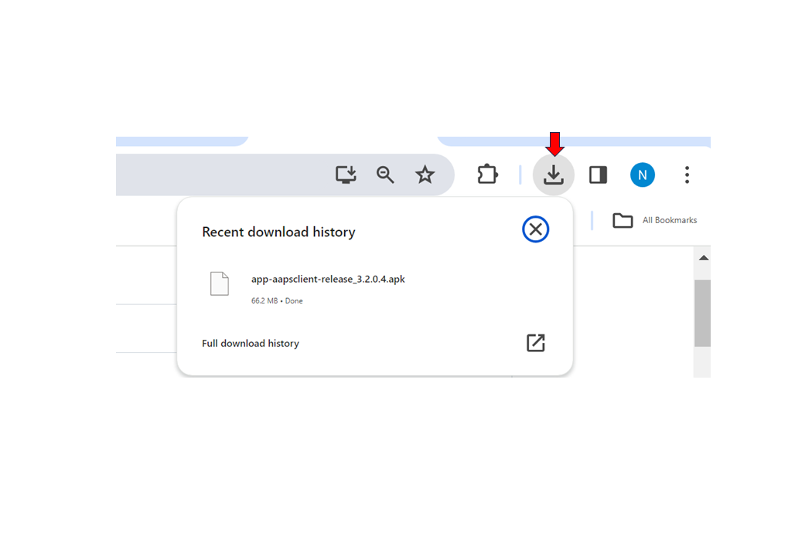
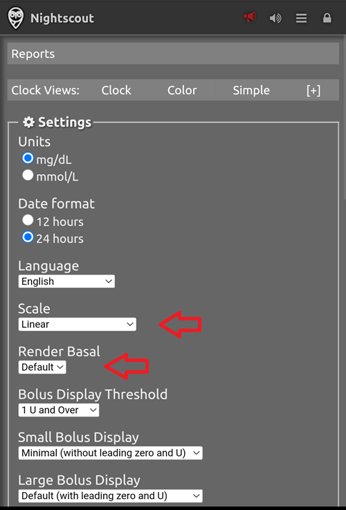

# 遠端控制 AAPS

```{contents} In this page
:backlinks: entry
:depth: 2
```

有四種非常有效的工具可以遠端管理 **AAPS**：

1) [SMS commands](#RemoteControl_SMS-Commands) (follower phone can be either Android or iOS), 2) [AAPSClient](#RemoteControl_aapsclient) (follower phone is Android; an iPhone version is in development) 3) [Nightscout](#RemoteControl_nightscout) (Android, iOS or other computer/device), mainly for following: see the note on [client control](#client-master-control) in that section.  
4) [Smartwatches](#RemoteControl_smartwatches) (Android)

前三個主要適合於照護者/父母，但智慧型手錶對照護者/父母**和**糖尿病患者本身都非常有用。


(RemoteControl_SMS-Commands)=

## 1) SMS 指令

請參見專門的 [SMS 命令](../RemoteFeatures/SMSCommands.md) 頁面。

(RemoteControl_aapsclient)=
## 2) AAPSClient

**AAPSClient** looks very similar in appearance to **AAPS** itself, offering the caregiver the same screens and buttons to send commands remotely to **AAPS**:


(remotecontrol-aapsclient-versions)=
### About AAPSClient, AAPSClient2 and AAPSClient3

There are 3 versions of the client app: **AAPSClient**, **AAPSClient2** and **AAPSClient3**. They work the same way. The only difference is that they can be installed side by side on the same follower phone.

A caregiver who follows one person needs only **AAPSClient**. To follow and remote control a second person (with their own **Nightscout** site and their own **AAPS** phone), install **AAPSClient2** as well, and **AAPSClient3** for a third person. Each app is set up and [paired](#aapsclient-pairing-with-the-master) on its own, with the **Nightscout** site and the **AAPS** phone of the person it follows.

To tell the apps apart, some elements have a different color: yellow for **AAPSClient**, blue for **AAPSClient2** and green for **AAPSClient3**. Those elements are the app icon, the widget background, and the **AAPS** status section on the home screen of the app. <br/> Note: the opacity of the widget background can be set in the widget configuration. At a low opacity the color is hard to see.


### 下載與安裝

**AAPSClient** 可以安裝在一部或多部追蹤者手機上（例如父母一的追蹤者手機和父母二的追蹤者手機），以便兩位照護者都能夠獲得權限並遠端控制患者的 **AAPS** 手機。

若要下載 **AAPSClient**，前往 [Github 儲存庫](https://github.com/nightscout/AndroidAPS/releases/) 並點擊資產 **「app-AAPSClient-release_x.x.x.x」**（可能比下方截圖所示版本更新）：


然後前往電腦上的 _下載_ 資料夾。在 Windows 上，-下載- 將顯示右邊的選單欄：



下載完成後，點擊 _顯示於資料夾中_ 來定位該檔案。

現在，**AAPSClient** apk 可以透過以下方式進行安裝：

透過 USB 傳輸線傳輸到追蹤者手機；或拖放至 Google 雲端硬碟資料夾，然後透過點擊“app-AAPSClient-release”檔案將其安裝到追蹤者手機。

如果你需要**AAPS**供自己使用，而需要**AAPSClient**來監控他人，則需要自行建置**AAPSClient**，而不是從上述GitHub儲存庫下載。原因是你無法在同一部手機上安裝**AAPS**和**AAPSClient**，因為它們是由不同的金鑰簽署的。 <br/> 要自行建置**AAPSClient**，請遵循[常見AAPS建置](../SettingUpAaps/BuildingAaps.md)的相同步驟。在**生成簽名的App Bundle或APK**頁面上，選擇**aapsclientRelease**，而不是**fullRelease**。

The same rule applies when you install several client apps (**AAPSClient**, **AAPSClient2**, **AAPSClient3**) on one follower phone: they must all be signed with the **same key**. Otherwise Android refuses to install the second one (error `INSTALL_FAILED_DUPLICATE_PERMISSION`).

### Synchronization: AAPSClient and AAPS set up

Once the __AAPSClient__ apk is installed on the follower phone, make sure **NSClientV3** is set up the same way on both phones for Nightscout 15 (see the [update notes](../Maintenance/UpdateToNewVersion)). The example below shows the synchronization set-up with NSClientV3 and Nightscout 15; other data sources are available in __AAPS__ (e.g. xDrip).

In **Configuration** > **Communication**, the user synchronizes their data with Nightscout through __NSClientV3__ (using the v3 API), set up the same way for both __AAPS__ and the follower phone.


The user must ensure that __both__ the AAPS and AAPS Client phones are synched together by setting up NSClientV3 on each. On the follower phone this can be done by scanning a QR code shown by **AAPS** instead, see [Pairing AAPSClient with AAPS](#remotecontrol-pairing) below:

- Enter your **Nightscout URL** in the NSClientV3 **Settings**

- Enter your **Nightscout access token** in the same settings. Please follow the notes [here](https://nightscout.github.io/nightscout/security/#create-a-token). On the **AAPS** phone use an **admin token**: with it **AAPS** makes a token of its own for each follower phone.

- Enable **Use websockets** on **both** phones. On the **AAPS** phone websockets are **required** for remote control: without them, **AAPS** cannot receive commands from **AAPSClient**. On both phones they also make synchronization faster, at the cost of slightly higher battery use.


The user should ensure that both __AAPSClient__ and __AAPS__ are showing  ‘connected’ in the **NSClientV3** screen of each phone. At this point **AAPSClient** follows **AAPS** (BG, treatments, profile), but it cannot control it yet: pair the two phones as described below.

(remotecontrol-pairing)=
### Pairing AAPSClient with AAPS (remote control)

From **AAPS** version 4, **AAPSClient** controls **AAPS** through a secure, **paired** connection. Synchronization alone is not enough: until the phones are paired, **AAPSClient** only shows **Manage** with a view-only **Profile** and **Pair with master**.

1. On the **AAPS** phone, open **Manage → Authorized clients** and turn on **Allow client control** (it is off by default, and always on in Simple Mode).
2. Tap **+**, enter a name for the follower phone, choose how it is set up and choose its **role**:
   - **QR code: Nightscout and pairing** — **AAPS** shows a QR code that sets up Nightscout on the follower phone and pairs it, in one scan. This needs an admin token in the **AAPS** phone's NSClientV3 settings.
   - **PIN** — for a follower phone without a camera, already connected to Nightscout: note the one-time **PIN** (valid for about two minutes).
3. On the **AAPSClient** phone, scan the code (in the Setup Wizard, or **Manage → Pair with master → Scan QR code**), or open **Manage → Pair with master** and enter the PIN. Confirm.

The follower phone then appears as **Active** in the **Authorized clients** list, and **AAPSClient** shows **Treatments**, **Scenes** and **Manage**. The follower phone gets a Nightscout token of its own, with only the rights it needs. The full procedure, with screenshots and troubleshooting, is on [Master ↔ Client control](#client_master_master_setup).

Check that the set-up works: enter carbs on **AAPSClient**, confirm the amount shown, and check that the entry appears in **Treatments** on both phones.

(remotecontrol-nightscout-access-token)=

### Troubleshooting 'Nightscout access token' configuration issues

The precise 'Nightscout access token' configuration may differ depending upon whether your Nightscout provider is a paid for hosted site or not.

If you are struggling with **AAPS** to accept the 'Nightscout access token' and using a paid for hosted Nightscout site, you may wish to first liaise with your Nightscout provider on how to resolve the 'Nightscout access token' difficulties. 否則，請聯繫 **AAPS** 小組，但在此之前，請務必仔細檢查是否正確遵循了說明 [此處](https://nightscout.github.io/nightscout/security/#create-a-token)。

### What AAPSClient offers

Once paired, **AAPSClient** offers the caregiver almost the same screens as **AAPS** itself:

- **Treatments**: insulin bolus, carbs and the bolus wizard.
- **Scenes**: start and stop [scenes](../DailyLifeWithAaps/Scenes.md).
- **Manage**: profiles, insulin settings, temporary targets, QuickWizard, automation, food, site rotation, pairing and the running temp basal.
- **Main menu**: treatments history, history browser, statistics, maintenance, configuration.

There is no pump and no objectives on **AAPSClient**. See [The AAPSClient app](AapsClient.md) for a detailed description.

**AAPSClient** lets the caregiver make most of the adjustments allowed directly in **AAPS**, **including insulin boluses**, remotely over the mobile or internet network. Every command is signed and sent through Nightscout to the **AAPS** phone, which checks it against its own data, caps it, shows you its own confirmation, and only then executes it. **AAPSClient** _can_ be much faster than [SMS Commands](../RemoteFeatures/SMSCommands.md), especially for commands that would need authentication.

Treatments entered in Nightscout by other means (for example the Nightscout website) are not applied while client control is on: **AAPS** is then in [hardened mode](#client-master-control-hardened-mode) and takes changes only from paired clients. With client control off, they are applied only if the matching **Receive** options are enabled in the [Synchronization section of NSClient preferences](#Preferences-nsclient-synchronization).

Remote control through **AAPSClient** is only recommended if your synchronization is working well (_i.e._ you don’t see unwanted data changes like self-modification of TT, TBR etc).

### AAPSClient 與智慧型手錶的選項

智慧型手錶可以是一個非常有用的工具，幫助管理兒童的 **AAPS**。有幾種不同的配置方式可供選擇。若在照護者的手機安裝了 **AAPSClient**，即可下載並安裝 [**AAPSClient WearOS** 應用程式](https://github.com/nightscout/AndroidAPS/releases/) 到與家長手機連線的相容智慧型手錶上。 This will show current BG and loop status. Once **AAPSClient** is paired with **AAPS**, the watch actions (including boluses, carbs, temp targets and profile changes) are relayed through **AAPSClient** to **AAPS**, which confirms and executes them: see [Wear OS on a client](#clientmastercontrol-wear-os-on-a-client). You can read more about Smartwatches [here](#remotecontrol-smartwatches).

(RemoteControl_nightscout)=
## 3) Nightscout

Nightscout 不僅是雲端中的伺服器，還有一個專用的 **Nightscout** 應用程式，可以直接從 iPhone 的 App Store 下載。如果你有 Android 追蹤者手機，並沒有專用的 Nightscout 應用程式，建議使用 [**AAPSClient**](#2-aapsclient)，或者如果你只想要追蹤而不發送治療資料，你可以從 Play 商店下載並安裝 [Nightwatch](https://play.google.com/store/apps/details?id=se.cornixit.nightwatch) 應用程式。

當你在 iPhone 上安裝了 **Nightscout** 應用程式，打開應用並按照設置提示進行操作，輸入你的 Nightscout 地址（見下方左側）。此地址的格式可能取決於你的 Nightscout 是如何託管的。(_例如_ http://youraddresshere.herokuapp.com)。然後輸入你的 Nightscout API 密碼（見下方右側）。如果未提示你輸入 API 密碼，請點擊應用程式頂部的鎖形圖示輸入密碼：


更多設置資訊可直接從 [Nightscout](https://nightscout.github.io/nightscout/discover/) 獲得

當你第一次登入時，顯示非常簡單。透過選擇右上角的「漢堡選單」並向下捲動來自訂顯示選項：


向下滾動到“設置”。你可能會想將 血糖 顯示的“比例”設置為“線性”，因為預設值是對數比例，並在“渲染基礎率”下選擇“預設”以顯示幫浦的基礎率。



選擇你想要的選項。如果你使用其他應用程式來發出警報，請取消勾選警報。


繼續向下滾動直到找到“顯示外掛”。

你需要確保已勾選“照護入口”，還可以選擇其他有用的指標（最常用的包括：IOB、照護入口、幫浦、套管時間、胰島素時間、基礎率設定和 OpenAPS）。

重要的是，你現在需要點擊底部的“儲存”，以使這些更改生效。


按下“儲存”後，應用程式將返回你的 Nightscout 主畫面，顯示如下：

1. 目前血糖值
2. 有關 AAPS 系統狀態的資訊 - 輕觸螢幕上的各個標籤以顯示更多詳細資訊。使用漢堡選單增加或移除這些顯示選項。
3. 顯示最近的血糖趨勢以及處理（碳水化合物、注射）
4. 長期的血糖趨勢
5. 設定顯示選項、產生報告、編輯設定檔和 Nightscout 管理工具的「漢堡選單」
6. "**+**" menu for entering treatments (see [below](#RemoteControl_nightscout-treatments) for when **AAPS** applies them).
7. 選擇不同的時間範圍來顯示
8. 基礎胰島素設定檔
9. 綠線 = 歷史血糖 藍線 = 預測血糖


更詳細地查看 Nightscout 應用程式左上角的選單：

1. Careportal 回溯編輯
2. 開啟/關閉警報
3. 漢堡選單 - 用於設定偏好設定
4. Careportal - Log treatment (see [below](#RemoteControl_nightscout-treatments) for when **AAPS** applies these)


此畫面上的灰色標籤包含大量關於 **AAPS** 系統狀態的資訊（點擊標籤可顯示更多資訊）：

1. 5分鐘血糖趨勢
2. 注射嚮導預覽
3. 按一下基礎來查看你目前的設定檔和基礎資訊
4. 自上次 AAPS 讀取 CGM 的時間
5. **幫浦**: 胰島素、電池百分比及上次 AAPS 何時與其連線
6. 上次 AAPS 重新整理 - 如果這超過 5 分鐘，則可能 AAPS 手機與幫浦/CGM 之間有連線問題
7. 按一下 IOB 查看基礎與注射胰島素的劑量
8. 儲存槽中的胰島素時間
9. 針頭的使用時間
10. AAPS 手機的電池狀態
11. 你的資料庫大小。如果它變得過於滿載（僅限 DIY Nightscout - 托管服務會忽略這一點），你可能會開始遇到連線問題。你可以通過管理工具選單（透過漢堡選單）刪除資料以減少資料庫大小。


按下頁面底部的「重新整理」以關閉彈出視窗。

(RemoteControl_nightscout-treatments)=
### 透過 Nightscout 應用程式向 AAPS 發送治療資料

In **AAPS** 4 the supported way to control **AAPS** remotely is a **paired AAPSClient**, see [Master ↔ Client control](#client-master-control): each client has a [role](#client-master-control-roles) that limits what it may do, and every command is signed, checked and confirmed by the **AAPS** phone. While client control is on, the **AAPS** phone is in [hardened mode](#client-master-control-hardened-mode): treatments, temporary targets and profile switches entered on the Nightscout website or in the Nightscout app are **not** applied. The Nightscout app is then a tool for following only.

```{admonition} Only when client control is off
:class: warning
If **Allow client control** is off in **Manage → Authorized clients** (and Simple Mode is off), **AAPS** applies careportal entries from Nightscout only for the data types you turned on under **Receive** in the [Synchronization section of the NSClientV3 settings](#Preferences-nsclient-synchronization): carbs, temporary targets, profile switches and the other careportal entries. Insulin is never delivered this way: a "Correction bolus" entered in Nightscout is only *announced*, and **AAPS** counts it as insulin on board without delivering it. This set-up is not recommended for remote control; use a paired **AAPSClient** instead.
```

閱讀更多關於 **Nightscout** 的選項[此處](https://nightscout.github.io/)

### 獲取 Nightscout 應用程式最佳使用效果的小提示

1). 如果你被困在某個頁面上，並希望再次查看主畫面，只需點擊“重新整理”（底部中間），這將帶你返回 **Nightscout** 主頁，顯示 血糖 圖表。

要查看手機上目前運作的設定檔，請按圖表上方的各個圖示。按下“基礎率”可以查看更多資訊（目前的碳水化合物比率、敏感性和時區等），“OpenAPS”顯示有關設定檔和目前目標的資訊。你還可以監控手機電池百分比和幫浦電池百分比。 BWP 提供關於算法在考慮 IOB 和 COB 情況下預測未來結果的資訊。

#### 選單中的其他圖示：鉛筆（編輯）圖示是什麼意思？

你可以（技術上）使用編輯鉛筆來移動或刪除過去 48 小時內的注射或修正治療。

更多相關資訊請參閱 [這裡](https://nightscout.github.io/nightscout/discover/#edit-mode-edit)

雖然這可能對刪除已宣佈（但未實際注射）的碳水化合物有幫助，但在實際操作中，這在 **AAPS** 中並不運作良好，因此我們建議直接透過 **AAPS** 應用程式進行此類更改。

(RemoteControl_smartwatches)= (remotecontrol-smartwatches)=

## 4) 智慧型手錶

### 選項 1) 從 Wear OS 手錶控制 AAPS


一旦你[在你的手錶上設置**AAPS**](../WearOS/BuildingAapsWearOS.md)，有關智慧型手錶錶盤及其功能的詳細資訊可以在[智慧型手錶上操作 AAPS](../WearOS/WearOsSmartwatch.md)中找到。

簡要總覽，以下功能可以從智慧型手錶觸發：

* 設置一個臨時目標

* 使用注射計算器（計算變數可在手機設定中定義）

* 管理 eCarbs

* 進行注射（胰島素 + 碳水化合物）

* 檢查手錶設定

* 狀態

* 檢查幫浦狀態

* 檢查循環狀態

* 檢查並更改個人設定、CPP（生理時鐘百分比設定 = 時間變動 + 百分比）

* 顯示 TDD（每日總劑量 = 每日注射 + 基礎劑量）

* 遠端注射，照顧者與 T1D 兒童位於不同地點（這在 **AAPS** 手錶和 **AAPS** 手機互相連線時是可能的）

#### 從照顧者到手錶的通訊使用其他應用程式（如 WhatsApp）

可以在手錶上新增額外的應用程式，如 WhatsApp，用於照顧者與孩子之間的訊息交流（例如）。重要的是，手機上只應關聯一個 Google 帳戶，否則手錶無法同步這些資料。你需要年滿 13 歲才能擁有 Samsung 帳戶，並且此帳戶需要使用與 Android 手機相同的電子郵件地址設置。

一段解釋如何在 Galaxy 4 手錶上設定 WhatsApp 進行訊息的影片（你無法獲得 WhatsApp 的完整功能）見 [這裡](https://gorilla-fitnesswatches.com/how-to-get-whatsapp-on-galaxy-watch-4/)

在 **AAPS** 手機和手錶的 **Galaxy wearable** 應用中進行調整，讓 WhatsApp 訊息以輕微震動的方式宣告，並且 WhatsApp 訊息可以顯示在現有的錶盤上。

### 選項 2) 在手錶上運作 **AAPS**，以遠端控制手機上的 **AAPS**

Similarly to using a follower phone with **AAPSClient** or SMS commands (see the sections above), a smartwatch can be used to remotely control **AAPS** and provide full profile data. A key difference to using a follower phone is that the smartwatch to **AAPS** phone link is via Bluetooth and needs neither Nightscout nor an authentication code. As a side-note, if both smartwatch and **AAPS** phone linked by Bluetooth are also on a Wi-Fi/Cellular data network, the watch will also interact with the **AAPS** phone, giving a longer range of communication. This includes remote delivery of a bolus where the caregiver with the **AAPS** watch and T1D child (with **AAPS** phone) are in different locations, which can be useful in circumstances where the T1D child is in school.

因此，遠端控制智慧型手錶在以下情況中特別有用：

a)  **AAPSClient** or **SMS** commands cannot work; or

b)  The user wishes to avoid typing an authentication code (as required for SMS commands).

A smartwatch needs **Wear OS 3 or newer** to be able to control **AAPS**. Please check the technical specifications of the watch, and see the [Smartwatches page](../Getting-Started/Watches.md). 如果不確定，請在 **AAPS** 的 Facebook/Discord 群組中搜尋或詢問。

以下是設置流行型號 Samsung Galaxy Watch 4（40 毫米）的具體操作指南。 Garmin 手錶也是一個受歡迎的選擇，請參閱[這裡](https://apps.garmin.com/en-US/apps/a2eebcac-d18a-4227-a143-cd333cf89b55?fbclid=IwAR0k3w3oes-OHgFdPO-cGCuTSIpqFJejHG-klBTm_rmyEJo6gdArw8Nl4Zc#0)。如果你有設置其他智慧型手錶的經驗，並且認為這對其他用戶有幫助，請[編輯文件](../SupportingAaps/HowToEditTheDocs.md)，將你的發現分享給更廣泛的 **AAPS** 社群。

### 選項 3) 在手錶上運作 AAPSClient 以遠端控制手機上的 **AAPS**


手錶軟體 **AAPSClient** Wear apk 可以直接從[Github](https://github.com/nightscout/AndroidAPS/releases/)下載。

To download the software, click on the watch app that matches the client app on the phone: **wear-aapsclient-release_**_version_ goes with **AAPSClient**, **wear-aapsclient2-release_**_version_ goes with **AAPSClient2** (see [About AAPSClient, AAPSClient2 and AAPSClient3](#remotecontrol-aapsclient-versions)):


然後點擊“另存為”，並將文件儲存到電腦上的方便位置：


你可以以與**AAPS** Wear 應用相同的方式，將**AAPSClient**穿戴 apk 傳輸到手機並側載到手錶上，如[將 Wear 應用傳輸到你的 AAPS 手機](#remote-control-transferring-the-aaps-wear-app-onto-your-aaps-phone)中詳細說明。  


