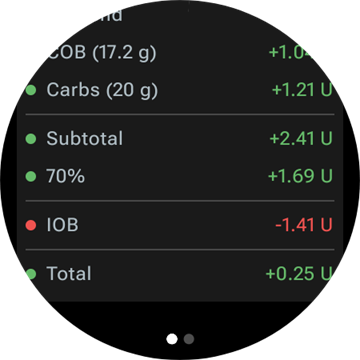
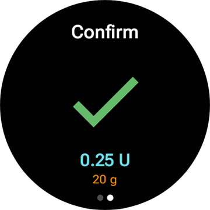
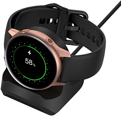

# 透過 Wear OS 智慧型手錶操作 AAPS

(Watchfaces-aaps-watchfaces)=

## AAPS 手錶外觀

```{warning}
經典的 <strong>AAPS</strong> 錶盤僅適用於 Wear OS 5 及更舊版本，而且 Wear OS 5 已對其設有限制。在 <strong>Wear OS 6 及更新版本</strong>中，手錶 App 會改為安裝一款採用 Google 錶盤格式的錶盤：您可以選擇以圖片呈現的自訂錶盤，或<strong>複雜功能錶盤</strong>。請參閱 [Wear OS 錶盤變更](#wearos-watchface-changes)，了解各 Wear OS 版本會有哪些功能無法使用；Wear OS 6 請參閱 [AAPS 安裝的錶盤](#wearos-aaps-v4-watchface)。
```

在 Wear OS 5 及更舊版本中，**AAPS** 手錶 App 內建數款經典錶盤。錶盤會顯示血糖值及其變化量、IOB、目前的基礎率，以及讀取值圖表。這些錶盤支援以下兩種雙擊操作：

* 雙擊血糖值，開啟 **AAPS** 主選單
* 雙擊圖表，變更顯示的時間範圍

所有 Wear OS 版本都支援本頁介紹的[複雜功能](#Watchfaces-complications)和[方塊](#WearOsSmartwatch-wear-os-tiles)，只要錶盤有足夠空間即可使用。

## 設定

在 [**組態建置工具** > **通訊**](#Config-Builder-wear)中啟用 **Wear**。

若要從手錶注射或執行其他操作，請開啟 **Wear 控制**。手錶上的注射嚮導選項也在相同位置設定：請參閱 [設定 > Wear](#preferences-wear)。關閉 **Wear 控制**時，手機會拒絕手錶傳送的所有治療或模式變更指令，而手錶會顯示 *「手機上的 Wear 設定已關閉 Wear 控制。」*

在 **Wear** 卡片上點選 **開啟外掛**，即可開啟 Wear 畫面：


最上方會顯示已連線手錶的名稱；若未連線，則會顯示 **(未連線手錶)**。您可以在此畫面中

* 重新發送所有資料。如果手錶在一段時間內未連接，可能會有所幫助，並且你想將資訊推送至手錶。
* 直接從手機上打開手錶的設置。
* 選擇 **AAPS** 要在手錶上安裝哪種錶盤（**手錶上安裝的錶盤**：自訂錶盤或複雜功能錶盤）。只有在連線的手錶搭載 **Wear OS 6** 或更新版本時，才會顯示此卡片。請參閱 [AAPS 安裝的錶盤](#wearos-aaps-v4-watchface)。
* 管理**自訂錶盤**（連線手錶時會顯示此卡片）：**載入錶盤**會將自訂錶盤傳送至手錶；**錶盤資訊**會列出已載入錶盤的詳細資訊及其包含的欄位；**更多錶盤**會在瀏覽器中開啟[分享網站](../ExchangeSiteCustomWatchfaces/index.md)；**匯出範本**則會儲存可供編輯的範本。按鈕下方會顯示已載入錶盤的預覽。請參閱 [切換為 AAPS 錶盤](#WearOS_changing-to-AAPS-watchface)。

確保手錶上未封鎖來自 AAPS 的通知。確認操作（例如注射、臨時目標）會透過通知進行，你需要滑動並勾選。

## J - 活性胰島素（來自注射 | 來自基礎速率）


若要開啟 **AAPS** 主選單，請使用以下任一方式：

* 從手錶的 App 清單開啟 **AAPS**
* 點選會開啟選單的 **AAPS** 複雜功能，請參閱[複雜功能相關設定](#WearOsSmartwatch-complication-settings)
* 點選 **BG 圖表**方塊，並將其**點選動作**設為**主選單**，請參閱[方塊設定](#WearOsSmartwatch-wear-os-tiles)
* 在經典的 **AAPS** 錶盤上，雙擊血糖值

(WearOsSmartwatch-loop-status)=

## 循環狀態畫面

**循環狀態**畫面會摘要顯示循環目前的運作狀況，讓你不必拿出手機也能查看。你可以從 AAPS 主選單（**循環狀態**，或**狀態 → 循環**）開啟此畫面，也可以輕觸**血糖**小工具。**狀態**選單中還有**幫浦**頁面，以及顯示每日總劑量的 **TDD** 頁面。


此畫面由多張資訊卡片組成。向下捲動即可查看所有卡片：

* **運作模式** — 目前的模式（閉合循環、開放循環、LGS、暫停、中斷連線等）；若為臨時模式，也會顯示剩餘運作時間。
* **循環結果** — 顯示循環上次執行的時間，以及要求的臨時基礎率或 SMB。
* **場景** — 只有在[場景](#scenes-from-watch)啟動時才會顯示：場景名稱、剩餘時間（若場景沒有結束時間，則顯示**直到結束**），以及場景結束後啟動的**後續場景**。
* **目標** — 顯示你的目標，以及目前啟動中的臨時目標。
* **設定檔** — 顯示目前使用的設定檔名稱；若**百分比**和**時間偏移**不是預設值，也會一併顯示。臨時切換設定檔時，卡片會以醒目方式顯示，並標示剩餘時間，以及結束後會**切換回**的設定檔。
* **敏感度** — 顯示的項目與手機主畫面上的敏感度標籤相同：自動敏感度調整數值，以及設定檔中的可變與有效胰島素敏感係數（ISF）。

運作模式、臨時目標或設定檔切換旁若顯示小型場景圖示，表示該項目是由**目前啟動的場景設定**。在**運作模式**選擇器中也會顯示相同的圖示。


(WearOsSmartwatch-bolus-calculator)=

## 手錶上的注射計算器

你可以從 **AAPS** 主選單、[操作小工具](#WearOsSmartwatch-wear-os-tiles)，或設定為開啟嚮導的小工具中，開啟**計算器**。計算器會依序顯示幾個頁面，從右向左滑動即可繼續：

| 碳水化合物                                                        | 請求                                                          | 結果                                                         | 計算                                                                 | 確認                                                          |
| ------------------------------------------------------------ | ----------------------------------------------------------- | ---------------------------------------------------------- | ------------------------------------------------------------------ | ----------------------------------------------------------- |
|  |  |  |  |  |

1. **碳水化合物**：使用**+10**、**+5**、**−**和**+**按鈕輸入碳水化合物。
2. **要求**：這是手機接手處理前的最後一個頁面。此頁會顯示你輸入的內容：碳水化合物，以及你有使用時的餐點類型、碳水化合物時間和百分比。請參閱[選用頁面](#WearOsSmartwatch-calculator-optional-pages)。輕觸勾號，將資料傳送到手機，由手機執行計算。
3. **結果**：顯示 **AAPS** 建議的注射量，下方會列出碳水化合物資訊：目前要攝取的碳水化合物、稍後攝取的 eCarbs、碳水化合物時間，以及用餐提醒的鈴鐺圖示。使用**−**和**+**調整劑量，請參閱下方說明。向下捲動到**計算**卡片，輕觸即可查看計算的每個步驟，內容與手機上相同。
4. **確認**：滑動到第二頁，再輕觸勾號。手機會執行注射並記錄碳水化合物。

(WearOsSmartwatch-calculator-optional-pages)=

### 選用頁面

手錶的三項設定各會在**碳水化合物**頁面後新增一個頁面。這些設定預設為關閉。開啟 **AAPS** 主選單，依序選取**設定** > **介面**，再開啟你需要的設定；若開啟多項設定，頁面會依**餐點類型**、**碳水化合物時間**、**百分比**的順序顯示。計算器底部的圓點會顯示頁面數量。

| 設定                                                                | 餐點類型                                                            | 碳水時間                                                               | 百分比                                                             |
| ----------------------------------------------------------------- | --------------------------------------------------------------- | ------------------------------------------------------------------ | --------------------------------------------------------------- |
|  |  |  |  |

* **計算器餐點類型**：**麵包**、**蛋糕**或**披薩**。選擇後，系統會將較慢消化餐點中的碳水化合物分為現在攝取和稍後以 eCarbs 攝取的部分。請參閱[選擇餐點類型](#WearOsSmartwatch-wizard-meal-type)。
* **計算器碳水化合物時間**：距離用餐的分鐘數；用餐提醒可設定**鬧鐘**。請參閱[碳水化合物時間和用餐提醒](#WearOsSmartwatch-wizard-carb-time)。
* **計算器百分比**：計算出的注射量百分比，例如想降低劑量時可設定為 70 %。此數值一開始會採用手機[注射嚮導設定](#Preferences-deliver-this-part-of-bolus-wizard-result)中的**注射百分比**；若未修改，預設為 100 %。另請參閱[在結果頁面調整注射量](#WearOsSmartwatch-wizard-result)下方的說明。

(WearOsSmartwatch-wizard-result)=

### 在結果頁面調整注射量

結果頁面會顯示 **AAPS** 建議的注射量，並提供 **−** 和 **+** 按鈕。確認前可使用這些按鈕調整劑量，不必返回手機。

| 建議量                                                                   | 更多                                                                    | 較少                                                                      |
| --------------------------------------------------------------------- | --------------------------------------------------------------------- | ----------------------------------------------------------------------- |
|  |  |  |

* 每按一次，注射量就會依照**幫浦的單次調整幅度**變更，因此顯示的劑量都符合幫浦實際可輸送的量。
* **按住**按鈕，即可持續變更數值。按住的時間越久，數值變更的速度就越快。
* 注射量不能低於 **0 U**，也不能高於**最大注射量**設定。

結果頁面會顯示目前的總量，讓您隨時確認即將送出的劑量。碳水化合物數量後方會顯示調整量，例如 *(+0.20 U)*；增加時，您使用的按鈕會變成綠色，減少時則會變成紅色。

如果 **AAPS** 必須限制劑量，例如計算出的注射量高於**最大注射量**設定，總量下方會以琥珀色文字顯示警告（例如 *「已套用注射量限制」*）。限制碳水化合物數量時也會顯示相同的警告。

```{admonition} 這與計算機百分比設定不同 :class: note **計算機百分比**設定可讓您在結果頁面**顯示之前**，輸入計算出的注射量的*百分比*。 **−** 和 **+** 按鈕則是在結果頁面**上**調整*最後的劑量*。兩種方式都可以使用。

    <br />(WearOsSmartwatch-wizard-meal-type)=
    
    ### 選擇餐點類型
    
    手錶計算機可以將需要較長時間進食的餐點所含碳水化合物，分成現在攝取的碳水化合物和稍後攝取的 eCarbs，方式與手機嚮導中的[碳水化合物類型](#AapsScreens-carbs-type)相同。在手錶的**設定** > **介面**中，開啟**計算機餐點類型**。此設定預設為關閉，關閉時會略過**餐點類型**頁面。
    
    * 輸入碳水化合物數量後，會顯示**餐點類型**頁面，其中有三個圖示：**麵包**、**蛋糕**和**披薩**。點選圖示後，圖示下方會顯示名稱和對應的碳水化合物數量，例如麵包為 *65 g*，披薩為 *52+22 g*（現在攝取 52 g，稍後攝取 22 g eCarbs）。預設會選擇**麵包**，並將所有碳水化合物列為現在攝取。
    * 請求頁面和確認頁面會以相同方式顯示碳水化合物數量（*52+22 g*）。結果頁面也會顯示 eCarbs 開始攝取的時間和持續時間。
    * 注射量只會依照現在攝取的碳水化合物計算。碳水化合物的分配方式與手機嚮導使用相同的數值。
    
    (WearOsSmartwatch-wizard-carb-time)=
    
    ### 碳水化合物時間與用餐提醒
    
    在手錶的**設定** > **介面**中開啟**計算機碳水化合物時間**後，輸入碳水化合物數量後會接著顯示**碳水化合物時間**頁面，讓您設定距離用餐的分鐘數，與手機嚮導中的[碳水化合物時間](#aaps-screens-bolus-wizard)相同。預設為**現在**。按下 **−** 和 **+**，可每次調整 5 分鐘，最多可設定為現在之前或之後 1 小時。設定過去的時間，表示您已經攝取了這些碳水化合物。
    
    如果設定未來的時間，數值下方會出現**設定鬧鐘**鈴鐺圖示。此功能預設為開啟，點選鈴鐺即可關閉。請求頁面和結果頁面會顯示碳水化合物時間，例如 *+30 min*，以及鈴鐺圖示。手機會在設定的時間記錄碳水化合物，並一併調整該餐點類型的 eCarbs 時間，接著啟動**用餐時間**提醒。
    
    | 結果 | 血糖圖表 | 提醒進行中 | 用餐時間 |
    | --- | --- | --- | --- |
    |  |  |  |  |
    
    手錶也會顯示提醒，因此即使手機不在附近，手錶也會發出提醒：
    
    * **血糖圖表**畫面、**血糖圖表**小工具，以及**複雜功能錶面**的圖表，會在提醒響起的時間位置畫出橘色虛線，旁邊並標示剩餘分鐘數。
    * 提醒期間，通知串流中會顯示靜音的**用餐時間**通知，並提供**停止**和**+5 分鐘**選項。如果將通知滑開，只要提醒尚未結束，通知就會再次出現。
    * 到了設定的時間，手錶會震動；若您尚未回應，接下來 5 分鐘內每隔半分鐘會再次震動。通知提供**靜音**和**+5 分鐘**選項；將通知滑開也會讓提醒靜音。
    
    在手錶、手機和 **AAPSClient** 上，**停止**、**靜音**和**+5 分鐘**的效果都相同，而且都會顯示相同的提醒。
    
    (Watchfaces-complications)=
    
    ## 複雜功能
    
    _複雜功能_是傳統鐘錶製造業的術語，指錶盤主要顯示功能以外的附加功能，例如以另一個小視窗或小錶盤顯示日期、星期、月相等資訊。 Wear OS 2.0 將此隱喻引入，允許自訂資料提供者（例如天氣、通知、健身計數器等）新增到支援複雜功能的任何手錶外觀中。
    
    從 build `2.6` 開始，AAPS Wear OS App 支援複雜功能。任何支援複雜功能的第三方錶面，都可以設定為顯示 AAPS 相關資料（血糖及趨勢、IOB、COB 等）。
    
    複雜功能也可作為 AAPS 功能的<strong>捷徑</strong>。點擊他們可以打開與 AAPS 相關的選單和對話框（具體取決於複雜功能類型和配置）。
    
    
    
    ### 複雜功能類型
    
    AAPS Wear OS App 只會依照預先定義的格式提供原始資料。第三方手錶外觀決定如何及在哪裡呈現複雜功能，包括其佈局、邊框、顏色和字體。在 Wear OS 提供的多種複雜功能類型中，AAPS 使用以下類型：
    
    * `SHORT TEXT` - 包含兩行文字，每行 7 個字元，有時也稱為數值和標籤。通常呈現在一個圓圈或小 POD 中 - 一行在另一行下方或並排顯示。這是一個空間非常有限的複雜功能。 AAPS 試圖移除不必要的字符以適應：透過四捨五入數值、去除值中的前導和尾隨零等方式。
    * `LONG TEXT` - 包含兩行文字，每行約 20 個字元。通常呈現在一個矩形或長 POD 中 - 一行在另一行下方顯示。用於顯示更多詳情和文本狀態。
    * `RANGED VALUE` - 用於顯示預先定義範圍內的數值，例如百分比。他包含圖示和標籤，通常以圓形進度表盤呈現。
    * `LARGE IMAGE` - 可使用自訂背景圖片（錶盤支援時），作為背景。
    * `SMALL IMAGE` / `MONOCHROMATIC IMAGE` - 小型圖示。在 `SMALL IMAGE` 欄位中，AAPS 會以自己的顏色繪製圖片；在 `MONOCHROMATIC IMAGE` 欄位中，錶盤會為圖片套用色調。
    
    ### 設定錶盤資訊
    
    若要在錶盤加入資訊，請長按錶盤，然後點選下方的齒輪圖示進行設定。根據具體手錶外觀的配置方式 - 可以點擊佔位符或進入複雜功能設置選單。 AAPS 複雜功能歸類在 AAPS 選單項目下。
    
    在配置手錶外觀上的複雜功能時，Wear OS 會顯示並篩選適合放置在選定複雜功能位置的列表。如果列表中找不到特定的複雜功能，可能是由於該類型不適用於該位置。
    
    ### AAPS 提供的錶盤資訊
    
    AAPS 提供以下錶盤資訊。「開啟項目」是指將 **錶盤資訊點擊動作** 留在 **預設** 時，點按會開啟的項目，請參閱[錶盤資訊相關設定](#WearOsSmartwatch-complication-settings)。
    
    **血糖**
    
    * **血糖值**（`SHORT TEXT`，開啟 _循環狀態_）：第一行顯示血糖值和趨勢箭頭，第二行顯示讀取值的時間和變化量。
    * **血糖值（大型）**（`SHORT TEXT`，開啟 _血糖圖表_）：第一行只顯示血糖值，讓錶盤可以將數值放大顯示。第二行顯示讀取值的時間和趨勢箭頭。
    * **血糖圖表**（`SMALL IMAGE` / `LARGE IMAGE`，開啟 _血糖圖表_）：以圖片顯示血糖圖表，適用於有圖片欄位的錶盤。這就是 **錶盤資訊** 錶盤上顯示的圖表。
    * **完整狀態**（`LONG TEXT`，開啟 _選單_）：在一行中顯示大部分資料：血糖值和趨勢箭頭、變化量與讀取值的時間，接著是活性碳水化合物、活性胰島素和基礎率。
    * **完整狀態（翻轉）**（`LONG TEXT`，開啟 _選單_）：顯示內容相同，但將兩行順序對調，適用於只會顯示 `LONG TEXT` 欄位其中一行的錶盤。
    
    **胰島素和碳水化合物**
    
    * **活性胰島素圖示**（`SHORT TEXT`，開啟 _注射_）：以注射器圖示顯示活性胰島素。
    * **活性胰島素詳細資訊**（`SHORT TEXT`，開啟 _注射_）：第一行顯示活性胰島素總量，第二行顯示注射和基礎胰島素的量。
    * **活性碳水化合物圖示**（`SHORT TEXT`，開啟 _嚮導_）：以碳水化合物圖示顯示活性碳水化合物。
    * **活性碳水化合物詳細資訊**（`SHORT TEXT`，開啟 _嚮導_）：第一行顯示目前的活性碳水化合物，第二行顯示尚未吸收的碳水化合物（eCarbs）。
    * **活性碳水化合物與活性胰島素**（`SHORT TEXT`，開啟 _嚮導_）：第一行顯示活性胰島素，第二行顯示活性碳水化合物。
    
    **基礎率和目標**
    
    * **基礎率**（`SHORT TEXT`，開啟 _選單_）：目前的基礎率。
    * **基礎率與活性胰島素**（`SHORT TEXT`，開啟 _選單_）：第一行顯示活性胰島素，第二行顯示基礎率。
    * **基礎率與目標**（`SHORT TEXT`，開啟 _臨時目標_）：第一行顯示目標；設定臨時目標時，也會顯示剩餘時間。第二行顯示基礎率。
    * **目標**（`SHORT TEXT`，開啟 _臨時目標_）：第一行顯示目標；設定臨時目標時，第二行會顯示剩餘時間。
    * **基礎率、活性碳水化合物與活性胰島素**（`SHORT TEXT`，開啟 _選單_）：第一行顯示基礎率，第二行顯示活性碳水化合物和活性胰島素。
    
    **循環和手機**
    
    * **運作模式**（`SMALL IMAGE` / `ICON`，開啟 _運作模式選擇器_）：以圖示顯示目前的循環模式：閉迴路、開迴路、低血糖暫停、已暫停、已中斷連線或已停用。點按後會開啟選擇器，顯示目前允許切換的模式，例如 **暫停循環**、**中斷幫浦連線**、**恢復循環** 或 **重新連線幫浦**。在 **AAPS** 主選單的 **運作模式** 下，也可以開啟相同的選擇器。
    * **上傳裝置／手機電量**（`RANGED VALUE` / `SHORT TEXT` / `ICON`，開啟 _狀態_）：顯示 **AAPS** 手機的電量，可用電量計搭配電池圖示、數字或單獨的圖示來呈現。這項資訊會與其他 **AAPS** 資料一起更新，通常每 5 分鐘取得一次新的讀取值。
    
    從錶盤資訊、主選單或運作模式方塊開啟的 **運作模式** 選擇器：
    
    
    
    (WearOsSmartwatch-complication-settings)=
    
    ### 錶盤資訊相關設定
    
    在手錶的 **AAPS** 主選單中，開啟 **設定** > **錶盤資訊**：
    
    
    
    * **錶盤資訊點擊動作**（預設為 `Default`）：設定點按 **AAPS** 錶盤資訊時要開啟的項目，適用於所有錶盤資訊：
      * _預設_：開啟該錶盤資訊本身的項目，請參閱上方清單
      * _選單_：**AAPS** 主選單
      * _計算機_：注射計算機
      * _治療_：治療對話方塊，可輸入胰島素和碳水化合物
      * _eCarbs_：eCarbs 對話方塊
      * _狀態_：狀態選單
      * _運作模式_：運作模式選擇器。必須在手機的 Wear 設定中開啟 **Wear 控制**，否則會改為開啟主選單。
      * _無_：點按不會執行任何動作
    * **血糖圖表時間範圍**（預設為 `3 hours`）：設定 **血糖圖表** 錶盤資訊顯示幾小時的資料，可選 1、3 或 6 小時。血糖圖表方塊有自己的設定。
    * **錶盤資訊使用 Unicode**（預設為 `On`）：錶盤資訊會使用 Unicode 符號，例如以 `Δ` 表示變化量、以 `⁞` 作為分隔符號，以及以 `⎍` 表示基礎率。符號的顯示效果取決於錶盤使用的字型。如果錶盤將這些符號顯示成方框或空白，請將此選項設為 `Off`。
    
    (WearOsSmartwatch-wear-os-tiles)=
    
    ## Wear OS 方塊
    
    從錶盤向左或向右滑動，即可切換到不同頁面，這些頁面稱為方塊。 **AAPS** 提供 7 個方塊，每個方塊最多包含 4 個按鈕。點按按鈕後，手錶會開啟相應的對話方塊，或要求你確認，接著由手機執行操作。方塊是捷徑，不是狀態顯示畫面：它不會同步顯示手機應用程式的狀態。
    
    使用方塊前，請先在[設定 > Wear](#preferences-wear)中開啟 **Wear 控制**。
    
    ### 新增方塊
    
    依手錶和手機的型號而定，有兩種新增方式：
    
    1. 在手錶上：從錶盤向左或向右滑動，越過最後一個方塊，直到看到 **新增方塊**，再選擇 **AAPS** 方塊。大多數手錶也可以長按方塊，開啟新增和移除方塊的畫面。
    2. 在手機上，開啟手錶的配套應用程式（Samsung 手錶使用 **Galaxy Wearable**，其他品牌使用 **Wear OS**）：開啟 **方塊**，點按 **新增**，再選擇要新增的 **AAPS** 方塊。拖曳即可調整方塊的順序。
    
    
    
    ### 方塊設定
    
    **動作**、**臨時目標**、**血糖圖表**和**場景**方塊可在手錶上設定。開啟 **AAPS** 主選單，然後選擇 **設定** > **方塊**，再選擇要設定的方塊。長按方塊也可以開啟設定，但 Pixel 手錶除外。其他 3 個方塊的內容由手機提供，無法在手錶上設定。
    
    | 主選單 | 設定 | 方塊 |
    | --- | --- | --- |
    |  |  |  |
    
    方塊設定會列出 4 個位置。點按某個位置來選擇要顯示的內容，或選擇 **無**，讓該位置保持空白。
    
    | 長按資訊方塊 | 臨時目標資訊方塊的設定 |
    | --- | --- |
    |  |  |
    
    每個資訊方塊有四個位置。如果資訊方塊的項目超過四個，就只會顯示前四個。
    
    ### 動作資訊方塊
    
    
    
    這是 **AAPS** 手錶應用程式中各對話框的捷徑。您可以在資訊方塊設定中選取最多四個項目：
    
    * **計算**：注射計算器，可輸入碳水化合物、選填百分比 [1] 和選填餐點類型 [2]
    * **治療**：一次輸入胰島素和碳水化合物
    * **胰島素**：輸入注射劑量，單位為 U
    * **碳水化合物**：輸入碳水化合物，也可輸入延伸碳水化合物。您可以輸入**負數**，最多可扣除目前的 COB，用來修正先前輸入的碳水化合物。手錶的血糖圖表會顯示扣除的碳水化合物。
    * **eCarbs**：延伸碳水化合物
    * **臨時目標**：設定自訂目標和持續時間的臨時目標
    * **切換設定檔**：切換設定檔，可設定百分比、時間偏移和持續時間
    
    
    
    點選按鈕後開啟的對話框。在對話框中由右向左滑動可前往下一頁，並在最後一頁點選勾選符號，將要求傳送至手機：
    
    | 治療 | 胰島素 | 碳水化合物 | eCarbs | 臨時目標 | 切換設定檔 |
    | --- | --- | --- | --- | --- | --- |
    |  |  |  |  |  |  |
    
    [1] 在手錶的 **設定** > **介面** 中，開啟 **計算器百分比**，即可在注射計算器中顯示百分比輸入欄位。預設百分比取自手機上的設定：「[傳送此百分比的注射嚮導結果](#Preferences-deliver-this-part-of-bolus-wizard-result)」。其他計算器設定則使用手機上 **設定** > **注射嚮導設定** 中的設定。
    
    [2] 在手錶的 **設定** > **介面** 中，開啟 **計算器餐點類型**，即可顯示 **餐點類型** 頁面。您可以選擇 **麵包**、**蛋糕** 或 **披薩**，將消化較慢的餐點所含碳水化合物分成現在攝取的碳水化合物和稍後攝取的 eCarbs。請參閱[選擇餐點類型](#WearOsSmartwatch-wizard-meal-type)。
    
    ### 臨時目標資訊方塊
    
    
    
    使用手機預設的臨時目標。您可以在手機的 **設定** > [預設臨時目標](#Preferences-default-temp-targets) 中設定每個預設目標的持續時間和目標值。您可以在資訊方塊設定中選取最多四個項目：
    
    * **活動**：運動時使用
    * **進食**：即將用餐時使用；設定較低的目標，讓用餐時體內有較多胰島素
    * **低血糖**：處理低血糖時使用較高的目標
    * **手動**：自訂目標和持續時間
    * **取消**：停止目前執行中的臨時目標。只有在臨時目標執行期間才會顯示此按鈕。
    
    ### 快速嚮導資訊方塊
    
    
    
    顯示手機上已開啟 **在手錶上顯示**，且目前時間在有效時段內的 [QuickWizard](#quickwizards) 項目。碳水化合物項目會顯示碳水化合物克數，胰島素項目則會顯示固定劑量（單位為 U）。在手錶上點選項目並確認後，即會執行該項目。無須在手錶上設定：請在手機上編輯項目，並在各項目 **裝置選擇** 中開啟 **在手錶上顯示**，即可將項目顯示在資訊方塊上。如果目前不在任何項目的有效時段內，資訊方塊會顯示 **沒有可用的設定**。
    
    
    
    ### 場景資訊方塊
    
    
    
    顯示手機上的[場景](#scenes-from-watch)。您可以在資訊方塊設定中，將四個位置分別設為 **自動**、**無** 或其中一個場景。設為 **自動** 的位置會從手機的場景清單中選取下一個尚未被其他位置使用的場景。如果某個位置設定的場景已不在手機上，該位置就會顯示 **無法使用**。
    
    
    
    ### 執行模式資訊方塊
    
    
    
    顯示可從目前模式切換至的[執行模式](#aaps-screens-running-mode)，圖示與手機上的相同：閉環、低血糖暫停、開環、停用循環、暫停循環及中斷幫浦連線；如果目前處於上述任一模式，也會顯示恢復和重新連線的選項。選擇 **暫停循環** 或 **中斷幫浦連線** 時，必須先設定持續時間。手機會決定要提供哪些模式。手錶會顯示前四個模式；如果清單中有 **暫停循環**，就不會顯示 **停用循環**。
    
    ### 使用者動作資訊方塊
    
    
    
    手機上每個觸發條件為 **使用者動作** 的[自動化](#automations-automation-triggers)都會有一個按鈕。點選按鈕並確認後，手機就會執行該自動化中的動作。按鈕名稱會使用自動化的名稱，請盡量取簡短的名稱。無須在手錶上進行設定。
    
    ### 血糖圖表資訊方塊
    
    
    
    顯示血糖值、箭頭、變化量和讀取值的時間；下方顯示體內胰島素、體內碳水化合物、基礎率和目標值；並顯示包含預測值、注射、碳水化合物和微量注射的血糖圖表。手錶上有兩項設定：**時間範圍**（1、3 或 6 小時）和 **點選動作**，可用來開啟完整的 **血糖圖表**、**主選單**或**循環狀態**畫面。
    
    
    
    
    
    ## 永遠顯示
    
    本節和下一節適用於 Wear OS 5 及更舊版本上的傳統 **AAPS** 錶面。 Wear OS 6 上的 **複雜功能錶面**本身就有永遠顯示的畫面，請參閱 [AAPS 安裝的錶面](#wearos-aaps-v4-watchface)。
    
    對於 Android Wear OS 智慧型手錶來說，長時間的電池續航力是一個挑戰。有些智慧型手錶最多可以持續使用30小時再充電。螢幕在不使用時應關閉以達到最佳節電效果。大多數手錶支援“永遠開啟”螢幕顯示。
    
    自 AAPS 版本3開始，我們可以在永遠開啟模式下使用“簡化 UI”。此 UI 只包含血糖值、方向和時間。此使用者介面經過電力優化，更新頻率較低，顯示的資訊較少，並且點亮的像素更少，以節省 OLED 螢幕的電力。
    
    數位風格和自訂錶面可使用簡化 UI 模式。簡化 UI 為選用功能，可透過錶面設定進行設定（長按錶面，再點選「編輯」或齒輪圖示）。選取「簡化 UI」設定，並設為「永遠顯示模式」或「永遠顯示並充電」。
    
    ### 夜間模式
    
    充電時，如果畫面能保持「永遠顯示」並在夜間顯示血糖值，會很方便。然而，標準錶盤過於明亮，資訊太多，而且在困倦的狀態下很難閱讀細節。因此，我們在配置中新增了一個選項，讓錶盤在充電期間可以簡化 UI。
    
    數位風格和自訂錶面可使用簡化 UI 模式。簡化 UI 為選用功能，可透過錶面設定進行設定（長按錶面，再點選「編輯」或齒輪圖示）。選取「簡化 UI」設定，並設為「充電時」或「永遠顯示並充電」。
    
    Android 開發者選項允許你的手錶在充電期間保持喚醒狀態。如需啟用開發人員選項，請參閱[官方說明文件](https://developer.android.com/training/wearables/get-started/debugging)。在開發者選項中，將“充電時保持喚醒”設置為“開啟”。
    
    注意：並非所有螢幕都能很好地處理永遠開啟功能。這可能會導致螢幕燒灼，特別是在較舊的 OLED 螢幕上。手錶通常會調暗螢幕以防止燒灼；請查閱你的使用手冊、製造商或網路上的建議。
    
    
    
    
    
    (WearOsSmartwatch-phone-alarms)=
    
    ## 手錶上的手機鬧鐘
    
    
    
    手錶會顯示手機上的鬧鐘，讓您知道手機為何發出聲響，並可直接從手腕上回應。手錶會震動；如果您尚未回應，接下來五分鐘內每隔半分鐘會再震動一次。通知會顯示鬧鐘標題和文字，並提供與[用餐時間](#WearOsSmartwatch-wizard-carb-time)提醒相同的回應選項：
    
    * **靜音**或滑動通知：鬧鐘會停止，手機上的鬧鐘畫面也會關閉。
    * **靜音 5 分鐘**：鬧鐘會停止，五分鐘後手機和手錶會再次響起。
    
    手錶會收到兩種鬧鐘：
    
    * 手機的鬧鐘畫面（幫浦錯誤、自動化鬧鐘、血糖鬧鐘）：可選擇 **靜音**或**靜音 5 分鐘**。
    * 有聲音的緊急通知，例如 *無法連線至幫浦* 或 Nightscout 鬧鐘：只能選擇 **靜音**。手機上只有 **關閉**選項；只要造成通知的情況持續存在，通知就會自動再次出現。
    
    *用餐時間*提醒不會以這種方式傳送：手錶會自行響起提醒。
    
    ## 延後鬧鐘捷徑
    
    手錶會自行[顯示鬧鐘](#WearOsSmartwatch-phone-alarms)；此捷徑則提供另一種靜音方式，只要按一下即可。可以建立一個捷徑來暫停 AAPS 的警報/鬧鐘。透過手錶靜音更方便且比拿手機快。注意：你仍然需要檢查手機上的警報訊息並相應處理，但可以稍後再檢查。如果您的手錶有兩個按鈕，可以將其中一個按鈕指定給 `AAPS Snooze Alert` 程式。
    
    若要連結 Samsung Watch 4 上的按鈕，請前往 `設定 > 進階功能 > 自訂按鈕 > 按兩下 > AAPS 延遲警示`
    
    在支援複雜功能的錶盤上，將「App 捷徑」複雜功能設為「AAPS 延遲警示」，輕點即可執行相同操作。[複雜功能錶盤的替代設定方式](#wearos-complications-watchface-setup)會使用右上方的欄位來設定此功能。
    
    ### 延遲 xDrip 警示
    
    如果您使用 xDrip，且已在手錶上安裝 xDrip，「AAPS 延遲警示」捷徑也會延遲任何 xDrip 警示。 
    
    
    ## 效能與電池續航力建議
    
    Wear OS 手錶是相當耗電的裝置。手錶機殼的尺寸限制了內置電池的容量。即使硬體和軟體方面都有了最新的進展，Wear OS 手錶仍然需要每天充電。
    
    如果您的手錶電池續航時間不到一天（從早到晚），可以參考以下建議來排查問題。
    
    主要耗電項目如下：
    
    * 螢幕持續顯示且背光開啟（LED 螢幕），或處於最高亮度模式（OLED 螢幕）
    * 螢幕畫面繪製
    * 透過藍牙進行無線通訊
    
    由於我們無法犧牲通訊功能（需要取得最新資料），也希望顯示最新資料，因此大多數的最佳化可以從「螢幕顯示時間」著手：
    
    * 手錶內建錶盤通常比從商店下載的自訂錶盤更省電。
    * 建議使用在非啟動／變暗模式下會限制顯示資料量的錶盤。
    * 與其他複雜功能搭配使用時請留意，例如第三方天氣小工具或其他會使用外部資料的功能。
    * 先從較簡單的錶盤開始使用。一次添加一個小工具並觀察他們對電池壽命的影響。
    * 在錶盤上使用深色主題。在 OLED 螢幕上，亮起的像素越少，耗電量和烙印情形就越少。
    * 確認在您的手錶上，哪種方式的效能較好：AAPS 內建錶盤，或搭配 AAPS 複雜功能的其他錶盤。
    * 在不同的活動狀態下觀察幾天。大多數手錶會因為抬腕查看、移動及其他使用相關的觸發事件而啟動螢幕顯示。
    * 檢查會影響效能的系統整體設定：通知、背光／螢幕持續顯示逾時時間，以及 GPS 啟動時機。
    * 查看[已測試的手機與手錶清單](#Phones-list-of-tested-phones)，並在[社群中詢問](../GettingHelp/WhereCanIGetHelp.md)，了解其他使用者的經驗和回報的電池續航時間。
    * **我們無法保證錶盤或複雜功能上顯示的資料是最新的**。最終，Wear OS 決定何時更新錶盤或小工具。即使 AAPS 應用程式請求更新，系統也可能為了節省電池而延後或忽略更新。當手錶電量不足時有疑慮時，請務必使用手機上的 AAPS 應用程式進行雙重檢查。
    
    (Watchfaces-troubleshooting-the-wear-app)=
    
    ## 排解 Wear 應用程式問題
    
    如果手錶沒有顯示資料，或顯示的是舊資料，請先確認手錶與手機之間的連線，並參閱[排解 AAPS 手錶與手機通訊問題](#wear-os-watch-phone-communication)。如果您的手錶搭載 Wear OS 5，也請參閱 [Wear OS 5 一般疑難排解建議](#wear-os-5-troubleshooting)。如果複雜功能沒有更新，原因與小工具或錶盤沒有更新相同，請先檢查這些項目。
    
    ## 另有其他 AAPS 自訂錶盤可供下載
    
    您可以[在此](../ExchangeSiteCustomWatchfaces/index.md)下載其他使用者製作的自訂錶盤 ZIP 檔案。
    
    ## 建立自己的錶盤
    
    如果您想建立自己的錶盤，請參閱[此處的指南](../ExchangeSiteCustomWatchfaces/CustomWatchfaceReference.md)。
    
    建立自訂錶盤後，您可以與他人分享自己的 **AAPS** 自訂錶盤。您可以透過 GitHub 的 Pull Request，將 ZIP 檔案上傳至「ExchangeSiteCustomWatchfaces」資料夾。在合併 Pull Request 時，文件團隊會提取 CustomWatchface.png 檔案，並在檔名前加上 Zip 檔案名稱作為前綴。
    
    (WearOsSmartwatch-complications-watchface-download)=
    
    ## 製作自己的複雜功能錶盤版本
    
    **AAPS** 在 Wear OS 6 上安裝的**複雜功能錶盤**（請參閱 [AAPS 安裝的錶盤](#wearos-aaps-v4-watchface)）是使用 Samsung 的 **Watch Face Studio** 製作的。您可以免費下載其專案檔，依照喜好修改，或在搭載 Wear OS 5 或更舊版本的手錶上使用；**AAPS** 不會在這些手錶上安裝此錶盤：
    
    [複雜功能錶盤（AAPS V4），ZIP 檔](https://github.com/openaps/AndroidAPSdocs/raw/refs/heads/master/docs/_static/wearos/Complications_watchface_AAPS_V4.zip)
    
    ZIP 檔內含四個檔案：
    
    * `AAPS V4_0_2.wfs`：專案檔。使用 [Watch Face Studio](https://developer.samsung.com/watch-face-studio/download.html) 開啟檔案，修改所需項目，然後直接從該工具安裝到手錶。
    * `com.watchfacestudio.aapsv4.apk`：可直接使用 [adb](https://developer.android.com/tools/releases/platform-tools) 安裝的錶盤檔案。手錶透過 ADB 偵錯連線後，執行 `adb install com.watchfacestudio.aapsv4.apk` 即可安裝。
    * `README.txt`：兩種建議的複雜功能設定方式，與 [Wear OS 頁面](#wearos-complications-watchface-setup)上的內容相同。
    * `AAPS V4.png`：預覽圖。
    
    ```{admonition} 這不是自訂錶盤
    :class: note
    此 ZIP 檔不是 Wear 外掛中「載入錶盤」功能可使用的自訂錶盤，手機也無法安裝此錶盤。必須先解壓縮，再如上所述，使用 Watch Face Studio 或 adb 安裝到手錶上。