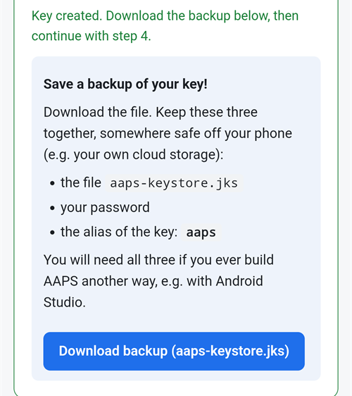

(aaps-builder)=

# 使用 AAPS Builder 的瀏覽器建置

```{note}
這是從 Android 手機建置 AAPS 的建議方式。也可在任何電腦的瀏覽器上運作。若要了解在電腦或 iPhone 上建置的其他方式，請參閱 [瀏覽器建置](BrowserBuild.md) 總覽。
```

```{contents} In this page
:backlinks: entry
:depth: 2
```

**AAPS Builder** 會在 GitHub（免費的原始碼託管網站）為你建置 AAPS 應用程式。你的手機上不需要安裝任何東西，也不需要開啟任何前置檔案。

本網站的設定頁面會一步一步帶你完成。第一次大約需要 10 分鐘：

1. 在你的 GitHub 帳號中建立一個空白的 **私有** 儲存庫。
2. 加入 **建置工作流程**（告訴 GitHub 如何建置 AAPS 的檔案）。
3. 建立或上傳你的 **簽章金鑰**（金鑰庫）。
4. 將此金鑰以 GitHub 的 **機密（secret）** 形式提供給你的儲存庫。
5. **建置** 應用程式。每次建置需時 15 到 30 分鐘。
6. **下載並安裝** 應用程式到你的手機上。

你**不**需要對 AndroidAPS 進行派生：每次建置都會從官方的 AndroidAPS 儲存庫下載 AAPS 原始碼。你也**不**需要 Google Drive：你會直接從 GitHub 下載應用程式。

```{admonition} Where the code comes from
:class: note

設定頁面與建置工作流程是本文件的一部分：它們會與本文件一同維護與審查。你新增到儲存庫的<a href="../aaps-builder-build.yml">工作流程</a>很精簡：它會執行文件儲存庫中維護的 [建置步驟](https://github.com/openaps/AndroidAPSdocs/blob/dev/.github/workflows/aaps-builder.yml)，並固定在一個經過審查的版本。在使用前，你可以先閱讀這兩者的內容。在建置時，該工作流程只會下載官方的 AAPS 原始碼與 GitHub 自家的建置工具。你的金鑰庫不會離開你的瀏覽器與你的私有儲存庫。
```

(aaps-builder-before-you-start)=

## 開始之前

你需要準備：

- 一個 **GitHub 帳號**（免費）。若尚未擁有，請先到 [github.com](https://github.com/signup) 建立。
- 一個 **網頁瀏覽器**：手機上的 Chrome，或電腦上的任一瀏覽器。開始前，請先在該瀏覽器登入 github.com。
- **你手機上已安裝 GitHub 應用程式嗎？** 可以保留。之後設定頁面上的部分按鈕會開啟該應用程式，而非 Chrome。在該應用程式中也能進行建置，但應用程式**無法下載**已完成的 AAPS：[步驟 6](#aaps-builder-step6) 會示範如何切換回 Chrome 以下載。
- 你先前已有的 **金鑰庫**（`.jks` 檔案）、其密碼與其別名；若你先前已建置過 AAPS，並想在不重新安裝的情況下進行更新，就需要這些。

```{warning}
**你的建置儲存庫必須維持為私有。** 任何能查看此儲存庫的人，都能看到建置所產生的一切內容。設定頁面會為你建立一個私有儲存庫。請勿將其變更為公開。

私有儲存庫每月可獲得 2000 分鐘的 GitHub Actions 免費額度，足以進行多次建置。
```

```{warning}
**新金鑰或既有金鑰：這將決定你是否能更新 AAPS。**

- **你的手機上已安裝 AAPS，且你仍保有當時使用的金鑰庫**：在設定頁面選擇 **I already have a keystore（我已經有金鑰庫）**，並上傳它。你下一次的建置會就地更新 AAPS。
- **你是第一次建置 AAPS，或你已遺失金鑰庫或其密碼**：請選擇 **Create a new key（建立新金鑰）**。以新金鑰簽署的應用程式，**無法更新**以其他金鑰簽署的 AAPS。你必須先匯出你的設定，將檔案複製到手機以外的位置，解除安裝舊版 AAPS，安裝新版後再匯入你的設定；請參閱 [遺失金鑰庫](#troubleshooting_androidstudio-lost-keystore)。

此後請務必持續使用同一把金鑰。 When you create a new key, download the backup the page offers and store it with its password and its alias (`key0`) somewhere safe, off your phone.
```

## 開啟設定頁面

**→ <a href="../aaps-builder.html">開啟 AAPS Builder 設定頁面</a>**

請在另一個分頁中保留本說明頁面開啟；下方步驟會更詳細說明設定頁面的各個部分。

設定頁面完全在你的瀏覽器中執行：你的金鑰與密碼不會被傳送到任何地方，唯獨在你自行貼上至 GitHub 機密（secret）時除外。它會記住你的 GitHub 使用者名稱與儲存庫名稱，因此你可以隨時回來重新開啟你的 Secrets 頁面或建置。


(aaps-builder-step1)=

## 步驟 1 – 建立你的私人建置儲存庫

此步驟會在你的 GitHub 帳號中建立一個空的私人儲存庫。只有你能看到它，以及由它建置的應用程式。

1. 請確保你已在此瀏覽器登入 github.com。

2. 在 **Your GitHub username** 欄位中，輸入你的 GitHub 使用者名稱。

3. 在 **Name of your repository** 中，保留建議的 `my-aaps`。如果你先前以其他名稱建立過儲存庫，請輸入該名稱的完整拼寫。

4. 檢查 **Your repository:** 這一行：它應顯示 `github.com/<your username>/my-aaps`。

5. 點選 **Create my private repository**。

   

6. GitHub 會在新分頁開啟，並以你的帳號作為 **Owner**，名稱則為你選擇的名稱。

   

   向下捲動：**Private**、**No template** 與 **Add README: Off** 已預先選取。不要變更任何設定，也不要新增 README 或其他檔案。

   

7. 向下捲動並點選綠色的 **Create repository** 按鈕。

   

返回設定頁面的分頁。

(aaps-builder-step2)=

## 步驟 2 – 新增建置工作流程

建置工作流程是一個簡短的文字檔，告訴 GitHub 如何建置 AAPS。設定頁面會將其新增到你的儲存庫一次；你只需確認即可。

1. 確認頁面顯示 **Workflow version … is ready**，然後點選 **Add the workflow to my repository**。

   

2. GitHub 會在你的儲存庫中開啟一個新檔案，名稱為 `.github/workflows/build.yml`，且內容已經填妥。檢查上方的檔名：必須完全為 `.github/workflows/build.yml`。不要變更文字內容。

3. 點選 **Commit changes…**

   

4. 接著在跳出的視窗中再次點選 **Commit changes**。

   

   GitHub 會在你的儲存庫中顯示位於 `.github/workflows` 資料夾內的新檔案 `build.yml`。

   

```{warning}
當檔案編輯器開啟時，請勿按手機的 **Back** 按鈕或下拉頁面：GitHub 會重新載入頁面，文字將會消失。若發生此情況，請點選藍色橫幅中的 **Restore**，或返回設定頁面再次點選該按鈕。
```

若文字區域為空，請在設定頁面步驟 2 的底部展開 **Updating the workflow, or the text area is empty**：點選 **Copy workflow**，並將其貼到文字區域中（手機上可長按貼上）。

```{warning}
只使用此設定頁面的工作流程。不要從其他網站或儲存庫複製建置工作流程：該工作流程會在你的簽章金鑰旁執行。
```

(aaps-builder-step3)=

## 步驟 3 – 你的簽章金鑰

應用程式必須使用你自己的金鑰簽章。請在兩個分頁籤中擇一。請先閱讀 [新金鑰或既有金鑰的警示](#aaps-builder-before-you-start)。


### 我已經有金鑰庫

1. 點選 **I already have a keystore**。
2. 在 **Keystore file** 中，選擇你的 `.jks` 檔案（或 `.keystore`、`.p12`、`.pfx`）。在手機上，先將檔案複製到你的手機或 Google 雲端硬碟。
3. 在 **金鑰庫密碼** 欄位中，輸入金鑰庫密碼。
4. 在 **金鑰別名** 中，從清單選擇你的別名。若是使用 Android Studio 建立的金鑰庫，通常為 `key0`。
5. 若你的金鑰密碼與金鑰庫密碼不同，請取消勾選 **金鑰密碼與金鑰庫密碼相同**，並輸入金鑰密碼。
6. 點選 **檢查並繼續**。

此頁面會在你的裝置上檢查密碼與別名。**金鑰庫 OK！繼續進行步驟 4。** 表示一切都正確。若顯示將在建置時檢查密碼，仍可繼續：建置時會告知是否有問題。

### 建立新金鑰

1. 點選 **建立新金鑰**。

2. 選擇一組密碼並輸入兩次。規則：至少 8 個字元，只能使用 a–z、A–Z 的字母、0–9 的數字，以及像 `! ? #`。不可有空白、重音符號的字母，也不能包含 `|` 字元。

3. 點選 **建立金鑰**。幾秒後會出現 **已建立金鑰**。

   

4. 點選 **下載備份（aaps-keystore.jks）**。請將以下三項一併妥善儲存於手機以外的安全位置（例如你自己的雲端儲存空間）：

   - 檔案 `aaps-keystore.jks`，
   - 你的密碼，
   - the alias of the key: **`key0`**.

   You need all three if you ever build AAPS another way, for example with Android Studio. Keys created with an earlier version of the setup page have the alias `aaps`.

   

(aaps-builder-step4)=

## 步驟 4 – 將金鑰提供給你的儲存庫

完成步驟 3 後，步驟 4 才會解鎖。你的金鑰、其密碼與別名會被封裝成一個值，即 `KEYSTORE_SET` 機密。

1. 點選 **開啟機密頁面**。


2. GitHub 會開啟你儲存庫的 **New secret** 頁面。在手機上，該頁位於設定選單下方：請往下捲動。


3. 在 **Name** 欄位中，輸入 `KEYSTORE_SET`。你也可以在設定頁面使用其旁邊的 **複製** 按鈕。

4. 在設定頁面點選 **複製機密**。在 GitHub 的 **Secret** 欄位貼上該內容（在手機上長按貼上）。

5. 點選 **Add secret**。 `KEYSTORE_SET` 會顯示在 **Repository secrets** 底下。


這個步驟只需要做一次。

```{tip}
GitHub 顯示 **找不到頁面**（404）？第 1 步中的使用者名稱或儲存庫名稱與你的儲存庫不相符。請在 github.com 檢查名稱，在第 1 步更正後，再次點選按鈕。
```

(aaps-builder-step5)=

## 步驟 5 – 建置應用程式

1. 在設定頁面點選 **開啟建置頁面**。 GitHub 會開啟你儲存庫中的 **Build AAPS** 頁面。

   

   如果改為開啟 **GitHub app**：點選 **RUN WORKFLOW**，確認版本與變體，然後再次點選 **RUN WORKFLOW**。然後繼續進行下方的步驟 4。

2. 若 GitHub 要求，請點選綠色按鈕以啟用工作流程。
3. 點選 **Run workflow**。會開啟一個小型表單：
   - **Version**：維持 `latest` 以建置最新的 AAPS 發行版，或輸入如 `3.3.2.1` 的發行版本號。
   - **Variant**：一般與幫浦搭配使用時，維持 `fullRelease`。其他變體的說明請參閱 [建置變體](#browserbuild-variant)。請勿選擇 `aapsclient3Release`：**AAPSClient3** 僅自 **AAPS** 版本 4.0 起存在。
   - 點選綠色的 **Run workflow** 按鈕。

   

4. 建置開始後會顯示 **In progress**，包含兩個部分：**AAPS / Check**，接著是 **AAPS / Build AAPS**。

   

5. 請等待 15 至 30 分鐘。綠色勾號表示建置已完成。紅色叉號表示失敗：開啟該建置以閱讀訊息，然後請參閱 [疑難排解](#aaps-builder-troubleshooting)。

   

如果沒有 **Build AAPS** 或 **Run workflow** 按鈕：

- 開啟你的儲存庫，確認檔案 `.github/workflows/build.yml` 是否存在。若遺失或更名，請再次執行 [步驟 2](#aaps-builder-step2)。
- 開啟 **Actions** 分頁。若顯示工作流程已停用，請點選綠色按鈕啟用，然後在清單中點選 **Build AAPS**。

(aaps-builder-step6)=

## 步驟 6 – 在手機上安裝應用程式

```{warning}
**每次更新前**，請在 AAPS 中 [匯出你的設定](#ExportImportSettings-Automating-Settings-Export)，並將檔案複製到手機以外的地方（Google Drive、Dropbox…）。同時保留數個較舊的匯出檔與 APK 檔案，以便隨時還原。
```

1. 在你的手機上，用 **Chrome** 開啟設定頁面。若出現提示，請登入 github.com。
2. 點選 **Open my builds**，然後選擇最新且為綠色勾號的建置。

   ```{admonition} The GitHub app opened instead of Chrome?
   :class: note

   GitHub App 無法下載建置。在 App 中開啟最新的建置，然後點選 **Artifacts ↗**，或點選頂端的分享圖示並選擇 **Chrome**。該建置會在 Chrome 中開啟：請在那裡繼續下一步。
   ```

   

3. 向下捲動至建置摘要，點選 **Download AAPS** 連結。

   

   ```{tip}
   請在文字區域滑動，而非在建置步驟的圖表上滑動：否則會只移動圖表而非整個頁面。
   ```

   你也可以繼續向下捲動到 **Artifacts**，點選 `aaps-….apk` 旁的下載圖示。

   

4. 下載完成後，開啟 Chrome 的選單 **⋮** → **Downloads**，點選 `aaps-….apk`，並選擇 **Install**。如有提示，請允許自此來源安裝應用程式。

   

`aaps-wear-….apk` 是智慧型手錶的應用程式。若未使用智慧型手錶，可略過此項。

此應用程式會在建置頁面保留 14 天。它不會顯示在你儲存庫的 **Code** 分頁中。請將它與你的設定匯出檔一起複製到安全且不在手機上的位置。

有關更多安裝應用程式的方法，請參閱 [Transferring and Installing AAPS](TransferringAndInstallingAaps.md)。

```{note}
自 2026 年 9 月起，Google 的 Android 開發者驗證可能會依你的國家／地區，阻擋透過點擊檔案安裝 APK。該頁面說明了免費的替代作法。
```

(aaps-builder-google-drive)=

## 步驟 7（可選）– 也將應用程式儲存在 Google Drive

你也可以將每次建置儲存到你的 Google Drive，位於資料夾 `AAPS/<version>`。這是可選的：應用程式一律會在建置頁面提供。

這需要再新增一個機密：`GDRIVE_OAUTH2`。你可以使用其他瀏覽器建置方法所用的準備檔來取得其數值：

1. 在 **電腦** 上，依照[選項 1 – 電腦](BrowserBuildO1Computer.md)的說明下載並開啟準備檔。略過金鑰庫的部分：你已經有你的金鑰。
2. 依照 [步驟 3 – 授權 Google Drive](#aaps-ci-google-drive-auth) 取得 `GDRIVE_OAUTH2` 的數值。
3. 在設定頁面，步驟 7 會開啟你的機密頁面。

   

   建立名為 `GDRIVE_OAUTH2` 的機密（按下 **Copy** 按鈕會複製名稱），貼上數值，然後點選 **Add secret**。

從下一次建置開始，APK 也會儲存在 Google Drive。

若你超過 6 個月沒有建置，或變更了 Google 密碼，Google 會停止存取權。之後建置會提示你：請重新執行這些步驟。請參閱 [Google 重新整理權杖已過期](#aaps-ci-google-token-expired)。

(aaps-builder-updates)=

## 更新AAPS

你的儲存庫不會自行建置任何內容：由你決定何時建置、要建置哪個版本與哪個變體。當有新的 AAPS 版本發佈時：

1. 依照 [步驟 6](#aaps-builder-step6) 的說明備份你的設定。
2. 依照 [步驟 5](#aaps-builder-step5) 建置新版本。保持 `latest`，或輸入發佈版本號。
3. 依照 [步驟 6](#aaps-builder-step6) 下載並安裝。

**建置工作流程的更新：**你的儲存庫不會自動下載新的工作流程，而且它執行的建置步驟會鎖定在經審查的某個版本上。當工作流程有變更時，會在[文件更新與變更](../Maintenance/DocumentationUpdate.md)頁面公告。若要更新，開啟設定頁面的步驟 2，然後前往**更新工作流程，或文字區域為空白**：

1. 點選 **Copy workflow**，接著點選 **Open my workflow file**。
2. 以複製的工作流程取代全部文字（在手機上長按：**Select all**，然後 **Paste**）。
3. 點選 **Commit changes…**，接著 **Commit changes**。

檔案的第一行會顯示其版本。

(aaps-builder-troubleshooting)=

## 問題排除

若要查看建置失敗的原因，從設定頁面的 **Open my builds** 開啟該建置：圖表下方的 **Annotations** 區塊會顯示錯誤訊息。若要查看完整日誌，點選帶紅色叉號的作業，然後點選帶紅色叉號的步驟。

- **要變更機密**：開啟你儲存庫的 **Settings** → **Secrets and variables** → **Actions**，點選該機密旁的鉛筆圖示，貼上新數值並點選 **Update secret**。
- **在修正後要再次執行建置**：開啟失敗的建置，點選頂端的 **⋯**，然後 **Re-run all jobs**；或依照 [步驟 5](#aaps-builder-step5) 開始新的建置。

- **建置停止並顯示 "This repository is PUBLIC"**：在你的儲存庫中，開啟 **Settings** → **General** → **Danger Zone** → **Change visibility** → **Private**，然後再建置一次。
- **"Secret KEYSTORE_SET is missing"** 或 **"KEYSTORE_SET is not valid"**：重新執行設定頁面的步驟 3 與 4，並再次複製該機密。
- **"Keystore, password or alias is wrong"**：請檢查你的金鑰庫密碼與別名，然後重新執行設定頁面的步驟 3 與 4。
- **"Version … does not exist"**：你輸入的版本不是 AAPS 的發佈版本。請使用 `latest`，或檢查發佈版本號。
- **設定頁面開啟 GitHub 時出現 "Page not found"（404）**：設定頁面步驟 1 中的儲存庫名稱與你的儲存庫不相符。請輸入完全相同的名稱。
- **沒有 Download 連結，或開啟的是 GitHub 應用程式**：GitHub 應用程式無法下載建置產物。依照 [步驟 6](#aaps-builder-step6) 的說明，改用 Chrome 開啟該建置。
- **設定頁面出現 "Could not read the workflow file"**：請重新載入頁面，然後再按一次該按鈕。必須從本文件網站開啟設定頁面。
- **提交工作流程時 GitHub 顯示檔案已存在**：你的儲存庫已經有一個工作流程。請改為更新它，詳見 [更新 AAPS](#aaps-builder-updates)。
- **"Google Drive access has expired or was revoked"**：請重新執行 [步驟 7](#aaps-builder-google-drive)，並更新 `GDRIVE_OAUTH2` 機密。

關於其他 GitHub 與 Google Drive 問題，請參閱[瀏覽器建置疑難排解](../GettingHelp/BrowserBuildTroubleshooting.md)。
