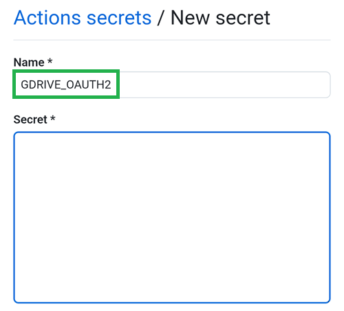

(aaps-ci-google-drive-auth)=

# 瀏覽器建置－步驟 3：授權 Google 雲端硬碟

```{note}
這是<a href="BrowserBuild.md">瀏覽器建置</a>的**步驟 3**。請先完成<a href="BrowserBuildKeystore.md">步驟 2－建立簽署金鑰庫</a>。
```

```{warning}
無論您是按照前述哪一組指示（選項 1 或選項 2）操作，都<strong x-id="1">必須</strong>新增 Google 雲端硬碟授權，才能順利使用瀏覽器建置。
```

注意：如果您已經按照影片完成這個部分，現在可以直接前往[步驟 4－建置 APK](BrowserBuildAPK.md)。

```{warning}
如果 Google 授權程序沒有開始，或準備頁面無法正常運作，請關閉準備頁面，按照步驟 2 的相同方式重新開啟 `aaps-ci-preparation.html`，然後重新執行這個步驟。請參閱<a href="#aaps-ci-preparation-web">疑難排解</a>。
```

切回準備頁面的分頁。

向下滾動到 Google Drive 認證部分，然後點擊開始認證。


選擇您的 Google 帳號。


向下滾動並接受存取權限。該網頁需要此存取權以獲取 Google Drive 認證金鑰。

點擊繼續。


`GDRIVE_OAUTH2` 欄位將會填寫，請點擊上方的複製按鈕。


切換回 GitHub 頁籤。

向下滾動到儲存庫密碼並點擊新增儲存庫密碼。

如果您遵循了選項 1，應該會看到這個：


如果您遵循了選項 2，將會有更多金鑰：


在名稱欄位中，貼上您剛才複製的文字。在文字框上長按以顯示「貼上」選單。



切換至準備頁面的分頁。

點擊第二個複製按鈕。


切換回 GitHub 頁籤。

1. 在「secret」」欄位中，貼上您剛才複製的文字。在文字框上長按以顯示「貼上」選單。

2. 點擊「Add secret」。


現在你應該有兩個（選項 1）或五個（選項 2）Secrets 項目。


GitHub 現在將能夠將 AAPS apk 檔案儲存在您的 Google Drive 中，一旦建立完成。

----

**下一步：[步驟 4－建置 APK](BrowserBuildAPK.md) →**
