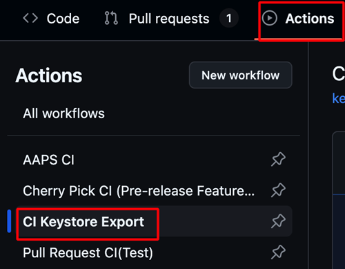

(aaps-ci-preparation)=

# 瀏覽器建置－步驟 2：建立簽署金鑰庫

```{note}
這是<a href="BrowserBuild.md">瀏覽器建置</a>的**步驟 2**。請先完成<a href="BrowserBuildFork.md">步驟 1－建立 GitHub 複刻</a>。
```

AAPS must be signed with private keys stored in a **Java KeyStore (JKS)**. 這是整個流程中最重要的決定，因為它會影響您之後是否能在不重新安裝的情況下**升級** AAPS。

```{note}
接下來，您會將私密資訊（金鑰庫，以及稍後的 Google 雲端硬碟存取權）以**機密**的形式儲存在 GitHub 中。機密就是經過加密的值，只有您自己的建置程序可以讀取；其他人都看不到，即使是查看您複刻版本的人也一樣。這樣就能確保您的建置版本只屬於您。
```

## 選擇金鑰庫策略

請閱讀以下兩個選項，並選擇符合您情況的一項。

### 選項 1－產生新的金鑰庫（新使用者）

如果符合以下**任何一項**情況，請選擇這個選項：

- 這是您**第一次**建置 AAPS。
- 您沒有之前使用 Android Studio 在電腦上建置時所用的金鑰庫。
- 您忘記了金鑰庫密碼或別名。

```{warning}
使用**選項 1** 建置 AAPS 時會建立全新的金鑰庫，因此**無法直接升級您目前安裝的 AAPS**。若要改用這個新的建置版本，您必須先匯出設定、解除安裝舊版 AAPS、安裝新版，再匯入設定。請按照<a href="#reinstall-aaps">使用新金鑰庫重新安裝 AAPS</a>中的步驟操作。
```

**→ [繼續使用選項 1－產生新的金鑰庫](BrowserBuildO1.md)**

### 選項 2－上傳現有的金鑰庫（現有或曾經使用過的使用者）

如果您**已經有**先前使用 Android Studio 在電腦上建置 AAPS 時所用的 `.jks` 金鑰庫，**而且**知道其密碼和別名（通常是 `key0`），請選擇這個選項。

使用這個選項，您目前安裝的 AAPS 就能繼續升級：未來的更新會使用相同的金鑰庫。

**→ [繼續使用選項 2－上傳現有的金鑰庫](BrowserBuildO2.md)**

----

```{note}
下一頁會請您選擇裝置（電腦或 iPhone）。接著，各裝置的說明頁面會引導您以正確方式下載並開啟準備檔案，並建立金鑰庫。建置完成的 AAPS App 會儲存在您的 Google Drive 中。
```

**下一步：請選擇上方的 [選項 1](BrowserBuildO1.md) 或 [選項 2](BrowserBuildO2.md)，然後按照適用於您裝置的說明頁面操作。**

----

(ci-keystore-export)=

## 匯出金鑰庫（選擇性）

如果您想要匯出儲存的金鑰庫，請使用這個方法。

這段腳本將會把您先前配置的金鑰庫資訊（來自選項 1 或選項 2）匯出為一個受密碼保護的 ZIP 檔案到你的 Google 雲端硬碟裡 `/AAPS/KeyStore` 目錄中

```{warning}
在使用這個匯出方法之前，請確保您的金鑰庫和 Google 雲端硬碟的設定已完成。
```

### 步驟：

1. **新增 ZIP 密碼：**
   - 前往您的儲存庫的 **設定** → **密碼和變數** → **動作**
   - 點擊 **New repository secret(新增儲存庫密碼)**
   - 在 **Name(名稱)** 欄位中，輸入: `ZIP_PASSWORD`
   - 在 **Secret(密碼)** 欄位中，輸入您自訂的 ZIP 加密密碼
   - 請僅使用英文字母和數字作為密碼（不可以使用特殊符號）
   - 點擊 **Add secret(新增密碼)**

   

2. **執行匯出工作流程：**
   - 前往您的儲存庫中的 **Actions** 標籤
   - Select **CI Keystore Export**
   - 點擊 **執行工作流程**
   - 匯出的金鑰庫 ZIP 檔案將會保存在您的 Google 雲端硬碟中

   

   

```{toctree}
:hidden:

選項 1 – 建立新的金鑰庫 <BrowserBuildO1.md>
選項 2 – 上傳現有的金鑰庫 <BrowserBuildO2.md>
```
