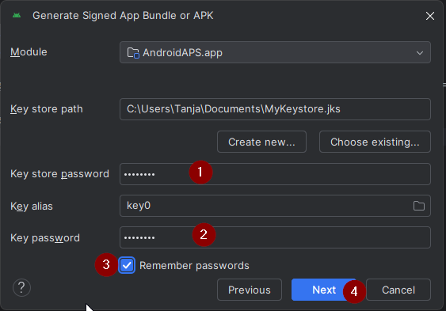

(aaps-ci-option2)=

# 選項 2 – 上傳現有的金鑰庫

```{note}
這是[瀏覽器建置](BrowserBuild.md)的[步驟 2 – 建立簽署用金鑰庫](BrowserBuildKeystore.md)的一部分。 Make sure you have read the [Option 1 vs Option 2 decision](#aaps-ci-preparation).
```

選項 2 會沿用您先前使用電腦上的 Android Studio 建置 AAPS 時所建立的 JKS。適合已有 JKS，且知道 JKS 密碼和別名的使用者。

在 GitHub 中，請於 `KEYSTORE_PASSWORD`、`KEY_ALIAS` 和 `KEY_PASSWORD` 欄位填入您實際使用的密碼和別名，也就是您在 Android Studio 中使用的內容。請參閱下方的說明。

```{warning}
**包含特殊字元的密碼。**請照原樣輸入密碼。請勿加入反斜線或其他跳脫字元：建置工作流程會保留每個字元，您額外加入的反斜線會成為密碼的一部分。

如果建置仍在簽署步驟失敗，而且您的密碼包含 `$`、反引號、`"` 或 `\`，代表您 fork 中的工作流程檔案已過時。請使用最新的 dev 更新您的 fork（[同步您的 fork](#Update-to-new-version-update-your-repo)），然後重新執行建置。請參閱[瀏覽器建置疑難排解](#aaps-ci-password-special-characters)。
```

```{admonition} KEY + PASSWORDS
:class: dropdown


```

## 選擇您的裝置

```{tip}
要使用 **Android 手機**進行建置嗎？請改用 [AAPS Builder](BrowserBuildAapsBuilder.md)：它不需要準備檔案。
```

請按照符合您用來進行建置之裝置的說明頁面操作：

- **[電腦](BrowserBuildO2Computer.md)** – Windows、Mac 或 Linux。

```{tip}
您可以隨時更換裝置，只要開啟相符的說明頁面即可。
```

```{toctree}
:hidden:

電腦 <BrowserBuildO2Computer.md>
```
