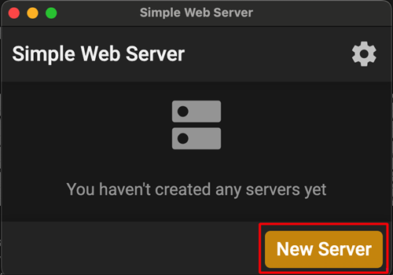
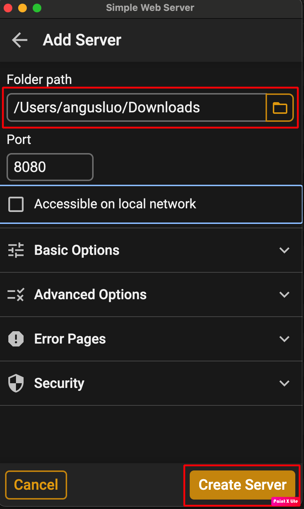

(aaps-ci-option2-computer)=

# Option 2 · Computer – Upload your existing keystore

```{note}
[Option 2](BrowserBuildO2.md) (upload an existing keystore) on a **computer** (Windows / Mac / Linux).
```

## 1. Download the preparation file

:::{include} BrowserBuildDownloadPrep.md
:::

## 2. Start a local server and upload the keystore

電腦上相容的作法（支援 Windows/Mac/Linux）

<!--crowdin: exclude-->
<div align="center" style="max-width: 360px; margin: auto; margin-bottom: 2em;">
  <div style="position: relative; width: 100%; aspect-ratio: 9/16;">
    <iframe
      src="https://geo.dailymotion.com/player/x9rdyc6.html?video=x9rdyc6&loop=true&mute=true"
      loading="lazy"
      style="position: absolute; top: 0; left: 0; width: 100%; height: 100%;"
      frameborder="0"
      allowfullscreen>
    </iframe>
  </div>
</div>

Install Simple Web Server</br></br> If you are a Windows or Mac user, you can install it from the Microsoft Store or the Mac App Store. If your browser asks whether to open the store app, allow it.</br></br> </br></br>

在 Mac 上的範例：

- 取得 → 安裝 → 開啟</br></br> </br></br>

- 按一下 「Get Started」鈕</br></br> </br></br>

- Click New Server</br></br> </br></br>

- 在文件夾路徑中，選擇包含 aaps-ci-preparation.html 的資料夾，然後按一下「Create Server」鈕。</br></br> </br></br>

- 看到這個畫面表示伺服器已啟動。</br></br> </br></br>

- Do not close Simple Web Server. 請切換到您的瀏覽器並打開</br></br> [http://127.0.0.1:8080/aaps-ci-preparation.html](http://127.0.0.1:8080/aaps-ci-preparation.html)</br></br>

- 後續步驟請參考下方影片，從 2 分 18 秒開始。</br></br>
  <!--crowdin: exclude-->
  <div align="center" style="max-width: 360px; margin: auto; margin-bottom: 2em;">
    <div style="position: relative; width: 100%; aspect-ratio: 9/16;">
      <iframe
        src="https://geo.dailymotion.com/player/x9rdvt0.html?video=x9rdvt0&startTime=138&loop=true&mute=true"
        loading="lazy"
        style="position: absolute; top: 0; left: 0; width: 100%; height: 100%;"
        frameborder="0"
        allowfullscreen>
      </iframe>
    </div>
  </div>

----

**Next: [Step 3 – Authorize Google Drive](BrowserBuildGoogleDrive.md) →**
