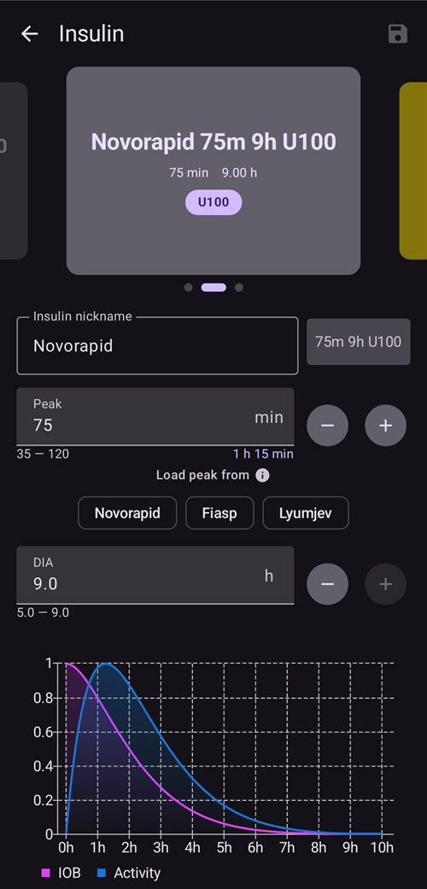
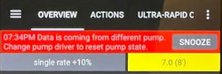

# 組態（組態建置工具）

```{admonition} Coming from AAPS v3?
:class: note
**組態建置工具**現在稱為**設定**，位於**選單**（☰）中。請參閱[ AAPS v4 的變更](#v4-changes)。
```

您可以在**設定**中選擇要啟用的外掛（CGM、幫浦、APS 演算法、敏感度、同步等）並開啟各個外掛及其設定。下方提供[操作說明](#configuration-v4)；本頁其餘部分會詳細說明各個區段。

(configuration-v4)=
## AAPS v4 中的設定

在 **AAPS** v4 中，點選主畫面左上角的**選單**（☰），然後選擇**設定**（_「設定您的組態（CGM、幫浦……）並啟用功能」_）。


外掛會依**類別**分組，例&#x5982;_&#x5E73;滑處理_、_校正_、_敏感度偵測_、_APS_、_通&#x8A0A;_&#x548C;_一般_。每個項目都會顯示類別名稱及**目前啟用**的外掛（例如 _APS → OpenAPS SMB_）。點選項目即可開啟該類別。


進入類別後，即可看到該類別提供的外掛。在單選類別中，您可以選擇要啟用的項目；有些類別則允許複選（_「選擇所有適用項目」_）。每個外掛都提供兩種操作：

- **開啟外掛** — 開啟外掛本身的畫面。
- **設定** — 開啟外掛的偏好設定（設定可能會分組在可展開的區段中）。


(configuration_sync_icon)=
### 手機圖示 —「已從主端同步」

類別或設定旁的小型**手機圖示**表示該項目**已從主端同步**——其數值／選取項目會透過 NSClientV3（Nightscout）通道傳送至此裝置。

在**用戶端**（**AAPSClient**）上，這些項目會與主控端**保持同步**。此圖示只會顯示在用戶端，因此上方截圖中看不到；該截圖是在主要的 **AAPS** 應用程式中擷取的。在用戶端上，圖示通常會顯示&#x5728;_&#x5E73;滑處理_、_校正_、_敏感度偵&#x6E2C;_&#x548C;_AP&#x53;_&#x65C1;。主控端與用戶端如何保持同步，以及您可以從哪一端變更哪些設定，請參閱[主控端 ↔ 用戶端控制](#client-master-config-prefs)。

相同的圖示也會出現在設定畫面中，顯示於個別同步設定旁。在下方範例中，_吸收截&#x6B62;_&#x65C1;有此圖示；沒有圖示的設定則是個別裝置設定：


**沒有**圖示的項目會**依裝置個別設定**。最重要的例子是 **NSClientV3（通訊）**連線本身 — **Nightscout URL**、**存取權杖**和 **WebSocket** 都是在各支手機上分別設定，因此旁邊**不會**顯示手機圖示。

---

(Config-Builder-tab-or-hamburger-menu)=
## 開啟外掛畫面

外掛畫面可透過以下其中一種方式開啟（**AAPS** v3 的分頁和眼睛核取方塊已移除，請參閱[ AAPS v4 的變更](#v4-changes)）：

- **設定** → 外掛類別 → **開啟外掛**，
- 底部導覽列的**管理**面板，可開啟您最常使用的畫面（設定檔、胰島素設定、幫浦、自動化、食物等），
- 您自行新增的 [QuickLaunch](../DailyLifeWithAaps/QuickLaunch.md) 按鈕，
- 主畫面上的**搜尋列**。

```{contents}
:backlinks: entry
:depth: 2
```

(ConfigBuilder_Profile)=

## 設定檔

此模組是 **AAPS** 的核心部分，因此無法停用。

請參閱[您的 AAPS 設定檔](../SettingUpAaps/YourAapsProfile.md)，了解**設定檔**中包含哪些基本內容。

(insulin)=
(Config-Builder-insulin)=
## 胰島素



在 **AAPS** 4 中，胰島素不再是透過**設定**選取的外掛。開啟**管理 → 胰島素設定**，設定您正在使用的胰島素。

胰島素編輯器可讓您進行以下設定：

- 為胰島素設定**胰島素暱稱**，方便辨識，
- 設定**峰值**（胰島素活性達到最高點所需的時間，以分鐘為單位）和 **DIA**（胰島素作用時間，以小時為單位），您可以輸入數值，或使用 **–**／**+** 按鈕，
- 點選預設的**載入峰值**按鈕——**Novorapid**（75 分鐘）、**Fiasp**（55 分鐘）或 **Lyumjev**（45 分鐘）——即可一次填入該胰島素的標準峰值時間。

無論使用哪種胰島素，允許的數值範圍都相同：

- **DIA**：5 至 9 小時（若患者類型設為**懷孕**，則為 5 至 10 小時）。請參閱[胰島素作用時間（DIA）與峰值](#Config-Builder-insulin-dia)，以選擇數值。
- **峰值**：35 至 120 分鐘。

編輯畫面底部顯示的**體內胰島素**（IOB）和**活性**曲線會隨著數值變更而更新，讓您立即查看設定如何影響胰島素作用。

如需了解 **AAPS** 中顯示的胰島素設定檔，請參閱[此處](#AapsScreens-insulin-profile)。

(Config-Builder-insulin-change-active)=
### 變更目前使用的胰島素（DIA 或峰值）

標示為**啟用中**的胰島素，就是目前執行中的設定檔所使用的胰島素。該胰島素的欄位會呈現灰色，無法編輯或刪除。如此一來，目前使用中的設定檔所顯示的胰島素名稱，就會與實際使用的設定相符。

若要變更目前使用的 DIA 或峰值：

1. 開啟**管理 → 胰島素設定**。如果畫面以唯讀模式開啟（頂端列有 **✏️ 鉛筆**圖示），請點選鉛筆圖示並解除設定鎖定。
2. 點選 **+**（_新增胰島素_）。 **AAPS** 會複製畫面上顯示的胰島素。
3. 設定新的**峰值**和／或 **DIA**，然後點選儲存圖示（右上角）。
4. 點選 **▶**（_啟用胰島素_）並確認。新的胰島素會變成**作用中**。

```{admonition} The name includes peak and DIA
:class: note
**AAPS** 會自動將峰值、DIA 和濃度加到胰島素名稱中（例如 _Fiasp 55m 8h U100_），讓你一眼就能區分不同的組態。
```

舊的胰島素不再啟用後，即可將它刪除。

### 「峰值載入來源」預設選項

在 **AAPS** 4 中，沒有可供選擇的胰島素類型清單。所有胰島素都使用相同的指數活性曲線，差別只在於<strong>峰值</strong>和 <strong>DIA</strong>。胰島素編輯器中的<strong>從以下項目載入峰值</strong>預設值，只要點選一次，就能填入最常見胰島素的建議峰值（點選<strong>從以下項目載入峰值</strong>旁的小型 ⓘ，即可查看胰島素清單及其峰值）。之後仍可調整<strong>峰值</strong>和 <strong>DIA</strong>。

只有在了解調整峰值的影響時，才將峰值改成建議值以外的數值。[胰島素曲線圖](#AapsScreens-insulin-profile)可協助您了解這些曲線。

#### Novorapid


- 建議用於 Humalog、Novolog 和 Novorapid（在 **AAPS** v3 中稱為 _Rapid-Acting Oref_）
- 峰值 = 注射後 75 分鐘

#### Fiasp


- 建議用於 Fiasp（在 **AAPS** v3 中稱為 _Ultra-Rapid Oref_）
- 峰值 = 注射後 55 分鐘

(Config-Builder-lyumjev)=
#### Lyumjev


- 建議用於 Lyumjev
- 峰值 = 注射後 45 分鐘

#### 自訂峰值

- 在 **AAPS** 4 中，沒有獨立的「Free-Peak Oref」胰島素類型：請在[胰島素編輯器](#Config-Builder-insulin)中直接輸入任意的 **Peak**（35 至 120 分鐘），不必使用預設選項。
- 如果你使用的胰島素不在清單中，或使用不同胰島素的混合物，自訂峰值就很有用。

(Config-Builder-insulin-dia)=
### 胰島素作用時間（DIA）和峰值

```{warning}
在循環運作時，降低 DIA 或峰值都會使給予的胰島素量增加。AAPS 中 DIA 的運作方式與商用 AID 系統不同；若不謹慎變更這些設定，胰島素劑量的變化可能遠超出或低於預期。
```

AAPS 使用數學公式來模擬胰島素作用的時間軸，並透過 **DIA** 和密切相關的 **peak** 設定進行調整。 DIA 是理論上 IOB 降至零所需的時間；峰值則是胰島素作用最強的時間點。這會產生 IOB 曲線和活性曲線，後者就是 IOB 衰減的**速率**。

請注意，AAPS 循環運作時，出現[零暫時基礎率](#Open-APS-features-super-micro-bolus-smb)的時段是正常的。這些未輸注的基礎胰島素會從 IOB 中全數扣除，因此實際上 IOB 會比設定的 DIA 早好幾個小時降至零。你可以在主畫面分別查看[注射 IOB 和基礎 IOB](#aaps-screens-iob-cob-basal-sens)。

若要設定 DIA 和峰值，請在主畫面點選 **管理**，再點選 **胰島素設定**。 AAPS 會如下方所示，顯示目前使用中的胰島素組態：


在此範例中，峰值設定為 55 分鐘，DIA 為 8 小時，而[胰島素濃度](#Insulin-Concentration)為標準的 100 IU/mL。

由於上述零基礎率的影響，以及 AAPS 使用的 IOB 衰減公式，大多數使用者設定的 DIA 都明顯長於商用系統中的設定。一般來說，許多人發現 **DIA** 設為 9 小時效果不錯。在更熟悉 AAPS 並將個人設定檔調整妥當後，您可以參考以下資訊，找出適合自己的 DIA 和峰值設定。

````{admonition} Details on the impact of DIA and peak configuration
:class: dropdown

由於基礎率會間接影響 AAPS 中 IOB 的衰減，因此基礎率過高可能會掩蓋 DIA 過長的問題，反之亦然。建議先仔細調整基礎率，再調整 DIA 和峰值。另外，DIA 和峰值的設定會彼此影響，也就是說，DIA 的效果取決於峰值，反之亦然。

這些圖表顯示在允許的數值範圍內，DIA 和峰值對 IOB 曲線的確切影響。

調整 DIA：

```{image} ../images/iob_remaining_static_peak.png
:width: 400px
```

調整峰值：

```{image} ../images/iob_remaining_static_dia.png
:width: 400px
```

最後，以下比較了同時調整 DIA 和峰值的情況。此處的邏輯是，兩個數值都以相同的相對幅度調整，因此 `49/35 ~ 7/5`。同樣地，`120/93 ~ 9/7`。只要兩者的相對變化相同，無論 DIA 或峰值的基準值為何，間隔都會一致。

```{image} ../images/iob_remaining_uniform.png
:width: 400px
```

請注意，以這種方式調整 DIA 和峰值時，曲線上的每個點都會以相同的相對幅度移動。

````

#### 延伸閱讀：DIA 和峰值設定

- [技術細節和 AAPS 前身 OpenAPS 的歷史背景](https://openaps.readthedocs.io/en/latest/docs/While%20You%20Wait%20For%20Gear/understanding-insulin-on-board-calculations.html#understanding-the-new-iob-curves-based-on-exponential-activity-curves)。
- Diabettech 上的文章：[為什麼我們經常弄錯胰島素作用時間（DIA），以及這為什麼很重要……](https://www.diabettech.com/insulin/why-we-are-regularly-wrong-in-the-duration-of-insulin-action-dia-times-we-use-and-why-it-matters/)。
- See My CGM（封存網站）上的文章：[指數型胰島素曲線 + Fiasp](https://web.archive.org/web/20220630154425/http://seemycgm.com/2017/10/21/exponential-insulin-curves-fiasp/)。
- Bionic Wookie 上的[閉環中的修訂版 Humalog 模型](https://bionicwookiee.com/2022/04/13/revised-humalog-model-in-a-closed-loop/)及其他文章，建議 Lyumjev、Fiasp、NovoRapid、Humalog 的 DIA 設為 9 小時。

(Config-Builder-bg-source)=
## 血糖來源
選擇你使用的血糖來源。請參閱 [血糖來源](../Getting-Started/CompatiblesCgms.md) 頁面，了解更多設定資訊。


向下捲動即可查看其他來源：


- [xDrip+ 血糖](../CompatibleCgms/xDrip.md) - 也適用於 [Juggluco](../CompatibleCgms/Juggluco.md) 等相容的應用程式
- [NSClient 血糖](../CompatibleCgms/CgmNightscoutUpload.md) - 僅限清楚自己在做什麼時使用，請參閱[血糖來源](../Getting-Started/CompatiblesCgms.md)。
- [MM640g](../CompatibleCgms/MM640g.md)
- Glimp - 僅支援 4.15.57 及更新版本
- [BYODA（自行打造 Dexcom 應用程式）](#DexcomG6-if-using-g6-with-build-your-own-dexcom-app)。
- MicroTech CGM App - 適用於 Aidex / LinX CGM
- [Poctech](../CompatibleCgms/PocTech.md)
- Tomato（MiaoMiao）- 適用於 MiaoMiao 裝置的 Tomato App
- [Glunovo](https://infinovo.com/) - 適用於 Glunovo CGM 系統的 Glunovo App
- Intelligo - Intelligo 應用程式
- Syai／Ottai - 適用於 Syai 和 Ottai 應用程式（請參閱 [Syai 標籤](../CompatibleCgms/SyaiTagX1.md) 和 [Ottai](../CompatibleCgms/OttaiM8.md)）
- SI App - 適用於 Sibionics CGM 的修補版 SI App 或 Sibionics App
- Sino App - 適用於 Sinocare CGM 的修補版應用程式
- 通知讀取器 - 從官方 CGM 應用程式（Dexcom、Medtronic、Eversense 等）顯示的通知中讀取血糖值
- Instara - Instara 應用程式
- 隨機血糖 - 產生隨機血糖資料以供測試。只有在使用 **Virtual Pump** 的工程（開發者）版本中才能啟用，因此無法在一般的 **AAPS** 安裝中使用。

## 平滑處理


請參閱[平滑處理血糖資料](../CompatibleCgms/SmoothingBloodGlucoseData.md)。

## 校正

選擇 **AAPS** 如何處理從感測器接收的數值：

- **不校正**：直接使用感測器讀取值。傳感器已在出廠時完成校正，且數值準確時，請使用此選項。此為預設選項。
- **線性校正**：**AAPS** 會使用斜率和截距校正感測器讀取值，並根據您輸入的指尖採血讀取值計算這兩個數值。

如何使用 **線性校正**：

1. 在**校正**類別中選取**線性校正**。
2. 插入新感測器時，請記錄感測器更換：在校正畫面使用**記錄感測器更換**，或在照護入口中輸入 CGM 感測器插入紀錄。這會讓**AAPS**知道感測器使用時段的開始時間。如果**AAPS**發現讀取值中斷超過 30 分鐘，可能會要求你標記感測器更換；這個提示只會出現在主控端，不會出現在用戶端。
3. 開啟外掛並點選**新增校正**。輸入指尖血糖值。 **AAPS**會將這個數值與過去 10 分鐘內的感測器讀取值配對。

只有在符合以下條件時，才會接受校正：

- 記錄感測器更換後，至少已經過 **2 小時**（暖機時間），
- 您的血糖值穩定。如果血糖變化太快，對話方塊會告知您並顯示限制值，
- 最近 10 分鐘內有 CGM 讀取值，
- 校正讀取值是目前的讀取值。你無法輸入較早之前的指尖血糖值。

校正方式：

- **AAPS** 會根據目前感測器的配對資料畫出一條直線：`corrected value = slope × sensor value + offset`。
- 較新的配對資料權重較高：2 天前的配對資料權重約為 37 %，4 天前的約為 14 %。因此，這條線會隨著感測器讀取值的漂移而變化。
- 至少需要 **2 組配對資料**。
- 如果配對資料彼此接近（相差不到 54 mg/dL / 3 mmol/L），只會平移數值（調整截距，不調整斜率）。
- 斜率會限制在 0.55 到 1.6 之間。如果斜率超出此範圍，會限制為最接近的界限值。
- 安全限制：如果在 100 mg/dL (5.5 mmol/L) 時，校正幅度會超過 ±30 mg/dL (1.7 mmol/L)，則不會套用校正。這能避免錯誤輸入造成影響。

校正會影響哪些項目：

- 校正後的數值會用於所有地方：主畫面上的血糖值、圖表和循環。感測器本身的讀取值不會改變。校正會套用在原始讀取值之上，也會套用到目前感測器較早之前的讀取值。
- 更換新感測器後，校正會從零開始。先前感測器的配對資料不再納入計算。
- 圖表會在指尖採血讀取值的位置，以標記顯示校正資料。
- 校正資料會透過 Nightscout 同步，因此您的用戶端會顯示相同的校正後數值。

查看及移除項目：

- **開啟外掛**會顯示狀態（例如 _斜率 0.85，中間範圍校正 -0.4_）、含直線的配對資料圖表，以及項目清單。
- 如果項目有誤（例如手指沾到糖），請點選該項目旁的垃圾桶圖示。系統會立即重新計算這條線。

```{admonition} Using xDrip+ as BG source?
:class: note
xDrip+ 有自己的校正功能。請只在一個地方進行校正，以免感測器讀取值被重複校正。
```

```{admonition} Calibrate with care
:class: warning
指尖採血讀取值錯誤會導致血糖值錯誤，進而造成胰島素劑量錯誤。測量前請洗手；血糖快速變化時請勿進行校正。
```


(Config-Builder-pump)=
## 幫浦
選擇你正在使用的幫浦。如需更多設定資訊，請參閱[相容的幫浦](../Getting-Started/CompatiblePumps.md)頁面。


向下捲動即可查看所有幫浦驅動程式：


選擇其他幫浦時，**AAPS** 會要求您確認變更：


- [Dana R](../CompatiblePumps/DanaR-Insulin-Pump.md)
- Dana R Korean（適用於國內 DanaR 幫浦）
- Dana Rv2（升級了非官方韌體的 DanaR 幫浦）
- [Dana-i/RS](../CompatiblePumps/DanaRS-Insulin-Pump.md)
- [Accu Chek Insight](../CompatiblePumps/Accu-Chek-Insight-Pump.md)
- [Accu Chek Combo](../CompatiblePumps/Accu-Chek-Combo-Pump-v2.md)
- 適用於 [Omnipod Eros](../CompatiblePumps/OmnipodEros.md) 的 Omnipod
- 適用於 [Omnipod DASH](../CompatiblePumps/OmnipodDASH.md) 的 Dash
- [Medtronic](../CompatiblePumps/MedtronicPump.md)
- [Diaconn G8](../CompatiblePumps/DiaconnG8.md)
- [EOPatch2](../CompatiblePumps/EOPatch2.md)
- [Medtrum](../CompatiblePumps/MedtrumNano.md)
- [Equil 5.3](../CompatiblePumps/Equil5.3.md)
- [Carelevo](../CompatiblePumps/CareLevo.md)
- 虛擬幫浦：開放迴路－僅提供 **AAPS** 建議
  - 在您開始使用 **AAPS** 的初期，完成前幾個[目標](../SettingUpAaps/CompletingTheObjectives.md)期間
  - 針對尚未擁有驅動程式的幫浦

(config-builder-wrong-pump-data)=
### 訊息：「資料來自不同的幫浦」

**AAPS** 會記住目前連線的幫浦（幫浦類型和序號）。如果收到來自其他幫浦的資料，例如原本的幫浦更換成同型號的新幫浦後，系統會顯示此訊息，並忽略該幫浦傳來的資料：



若要使用新的幫浦，請變更幫浦驅動程式：選取 **虛擬幫浦**，確認後再選取您的幫浦。接著，**AAPS** 會註冊目前連線的幫浦。

(Config-Builder-sensitivity-detection)=

## 敏感性偵測


選擇你正在使用的敏感性偵測類型。如需不同設計的詳細資訊，請[參閱此處](../DailyLifeWithAaps/SensitivityDetectionAndCob.md)。此功能會即時分析歷史資料，並在你對胰島素的反應比平常更敏感（或相反，更具抗性）時進行調整。如需敏感度比值本身的計算方式，請參閱[重要的 AAPS 功能 > Autosens](#Open-APS-features-autosens)。

您可以在主畫面選取 SENS%，並查看白線，在[額外圖表](#AapsScreens-section-g-additional-graphs)中檢視您的敏感度。請注意，您必須達到[目標 8](#objectives-objective8)，才能讓敏感度偵測／[Autosens](#Open-APS-features-autosens)自動調整胰島素輸注量。在達到該目標之前，Autosens 的百分比/圖表中的線僅供參考。

### 吸收設定
若使用搭配 **SMB** 的 Oref1，必須將 **min_5m_carbimpact** 改為 8。此數值僅會在 **CGM** 讀取值出現間隔時使用，或是在身體活動「消耗掉」所有原本會使 **AAPS** 降低 COB 的血糖升幅時使用。當無法根據血糖反應動態計算[碳水化合物吸收](../DailyLifeWithAaps/CobCalculation.md)時，系統會為碳水化合物套用預設衰減。基本上，這是一個安全保護機制。

(Config-Builder-aps)=
## APS


選擇用於治療調整的 APS 演算法。您可以使用 **開啟外掛**，查看所選演算法的作用中詳細資訊。
- OpenAPS AMA
  - 進階餐點輔助：不再建議使用的舊演算法。
  - 簡單來說，這些好處是在你提供餐前注射後，系統可以更快進行高溫调节，前提是你可靠地輸入碳水化合物。
- [OpenAPS SMB](#Open-APS-features-super-micro-bolus-smb)
  - 超微量注射：建議所有用戶使用的最新演算法。
  - 與 AMA 不同，SMB 不會使用臨時基礎率控制血糖，而主要使用小劑量的**超微量注射**。
  - 注意：建議從一開始就使用此演算法，但在達到[目標 9](#objectives-objective9)之前，實際上不會輸注 SMB。
- [Auto ISF](#Open-APS-features-auto-isf)
  - 供進階使用者使用的實驗性演算法。完成各項目標後，此演算法才會出現在清單中。

若要從 AMA 切換至 SMB 演算法，必須在[設定 → 吸收設定](#Preferences-min_5m_carbimpact)中，手動將 _min_5m_carbimpact_ 改為 **8**（SMB 的預設值）。

## 循環

此模組是 **AAPS** 的核心部分，因此無法停用。


## 約束條件


### 目標

**AAPS** 設有學習計畫（一系列目標），您必須逐步完成。這將引導你安全地設置閉合循環系統。

如需詳細資訊，請參閱[目標](../SettingUpAaps/CompletingTheObjectives.md)頁面。

## 通訊

在此類別（**AAPS** v3 中稱為**同步**）中，您可以選擇是否要讓 **AAPS** 傳送資料，以及要傳送至何處。


向下捲動即可查看清單中的其他項目：


### NSClientV3

可用作[報告伺服器](../SettingUpAaps/SettingUpTheReportingServer.md)，也可用於[遠端監控](../RemoteFeatures/RemoteMonitoring.md)和[遠端控制](../RemoteFeatures/RemoteControl.md)。

如需設定 NSClientV3 同步，請參閱[與報告伺服器同步](#SetupWizard-synchronization-with-the-reporting-server-and-more)。

### Tidepool

可用作[報告伺服器](../SettingUpAaps/SettingUpTheReportingServer.md)。

請參閱 [Tidepool](../SettingUpAaps/Tidepool.md)。

### xDrip

用於將血糖值和治療資料等資料**傳送**至同一支手機上的 xDrip+。其設定也包含**傳送狀態至 xDrip+**，這是一行包含 IOB 和 COB 的狀態資訊，xDrip+ 和部分手錶配套應用程式會顯示此資訊。

### Open Humans

請參閱 [Open Humans](../SupportingAaps/OpenHumans.md)。

(Config-Builder-wear)=
### Wear
透過 Wear OS 手錶監控及控制 **AAPS**。 [Wear OS 智慧型手錶](../WearOS/WearOsSmartwatch.md)頁面說明如何設定手錶。啟用外掛後，請在[設定 > Wear](#preferences-wear)中選擇其選項。[透過 Wear OS 智慧型手錶操作 AAPS](../RemoteFeatures/RemoteControlWearOS.md)頁面說明如何使用手錶。

(external-companion-apps)=
### 外部輔助 App

在手機上廣播 **AAPS** 狀態資料，讓手機上安裝的其他應用程式顯示這些資料，例如手錶或小工具配套應用程式。廣播的內容包括血糖和趨勢、IOB、COB、基礎率和臨時基礎率、設定檔名稱、循環狀態、手機和幫浦電量、藥量，以及注射進度。只有在你使用的配套 App 要求提供這些資料時，才啟用此功能。

已知會讀取此廣播的應用程式包括 [WatchDrip+](https://bigdigital.home.blog/)（小米和 Amazfit 手錶）、[GlucoDataHandler](https://github.com/pachi81/GlucoDataHandler)（Wear OS 錶面複雜功能與小工具，以及透過 GlucoDataAuto 使用 Android Auto），還有 G-Watch 應用程式。其設定方式請參閱[智慧型手錶與 AAPS](#watches-external-companion-apps)。其中一些人也會使用上方 **xDrip** 外掛中的 **將狀態傳送至 xDrip+**，以顯示包含 IOB 和 COB 的狀態列。

在較早的版本中，這個外掛稱為 **Samsung Tizen**，名稱取自最初為 [Samsung Tizen 手錶的 G-Watch app](#Watchfaces-tizen) 開發的應用程式。

### Garmin

連接到 Garmin 設備（Fenix、Edge...）
## 治療
開啟**選單**（☰），然後選取 [治療紀錄](#aaps-screens-treatments)，即可查看已記錄的治療項目。如果您想編輯或刪除項目（例如，您攝取的碳水化合物比預期少），請選取「移除」，然後透過底部導覽列中的**治療 → 碳水化合物**輸入新數值（必要時也可變更時間）（請參閱[碳水化合物](#screens-bolus-carbs)）。

## 一般問題

在 **AAPS** 4 中，**組態設定**的**一般**類別只列出 **Autotune**。以下說明的其他功能一律可用，不再需要在此啟用；各段落會說明如何找到這些功能。


### 首頁總覽

**AAPS** 的[主畫面](#AapsScreens-the-homescreen)已不再是外掛，在**組態設定**中也沒有自己的設定。原本位於此處的選項，現在位於**設定**（齒輪圖示）：[在對話方塊中顯示備註](#Preferences-show-notes-field-in-treatments-dialogs)、[狀態燈號](#Preferences-status-lights)，以及注射嚮導使用的[注射劑量百分比](#Preferences-deliver-this-part-of-bolus-wizard-result)。 **AAPS** 3.x 的超級注射選項，在 **AAPS** 4 中[無法作為設定使用](#Preferences-advanced-settings-overview)。

(Config-Builder-actions)=
### 操作

**AAPS** 3.x 的「動作」分頁已不存在。其按鈕現在位於**管理**頁面中 — 請參閱[「動作」分頁到哪裡去了？](#screens-action-tab)。

### 自動化

**管理 → 自動化**可讓您管理[自動化](../DailyLifeWithAaps/Automations.md)，從[目標 10](#objectives-objective10)開始使用。

(Config-Builder-sms-communicator)=
### SMS(簡訊) 通訊器
讓遠端照護者透過 SMS 控制部分 **AAPS** 功能。更多設定資訊請參閱 [SMS 指令](../RemoteFeatures/SMSCommands.md)。

### 食物
**管理 → 食物**會顯示 Nightscout 食物資料庫中定義的食物預設項目。更多設定資訊請參閱 [Nightscout Readme](https://github.com/nightscout/cgm-remote-monitor#food-custom-foods)。

注意：這些項目無法用於 **AAPS** 計算機。（僅供檢視）

(Config-Builder-autotune)=
### 自動調整

您可以啟用 Autotune，請參閱[此處](../AdvancedOptions/Autotune.md)。

### 維護

開啟**選單**（☰），然後選取**維護**，即可匯出／匯入設定並管理記錄檔。


### 組態建置工具

現在稱為**組態設定**：就是目前這個頁面。