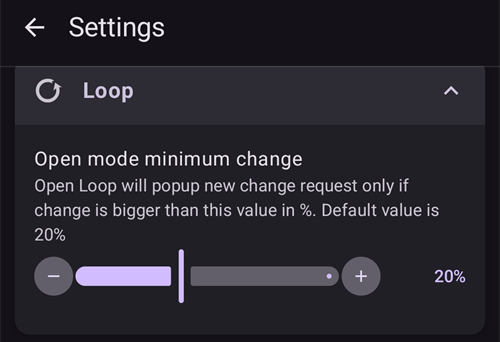
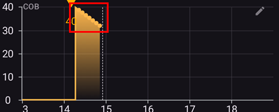
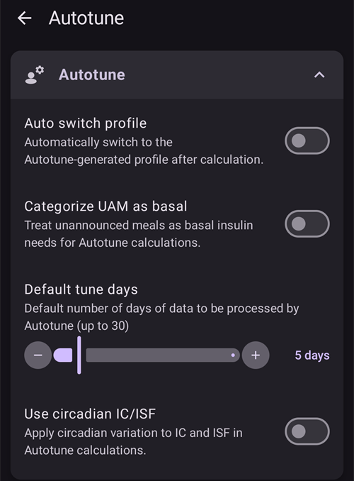
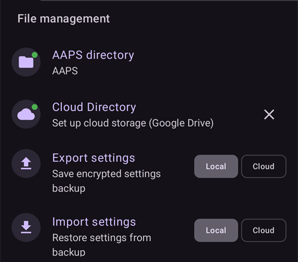
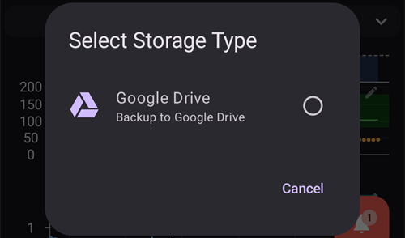

# Settings (Preferences)

In **AAPS** v4 the preferences are found on the **Settings** screen. There are three routes to reach them — see [Making changes to your AAPS' configuration](../SettingUpAaps/ChangeAapsConfiguration.md) for details:

1. Tap the **Settings** (gear) icon in the top-right corner of the main screen: all settings, grouped into expandable sections.
2. In **Configuration**, tap "**Settings**" underneath an active plugin: only that plugin's settings.
3. Use the **search bar** on top of the main screen: just start typing part of the text you are looking for. This finds individual settings (even those not visible in the Settings screen), dialogs and documentation.


- **Sections** are opened and closed by tapping them. The sections you see depend on the plugins you have enabled and on [Simple mode](#preferences-simple-mode).


```{contents}
:backlinks: entry
:depth: 2
```

(Preferences-general)=
## 一般問題


**單位**

- Set units to mmol/L or mg/dL depending on your preferences.

**語系**

- 新增選項可使用手機的預設語系（推薦）。

- 如果你希望**AAPS**使用不同於標準手機語言的語言，你可以從廣泛的選擇中選擇。

- When you change the language, the texts of **AAPS** switch to the new language straight away. If some texts still show the old language, restart **AAPS**.
- 在[簡易模式](#preferences-simple-mode)中隱藏的設置。

(preferences-simple-mode)= **簡易模式**

在首次安裝**AAPS**時，將預設啟用**簡易模式**。在**簡易模式**中，大量設定將被隱藏，偏好設定將被預定義的數值取代。一旦你熟悉**AAPS**的用戶介面和設定，應該關閉簡易模式。

**Insulin concentration support**

- Enables support for different insulin concentrations (U50, U200, ...). Only enable this if you really use a concentration other than U100, and read the warnings carefully.
- 在[簡易模式](#preferences-simple-mode)中隱藏的設置。

**保持螢幕常亮**

- Forces Android to keep the screen on at all times. 這對於演示等場合很有用。但他會消耗大量電池電量。因此，建議將智慧型手機連線到充電線。

**Instance name**

- The name of the person using this phone. It tells this **AAPS** instance apart in reports and synchronization, for example if two children with type 1 diabetes in your family use **AAPS**.
- Used in the names of exported settings files.
- 在 [雙錶面](../WearOS/WearOsSmartwatch.md) 中顯示。

(Preferences-skin)=
### 外觀

The skin selection from **AAPS** 3.x (Original, Low resolution, Large display...) no longer exists in **AAPS** 4. The new interface adapts to your screen automatically, and the color scheme can be changed in [Appearance](#preferences-appearance).

(preferences-appearance)=
## Appearance


(Preferences-range-for-visualization)=
### 可視化範圍

Choose the high and low marks for the BG-graph on **AAPS** main screen and smartwatch. 這僅限於視覺化顯示，並非血糖的目標範圍。 Example: 70 - 180 mg/dL or 3.9 - 10 mmol/L

(Preferences-show-notes-field-in-treatments-dialogs)=
### Show notes in dialogs

給你一個在治療（追加注射嚮導、碳水化合物、胰島素等）中添加簡短文字備註的選項。

在[簡易模式](#preferences-simple-mode)中隱藏的設置。

### App Color Scheme

Choose between the light theme, the dark theme, or following the phone's system setting.

(Preferences-protection)=
## 保護


(Preferences-master-password)=
### 主密碼

出於安全要求，通常必須能夠[匯出設定](../Maintenance/ExportImportSettings.md)，因為從版本 2.7 開始它們是加密的。

**生物識別保護可能在 OnePlus 手機上無法運作。這是部分 OnePlus 手機的已知問題。**


(Preferences-settings-protection)=
### 設定保護

- 用密碼或手機的生物識別身份驗證來保護你的設定（例如：[小孩正在使用**AAPS**](../RemoteFeatures/RemoteMonitoring.md)）。 If you enable this feature, you will be prompted for authentication each time you want to access any Settings related view.

- The management screens (**Profile**, **Insulin settings**, **Temp Target**, **QuickWizard**) then open **read-only**. You can still activate or use an entry, but adding, editing, cloning and deleting are hidden until you unlock your settings. See [Settings protection now also locks the management screens](#v4changes-read-only-management).

- Custom password should be used if you want to use master password just for securing [exported settings](../Maintenance/ExportImportSettings.md), and use a different one for editing the settings.

- 如果你使用自定密碼，請點擊「設定密碼」來設置密碼，如上文[所述](#Preferences-master-password)。

### 應用程式保護

If the app is protected, you must enter the password or use the phone's biometric authentication to open **AAPS**, and again when you come back to it after the [protection timeout](#Preferences-password-and-pin-retention).

**AAPS**如果輸入錯誤密碼將立即關閉，但如果先前成功打開，將仍會在背景運行。

### 注射保護

- 如果**AAPS**被小孩使用，則注射保護可能會很有用，並且你可通過[SMS 進行注射](../RemoteFeatures/SMSCommands.md)。

- **Bolus protection** can only be selected once **Settings protection** (Level 2) is set.

- In the example below, bolus protection uses the **Master password**: **AAPS** asks for it before opening a treatment dialog such as **Insulin**. With **Biometric**, if biometric authentication does not work, you can enter the master password instead.


(Preferences-password-and-pin-retention)=
### 密碼和 PIN 保留

**Protection timeout** defines how long (in seconds) the settings or bolus functionalities remain unlocked after you successfully enter the password.

## 治療安全


(preferences-patient-type)=
### Patient age

- 安全限制是根據你在此設置中選擇的年齡設定的。
- 如果你開始觸及這些嚴格的限制（如最大注射量），那麼是時候提升一步了。
- 選擇高於實際年齡是一個不好的主意，因為這可能會因在胰島素對話框中輸入錯誤的數值（例如，跳過小數點）而導致過量。
- 如果你想知道這些硬編碼的安全限制的實際數字，請滾動到你在[這個頁面](../DailyLifeWithAaps/KeyAapsFeatures.md)上使用的算法功能。

(Preferences-maximum-bolus)=
### Maximum bolus

- 定義**AAPS**一次允許輸送的最大胰島素注射量（以胰島素單位計算）。
- 此設置作為安全限制，防止因意外輸入或用戶錯誤而導致大量注射。
- 建議將此設置為合理的數量，大致對應於你可能在一餐或校正劑量中需要的最大注射胰島素量。
- 這個限制也適用於注射計算機的結果。

### Maximum carbs allowed

- 定義**AAPS**注射計算器允許劑量的最大碳水化合物量（以克計算）。
- 此設置作為安全限制，防止因意外輸入或用戶錯誤而導致大量注射。
- 建議將此設置為合理的數量，大致對應於你可能在一餐中需要的最大碳水化合物量。

## 血糖資料來源

The settings of your selected [BG source](#Config-Builder-bg-source) appear as their own section. For example with **xDrip+ BG**:


- **Upload BG data to NS**: let **AAPS** upload the received BG values to Nightscout. Only enable this if the CGM app itself is not already uploading them.
- **Log sensor change**: create a sensor change therapy event automatically when the sensor is inserted.

## The main screen

In **AAPS** 3.x these settings were grouped in an "Overview" section. In **AAPS** 4 they are configured directly from the main screen elements they belong to.

(偏好設定-按鈕)=
### QuickLaunch buttons

Define which action buttons are visible on the main screen: tap the small **gear** at the bottom center of the main screen ("Configure QuickLaunch") and **Add** the actions you want quick access to (treatments, CGM actions, careportal entries...).


(Preferences-quick-wizard)=
### 快速嚮導

Create customized buttons for certain standard meals or snacks which will be displayed on the main screen. 適用於經常食用的標準餐點。

對於每個按鈕，你定義碳水化合物和注射的計算方式。 Then, you define during which time period the button will be visible on your main screen - just one button per period. 如果超出指定的時間範圍，或者如果你有足夠的IOB來覆蓋快速嚮導按鈕中定義的碳水化合物，則該按鈕不會顯示。 If different times are specified for the different meals you will always have the appropriate standard meal button on the main screen, depending on the time of day.

To manage your Quick Wizard presets, type "QuickWizard" in the main screen search bar and open **QuickWizard - Manage quick wizard presets**.

如果你點擊快速嚮導按鈕**AAPS**將根據你目前的比率計算並建議對應的注射量（考慮血糖值或設定的胰島素用量）。

該建議需要確認後才會注射胰島素。

(Preferences-default-temp-targets)=
### 預設臨時目標

[臨時目標（TT）](../DailyLifeWithAaps/TempTargets.md)允許你在特定時間範圍內更改你的血糖目標。設置預設TT時，你可以輕鬆更改活動、即將用餐等的目標。

Tap the **target range** on the main screen to open the **Temp Target** screen. Swipe through the preset cards (Eating Soon, Activity, Hypo) and change the target and the duration of each preset under **Preset Settings**. 預設值為：

* Eating soon: target 90 mg/dL / 5.0 mmol/L, duration 45 min
* Activity: target 140 mg/dL / 7.8 mmol/L, duration 90 min
* Hypo: target 160 mg/dL / 8.9 mmol/L, duration 60 min


了解如何在這裡[啟用臨時目標](#TempTargets-where-can-i-select-a-temp-target)。

### 填充/啟動標準胰島素量

If you want to fill the tube or prime the cannula through **AAPS** you can do this with the **Prime/Fill** buttons in the expanded status panel of the main screen.

The default amounts of the three fill buttons can be defined in the **Prime/Fill** settings, depending on the length of your catheter. Type "prime" in the main screen search bar to open them.


(Preferences-status-lights)=
### 狀態燈

狀態指示燈為以下情況提供視覺警告：:

- 傳感器使用時間
- 胰島素的使用時間（儲液罐使用的天數）
- 儲液罐的剩餘容量（單位）
- 針頭的使用時間
- 幫浦電池壽命
- 幫浦電池電量（百分比）

如果超出警告門檻值，數值將顯示為黃色。如果超出危急門檻值，數值將顯示為紅色。

To change the thresholds, expand the status panel on the main screen (chevron on the right of the status row) and tap the small **Settings** icon next to "Status":


Tap an item (**Cannula**, **Insulin**, **Sensor** or **Pump battery**) to open its warning and critical thresholds:


最後一個選項允許你從Nightscout匯入那些設定（如果在那裡定義）。詳情請參考[Nightscout文件](https://nightscout.github.io/nightscout/setup_variables/#age-pills)。

(Preferences-deliver-this-part-of-bolus-wizard-result)=
### Bolus wizard settings

Type "bolus" in the main screen search bar to open the **Bolus wizard** settings:


**Bolus percentage** sets the [default percentage](#AapsScreens-section-j) of the bolus calculated when using the bolus wizard.

預設值為 100%：無需修正。即便在這裡設置不同的值，你每次使用注射嚮導時仍然可以更改。如果此設定為75%，而你必須注射10U，則注射嚮導將提出僅7.5單位的餐前注射。

使用[SMB](#objectives-objective9)時，許多人不會注射所需胰島素的100%，而只會注射部分（例如75%），並讓SMB以UAM（不在場用餐偵測）處理餘下的部分。在這裡使用低於100%的值可能會有用：
* 對於消化緩慢的人來說：一次傳送所有的注射劑量可能會引起低血糖，因為胰島素的作用速度比消化快。
* 以便給**AAPS**留出更多空間自行處理**血糖上升**。在這兩種情況下，**AAPS**將在需要時透過SMB來補償缺失的注射部分。

**Use bolus advisor**

When enabled, if you use the bolus wizard while you are in hyperglycemia, you will get a warning, prompting you if you wish to pre-bolus and eat later, when your **BG** gets back in range.

(Preferences-advanced-settings-overview)=
### 超級注射

The Superbolus option of **AAPS** 3.x is not available as a setting in **AAPS** 4.

## 循環

See [AAPS screens > The main screen > Loop status](#AapsScreens-loop-status) to change loop mode now.

(Preferences-minimal-request-change)=
### Open mode minimum change

使用 **開放環路** 時，你將在每次**AAPS** 建議調整基礎率時收到通知。 To reduce the number of notifications you can either use a [wider bg target range](#profile-glucose-targets) or increase the percentage of the "**Open mode minimum change**" setting. 這定義了觸發通知所需的相對變更。



## 進階餐前注射助手（AMA）或超微量注射（SMB）

Depending on your settings in [Configuration > APS](../SettingUpAaps/ConfigBuilder.md) you can choose between two algorithms:

- [進階餐前注射助手（OpenAPS AMA）](#Open-APS-features-advanced-meal-assist-ama) - 2017年的算法狀態
- [超微量注射（OpenAPS SMB)](#Open-APS-features-super-micro-bolus-smb) - 最推薦給初學者的最新算法

自[**AAPS**版本 3.3](#version3300)起，[動態 ISF](../DailyLifeWithAaps/DynamicISF.md)功能已移至 OpenAPS 微量注射的一部分。

### OpenAPS AMA

所有針對OpenAPS AMA的設置都在[關鍵AAPS功能 > 進階餐點輔助(AMA)](#Open-APS-features-advanced-meal-assist-ama)中詳細描述。

(Preferences-openaps-smb-settings)=
### OpenAPS SMB

所有針對OpenAPS SMB的設置都在[關鍵AAPS功能 > 超微量注射(SMB)](#Open-APS-features-super-micro-bolus-smb)中詳細描述。

The list of settings you see depends on your progress in the [Objectives](../SettingUpAaps/CompletingTheObjectives.md) and on [Simple mode](#preferences-simple-mode). On a new installation only **Use dynamic sensitivity** is shown. Once the objectives are completed, the section looks like this:


**Advanced Settings** at the bottom of the section holds values that you normally do not have to change:


## 吸收設定


(Preferences-min_5m_carbimpact)=
### SMB min 5m carbs impact (min_5m_carbimpact)

在[簡易模式](#preferences-simple-mode)中隱藏的設置。

該演算法使用BGI（血糖影響）來確定[碳水化合物的吸收](../DailyLifeWithAaps/CobCalculation.md)時間。

在無法根據你血液反應動態計算碳水化合物吸收的時候，**AAPS** 會為你的碳水化合物插入一個預設衰減值。基本上，這是一個安全保護機制。此值僅在**CGM** 讀數出現間隙或當身體活動“消耗掉”所有本來會引起**AAPS**衰減COB的血糖上升時使用。

簡單來說：演算法「知道」在目前胰島素劑量等影響下，你的血糖應該如何變化。 Whenever there is a positive deviation from the expected behavior, some carbs are absorbed/decayed. 大的變化＝許多碳水化合物等。

min_5m_carbimpact 定義了每 5 分鐘的預設碳水化合物吸收影響。 For the full parameter reference see [OpenAPS's preferences and safety settings documentation](https://openaps.readthedocs.io/en/latest/docs/While%20You%20Wait%20For%20Gear/preferences-and-safety-settings.html?highlight=carbimpact#min-5m-carbimpact).

Standard value for AMA is 3, for SMB it's 8.

The COB graph on the main screen indicates when min_5m_carbimpact is being used by putting orange dots along the top of the COB curve.



### Absorption cutoff

Time at which any meal is considered absorbed; remaining carbs will be cut off. 如果你經常進食高脂肪或高蛋白質餐點，你需要增加餐點吸收時間。

### 進階設定 - autosens 比例


- 定義最小和最大[autosens](#Open-APS-features-autosens) 比例。
- 通常標準值（最大 1.2 和最小 0.7）不應更改。

## 幫浦


### 藍牙監控

如有必要，啟用藍牙監控（例如對於Dana幫浦）。 It switches off Bluetooth for one second if no connection to the pump is possible. This may help on some phones where the Bluetooth stack freezes.

## 幫浦設定

The options here will vary depending on which pump driver you have selected in [Configuration > Pump](#Config-Builder-pump). Pair and set up your pump according to the [pump-related instructions](../Getting-Started/CompatiblePumps.md).

For example with the **Virtual Pump**, the section is called **Virtual pump settings**. You choose the **Pump type** the virtual pump imitates, and whether its status is uploaded to Nightscout:


## Tidepool

詳細資訊請參閱專門的[Tidepool](../SettingUpAaps/Tidepool.md)頁面。

(Preferences-nsclient)=
## NSClient


The NSClient plugin (shown as **NSClientV3** in the configuration menu) synchronizes your data with Nightscout. It uses the Nightscout API v3.

```{admonition} Data uploaders
:class: warning

When using NSClientV3, all uploaders must use the Nightscout API v3. If another uploader (for example your CGM app) is not API v3 compliant, **let **AAPS** upload all data** (BG, treatments, ...) to Nightscout and disable that uploader.
```

- 設置你的*Nightscout URL*（即 <https://yoursitename.yourplaform.dom>）。
- **確保網址末尾沒有 /api/v1/。**
- In Nightscout, create an *[Admin token](https://nightscout.github.io/nightscout/security/#create-a-token)* (requires [Nightscout 15](https://nightscout.github.io/update/update/) to use the V3 API) and enter it in the **Nightscout access token** (not your API Secret!). On **AAPSClient** you can scan the main phone's QR code instead, which sets up a token of the client's own. A client paired with the PIN gets its own token from the main phone after pairing. See [The client's own Nightscout token](#client-master-control-own-token).
- 這使得資料能在Nightscout網站與**AAPS**之間讀取和寫入。
- 如果你在目標 1 中遇到困難，請再次檢查是否有拼寫錯誤。
- Leave "Use websockets" enabled (recommended).

(Preferences-nsclient-synchronization)=
### 同步選項


同步選擇將取決於你希望如何使用**AAPS**。

你可以選擇[上傳和下載至 Nightscout 的資料](#Nightscout-aaps-settings)。

While client control is on (always in Simple Mode), these settings are hidden: **AAPS** is then in [hardened mode](#client-master-control-hardened-mode), takes no changes made directly in Nightscout and uploads all its data.

### 警報選項


- 警報選項允許你選擇透過應用程式使用哪些 Nightscout 警報。 **AAPS** 將在觸發Nightscout警報時發出警告。
- 要使警報發出聲音，你需要在[Nightscout 變數](https://nightscout.github.io/nightscout/setup_variables/#alarms)中設置緊急高、高、低和緊急低的警報值。
- They will only work while you have a connection to Nightscout and are intended for parent/caregivers.
- If you have the **CGM** source on your phone (i.e. xDrip or BYODA) then use those alarms instead of Nightscout Alarms.
- NS announcements will echo Nightscout [announcements](https://nightscout.github.io/nightscout/discover/#announcement) in the **AAPS** notifications.
- 當在一定時間內未從 Nightscout 收到資料時，你可以更改過時資料和緊急過時資料警報的門檻值。

### 遠端控制

The switch "**Allow client control**" is no longer in these settings: it is at the top of **Manage → Authorized clients**, where the paired clients are managed. See the dedicated [Client / Master control](../RemoteFeatures/ClientMasterControl.md) page, including [hardened mode](#client-master-control-hardened-mode), which this switch turns on.

### 連線設定


- 連線設定定義了何時啟用與 Nightscout 的連線。
- 將 Nightscout 上傳限制為僅在 Wi-Fi 下進行，甚至僅限於特定的 Wi-Fi SSID。
- 如果你只想使用特定的Wi-Fi網路，可以輸入其Wi-Fi SSID。
- 多個 SSID 可以用分號分隔。
- 若要刪除所有 SSID，請在該欄位中輸入空格。

(Preferences-advanced-settings-nsclient)=
### 進階設定（NSClient）


進階設定中的選項都非常直觀易懂。

## SMS(簡訊) 通訊器

詳細資訊請參閱專門的[簡訊命令](../RemoteFeatures/SMSCommands.md)頁面。

(preferences-wear)=
## Wear

This section is shown when the **Wear** plugin is enabled in [Configuration > Communication](#Config-Builder-wear). More information on the dedicated [Wear OS smartwatch](../WearOS/WearOsSmartwatch.md) and [Operation of AAPS via your Wear OS smartwatch](../RemoteFeatures/RemoteControlWearOS.md) pages.


- **Wear control**: allow treatments and other actions to be sent from the watch. Without it, the watch only displays data: the phone refuses any command from the watch, and tapping a complication that would open a control screen opens the **AAPS** menu on the watch instead.

**Wear Wizard Settings** defines which calculations are included in the result of the bolus wizard on the watch. On the watch you only enter the carbs; these switches replace the choices you would make in the bolus wizard on the phone:

- **Include BG in wizard**: add a correction for the difference between your current glucose and your target.
- **Include temp target in wizard**: use the running temp target instead of the profile target for this correction.
- **Include trend in wizard**: take the current glucose trend into account.
- **Include COB in wizard**: add insulin for the carbs that are still on board.
- **Include IOB in wizard**: subtract the insulin that is still on board.


**Custom Watchface Settings** contains **Authorize custom watchfaces**. A custom watchface file can include values for some watch settings. When this switch is on, loading such a watchface is allowed to change those settings on the watch; when it is off, the watchface is loaded but the settings stay as they are:


**General Settings** contains **Notify on SMB**, to get a notification on the watch each time an SMB is delivered:


## 自動調整

This section is shown when the **Autotune** plugin is enabled in [Configuration > General](#Config-Builder-autotune). The settings are described on the dedicated [Autotune](../AdvancedOptions/Autotune.md) page.



## 自動化


選擇要使用的定位服務：

- 使用被動位置：**AAPS**僅在其他應用要求時才會獲取位置
- 使用網路定位：你的 Wi-Fi 位置。
- 使用 GPS 定位（注意！可能會導致電池過度消耗！）

## 本地警報


設定應該是簡單明瞭的。

(preferences-maintenance-settings)=
## 維護設置


**電子郵件收件人**：日誌的標準收件人是<logs@aaps.app>。

**Number of logs to send**: how many of the most recent log files are attached when you send logs.

**資料選擇**


你可以通過向開發者發送崩潰報告來幫助進一步開發**AAPS**。

**自動設定匯出**<br/>啟用此功能後，你允許**AAPS**自動執行設定匯出，而無需用戶介入。為此，主密碼 安全地存儲在你的手機中（僅限於下次手動匯出時）。存儲的密碼將在最多 4 週內有效。 4 週後，你將收到通知，提示密碼即將過期。在為期 1 週的寬限期內，可以透過 從維護選單手動匯出設定來刷新密碼。

在寬限期過期的 1 週後，存儲的密碼將過期，任何自動化設定匯出將中止，同時通知用戶，要求 重新輸入密碼。 [(**Automated settings exports**)](../DailyLifeWithAaps/Automations.md#automating-preference-settings-export) will be logged to the **AAPS** 'Careportal' and 'User entry' lists under Treatments.

啟用此選項後，請確保執行一次手動設定匯出，屆時系統會要求你輸入密碼，以便**AAPS**能夠儲存它。

### 日誌文件

AAPS 會儲存記錄，以利疑難排解。

請勿停用此功能：若發生問題，它有助於了解原因。

If you need to send the logs to the developers, make sure you accurately describe the issue in the email. 建議僅在[在 GitHub 提交問題回報](https://github.com/nightscout/AndroidAPS/issues)後，且被要求時再傳送記錄。

你可以在手機記憶體 -> Android -> data -> info.nightscout.androidaps -> files 中找到 AAPS 記錄。

Log handling (log settings, sending and deleting logs) and file management are found on the **Maintenance** screen, opened from the **menu** (☰) in the top-left corner of the main screen:



(preferences-maintenance-logdirectory)=

### 設定本機 AAPS 目錄

The **Maintenance** screen also includes the **AAPS directory**. 此設定允許用戶選擇電話上的一個目錄，**AAPS**將在該目錄中儲存偏好設定、日誌及其他檔案。 Once a directory is chosen, its path (for example `Documents/AAPS`) is shown below **AAPS directory**, so you can always see where your files are saved.

強烈建議將目錄設在手機儲存空間的主目錄下。預設為 AAPS。


若你選擇了 AAPS 的子目錄，會顯示「目錄選擇錯誤」的訊息。點選「確認」並重新選擇正確的目錄（上一層）。除非你非常清楚自己在做什麼，請不要選擇「關閉」。


Android can silently take the directory permission away, for example after you reinstall **AAPS** or clear its storage. When that happens, **AAPS** shows a persistent **Access to the AAPS directory was lost** notification and local settings export stops working until you come back here and select the directory again. Do this promptly, otherwise your backups on the phone are no longer refreshed.

(preferences-maintenance-cloud)=

### 設定雲端目錄

你可以將設定、記錄與 CSV 資料匯出到雲端服務。

1. Open the **menu** (☰), select **Maintenance** and tap **Cloud Directory** (under **File management**).

   

2. In **Select Storage Type**, select **Google Drive**.

   

3. A Google sign-in page opens. Choose the Google account that will hold your backups (you can use a [dedicated Google account](../UsefulLinks/DedicatedGoogleAccountForAaps.md)).

   

4. Check that the account is the right one and tap **Continue** to give **AAPS** access. If you set up the cloud directory before, the page says that **AAPS** already has some access.

   

5. Back in **AAPS**, the message **Cloud storage authentication successful** appears at the bottom of the main screen:

   

   In the **Maintenance** menu, **Cloud Directory** now has a green dot, and the **Cloud** buttons next to **Send logs**, **Export settings**, **Import settings** and **Export User Entries to Excel (csv)** are available.

   

To stop exporting to the cloud, tap the **✕** (**Clear Settings**) icon at the end of the **Cloud Directory** row in the **Maintenance** menu (it is shown once a cloud service is set up) and confirm **Clear Cloud Settings**. This switches back to local storage and clears the authorization.

## Open Humans

你可以透過捐贈你的資料來協助研究項目，幫助社群！詳細資訊請參閱[Open Humans 頁面](../SupportingAaps/OpenHumans.md)。

In **Settings → Open Humans**, you can define when data shall be uploaded
- 僅在連接到Wi-Fi時
- 僅在充電時
