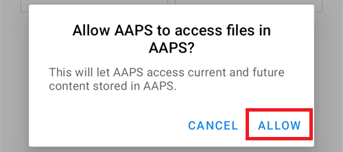
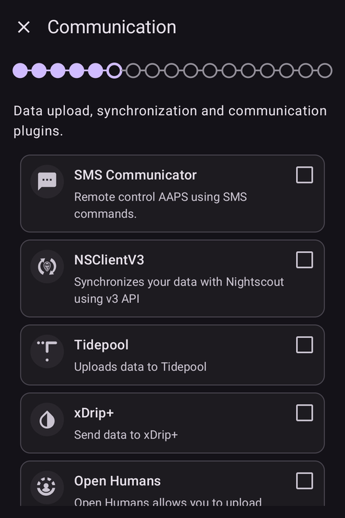
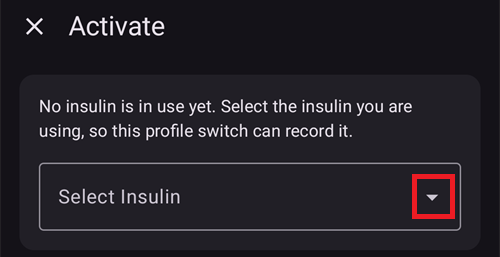
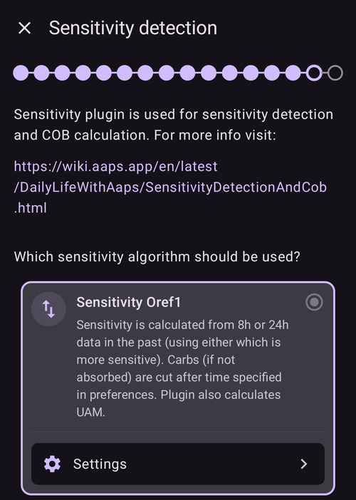

# AAPS設定嚮導

```{contents} In this page
:backlinks: entry
:depth: 2
```

當你首次啟動**AAPS**時，系統會引導你使用「**設定嚮導**」，以便快速設置應用程式的所有基本配置。**設定嚮導**會引導你，以避免遺忘某些關鍵內容。例如，**權限設定**對於正確設置**AAPS** 是非常重要的。

不過，在首次使用**設定嚮導**時，並不一定需要完全配置所有內容，你可以輕鬆地退出嚮導，稍後再返回。 There are three routes available after the **Setup Wizard** to further optimize/change the configuration. 這些路徑將在下一部分進行解釋。因此，如果你在設定嚮導中跳過了一些選項，沒關係，你可以輕鬆地稍後配置他們。

在使用**設定嚮導**期間及其後，你可能不會注意到**AAPS**中有任何顯著可見的變化。要啟用你的**AAPS**循環，你必須遵循**目標**以啟用每一項功能。你會在設定嚮導結束時開始**目標 1**。你是**AAPS**的主導者，而不是相反。

```{admonition} Preview Objectives
:class: note
如果你想知道目標的結構，請閱讀[完成目標](../SettingUpAaps/CompletingTheObjectives.md)，然後先返回這裡運行設定嚮導。

```

從以往經驗中，我們知道新用戶經常會給自己施加壓力，希望儘快設置**AAPS**，這可能會導致挫折，因為這是個龐大的學習曲線。

因此，請花時間配置你的循環，運行良好的**AAPS**循環帶來的好處是巨大的。

```{admonition} Ask for Help
:class: note
如果文件中有錯誤或你對如何解釋某些內容有更好的想法，你可以按照[與其他用戶聯繫](../GettingHelp/WhereCanIGetHelp.md)的說明向社區尋求幫助。
```
## 歡迎訊息

When the Setup Wizard opens, it greets you with a short welcome message and immediately shows a "**Permissions Required**" panel at the bottom of the screen (see next section).

Once you have granted the permissions, the panel closes and the welcome screen shows a "**Next**" button. Press "**NEXT**" to continue:


## 必要的權限

**AAPS** needs a few permissions to operate correctly. The Wizard groups them on a single "**Permissions Required**" panel, each with its own "**Grant**" button. Grant them one by one — the icon next to each item turns into a tick once it is done.


### Battery optimization

由於電池效能仍相當有限，智慧型手機的電量消耗需要特別留意。因此，你的智慧型手機上的 Android 作業系統會對允許應用程式在背景執行並耗用 CPU 時間（也就是電量）採取較嚴格的限制。

然而，**AAPS** 需要定期運行，_例如_每幾分鐘接收血糖讀值，然後根據你的規範應用算法來決定如何處理你的血糖水平。 Therefore it must be excluded from battery optimization.

Press "**Grant**" next to "**Battery Optimization**", then select "**Allow**" on the "Let app always run in background?" dialog:


(SetupWizard-StoragePermission)=

### AAPS 目錄

**AAPS** needs to store its settings and log information on the permanent storage of your smartphone. 永久儲存意味著即使重啟智慧型手機後，他仍然可用。其他訊息則會遺失，因為他們沒有儲存到永久儲存中。

Press "**Grant**" next to "**AAPS Directory**". This opens the file system on your phone and lets you choose where **AAPS** stores its information.

```{tip}
建議選擇 AAPS 的預設目錄。</br>
請不要選擇 AAPS 的子目錄。
```

預設目錄是 **AAPS**，但你可以使用任何慣用的目錄。 Create the directory if necessary, enter it and choose "**USE THIS FOLDER**":


Confirm with "**ALLOW**" that you wish to grant access to **AAPS** to the selected directory:



### 通知

如果應用程式希望向你發送通知，Android需要特殊的許可。

While it is a good feature to disable notifications _e.g._ from social media apps, it is essential that you allow **AAPS** to send you notifications.

Press "**Grant**" next to "**Notifications**" and select "**Allow**" at the system prompt:


### Alarms and reminders

On **Android 14 and newer**, **AAPS** needs the "**Alarms and reminders**" permission so that alarms can wake the screen while **AAPS** is in the background, and so that reminders (for example from an **Automation**) ring on time.

This item is only shown while it is needed. Once **AAPS** is excluded from battery optimization (see above), Android grants exact alarms automatically and the item disappears. If it is still listed, press "**Grant**" next to "**Alarms and reminders**". This opens a system settings screen for **AAPS**; enable the toggle and return to **AAPS**. On Android 13 and older this item does not appear and no action is needed.

Once all the permissions show a tick (three, or four on Android 14 and newer), the "**Permissions Required**" panel closes by itself and you can press "**NEXT**" on the welcome screen to continue.

(setup-wizard-bluetooth-battery-optimisation)=
### Bluetooth battery optimization

```{admonition} Extra Android setting, not part of the Wizard
:class: note
The following is additional Android configuration done outside of the Setup Wizard. It is not one of the "Grant" buttons above, but it is important for a reliable pump connection.
```

Newer versions of Android have added battery optimization to the system Bluetooth application too.

As well as disabling battery optimization for **AAPS**, you will likely need to also disable this for the Bluetooth system app. 未這麼做可能會導致幫浦連線中斷與問題。

***注意：xDrip 說明文件在此介紹如何操作：[xDrip 說明文件](https://navid200.github.io/xDrip/docs/BluetoothBatteryOpt.html)***

Follow these steps on Android 16; other versions will vary slightly from the provided screenshots:

1. 開啟 Android 設定並搜尋 **Apps**，然後開啟 Apps 設定。

   

2. 你會看到 App 設定，但我們需要展開以查看所有 App，點擊 **See all apps** 以展開。

   

3. As the Bluetooth app is a system app, it's hidden by default, so we need to show system apps. Click on the **three dots** (⋮) on the top right (1). Then click on **Show system** (2).

   

4. 搜尋 `Bluetooth` 應用程式，點擊 `Bluetooth` 以及／或 `Legacy Bluetooth`。若兩者皆存在，請確保兩者都依照此流程設定。

   ***注意：可以放心忽略 `Bluetooth MIDI Service`，AAPS 並未使用它。***

           

   1. 在 Android 12 點擊 `Battery`，Android 13+ 點擊 `App battery usage`，

   )

5. 在 Android 12+ 選擇 `Unrestricted` 選項；在 Android 15+ 需要展開 `Allow background usage` 設定，點擊紅色標示的區域展開，然後依步驟 6 完成。

       

6. 在 Android 16 選擇 `Unrestricted`

   

## 許可協議

在最終用戶授權協議中，有關於使用**AAPS**的法律事宜的重要訊息。請仔細閱讀。

如果你不理解或無法同意最終用戶授權協議，請根本不要使用**AAPS**！

If you understand and agree, please press the "**I UNDERSTAND AND AGREE**" button and follow the Setup Wizard:


A "**Next**" button appears once you have agreed. Press "**NEXT**".

The next screen, "**Permissions**", lists the permissions again. They should all show a tick, as you granted them at the start. If one is missing, press "**Grant**" next to it. Press "**NEXT**" to continue:


## 主密碼

As the configuration of **AAPS** contains some sensitive data (_e.g._ the access token for your Nightscout server) it is encrypted by a password you set here.

The Wizard shows "**Password not set**". Press "**Set**":


This opens the "**Protection**" screen. Press "**Master password**" (shown as "Password not set"):


Enter the same password in both fields and press "**OK**":


Go back with the arrow in the top left corner. The Wizard now shows "**Password set!**":


```{admonition} Do not lose your Master Password
:class: danger
Please **DO NOT LOSE YOUR MASTER PASSWORD**. Make a note of it _e.g._ on Google Drive, which is a good place as it is backed up by Google for you. 你的智慧型手機或電腦可能會崩潰，並且你可能沒有實際副本。如果你忘記了主密碼，日後可能很難恢復你的設定檔案和在 **目標** 中的進展。
```

When you are done, press "**NEXT**" to go to the next screen.

(setup-wizard-import-settings)=
## 匯入設置

This screen is only shown when **AAPS** finds settings exported earlier in the **AAPS** directory ("Stored settings found"), for example when you reinstall the app or move to a new phone.

- To restore your previous configuration, press "**Import settings**" — see [Export & import settings](../Maintenance/ExportImportSettings.md).
- To start with a new configuration, press "**NEXT**" and continue with the Wizard.


## 單位 (mg/dL <-> mmol/L)

Please select if your glucose values are in mg/dL or mmol/L, then press the "**NEXT**" button:


## Display Settings

Here you set the "**LOW mark**" and "**HIGH mark**" for the sensor glucose display. Glucose values between these two marks are shown as "in range". You can leave the default values (72 and 180 mg/dL) for now, and edit them later.

你選擇的值只會影響圖表的圖形展示，其他方面不會受到影響。

你的血糖目標_例如：_在你的個人設定中單獨配置。

你的TIR（範圍內時間）分析範圍在你的報告伺服器中單獨配置。

Adjust the marks with the "−" / "+" buttons if needed, then press the "**NEXT**" button:


(SetupWizard-synchronization-with-the-reporting-server-and-more)=
## Communication

The "**Communication**" screen lists the plugins used to upload, synchronize and broadcast your data:

- **SMS Communicator** – remote control of **AAPS** using SMS commands
- **NSClientV3** – synchronizes your data with Nightscout using the v3 API
- **Tidepool** – uploads data to Tidepool
- **xDrip** – sends data to xDrip
- **Open Humans** – upload and donate your diabetes data to scientific projects
- **Wear** – monitor and control **AAPS** from a WearOS watch
- **External Companion Apps** – data broadcasting to various external apps
- **Garmin** – connection to a Garmin device



Scroll down to see the rest of the list:


You could configure several of these now, but for the first run we will just focus on the reporting server. If you are not able to set it up at the moment, skip it for now — you can configure it later.

In this example we use Nightscout as reporting server. Tick the box on the right of "**NSClientV3**" to enable it. 對於Tidepool來說，這更簡單，因為你只需要你的個人登錄訊息。

Once enabled, press "**Settings**" below NSClientV3 to configure it:


Here you configure the Nightscout reporting server. The NSClientV3 settings are shown as one scrollable page:


Press "**Nightscout URL**" and enter your personal Nightscout server address (the URL you set up yourself, or were given by your service provider). Confirm with "**OK**".

Press "**Nightscout access token**" and enter the access token for your Nightscout server. 沒有這個權杖，無法存取。 If you don't have it yet, please check the documentation for setting up the reporting server.

Leave "**Use websockets**" enabled for real-time communication with Nightscout.

The remaining sections can be left at their defaults for now. They are described here so you know where to find them later:

**Alarm options** — Nightscout alarms, announcements and stale-data thresholds. Leave the switches off for now; we only open them so you are aware of the options.

**Connection settings** — choose how data is transferred. Caregivers must enable "**Use cellular data**", otherwise the phone of the person they care for (_e.g._ a child) cannot upload outside Wi-Fi range, _e.g._ on the way to school. Other users can disable cellular transfer to save data or battery. If in doubt, leave everything enabled.


**Advanced Settings** — enable "**Log app start event**" if you want to see in Nightscout when the app restarts (useful for caregivers). Keep "**Create announcements from errors**" and "**Create announcements from carbs required**" enabled. Leave "**Use slow sync**" off; you would only use it if the Nightscout server is slow to process a large amount of data.


Go back to the list of plugins and press "**NEXT**" to go to the next screen.

## Client control

From **AAPS** version 4, client devices running **AAPSClient** can be **paired** with this phone (the **master**) and control it with signed commands sent over Nightscout. This is the new recommended way to control **AAPS** remotely — see [Master ↔ Client control](../RemoteFeatures/ClientMasterControl.md) for the full explanation and setup.

There is nothing you have to configure on this screen now; you can pair clients at any time later from **Manage → Authorized clients**. There you add a client with a **QR code** (it sets up Nightscout on the client too) or with a **PIN**, and give it a **role**.

- "**Authorized clients**" — manage the paired client devices allowed to control this master.
- "**Nightscout data acceptance**" — accepting treatments and data entered directly in Nightscout (the old, less secure way) is now turned off by default. Only open these settings if you still need it, _e.g._ to enter data through Nightscout or third-party apps.

When client control is already on — always in [Simple Mode](#preferences-simple-mode) — this phone is in [hardened mode](#client-master-control-hardened-mode): it takes changes only from paired clients, so the screen explains hardened mode instead of offering the "**Nightscout data acceptance**" settings.


"**Nightscout data acceptance**" opens the "**Synchronization**" settings, where each kind of data received from Nightscout has its own switch:


Press "**NEXT**" to go to the next screen.

(setup-wizard-instance-name)=
## Who is using this phone?

Here you enter the name of the person using this phone. It tells this **AAPS** instance apart from others in reports and when synchronizing, for example if two children in your family use **AAPS**. It is also used in the names of exported settings files and shown on the watch.

這可以是任何名字。 You can change it later in **Settings → General → Instance name**.

Press "**NEXT**" to go to the next screen.


## 病人類型

在這裡你選擇你的「患者類型」，這點很重要，因為**AAPS**軟體根據患者的年齡有不同的限制。這對安全至關重要。

在這裡你也配置**每餐最高允許注射量**。也就是說，你在典型餐點中需要的最大注射量。 It's a security feature to help avoid accidentally overdosing when you are bolusing for a meal.

第二個限制與此類似，但涉及你預期的最大碳水化合物攝入量。

After setting these values, press "**NEXT**" to go to the next screen:


## 胰島素

Here you configure the insulin used in your pump. New insulin profiles require a **DIA of at least 5 h**.

Press the "**Insulin**" button to open the insulin editor:


In the editor you can give the insulin a **nickname** and set its **Peak** (in minutes) and **DIA** (in hours). The quickest way is to load a preset with "**Load peak from**" — choose **Novorapid**, **Fiasp** or **Lyumjev** — and the peak is filled in for you. The graph at the bottom previews the resulting insulin activity curve.


Pick the preset that matches your insulin, for example **Fiasp**:


```{admonition} Use your insulin brand's preset peak
:class: danger
Please don't change the peak unless you are an expert — usually the preset values work well for each branded insulin.
```

If you are a new **AAPS** user, set **DIA** to 9 hours — see [Duration of insulin action (DIA) and peak](#Config-Builder-insulin-dia) to understand why.

```{admonition} "Insulin configuration changed" dialog
:class: note
If a paired client (_e.g._ another phone) has changed the insulin configuration, a dialog appears. Press **OK** to load their changes, or **Cancel** to keep editing (your next save will overwrite theirs).
```


Press the save icon (top right), then press "**NEXT**" to go to the next screen.

## 血糖來源

Here you select where **AAPS** gets its glucose data from. 請閱讀你的[血糖資料來源](../Getting-Started/CompatiblesCgms.md)的文件。

Many sources are available — scroll through the list and select the one you use:


Once you select a source, its card expands and shows two buttons: "**Settings**" to adjust how the data is received, and "**Open plugin**" to open the source's own screen. In the example below, **BYODA** is selected. Some sources have nothing to configure at this stage, so you can usually go straight to the next screen:


After making your selection, press "**NEXT**" to go to the next screen.

(setup-wizard-profile)=
## 設定檔

現在我們進入設定嚮導中的一個非常重要的部分。

在嘗試在下一個畫面中輸入你的設定檔詳細資訊之前，請閱讀關於[設定檔](../SettingUpAaps/YourAapsProfile.md)的文件。

```{admonition} Working profile required - no exceptions here !
:class: danger
準確的設定檔對於控制**AAPS**的安全操作是必要的。

您必須與醫生討論並確定您的配置檔案，並透過成功的基礎率、ISF 和 IC 測試證明其有效！

如果一個機器人有錯誤的輸入，它將不斷失敗。 **AAPS** 只能使用所提供的訊息。如果你的個人設定過強，則可能會面臨低血糖風險；如果過弱，則可能會面臨高血糖風險。 
```

Press the "**Profile**" button to open the profile editor:


The editor opens empty ("No records available"). Press the "**+**" button at the bottom to create a new profile:


長期來看，如果有需要，你可以擁有多個設定檔案。這裡我們只建立一個。

```{admonition} Profile only for tutorial - not for your usage
:class: note
The example profile here is only to show you how to enter data.

It is not intended to be an accurate profile or something very well optimized, because each person's needs are so different.

不要用它進行實際循環！
```

The new profile (for example "**LocalProfile1**") has four tabs: **IC**, **ISF**, **BAS** and **TARG**. Press the pencil next to the profile name to rename it. Fill in every tab — a tab stays red and shows an error message until it contains valid values:


Press "**IC**" and enter your [IC](#your-aaps-profile-insulin-to-carbs-ratio) values. Use the "**+**" button to add more time blocks:


Press "**ISF**" and enter your [ISF values](#your-aaps-profile-insulin-sensitivity-factor):


Press "**BAS**" and enter your [basal values](#your-aaps-profile-basal-rates):


Press "**TARG**" and enter your blood sugar target values.

對於開放循環，此目標範圍可以更寬，否則**AAPS**會持續通知你更改臨時基礎率或其他設定，這可能會很累人。

稍後，對於閉環循環，你通常只會有一個上限和下限值。這樣可以使**AAPS**更容易達到目標，並為你提供更好的整體糖尿病控制。


When all four tabs are valid, the **save icon** (top right) becomes active. Press it to save the profile:


Close the editor with the "**X**" in the top left corner. The profile summary then shows its name, its total daily basal (∑), the units and the IC and ISF values with their graphs:


```{admonition} Several defined but only one active profile
:class: note
You can have several profiles defined, but only one activated profile running at any given time.
```

Press the "**▶**" (activate) button at the bottom right. The "**Activate**" screen opens. As no insulin is in use yet, it first asks you to select the insulin you are using, so that the profile switch can record it. The "**Activate**" button stays greyed out until you do:



Press "**Select Insulin**" and choose the insulin you configured earlier. Leave the percentage at 100 % and press "**Activate**":


A profile switch dialog appears. In this case let it stay as preset and confirm with "**OK**":

```{admonition} Profile switch dialog
:class: note
You will learn later how to use this general dialog to handle situations like illness or sport, where you need to change your profile to suit the circumstances.
```


Your profile is now active. Press "**NEXT**" to go to the next screen.

## 胰島素幫浦

Now you select your insulin pump. 請閱讀你[胰島素幫浦](../Getting-Started/CompatiblePumps.md)的文件。

Scroll the list and select your pump. In this example we use the "**Virtual Pump**", which is useful while you are still learning and have not connected a real pump yet:


Many pumps are supported — scroll down to find yours:


When you select a real pump, **AAPS** asks for a confirmation, because it will copy the basal rates of your profile to the pump and overwrite the basal rates stored there. Press "**OK**" only if the basal rates in your **AAPS** profile are correct; otherwise press "**Cancel**" and switch to the pump later:


If the pump you select communicates over Bluetooth, **AAPS** asks for permission to connect to nearby devices once you finish the Wizard (see [Bluetooth permission](#bluetooth-permission)).

If you have already set up your profile and know how to connect your pump, feel free to connect it now. Otherwise leave it on **Virtual Pump** for the moment — you can change it anytime, or leave the Setup Wizard using the arrow in the top left corner and let **AAPS** first show you some blood glucose values.

Press "**NEXT**" to go to the next screen.

## APS 演算法

選擇OpenAPS SMB演算法作為你的APS演算法。 Despite the name, the SMB feature of the algorithm is disabled until you are familiar with AAPS and have worked through the first objectives. OpenAPS SMB is newer and generally better than OpenAPS AMA anyway.

SMB is disabled at the start because the SMB feature reacts faster to a blood sugar increase, using a Super Micro Bolus instead of increasing the basal rate percentage. Because your profile is generally not as good in the beginning as it is after some experience, the feature is disabled at first.

```{admonition} Only use the older algorithm **OpenAPS AMA** if you know what you are doing
:class: note
OpenAPS AMA is the most basic algorithm which does not support micro boluses to correct high values. 在某些情況下，使用此算法可能更好，但這不是推薦的做法。
```

Select "**OpenAPS SMB**", then press "**Settings**" to see the details:


The only option here is "**Use dynamic sensitivity**". Leave it off and change nothing for now — just read the text.

由於**目標**所施加的限制，你目前無法使用「關閉循環」或「SMB 功能」。

Go back and press "**NEXT**" to go to the next screen:


## 敏感度偵測

Leave "**Sensitivity Oref1**" selected as the standard sensitivity plugin:



If you press "**Settings**" you can review the absorption settings; the defaults (_e.g._ a 6 h absorption cutoff) are fine for now.


Press "**NEXT**" to go to the next screen.

## 開始目標1

You are now entering the Objectives — the qualification for access to further **AAPS** features.

Press "**Open Objectives**":


我們從目標1開始，即使此刻我們的設置尚未完全準備好成功完成此目標。但這是開始。

Press the "**Start**" button next to "**1. Objective**":


The objective expands to show its individual checks. You can see that you already made some progress, while other items are still to be done:


Go back, then press "**FINISH**" to complete the Setup Wizard:


After pressing "**FINISH**" you arrive at the main screen of **AAPS**. A "**Notification**" panel may open with information messages, for example about the profile switch you just made — press "**Dismiss**" below each message to clear it.

如果你在任何時候不小心離開設置嚮導，你可以簡單地重新啟動嚮導，或手動更改[AAPS 循環的配置](../SettingUpAaps/ChangeAapsConfiguration.md)。

## Bluetooth permission

If you select a pump that connects over Bluetooth (for example **Omnipod Dash**), a banner reminds you that **AAPS** needs Bluetooth permission. You can press "**Dismiss**" for now — the permission is granted after you finish the Wizard:


Once the Setup Wizard is finished, the **AAPS** main screen shows a "**Permissions Required**" panel. The other permissions are already granted; press "**Grant**" next to "**Bluetooth**":


Select "**Allow**" so **AAPS** can find and connect to your pump:


如果你的**AAPS**循環現在已完全設置，請繼續下一部分[「完成目標」](../SettingUpAaps/CompletingTheObjectives.md)。
