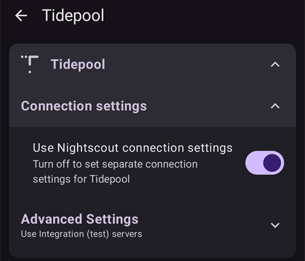

# Tidepool

Tidepool 是第三方工具，可收集血糖、胰島素和碳水化合物相關資料（以及您新增至治療紀錄的備註），並可用來分析資料及與您的醫療團隊分享。自 **AAPS** 3.2 版起，它可作為 Nightscout 的替代方案，用於完成目標 1 的部分要求。他也可以與 Nightscout 結合使用，作為一個替代的報告平台，與臨床環境緊密整合。這對於使用 AAPS 的兒童來說可能是一個理想選擇，他們希望擁有 Nightscout 的遠端監控和控制功能，但希望使用他們的臨床團隊更熟悉的報告平台。

請務必了解，Tidepool 僅供製作報告使用。他不是一個實時的追蹤應用程式。如果除了主要的 AAPS 手機之外，您還需要其他人追蹤資料，也必須設定 Nightscout。

注意：Tidepool 組織已獲得 FDA 核准，將 iOS Loop 產品推向市場。這與他們的資料報告平台或 AAPS 無關。

## 步驟 1：設定 Tidepool 帳號

- 瀏覽[tidepool.org](https://www.tidepool.org/)

- 選取「Personal Sign Up」或「Sign Up」

- 建立並紀錄電子郵件和密碼

- 選取「Personal Account」，然後按一下「Continue」

- 完成患者資料部分並接受使用條款

- 透過你電子郵件中的指示來驗證你的電子郵件地址

## 步驟 2：將 AAPS 連接至 Tidepool

- 在主畫面左上角開啟**選單**（☰），然後選取「**組態設定**」

- 開啟「**通訊**」類別，並啟用「**Tidepool**」：

- 點選 Tidepool 下方的「**開啟外掛**」，接著點選右上角的**登入**圖示（箭頭指向門內）

- 瀏覽器視窗會開啟 Tidepool 登入頁面。使用你在上方步驟 1 建立的電子郵件地址和密碼登入：

- 成功登入後，瀏覽器會關閉，Tidepool 畫面會顯示「**已連線**」狀態；下方的記錄會列出資料上傳情形。如果登入失敗，請確認帳號密碼正確，且已透過 Tidepool 驗證電子郵件地址。

- 在 Tidepool 外掛的「**設定**」中，開啟「**連線設定**」。「**使用 Nightscout 連線設定**」預設為開啟，因此 Tidepool 會依照你為 Nightscout 設定的相同條件上傳資料。如果想為 Tidepool 設定不同條件，請關閉此選項。例如，你可以設定只在使用 Wi-Fi 且充電時上傳至 Tidepool，而 Nightscout 則可使用行動資料。

 

如需更多關於如何在 Tidepool 上傳資料後使用你的資料的協助，請進入：[https://www.tidepool.org/viewing-your-data](https://www.tidepool.org/viewing-your-data)

(tidepool-menu)=
## Tidepool 按鈕

Tidepool 畫面的右上角：

- **登入**或**登出**圖示 — 連線至 Tidepool 帳號或中斷與帳號的連線。畫面上只會顯示其中一個圖示：登出時顯示**登入**，登入時則顯示**登出**。 **AAPS** 會在你登出前要求確認。
- 齒輪圖示 — Tidepool 設定。

Tidepool 畫面底部的按鈕：

- 「**立即上傳**」— 立即上傳新資料，不必等候下次自動上傳。
- 「**完整同步**」— 再次上傳儲存在 **AAPS** 中的所有資料。
- 「**清除所有資料**」— 刪除 **AAPS** 已上傳至 Tidepool 帳號的**所有**資料。此操作無法復原。只有在要移除錯誤或重複的資料時才使用此功能，接著執行「**完整同步**」重新上傳資料。
- 「**清除記錄**」— 清空 Tidepool 畫面上顯示的記錄。

在 Tidepool 中，**AAPS** 4 上傳的資料會顯示在裝置名稱 **AAPS** 底下。如果你先前使用較舊版本搭配 Tidepool，請參閱[AAPS v4 的變更內容](#v4changes-tidepool)。 
