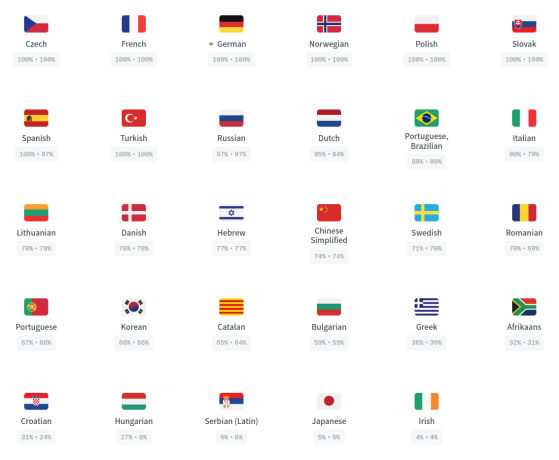

# 如何為 AAPS 應用程式或文件翻譯文字

* 若要查看應用程式中使用的文字，請前往 <https://crowdin.com/project/androidaps>，並使用 GitHub 帳號登入。
* 要翻譯文件，請查看 <https://crowdin.com/project/androidapsdocs>，並使用你的 GitHub 帳號登入

* 向文件團隊發送加入請求。為此，點擊所需語系的國旗，然後在下一頁的右上角點擊“加入”按鈕。請指定語系，提供一些關於你的資訊以及你的 AAPS 經驗，並說明你想成為翻譯者還是校對者（僅限具有翻譯技能且為進階 AAPS 用戶的人成為校對者）。

```{admonition} 審閱時間 :class: note

審閱是一個手動步驟。作為非營利組織，我們不提供 SLA，但一般情況下審閱會在 1 天內完成。如果沒有，請透過 Facebook 或 Discord 聯繫文件團隊。

    <br />* 當我們批准你後，請點擊旗幟
       
    
    ## 應用程式的翻譯
    
    (translations-translate-strings-for-AAPS-app)=
    ### 翻譯 AAPS 應用程式的文字
    
    * 如果你對翻譯的文字沒有特別偏好，只需選擇「翻譯全部」按鈕即可開始。他會顯示需要翻譯的文字。
    
       
    
    * 如果你想翻譯個別檔案，請透過搜索對話框或樹狀結構搜尋該檔案，然後點擊檔名以開始對該檔案中的文字進行翻譯工作。
    
       
    
    * 通過添加新的翻譯文字或使用＆編輯建議來翻譯左側的句子
    
       
    
    
    ### 校對 AAPS 應用程式的文字
    
    * 校對者從語系主頁選擇「校對」開始。
    
        
    
    
      並批准翻譯的文字 
    
       
    
    當校對者批准翻譯時，它將被添加到下一個 AAPS 版本中。
    
    (translations-translation-of-the-documentation)=
    ## 文件的翻譯
    
    * 點擊你想翻譯的文件頁面名稱
    
    
    
    
    * 逐句翻譯句子
    
        1. 黃色文本是你目前正在處理的文本。
    
        1. 綠色文本是已翻譯的文本。你不需要再次翻譯這些。
    
        1. 紅色文本是仍需翻譯的文本。
    
        1. 這是你目前正在處理的原始文本
    
        1. 這是你正在準備的翻譯。你可以從上方複製文本或選擇下方的建議之一。
    
        1. 以下是翻譯建議。你可以查看 Crowdin 對翻譯相符程度的評分，也可以確認這段文字是否曾經翻譯過，只是因為文字移動而非內容變更，才再次出現。
        1. 按下“儲存”按鈕以儲存翻譯建議。接著，內容會交由校對人員進行最後檢查。
    
    
    
    * 轉換的頁面在文件中不會發佈，直到 
    
        1. 翻譯已校對
    
        1. the sync run between Crowdin and Github finished (once an hour) which creates a PR for GitHub.
    
        1. 該 PR 在 Github 中獲得批准。
    
    一般來說，這需要 1-3 天，但在假日期間可能會花費更長時間。
    
    ### 翻譯鏈接
    
    ```{admonition} 鏈接不再翻譯
    :class: note鏈接不再翻譯。 In the past we had a topic here but this is gone as through migration to Markdown and the myst_parser we explicitly create labels in the english text and propagate these labels under the hood to the languages.
    
    

你正在翻譯代表鏈接的文本。 Please be careful **not** to remove the link, which is represented by a pair of `<0></0>` tags (or other numbers, if there are more links in one paragraph).

這是校對者需要特別注意的事項！

### 校對

* 校對者必須切換到校對模式
    
    
    
    並批准翻譯的文本
    
    

* 校對人員核准翻譯後，內容會納入下一次文件建置。文件建置沒有固定時程，會視需求進行，通常約每週一次，假期除外。為加快過程，你可以通知文件團隊關於新翻譯。