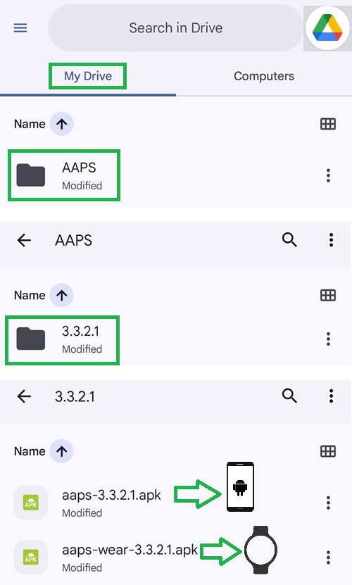

# 建置 Wear AAPS 應用程式

The **AAPS** app for a Wear OS smartwatch (the **Wear apk**, `aaps-wear-….apk`) is a separate installation file from the **AAPS** phone app. You need both: the phone app runs the loop, the watch app shows its data and can send commands to it. The watch app is installed from the phone, see [Set up AAPS on your Wear OS watch](WearOsSmartwatch.md).

The two apps only work together when they match:

- **Same AAPS version** on the phone and on the watch.
- **Same keystore** used to sign both apps.

The simplest way to guarantee this is to build both apps **at the same time**, in the same build. The browser build does this for you: every build produces the phone apk and the Wear apk together. With Android Studio or the command line, you build the Wear apk as a second step right after the phone apk.

```{note}
Already using **AAPS** on your phone but no Wear apk from the same build? Build both apps again, with the same keystore, and reinstall the phone app too. A Wear apk built months later, or with a different Android Studio version, is unlikely to be compatible with the phone app.
```

## 支援的 Wear OS 版本

**AAPS** runs on watches with **Wear OS 3.0, 3.2 or 3.5** (Android 11, API level 30) **or newer** (Wear OS 4, 5 and 6). Watches with Wear OS 2 are not supported.

```{warning}
AAPS Watchfaces are available for Wear OS smartwatches with API level 30 to 33 (Wear OS 3.0, 3.2, 3.5 and 4).<br>
Newer Wear OS versions progressively break the AAPS watchfaces — see [Wear OS watch face changes](#wearos-watchface-changes) and the [Wear OS 5 limitations](#BuildingAapsWearOs-WearOS5).
```

(building-aaps-wear-os-method)=

## Get the Wear apk with your build method

Follow the section for the method you use to [build AAPS](../SettingUpAaps/BuildingAaps.md).

(building-aaps-wear-os-browser)=

### Browser build (recommended)

**Nothing extra to do.** Every browser build produces two files from the same source and the same keystore:

- `aaps-….apk`: the phone app.
- `aaps-wear-….apk`: the watch app.

The Wear apk follows the [variant](#browserbuild-variant) you selected for the build: `fullRelease` gives the **AAPS Wear** app, `aapsclientRelease` the **AAPSClient Wear** app, `pumpcontrolRelease` the **PumpControl Wear** app. Each Wear app only talks to its matching phone app.

Where to find the Wear apk:

- **AAPS Builder**: on the build page, scroll down to **Artifacts** and download `aaps-wear-….apk` next to the phone app, as shown in [Step 6 – Install the app on your phone](#aaps-builder-step6). Download it on the phone that runs **AAPS** if you install the watch app from the phone (Wear Installer 2 or Easy Fire Tools), or on your computer if you use ADB.

  

- **Fork with Google Drive**: open your Google Drive, folder `AAPS`, then the folder of the version you built. It contains the phone apk and the Wear apk, see [Step 4 – Build the APK](#github-build-apk).

  

Keep the Wear apk together with the phone apk in your backups. With **AAPS Builder**, the files stay on the build page for 14 days only.

Next: install the Wear apk on the watch, see [Set up AAPS on your Wear OS watch](WearOsSmartwatch.md).

(building-aaps-wear-os-android-studio)=

### Android Studio

The Wear apk is built like the phone apk, as a second signed build. Do it right after the phone apk, with the same Android Studio version and the same keystore.

- Follow the instructions for [Android Studio Build](../SettingUpAaps/ComputerBuild.md).
- 當你在「建置 AAPS 簽章 APK」中到達[模組選擇](#Building-APK-wearapk)時，請確保選擇**`AndroidAPS.wear`**。


選擇"**fullRelease**"以產生**AAPS** Wear APK 檔案。


如果你願意，你也可以從下拉選單中選擇建置 **“pumpcontrolRelease”**，這將只允許你遠端控制幫浦，但不包括循環功能。

Next: install the Wear apk on the watch, see [Set up AAPS on your Wear OS watch](WearOsSmartwatch.md).

(building-aaps-wear-os-troubleshooting)=

#### Troubleshooting the Android Studio build

In the process of building the full **AAPS** app (and in fact any signed app), Android Studio generates a .json file in the same folder. 這會在你嘗試建置下一個已簽章的應用程式（如 **AAPS** wear 應用程式）時，導致[未提交的變更](#troubleshooting_androidstudio-uncommitted-changes)錯誤。解決此問題的最快方法是導航到建置完整 AAPS 應用程式的資料夾，你的資料夾可能類似於：

`C:\Users\你的名稱\AndroidStudioProjects\AndroidAPS\app\aapsclient\release。`

將不需要的 .json 檔案刪除或移出該資料夾。然後再次嘗試建置 **AAPS** wear 應用程式。如果這不起作用，請參閱[更詳細的問題排除指南](../GettingHelp/TroubleshootingAndroidStudio.md)，以幫助你識別導致問題的具體檔案，也可能是你的密鑰庫檔案。

(building-aaps-wear-os-cli)=

### Command line

Follow [Build instructions for the command-line](../SettingUpAaps/CLIBuild.md) and repeat the compile and sign steps for the `wear` module, with the same keystore:

```sh
./gradlew :wear:assembleFullRelease
```

The unsigned Wear apk is written under `wear/build/outputs/apk/full/release/`. Sign it with `apksigner` exactly like the phone apk, then install it on the watch, see [Set up AAPS on your Wear OS watch](WearOsSmartwatch.md).
