# AP550 Insulin Pump

_Insulin Pump uAP 550S_

_These instructions are for configuring AAPS and your pump if you use uAP 550S. The driver talks to the pump over Bluetooth LE._

The pump runs on standard **AAA batteries**.

(AP550-Insulin-Pump-pairing-pump)=
## Pairing pump

* On the AAPS homescreen press the hamburger menu on the top left corner and go to **Config Builder**.
* In the pump section select **AP550**.
  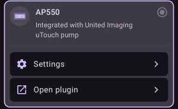
* The AP550 overview screen opens. Tap the connection card which says
  **"Insulin pump not bound"**. You can also click the bottom botton **"Pair"**

  

* The pair wizard starts. You can find the pump in two ways:

  1. **Scan** — the wizard scans for nearby pumps for 15 seconds and lists them by name and serial number(The pump serial number is on the back label.). Tap your pump in the list.
  2. **QR code** — tap "QR code scan" and point the camera at the QR code on the **back of the pump**. The QR code holds the model and serial number. AAPS then scans until it finds the pump with this serial number.

  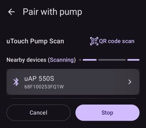

* AAPS connects to the pump ("Bluetooth is connecting...").
* **Enter the 6-digit pairing code shown on the pump.** You must also confirm the code on the pump. This works like a normal Bluetooth pairing, for example phone and car audio.
  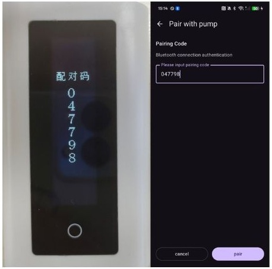
* If the code is wrong you can try once more. After a second wrong code the link drops and you start again at the scan step.
* When pairing succeeds you see "Pump pair successes". Press OK to return to the overview.

## Operating the pump

The default password to enter the menu on the pump is **211**.

### Unlocking the pump

1. **Double-tap the circle on the screen** to wake the screen up.
2. Tap the **unlock button**.
3. **Swipe up** to unlock.
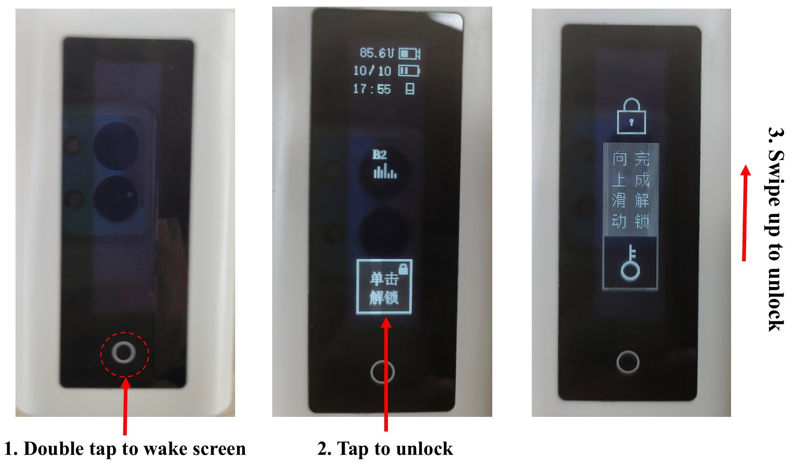

### Pump buttons

The table below lists the common buttons on the AP550 pump and what each one does. A single screenshot may show several buttons at once; in that case the image spans multiple rows and each button gets its own description row.

<table>
  <tr>
    <th>Button</th>
    <th>Description</th>
  </tr>

  <!-- Group 1: one screenshot containing 4 buttons -->
  <tr>
    <td rowspan="4">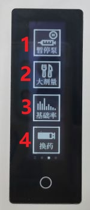</td>
    <td>1: Stop pump Injection</td>
  </tr>
  <tr><td>2: bolus</td></tr>
  <tr><td>3: basal</td></tr>
  <tr><td>4: Change the infusion set</td></tr>

  <!-- Group 2: one screenshot containing 2 buttons -->
  <tr>
    <td rowspan="3"></td>
    <td>1: Settings</td>
  </tr>
  <tr><td>2: History</td></tr>
  <tr><td>3: Device Info</td></tr>

  <tr>
    <td rowspan="2"></td>
    <td>1: Normal Basal Rate</td>
  </tr>
  <tr><td>2: Temporary Basal Rate</td></tr>

  <tr>
    <td rowspan="2"></td>
    <td>1: Set a temporary basal rate as a percentage.</td>
  </tr>
  <tr><td>2: Set a temporary basal rate as a rate</td></tr>

  <tr>
    <td rowspan="2"></td>
    <td>1: Manual Bolus</td>
  </tr>
  <tr><td>2: Preset Bolus</td></tr>

  <tr>
    <td rowspan="4">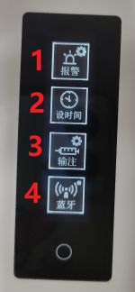</td>
    <td>1: Alarm</td>
  </tr>
  <tr><td>2: Time</td></tr>
  <tr><td>3: Infusion</td></tr>
  <tr><td>4: Wireless</td></tr>

  <tr>
    <td rowspan="4"></td>
    <td>1: Bolus Settings</td>
  </tr>
  <tr><td>2: Low Reservoir Threshold</td></tr>
  <tr><td>3: Max basal</td></tr>
  <tr><td>4: Max bolus</td></tr>

</table>

### Changing the reservoir and infusion set

The **Change the infusion set** button in the main menu is used whenever the delivery line has to be opened. There are two situations:

* the insulin in the reservoir is used up and the reservoir has to be replaced with a new one:

  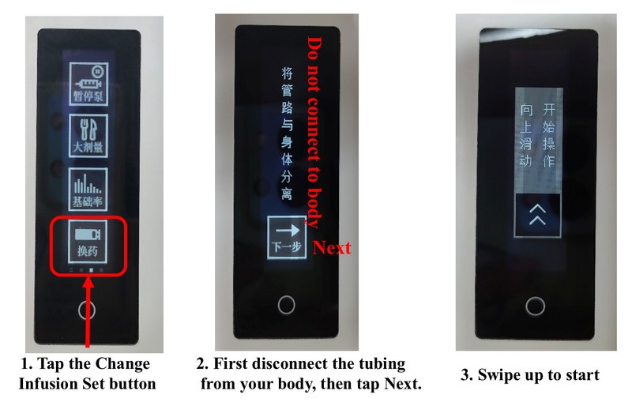

  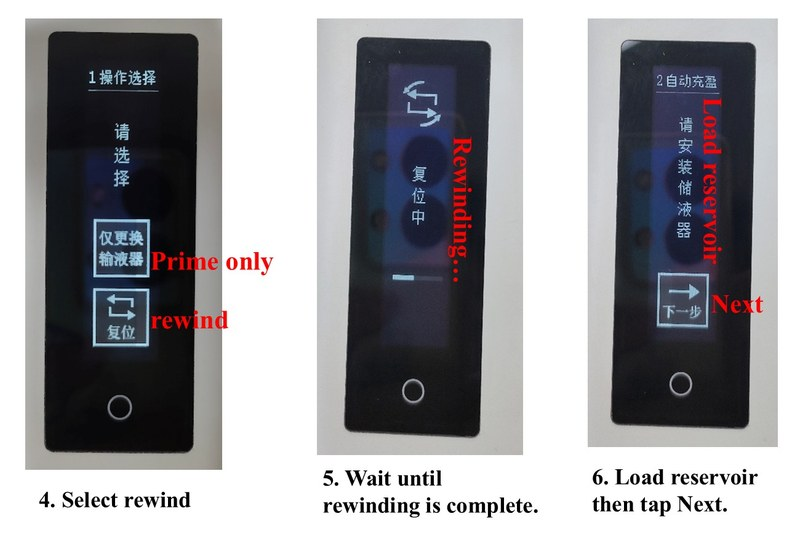

  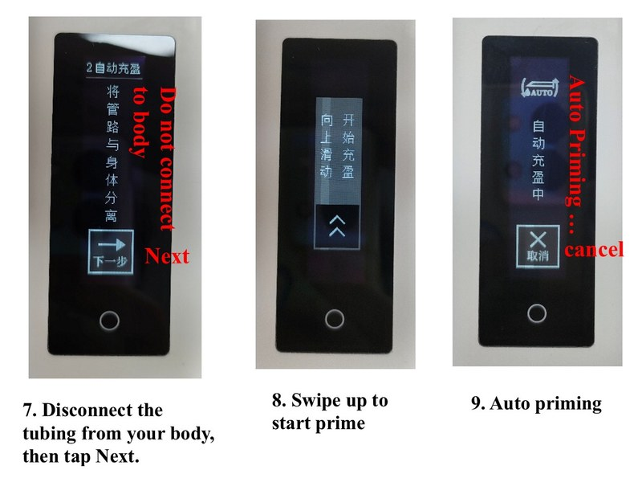

  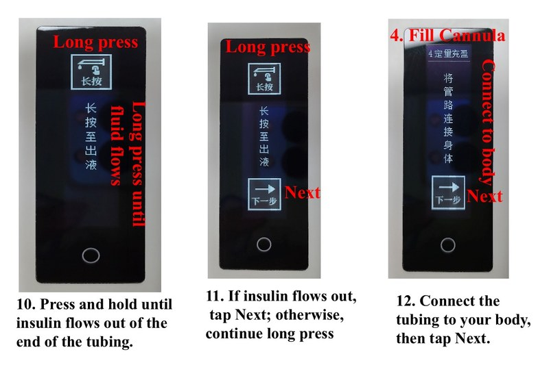

  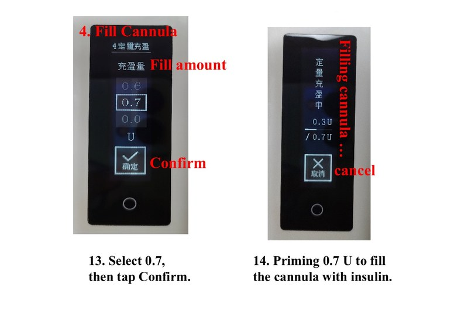

* the infusion set (tubing and cannula) has to be replaced:

  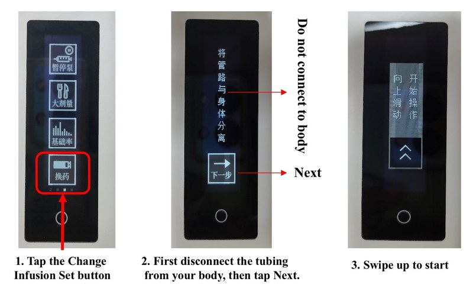

  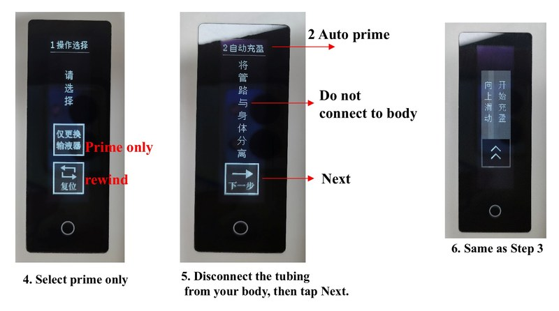

  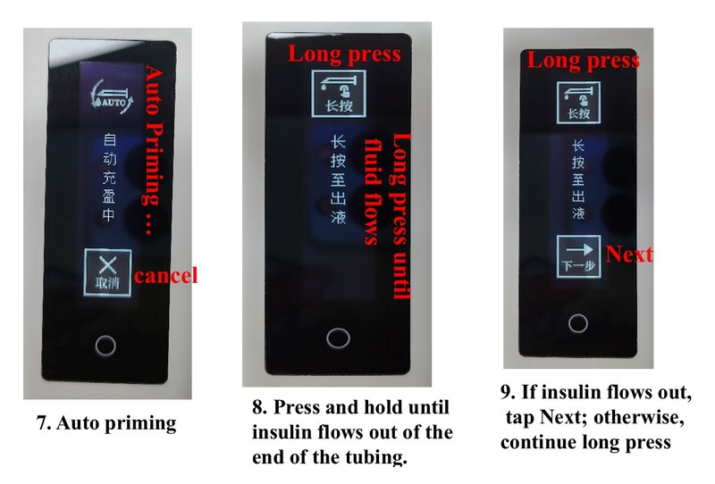

  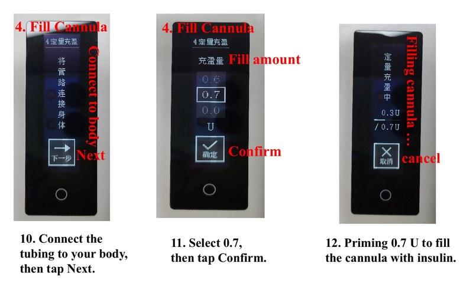

### Pump alarms

The pump shows an alarm screen when something needs your attention. The
picture below shows the alarms as they appear on the pump, together with the
buttons you can press. Each alarm is explained in the table.

<table>
  <tr>
    <th>Alarm</th>
    <th>Meaning / what to do</th>
  </tr>
  <tr>
    <td rowspan="9"></td>
    <td><strong>H1 Pump battery empty</strong> — the AAA batteries are empty. Replace them immediately.</td>
  </tr>
  <tr><td><strong>H2 Abnormal pump motor</strong> — the pump detected a motor fault. Stop using the pump and contact your supplier.</td></tr>
  <tr><td><strong>H3 Insulin depleted</strong> — Insulin depleted. Unable to complete delivery.</td></tr>
  <tr><td><strong>H4 Occlusion</strong> — the tubing or cannula is blocked. Check the infusion set and replace it if needed.</td></tr>
  <tr><td><strong>L1 Reservoir empty</strong> —  No reservoir detected.</td></tr>
  <tr><td><strong>L2 Pipeline detachment</strong> — the tubing has come off. Reconnect or replace the infusion set.</td></tr>
  <tr><td><strong>L3 Low battery</strong> — the batteries are almost empty. Replace them soon.</td></tr>
  <tr><td><strong>L4 Insufficient insulin</strong> — The remaining insulin is below the alarm threshold.</td></tr>
</table>

### Pump prompts

Besides alarms, the pump also shows **prompts**: short screens that ask you to
confirm an action or that inform you about the state of the pump. The table
below shows each prompt screen and explains what it means.

<table>
  <tr>
    <th>Prompt</th><th>Meaning</th>
    <th>Prompt</th><th>Meaning</th>
    <th>Prompt</th><th>Meaning</th>
  </tr>

  <!-- Row 1: prompts 1–3 -->
  <tr>
    <td></td>
    <td>The device has been powered off for too long. Please reset the time.</td>
    <td></td>
    <td>The value exceeds the maximum. Please re-enter.</td>
    <td></td>
    <td>Infused ** U ** minutes ago.</td>
  </tr>

  <!-- Row 2: prompts 4–6 -->
  <tr>
    <td></td>
    <td>A maximum of ** U can be infused for this bolus.</td>
    <td></td>
    <td>The 4-hour bolus limit has been reached: ** U.</td>
    <td></td>
    <td>The daily bolus limit has been reached: ** U.</td>
  </tr>

  <!-- Row 3: prompts 7–9 -->
  <tr>
    <td></td>
    <td>Bolus aborted. Please check the record.</td>
    <td></td>
    <td>Infusion cannot be resumed under the current alarm condition.</td>
    <td></td>
    <td>Bolus in progress. Changing the infusion set is not allowed.</td>
  </tr>

  <!-- Row 4: prompts 10–12 -->
  <tr>
    <td></td>
    <td>Temporary basal rate in progress. Changing the infusion set is not allowed.</td>
    <td></td>
    <td>Bolus in progress. Editing is not allowed.</td>
    <td></td>
    <td>Temporary basal rate in progress. Editing is not allowed.</td>
  </tr>

  <!-- Row 5: prompts 13–15 -->
  <tr>
    <td></td>
    <td>Dose is 0. Unable to set.</td>
    <td></td>
    <td>Infusion paused. Please go to the home screen to resume infusion.</td>
    <td></td>
    <td>All infusions are paused. Editing is not allowed.</td>
  </tr>

  <!-- Row 6: prompts 16–18 -->
  <tr>
    <td></td>
    <td>Not a new battery.</td>
    <td></td>
    <td>Please replace the battery.</td>
    <td></td>
    <td>Please reset the time.</td>
  </tr>

  <!-- Row 7: prompts 19–21 -->
  <tr>
    <td></td>
    <td>Please reset the insulin pump parameters.</td>
    <td></td>
    <td>There is an unfinished operation.</td>
  </tr>
</table>

## Overview screen

The AP550 overview screen shows the state of the pump:

* Connection card at the top: tap it to **connect** or **disconnect**.
* Info rows: serial number, battery, last connection, daily units,
  reservoir, base basal rate, basal step, bolus step, firmware, max bolus, max basal.
* **Pump History** — boluses, temp basals, alarms, refills and more. This history comes from the pump itself and stays on the phone.
* **Stop pump Injection / Resume pump Injection** — suspend or resume the
  pump. AAPS asks you to confirm first.
* **Connect Status** — a list of past connect and disconnect events.
* **Turn pump sound on/off** — mute or unmute the pump. AAPS asks you to
  confirm first.

## Settings

Open the pump settings through Config Builder (gear wheel next to AP550):

* **Visualize basal as percentage** — the pump uses percent temp basals
  (10 % – 300 %). When this is on, AAPS sends and shows temp basals as a
  percent instead of U/h.
* **Hypoglycemia risk alert** — the pump warns when a low glucose is likely in
  the near future. AAPS checks the risk once a day and after every bolus.
* **Unpair** — forgets the pump. 

## Bolus limits

The pump and the driver limit how much insulin can be given:

* Maximum single bolus — set on the pump.
* **4-hour total bolus limit** — 2× the pump max bolus.
* **Daily total bolus limit** — 4× the pump max bolus.

AAPS blocks a bolus which would go over one of these limits.

## Errors and alarms

### Errors during insulin delivery

If the connection is lost while a bolus is running (for example you walk away
from the phone), AAPS shows a message that it lost communication with the pump
and asks you to **check on the pump how much bolus was actually delivered**.
The real amount is read from the pump on the next connection.

### Delivery error codes

When a delivery fails, the pump reports a code. The most important ones:

| Code | Meaning |
|------|---------|
| 01 | Manually paused injection |
| 03 | Abnormal pump motor |
| 04 | Pump battery empty |
| 05 | Daily dose limit reached |
| 06 | Occlusion (pump pipeline blockage) |
| 07 | Reservoir empty |
| 08 | Pipeline detachment |
| 09 | Bolus over the pump maximum |
| 10 | Low battery — or a bolus / temp basal is already running on the pump |
| 12 | Communication error, please reconnect the pump |

### Connection problems

While AAPS tries to reach the pump it reminds you every few minutes:

1. Please confirm that the pump is within searchable range.
2. Please confirm that the pump and phone bluetooth are enabled.

If AAPS receives no blood glucose data for over 10 minutes it shows a
notification ("AAPS blood glucose data lost") so you can check the connection.

### Basal profile mismatch

If the basal profile on the pump does not match the profile in AAPS, the pump
reports its own rate (for example "pump basal rate: 0.80 U/h, please reset
profile"). Re-send your profile from AAPS.

## Unpair and switching phone

* **Unpair** — in the pump settings press "Unpair" and confirm. The driver
  forgets the pump address and serial number. The pump stays paired in the
  Android Bluetooth settings; you can remove it there too if you want.
* **Pair a different pump** — simply start the pair wizard again. Pairing a new
  pump replaces the old registration, and the history of the old pump is not
  merged.
* **Switching phone** — unpair on the old phone (or just pair again), then
  [export settings](../Maintenance/ExportImportSettings.md) on the old phone,
  install AAPS on the new phone, and
  [import settings](../Maintenance/ExportImportSettings.md). If the connection
  does not come back, pair the pump again as described
  [above](#AP550-Insulin-Pump-pairing-pump).

## Timezone traveling with AP550

The AP550 does not support time changes over 24 hours. If you travel across
time zones, AAPS updates the pump time on the next connection after the phone
time has changed. If the difference is over 24 hours, AAPS asks you to check
the time on the phone and the pump first.

Keep in mind that time shifts on the pump can cause wrong basal records in the
pump history. See also [Timezone traveling with pumps](#timezone-traveling-with-pumps).