(omnipod5)=
# Omnipod 5

These instructions are for using **Omnipod 5** pods with **AAPS**.

```{admonition} In development
:class: warning
The Omnipod 5 driver is in development. It is not part of a released **AAPS** version yet and only runs in test builds. Screens and steps on this page can still change before the release.
```

```{contents} Table of contents
:depth: 1
:local: true
```

(omnipod5-how-it-works)=
## How AAPS uses Omnipod 5

The Omnipod 5 driver works in almost the same way as the [Omnipod DASH driver](../CompatiblePumps/OmnipodDASH.md):

- **AAPS** connects to the pod over the phone's Bluetooth. No RileyLink or other bridge device is needed.
- **AAPS** connects only to send a command (for example a bolus or a **TBR**) or to read the pod status, and disconnects right after.
- **AAPS** controls the pod as a normal pump: it sets the basal rates, **TBRs**, boluses and **SMBs**. The pod's own automated mode is never used.
- The doses and limits are the same as for DASH: boluses in 0.05 U steps, basal rates in 0.05 U/h steps (minimum 0.05 U/h), **TBRs** up to 30 U/h for up to 12 hours.
- Extended boluses are not supported.

The main difference with DASH is the **personal certificate**. **AAPS** needs it to pair with an Omnipod 5 pod. You get it once, before you activate your first pod, by signing in with your GitHub account (see [Get your Omnipod 5 certificate](#omnipod5-certificate)).

(omnipod5-requirements)=
## Requirements

- Omnipod 5 pods.
- A compatible Android phone with Bluetooth Low Energy (see [Phones](../Getting-Started/Phones.md)).
- An **AAPS** build that includes the Omnipod 5 driver.
- A [GitHub account](#omnipod5-github-account) with a verified e-mail address, at least 7 days old.
- An internet connection on the phone the first time you activate a pod.
- A supported [Continuous Glucose Monitor (CGM)](../Getting-Started/CompatiblesCgms.md), connected to **AAPS** as usual.

### Safety first

Do not connect **AAPS** to a pod for the first time without:

1. Spare pods (3 or more).
2. Spare insulin and equipment for injections.
3. A working Omnipod 5 controller or app, in case **AAPS** fails.

### The pod only talks to AAPS

The device that activates a pod is the only device that can control it. Once **AAPS** has activated a pod, you cannot use your Omnipod 5 controller or app with that pod. Keep your controller or app anyway, as a backup for the next pod.

### The pod keeps delivering insulin without AAPS

On activation, **AAPS** programs the basal rates of your active [**Profile**](../SettingUpAaps/YourAapsProfile.md) on the pod. **TBRs** set by **AAPS** run for a limited time. If the phone loses contact with the pod, the pod goes back to these basal rates when the **TBR** ends.

### Profile limits

The same limits as for DASH apply:

- **AAPS** profiles only support basal rates that start on the full hour. A rate starting at 09:30 must be moved to 09:00 or 10:00.
- Basal rates of 0 U/h are not supported in a **Profile**. Use a zero **TBR**, **Disconnect pump** or **Suspend loop** instead.

(omnipod5-select)=
## Select Omnipod 5 in AAPS

1. Open the **menu** (☰) in the top-left corner of the main screen and select **Configuration**.
2. Tap **Pump** and select **Omnipod 5** (*"Pump integration for Omnipod 5."*).
3. The **Omnipod 5** card now shows two buttons:
   - **Settings** opens the [Omnipod 5 settings](#omnipod5-settings).
   - **Open plugin** opens the [Omnipod 5 pump screen](#omnipod5-pump-screen).

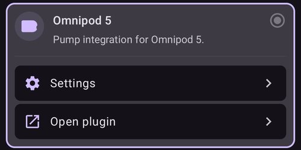

(omnipod5-pump-screen)=
## The Omnipod 5 pump screen

Open it with **Manage** > **Pump**, or with **Open plugin** on the **Omnipod 5** card. This is where you activate and deactivate pods, refresh the pod status and look at the pod history.

Without an active pod, the **Pod Status** field shows **No Active Pod** and the **Activate Pod** button is shown:

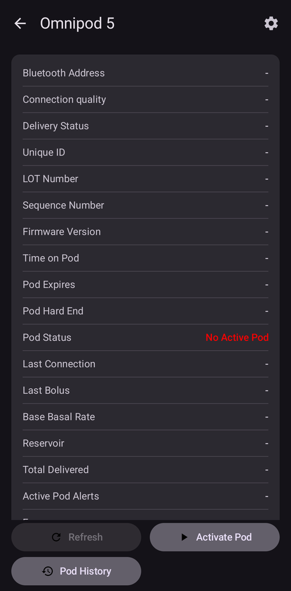

With an active pod, the screen shows the pod information and the **Deactivate Pod** button:

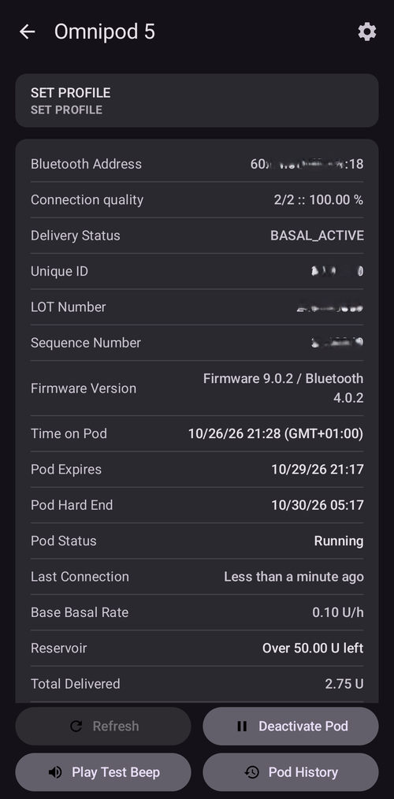

The fields and buttons are the same as on the DASH pump screen: see [Fields](#omnipod-dash-tab) and the button list below it. A few notes:

- **Delivery Status** is only shown in engineering mode builds.
- **Reservoir** shows *Over 50.00 U left* until the pod has less than 50 units left. Then it shows the exact amount.
- After a pod fault, the **PDM Notification** field shows the fault the way the Omnipod 5 app would have shown it, for example *Blockage detected*, *Pod Out of Insulin*, *Pod Expired*, *Pod Shut-Off* or *Pod Error*.
- There is no button to suspend the pod. To stop insulin delivery for a while, set a zero **TBR**.

The **Settings** (gear) icon in the top-right corner opens the [Omnipod 5 settings](#omnipod5-settings).

(omnipod5-certificate)=
## Get your Omnipod 5 certificate

**AAPS** needs a personal certificate to pair with Omnipod 5 pods. You get it once, by signing in with GitHub. After that, you can activate new pods without an internet connection.

You do not have to start this step yourself: when you press **Activate Pod** and no certificate is installed yet, **AAPS** opens the **Import certificate** screen first.

(omnipod5-github-account)=
### Your GitHub account

Use the GitHub account you use to build **AAPS**. The account must:

- have a **verified e-mail address**: you must have clicked the confirmation link that GitHub sent you,
- be at least **7 days old**.

If you do not have a GitHub account yet, see [Building AAPS](../SettingUpAaps/BuildingAaps.md). Create it at least a week before you plan to start with Omnipod 5.

### Steps

1. Make sure the phone is connected to the internet. Open the Omnipod 5 pump screen and press **Activate Pod**.

   If there is no internet connection, **AAPS** shows *Unable to connect. An internet connection is needed to retrieve your Omnipod 5 certificate.* Connect the phone to the internet and press **Try again**.

   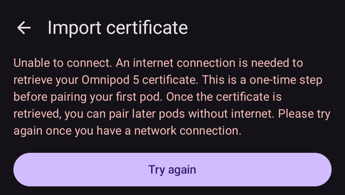

2. The **Import certificate** screen opens and loads the **Connect O5 to AAPS** page. Read it and press **Sign in with GitHub**.

   Your GitHub login is only used for this step. It is not stored by **AAPS**.

   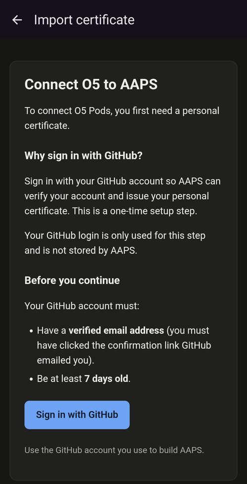

3. The GitHub sign-in page opens: *Sign in to GitHub to continue to OSAID Keymanager*. OSAID Keymanager is the service that issues your certificate. Enter your GitHub username or e-mail address and your password, and press **Sign in**.

   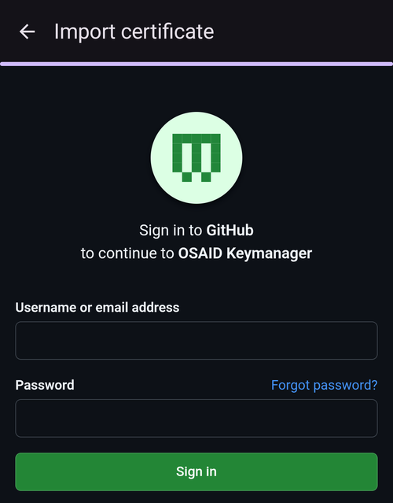

4. If you use two-factor authentication on GitHub, confirm the sign-in the way you usually do. For example, open the GitHub Mobile app and enter the digits shown on the phone.

   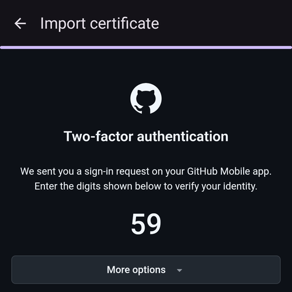

5. For a moment, *You are being redirected to the authorized application* is shown. Wait: you do not need to tap the link.

   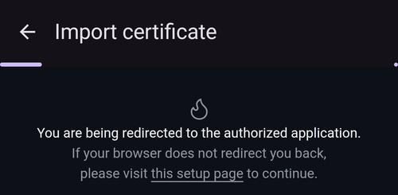

6. **AAPS** shows *Omnipod 5 certificate imported* and the activation wizard opens at the **Fill Pod** step. Continue with [Activate Pod](#omnipod5-activate-pod), step 2.

GitHub sends you an e-mail that a third-party application (*OSAID Keymanager*) with *user:email* scope was authorized for your account. This is expected: the service only reads your e-mail address to check your account.

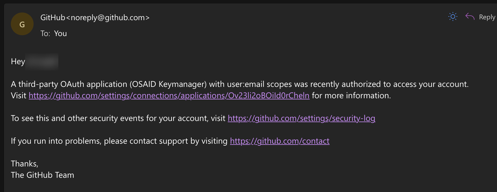

```{admonition} New phone or reinstall
:class: note
The certificate is stored encrypted on the phone. It is not part of the exported settings. After a reinstall of **AAPS** or on a new phone, **AAPS** asks you to sign in with GitHub again the next time you press **Activate Pod**. Make sure the phone has an internet connection at that moment.
```

(omnipod5-activate-pod)=
## Activate Pod

1. Open the Omnipod 5 pump screen (**Manage** > **Pump**) and press **Activate Pod**.

   The first time, **AAPS** first asks you to [get your certificate](#omnipod5-certificate).

   If you have never activated a **Profile** in **AAPS** before, the wizard first shows the **Profile required** step: select the profile to apply on activation and continue.

2. On the **Fill Pod** step, fill a new pod with enough insulin for 3 days, **at least 80 units**. Listen for two beeps from the pod: they mean the minimum of 80 units has been filled. Empty the fill syringe completely, even after the two beeps. Do not remove the pod's needle cap yet.

   ***NOTE:** Priming the pod uses about 3-10 units. Keep this in mind when you calculate the insulin you need for 3 days.*

   Keep the new pod close to the phone and press **Next**.

   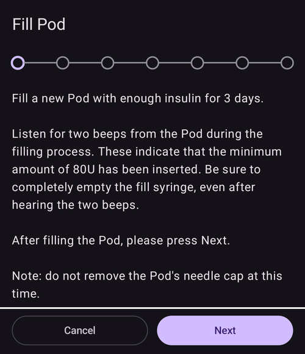

3. If you use more than one insulin in **AAPS**, the **Select Insulin** step is shown. **Will be activated** shows the insulin **AAPS** will use. If you filled the pod with a different insulin, press **Change** and select it. **AAPS** applies a **Profile Switch** with this insulin when the activation is finished. Press **Next**.

   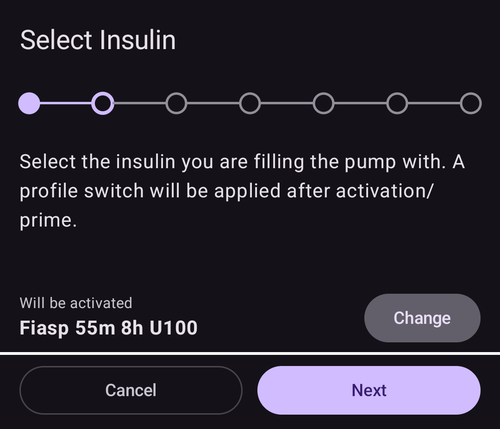

4. On the **Initialize Pod** step, **AAPS** pairs with the new pod and primes it. You hear a click, then a series of ticks while the pod primes itself. When this has finished, the **Next** button appears. Press **Next**.

   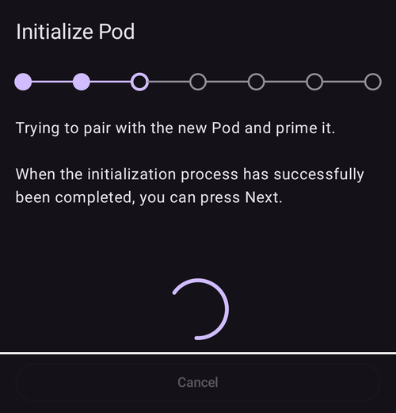    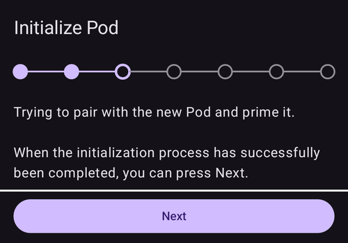

   If an error such as *Scan failed* or *Found too many Pods* is shown, press **Retry**. For *Found too many Pods*, first move away from other pods that are waiting to be activated.

5. If you manage pump site rotation in **AAPS** (**Manage pump site rotation** in the [Site Rotation](#Aapsscreens-site-rotation) settings), the **Site location** step is shown. Tap where you will place the pod on the body diagram and press **Next**, or press **Skip**.

   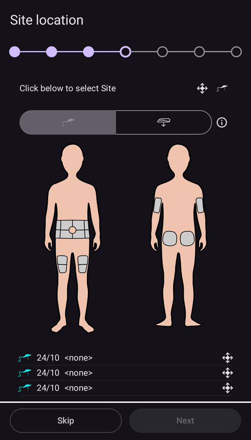

6. Prepare the infusion site: wash your hands, clean the skin with soap and water or an alcohol wipe, and let it dry completely.

   On the **Attach Pod** step, remove the pod's needle cap. If the cannula or anything else sticks out of the pod, **STOP**: press **Cancel** and start again with a new pod. If everything looks normal, remove the adhesive backing and stick the pod to the chosen site. Press **Next**.

   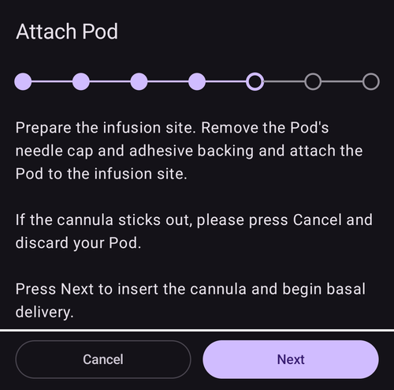

7. A dialog asks you to confirm: *When you press OK, the cannula will be inserted.* **Press OK only when the pod is attached to your body.**

   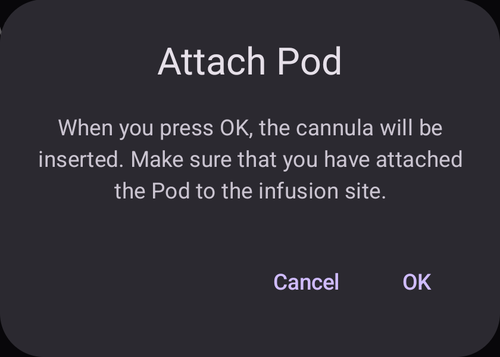

8. On the **Insert Cannula** step, **AAPS** sets your basal schedule and the pod inserts the cannula. This can take 1-2 minutes. When the cannula has been inserted, the **Next** button appears. Press **Next**.

   ***NOTE:** Pinching the skin near the pod before the cannula is inserted helps the cannula go in smoothly.*

   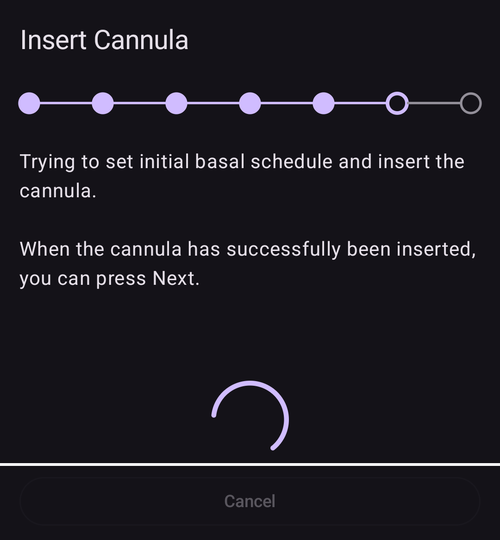    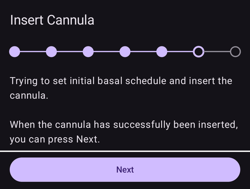

9. The **Pod Activated** step is shown. Check that the cannula has been inserted correctly. Change the pod if you think it has not. Press **Finish**.

   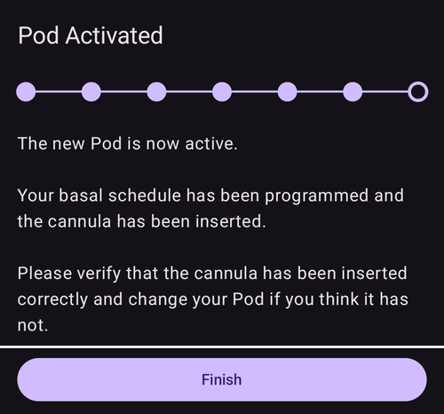

10. The pump screen now shows your active pod, with **Pod Status** *Running*. **Activate Pod** is replaced by **Deactivate Pod**: you must deactivate the active pod before you can activate a new one.

    ***NOTE:** Export your settings after each pod activation, and copy the file to a safe place off your phone (see [Export settings](../Maintenance/ExportImportSettings.md)).*

If an activation stopped after the pod was primed, pressing **Activate Pod** continues from the **Attach Pod** step.

(omnipod5-daily-use)=
## Deactivating, alerts and pod history

These work in the same way as with DASH:

- [Deactivate Pod](#omnipod-dash-deactivate-pod), and [Discarding a pod](#omnipod-dash-discard-pod) when the pod no longer responds.
- [Resuming Insulin Delivery](#omnipod-dash-resuming-insulin-delivery) when delivery stayed suspended after a **Profile Switch**.
- [Silencing Pod Alerts](#omnipod-dash-silencing-pod-alerts) for the expiry and low reservoir alerts.
- [View Pod History](#omnipod-dash-view-pod-history), including the small *Basal correction* boluses the driver sends by itself.

A pod expires 72 hours after activation (**Pod Expires**). It keeps delivering insulin for an 8-hour grace period and stops at **Pod Hard End**, 80 hours after activation.

(omnipod5-settings)=
## Omnipod 5 settings

Open them with the **Settings** (gear) icon on the Omnipod 5 pump screen, or with **Settings** on the **Omnipod 5** card in **Configuration** > **Pump**.

The settings are the same as the DASH settings, in three sections:

- [Confirmation Beeps](#omnipod-dash-settings): pod beeps for bolus, basal, **SMB** and **TBR**.
- **Alerts**: the expiration reminder, the expiration alert and the low reservoir alert. When you change them while a pod is active, **AAPS** sends the new alert settings to the pod.
- **Notifications**: whether **AAPS** plays a sound when it is not sure that a **TBR**, **SMB** or bolus was delivered, and when delivery is suspended.

There is no **Advanced Settings** section: Bluetooth bonding is not available for Omnipod 5.

(omnipod5-certificate-store)=
### Certificate store

In engineering mode builds, the settings have one more item: **Certificate store** (*Import and manage the Omnipod 5 pairing certificate*). It lists the **Installed certificates** (*Controller* followed by a number) and lets you:

- **Import certificate** by pasting a certificate string from a trusted source. This only makes the certificate available for pairing: it does not pair with a pod.
- Remove a certificate. This is only possible when there is no active pod.

You do not need the certificate store for normal use: **AAPS** gets the certificate for you on the first **Activate Pod**.

(omnipod5-troubleshooting)=
## Troubleshooting

Most problems are the same as with DASH: see [Troubleshooting](#omnipod-dash-troubleshooting) and [Bluetooth Troubleshooting](../GettingHelp/BluetoothTroubleshooting.md). The following are specific to Omnipod 5.

### Certificate problems

- *Unable to connect. An internet connection is needed to retrieve your Omnipod 5 certificate.*: connect the phone to the internet and press **Try again**.
- The GitHub sign-in is refused: check that the e-mail address of your GitHub account is verified and that the account is at least 7 days old.
- *Error importing certificate* or *Could not import the certificate. Please try again.*: go back to the pump screen and press **Activate Pod** again.
- *This device's WebView does not support the certificate bridge.*: update **Android System WebView** from the Google Play Store and try again.

### Uncertain commands

If the phone loses contact with the pod while sending a command, **AAPS** can be unsure whether the command was carried out. It then shows a notification, for example *Unable to verify whether the SMB bolus (0.55 U) succeeded. Refresh pod status to confirm or deny this command.*

Press **Refresh** on the Omnipod 5 pump screen once the pod is in range. Until the uncertain command is confirmed or denied, **AAPS** does not send new boluses or **TBRs** (*An earlier dose could not be confirmed with the pod, so a new one was not sent.*).

### Pod faults

When a pod fails, it stops delivering insulin and beeps. **AAPS** shows a notification with the fault code. The **PDM Notification** field on the pump screen tells you what happened, as the Omnipod 5 app would, for example *Blockage detected. Insulin delivery stopped. Change Pod now. Check your BG.*

Check your blood glucose, then [deactivate the pod](#omnipod-dash-deactivate-pod) and activate a new one. A failed pod cannot be used again.

(omnipod5-help)=
## Where to get help

The Omnipod 5 driver is made by volunteers. Read this page and the [Omnipod DASH page](../CompatiblePumps/OmnipodDASH.md) first. Then ask in the *#AAPS* channel on **Discord** ([invite link](https://discord.gg/4fQUWHZ4Mw)) or see [Where can I get help](../GettingHelp/WhereCanIGetHelp.md). Report bugs on [GitHub issues](https://github.com/nightscout/AndroidAPS/issues) with your [log files](../GettingHelp/AccessingLogFiles.md).
