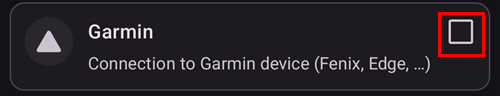

# Smartwatches and AAPS

Various smartwatches can be used to display some of the information available in **AAPS** or perform remote actions.

Having a smartwatch directly control **AAPS** (pump and sensor) is achieved using full Android watches (that are considered like small [smartphones](./Phones.md)).

Some smartwatches can allow you to enter treatments, or more, but with the phone itself still managing **AAPS**.

Smartwatches are becoming increasingly used with **AAPS** _both_ for adults with diabetes and carers/parents of children with diabetes. 

## General advantages of using smartwatches with **AAPS** 


Smartwatches - depending on the model - can be used in many different ways with **AAPS**. They can be used to fully or partly control **AAPS**, or simply to remotely check glucose levels, insulin-on-board, and other parameters.

Integrating a smartwatch with **AAPS** can be useful in many situations, including driving a car or (motor) bike and during exercise. Some people feel that looking at a watch (in a meeting, party, dinner table etc.) is more discreet than looking at a phone. From a security perspective, a smartwatch can also be beneficial while on the move, enabling the user to keep their **AAPS** phone stored out of sight (like inside a bag), while still using the smartwatch for remote control.

## Specific advantages for parents/carers using **AAPS** 

For a child - if their **AAPS**  phone is nearby - a caregiver can use a smartwatch to monitor or make modifications without needing to use the **AAPS**  phone. This can be useful, for example, if the **AAPS** phone is hidden away in a pump belt. 

A smartwatch can be used either _in addition_ to, or as an _alternative_ to the PHONE-based options for remote control or [following only](../RemoteFeatures/FollowingOnly.md). 

Additionally, unlike parent/caregiver follower phones (which rely on the mobile network or Wi-Fi connection), Bluetooth connected smartwatches can be useful in remote locations, like a cave, in a boat, or half-way up a mountain. If both devices (**AAPS** phone and smartwatch) are on the same Wi-Fi network, they can also use Wi-Fi.

## Different types of Smartwatch-AAPS interactions

There are currently five main ways in which smartwatches are used in conjunction with **AAPS**. These are shown in the table below: 

| Watch Setup         | Features                            | Requirements                                                 |
| ------------------- | ----------------------------------- | ------------------------------------------------------------ |
| Standalone          | AAPS without a phone                | Full Android smartwatch (check min Android)</br> Running **app-fullRelease** |
| Full remote control | Most AAPS functions                 | Android **Wear OS** watch (check Android/API)</br>Running **wear-fullRelease** |
| Remote control      | AAPSClient functions                | Android **Wear OS** watch (check Android/API)</br>Running **[wear-aapsclientRelease](https://github.com/nightscout/AndroidAPS/releases)** |
| Remote control      | Some AAPSClient functions           | Garmin watches</br>(older Samsung Tizen and Fitbit setups only, not recommended)</br>See below. |
| Display             | Glucose, trend, IOB, COB, loop and pump status | Many smartwatches, through a companion app on the **AAPS** phone fed by the [External Companion Apps](#watches-external-companion-apps) broadcast: [WatchDrip+](https://bigdigital.home.blog/) (Xiaomi, Amazfit), [GlucoDataHandler](https://github.com/pachi81/GlucoDataHandler) (Wear OS), G-Watch</br>See below. |

## Before you buy a smartwatch…

The exact model of smartwatch you buy depends on the desired function(s). You may find useful information on the [Phones page](#Phones-list-of-tested-phones), including a list of tested phones that also contains some smartwatches.

Popular watch brands include Samsung Galaxy, Garmin, Fossil and Mi band. The different options summarized in the Table above are explained in more detail below, to help you decide which smartwatch is right for your situation.

If you are integrating a smartwatch with **AAPS** on a phone with the intention to remotely interact with **AAPS**, you also need to consider if the two devices are compatible with each other, particularly if you have an older, or an unusual phone. 

In general, if you only want to follow glucose numbers and not interact with **AAPS**, there are a wider range of affordable and simpler watches you can use. 

The best way to choose a smartwatch is to search for "watch" posts on either Discord or Facebook **AAPS** groups. Have a read of others' experiences, and post any specific questions if your query isn't answered by older posts.

## Full Android

It sounds like an attractive option, right? However, at present, only a few enthusiasts are experimenting with **AAPS**  on a stand-alone watch. There are a limited number of smartwatches with a reasonable interface which also work well with standalone use of **AAPS** and your CGM app. Popular models include the LEMFO LEM 15 Pro and 16. You will need to load the watch with the **AAPS** "full" apk (the apk which is usually installed on a smartphone) rather than the **AAPS** "wear" apk. 

While there is no clear specification which helps you to know if a watch will work well for standalone **AAPS** use, the following parameters will help:

1)	Android 12 or newer.
2)	Being able to take the watchface off “square” mode to make text larger and easier to read.
3)	Very good battery life.
4)	Good Bluetooth range.

Most of the frustrations of standalone **AAPS** watches come from interacting with a tiny screen, and the fact that the current AAPS full app interface has not been designed for a watch. You may prefer to use a stylus to edit **AAPS**  settings on the watch, due to the restricted screen size, and some AAPS buttons may not be visible on the watch screen. 

Additional challenges are that it is hard to get sufficient battery life, and watches with sufficient battery are often bulky and thick. Users report fighting with the OS and power-saving settings, difficulty in starting sensors on the watch, poor Bluetooth range (for maintaining connection with both the sensor and pump) and questionable water resistance. Examples are shown in the photos below.


If you are interested in setting up a standalone watch, read the posts and comments on the **AAPS**  Facebook group (good search options are “standalone” and “Lemfo”) and Discord for more information.

## Wear OS

**AAPS** code contains an app extension that can be installed on [**Wear OS** smartwatches](https://wearos.google.com/#oem-carousel).


Verify your smartwatch satisfies **AAPS** [prerequisites](#maintenance-android-version-aaps-version).

### What _is_ Wear OS?

The first three smartwatch options require the smartwatch to have **Wear OS** installed. 

**Wear OS** is the operating system which runs on some modern Android smartwatches. If the description of the smartwatch indicates only _compatibility_ with Android and iOS - it does not mean it is running Wear OS. It may be some other sort of Vendor specific operating system which is not compatible with **AAPS**. 
To support installation and use of any version of **AAPS** or **AAPSClient**, a smartwatch must be running **Wear OS 3.0, 3.2 or 3.5** (Android 11, API level 30) **or newer**. Each Wear OS release follows the Android version it is based on: **Wear OS 3** is Android 11 (API level 30), **Wear OS 4** is Android 13 (API level 33), **Wear OS 5** is Android 14 (API level 34) and **Wear OS 6** is Android 16 (API level 36). Watches on Wear OS 2 cannot run **AAPS**.

If you install **AAPS** wear.apk on a **Wear OS** watch, there are a range of different custom **AAPS** watchfaces which can be selected. Alternatively, you can use a standard smartphone watchface, with your **AAPS** information included in small tiles known as “complications” on the face. A complication is any feature that is displayed on a watchface in addition to the time.

```{note}
Recent **Wear OS** changes progressively break the custom **AAPS** watchfaces (the higher the Wear OS version, the more severe), although **complications** keep working. Before buying or updating a watch, read [Wear OS watch face changes](#wearos-watchface-changes).
```


### What could my smartwatch look like? 

After [installing **AAPS** onto your watch](../WearOS/WearOsSmartwatch.md), you will automatically be able to select your preferred watchface from these **AAPS**-dedicated watchfaces. On most watches, you simply long-press on the home screen until the screen shrinks and swipe right to select an alternative screen:  


These are the basic screens embedded in **AAPS**, there are [more watchfaces](#WearOS_changing-to-AAPS-watchface) and you can also use [complications](#Watchfaces-complications).

### How would I operate a Wear OS watch from day-to-day? 

Further details about the watchfaces, and day-to-day use, including how to make (and share) your own customized watchface, can be found in the section [Operation of Wear AAPS on a Smartwatch](../WearOS/WearOsSmartwatch.md).

(Watchfaces-tizen)=
(watches-external-companion-apps)=

## External Companion Apps

**AAPS** can broadcast its status to other apps installed on the same phone: glucose and trend, IOB, COB, basal and temp basal, profile name, loop status, phone and pump battery, reservoir level and bolus progress. Several watch companion apps read this broadcast and display the data on watches that **AAPS** does not support directly. To send the data, enable **External Companion Apps** in **Configuration** > **Communication** (see [External Companion Apps](#external-companion-apps) on the Configuration page). The broadcast is sent with each new reading and cannot be requested: a refresh button in the companion app has no effect on **AAPS**.


Companion apps known to use this broadcast:

- [WatchDrip+](https://bigdigital.home.blog/) for Xiaomi and Amazfit watches, see [Xiaomi and Amazfit watches](#watches-xiaomi-amazfit) below.
- [GlucoDataHandler](https://github.com/pachi81/GlucoDataHandler) for Wear OS watches, as a complication or a widget. It is a useful fallback on Wear OS versions where the **AAPS** watchfaces are unreliable, see [Set up AAPS on your Wear OS watch](../WearOS/WearOsSmartwatch.md). Its companion app GlucoDataAuto shows the same data in a car with Android Auto.
- [G-Watch app](https://play.google.com/store/apps/details?id=sk.trupici.g_watch) for Samsung Tizen watches, and its later Wear OS port. In earlier **AAPS** versions the plugin was named **Samsung Tizen** after this app.

```{warning}
The **G-Watch app** and its **Wear OS** port are no longer maintained, and Samsung has moved its smartwatches from Tizen to Wear OS. G-Watch is only relevant for existing, older setups and is not recommended for a new installation. Check the dedicated [Facebook group](https://www.facebook.com/groups/gwatchapp) for the latest news.
```

(Watchfaces-garmin)=

## Garmin

There are some watch faces for Garmin that integrate with [AAPS](https://apps.garmin.com/search?keywords=androidaps), on the Garmin ConnectIQ store.



[AAPS Glucose Watch](https://apps.garmin.com/apps/3d163641-8b13-456e-84c3-470ecd781fb1) integrates directly with **AAPS**. It shows loop status data (insulin on board, temporary basal) in addition to glucose readings and sends heart rate readings to **AAPS**. It is available in the ConnectIQ store; enable the **Garmin** plugin in **Configuration → Communication**.


1. Highest and lowest glucose values on the graph
2. Glucose change per minute
3. Insulin on board (IOB)
4. Time since the last glucose reading (minutes:seconds)
5. Temporary basal rate, as a percentage of the profile basal rate
6. Glucose graph of the last 2 hours
7. Current glucose value


## Fitbit

```{warning}
Google is moving Fitbit into Google Health and is removing third-party apps and watch faces from Fitbit watches in the EU. Fitbit watchfaces are therefore **no longer a recommended option**, and buying a Fitbit for use with **AAPS** is not recommended.
```

For existing Fitbit watches, the [Nightscout webpages](https://nightscout.github.io/nightscout/wearable/#fitbit) list some monitoring-only options, such as [Glance](https://glancewatchface.com/). These are third-party watchfaces too, so the same EU restriction applies.

## Following only

These smartwatches will reflect some **AAPS** information, some will require other apps.

There are a wide range of affordable smartwatches which can provide display only. If you are using Nightscout, then a good overview of all the options is [here](https://nightscout.github.io/nightscout/wearable/#)

Here below some of the follow-only watch options popular with **AAPS** users: 

(watches-xiaomi-amazfit)=
### Xiaomi and Amazfit watches

**WatchDrip+** is a community-developed companion app that displays glucose and loop data on various smartwatch models, mostly Xiaomi (_e.g._ Mi Band) and Amazfit brands:


Since version 0.5, **WatchDrip+** reads its data directly from **AAPS**, without xDrip+ as a relay. On the **AAPS** phone:

1. Enable **External Companion Apps** in **Configuration** > **Communication**, see [above](#watches-external-companion-apps). It provides the current glucose, delta, trend arrow, IOB and pump status.
2. Enable the **xDrip** plugin in **Configuration** > **Communication** and turn on **Send status to xDrip+** in its settings. It provides the IOB/COB status line, and the glucose graph on the watch fills in after a few readings.
3. If xDrip+ is installed on the phone, disable its **Broadcast Service API** (xDrip+ > Settings > Inter-app settings) so that the watch does not receive the data twice. If xDrip+ was only relaying data to the watch, you can uninstall it.

The refresh button of WatchDrip+ has no effect with **AAPS**: the data arrives with each new reading.


You can read more about them, including how to set them up, on the [WatchDrip+ website](https://bigdigital.home.blog/). The advantage of these watches is that they are small and relatively affordable. They are a popular option especially for kids and those with smaller wrists to wear.

### Pebble watch


Pebble watches ([now discontinued](https://en.wikipedia.org/wiki/Pebble_(watch))) were on general sale from 2013 to 2016, and may still be available second-hand. Fitbit took over Pebble’s assets. Pebble users can use the Urchin watchface to view Nightscout data. Displayed data options include IOB, currently active temp basal rate and predictions. If open looping you can use IFTTT to create an applet that says if a Notification has been received from **AAPS**  then send either an SMS or pushover notification.

### [Bluejay watches](https://bluejay.website/)


These are unique pieces of technology which can receive glucose data **directly** from the Dexcom transmitter. It is not widely known that Dexcom G6/G7 transmitters actually broadcast the current glucose data on _two_ separate channels, a phone channel and a medical channel. The Bluejay watches can be set to receive glucose data on either channel, so if **AAPS** is using the phone channel, then the Bluejay watches can use the medical channel.

The key advantage is that the watch is independent of both the phone and the looping system. So, for example, if you disconnect the pump and the **AAPS** phone at the beach or theme park, and are out of range of the **AAPS** phone, you can still get readings from your Dexcom directly to the Bluejay watch.

The original **Bluejay GTS** is discontinued and cannot read the Dexcom G7. The later models (U1, then the current **U3**, sold as early access at the time of writing) are full Android watches running xDrip, which collect from the Dexcom G6 and G7 directly. The vendor describes the watch as a research tool, not for medical use. Reported disadvantages are that it does not always pick up a reading every 5 minutes and that the battery needs frequent charging. Check the [Bluejay website](https://bluejay.website/) for the current model and availability.

### Apple watch

Check [Nightscout on your watch](https://nightscout.github.io/nightscout/wearable/#).

The Apple watch now supports G7 direct connection and can be used simultaneously with **AAPS**.

