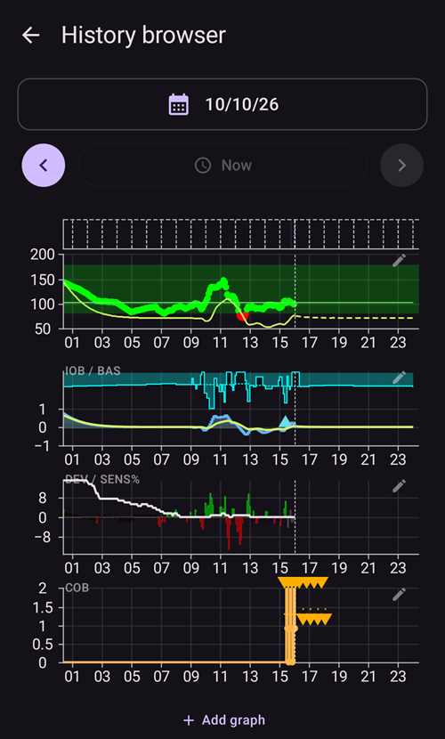

# Reviewing your data

## AAPS History Browser

**AAPS** keeps all your history (**BG**, treatments, basal, targets, **Profile Switch**, …) in a local database on the phone. This database is not part of the [settings export](../Maintenance/ExportImportSettings.md). You can review it in **AAPS** itself with the **History browser** and the **Statistics** screen described below. For long-term reviews and reports, upload your data to [Nightscout](../SettingUpAaps/Nightscout.md) or [Tidepool](../SettingUpAaps/Tidepool.md).

**AAPS** history can be reviewed in the **History browser**: open the **menu** (☰) and select **History browser**.

- Tap the **date card** to pick the day you want to review.
- The graphs open zoomed out to show the **whole selected day**. Pinch to zoom in on part of it.
- Use the **<** and **>** arrows to move one day back or forward, and **Now** to return to the current day.
- The graphs show the same data as the main screen graphs (BG, treatments, basal, IOB, COB, activity, deviations...).

(reviewing-statistics)=
## AAPS Statistics

**AAPS** provides basic monitoring statistics.

Most values are referenced by ADA 2023 [recommendations](https://diabetesjournals.org/care/article/46/Supplement_1/S97/148053/6-Glycemic-Targets-Standards-of-Care-in-Diabetes).

To open them, open the **menu** (☰) and select **Statistics**.

The **Statistics** screen has four tabs: **Insulin**, **Time in Range**, **Glucose** and **Cycle**. Tap a tab, or swipe left or right to move between them.

### Insulin tab: Total Daily Dose

The **Total Daily Dose** card shows one line per day for the previous days (up to one week) for which **AAPS** has insulin data, then their **Average**, then **Today** so far. Right after installing **AAPS**, only **Today** is shown. The columns are:

- **Basal**: only basal.
- **Bolus**: the sum of bolus treatments and SMBs.
- **TDD Total**: the Total Daily Dose of insulin (**TDD**), the sum of bolus and basal insulin delivered during the day.
- **Carbs**: declared carbs and eCarbs treatments.

The **TDD** section is calculated when you open the page and takes a few seconds to compute. Tap **Recalculate** to compute it again.

### Time in Range tab

Time In Range (**TIR**): 70-180 mg/dL or 3.9-10 mmol/L.

**TIR** information is available for 7 and 30 days, depending on the amount of data available within the **AAPS** database.

Time In Tight Range (TITR) 70-140 mg/dL or 3.9-7.8 mmol/L statistics are available below (the screen shows this range as 70-141).

**Discuss targets with your endo**

Your diabetes may vary. Any suggested targets should be discussed with your endocrinologist or supporting medical team. If used correctly, AAPS’ statistics can be an effective tool to follow __BG__ trends and monitor progress .

Below, the **Dexcom TIR** card shows detailed 14 days **TIR** statistics.

**SD**: Standard Deviation, an [indicator](https://www.ncbi.nlm.nih.gov/pmc/articles/PMC3125941/) of BG variability (the highest = the worst).

HbA1c: the estimate of the resulting glycated hemoglobin, based on the average of CGM measurements. This is an indicative value that might not match blood HbA1c tests.

(reviewing-statistics-agp)=
### Glucose tab: Ambulatory Glucose Profile (AGP)

The **Ambulatory Glucose Profile** (**AGP**) shows how your glucose usually moves over the day. Choose the period with the buttons at the top: **Today**, **24h**, **7d**, **30d** or **90d**.

- **The chart**: one day from midnight to midnight. The line is the **Median** (half of your readings at that hour were lower, half were higher). Around it, one band holds the middle half of your readings (**25–75%**) and a wider band most of them (**10–90%**). A narrow band means your glucose is similar from day to day at that hour. Dashed lines mark your **LOW mark**, 140 mg/dL (7.8 mmol/L) and your **HIGH mark**.
- **Glycemic overview**: the time spent in your range, in the tight range (70–140 mg/dL or 3.9–7.8 mmol/L), above your range and below it, then your **Average** and **Median** glucose. Your range is the **LOW mark** and **HIGH mark** set in [Range for visualization](#Preferences-range-for-visualization).
- **eA1c** and **GMI**: two estimates of HbA1c calculated from your CGM readings. Like the HbA1c above, they might not match your blood HbA1c tests.
- **SD** (standard deviation) and **CV** (coefficient of variation): how much your glucose varies. A lower value means steadier glucose.
- **Days**: how many days of CGM data were used.

 

Below the AGP, the **Glucose Pentagon (CGP)** card draws five measures of your last 14 days of glucose as a pentagon. A smaller pentagon means better glucose control.

### Cycle tab: TDD Cycle Pattern

**TDD Cycle Pattern** overlays your daily insulin totals in 28-day cycles, to help you spot recurring patterns. Each cycle is drawn as a line (**Individual cycles**), together with their average.

- **Raw TDD** / **Cleaned TDD**: choose the total daily dose as delivered, or the TDD minus insulin for carbs.
- **Cycle offset**: moves the start of the cycle (0 to 27 days).

At least 56 days of data (2 cycles) are needed. With less data, the card shows **Not enough data (need at least 56 days for 2 cycles)**. The pattern is calculated only when you open the **Cycle** tab, because it reads 168 days of data.

------

## What is the difference between Nightscout vs Tidepool?

Nightscout can facilitate the user’s storage of **AAPS’** data and offers a wide range of [reporting tools](https://nightscout.github.io/nightscout/reports/).

Whereas, Tidepool allows the user to [review their data](https://www.tidepool.org/viewing-your-data) and provides [simple sharing with your endo team](https://www.tidepool.org/providers/how-it-works#tidepool-data-platform).