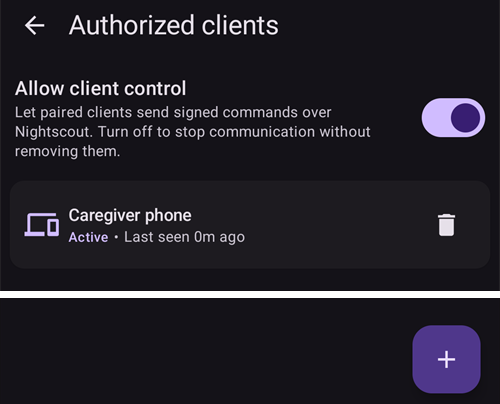
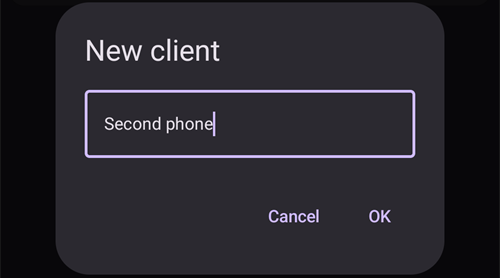
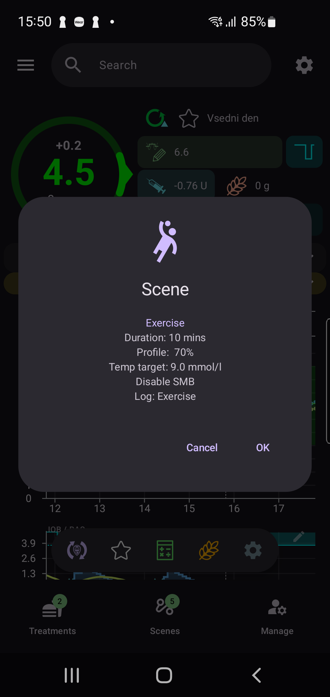
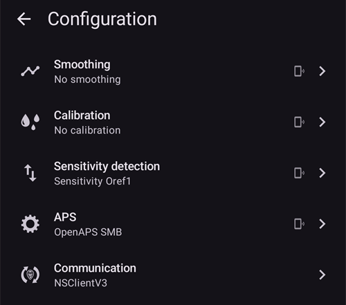

(client-master-control)=
# Master ↔ Client control (signed remote control)

From **AAPS** version 4, a follower phone running **AAPSClient** can do much more than *announce* treatments through Nightscout: once it has been **paired** with the main phone, it can send **signed commands** that the main phone (the **master**) checks, confirms and executes — including delivering an **insulin bolus** on the master's pump.

This page explains how it works, and how to set it up and use it.

```{contents} Table of contents
:depth: 2
:local: true
```

```{admonition} Wording used on this page
:class: note
- **Master** = the main **AAPS** phone that owns the pump and runs the loop (the `full` app).
- **Client** = an **AAPSClient** phone with no pump that follows and now also *controls* the master.
- Both phones must be connected to the **same Nightscout** site. All communication still travels through Nightscout — no direct connection between the phones is needed.
```

---

## How it works

```{admonition} Coming from AAPS v3?
:class: note
In **AAPS** v3, **AAPSClient** could only write unsigned care-portal treatments to Nightscout, and could not deliver a bolus. Remote control now needs a one-time [pairing](#client_master_master_setup). See also [What changed in AAPS v4](#v4changes-remote-control).
```

**AAPS** v4 uses a dedicated **Client-Control** channel. It still rides on your Nightscout site (in the `settings` collection), but every message is **cryptographically signed** with a secret that only the two phones know. The secret is handed over once, during **pairing**, and replaced by a new one right after it, so it never travels in clear text.

The guiding principle is **the master is in charge**:

1. The client sends an *intent* (“bolus 2 U”, “start the Exercise scene”, “set this temp target”…).
2. The **master** re-computes and **caps** the action against its **own** live data (profile, IOB, COB, current temp target, pump), and **authors the exact confirmation** the user will see.
3. The client (or watch) shows the **master's** confirmation text — it never builds its own.
4. On confirmation the master **executes once** and reports the result back to the client.

What this means for you:

- **Signed commands**: only the clients you paired can send commands (per-client pairing secret and signature). Old or replayed commands are rejected.
- **A role for each client**: you decide what each client may do, from *Read-only* to *Admin* — see [Client roles](#client-master-control-roles).
- **Insulin bolus from a client**: the master delivers it on its pump, and the client shows the delivery progress.
- **The master decides**: it caps every action against its own constraints and writes the confirmation shown on the client.
- **Only paired clients change therapy**: while client control is on, the master no longer takes treatments or changes typed directly into Nightscout — see [Hardened mode](#client-master-control-hardened-mode).
- **Each client gets its own Nightscout token** with only the rights a client needs — see [The client's own Nightscout token](#client-master-control-own-token).
- **Master offline**: actions are blocked with a clear message.
- **Revoking a client** takes one tap (per client), or use the master's switch to stop all clients.

Actions that can be triggered from a client: **bolus**, **carbs / eCarbs**, **temporary target** (set & cancel), **profile switch**, **loop / running-mode** change, **temp basal** (set & cancel), **extended bolus** (set & cancel), **insulin selection**, and **[scenes](../DailyLifeWithAaps/Scenes.md)**. A subset of bidirectional **preferences** is also kept in sync between master and clients.

---

## Roles and prerequisites

```{admonition} Before you start
:class: important
- The **master** runs the normal `full` **AAPS** build and is connected to your pump.
- The **master** uses **NSClientV3** with your Nightscout and is showing *connected*. Give it an **admin token** of your Nightscout: with it the master can make a token of its own for each client and show it to the client as a QR code.
- The **client** runs **[AAPSClient](AapsClient.md)** (or **AAPSClient2** / **AAPSClient3** for further patients — see [About AAPSClient, AAPSClient2 and AAPSClient3](#remotecontrol-aapsclient-versions)). It must use the **same** Nightscout. If you set it up with the master's QR code, the client gets its Nightscout address and token from the master; otherwise set up **NSClientV3** on it yourself first.
- **Websockets** are needed on both phones: commands only reach the master over the websocket connection. While client control is on, **AAPS** keeps websockets on, on the master and on paired clients.
```

Pairing and synchronization are two different things:

- **Synchronization** (data: BG, treatments, profile) is set up as before — see [Synchronization](#RemoteControl_aapsclient). The master's QR code can do it for you on the client.
- **Pairing** (control: the signed command channel described here) is the new step below.

---

## Setting it up

(client_master_master_setup)=
### 1. On the master — enable control and add a client

On the master, open the **Manage** screen and choose **Authorized clients**.

Turn on **Allow client control** (it is **off** by default). This is the master kill-switch: with it off, no client can send commands, but your paired clients are kept so you can turn it back on later. Turning it on also turns on [Hardened mode](#client-master-control-hardened-mode), shown as "*Hardened mode on*" with an **(i)** that explains it. In [Simple Mode](#preferences-simple-mode) client control is always on, so the switch is not shown.



Tap the **+** button (bottom right) to add a client. In the **New client** dialog:

1. Enter a **device name**, so you can recognize it in the list.
2. Choose **how the phone is set up** (see the table below).
3. Choose its **[role](#client-master-control-roles)**. Nothing is selected for you: the right role depends on who uses the phone.

<!-- 📷 SCREENSHOT NEEDED: the New client dialog on the master with the three ways
     (QR code: Nightscout and pairing / QR code: Nightscout only / PIN) and the role row.
     Replaces new_client_master.png, which shows the older dialog with the name only. -->


| Way | What the new phone gets | Use it when |
|---|---|---|
| **QR code: Nightscout and pairing** | the Nightscout address, its own Nightscout token and the pairing, in one scan | the new phone has a camera: the quickest way, nothing to type |
| **QR code: Nightscout only** | the Nightscout address and its own Nightscout token, no pairing | the phone should only **show** data and never send commands |
| **PIN** | the pairing only; it keeps the Nightscout settings it has | the phone has no camera (or the master cannot make tokens); it must be connected to Nightscout already |

The two QR code ways need an **admin token** in the master's **NSClientV3** settings, because the master makes the client's token in Nightscout. Without one, the QR code options are shown but cannot be chosen, and the dialog says why; the **PIN** always works.

#### With a QR code

Tap **OK**: the master makes the client's Nightscout token and shows a **QR code**. A code that also pairs works for about **two minutes**; the screen counts down and closes by itself when the client has paired. Scan it on the new phone as described in [On the client](#client_master_client_setup).

```{admonition} The QR code is a secret
:class: warning
Anyone who sees the QR code can read your Nightscout, and a code that pairs also carries the pairing. Show it only to the new phone. **AAPS** blocks screenshots while the code is on screen.
```

<!-- 📷 SCREENSHOT NEEDED (optional): cannot be taken from the phone, because AAPS blocks
     screenshots of the QR code. A photo of the screen with a blurred code would do. -->

#### With a PIN

Tap **OK**: the master displays an 8-digit **pairing PIN**, shown in two groups of four (for example `1234 5678`). This PIN is **one-time** and **expires after about two minutes**.


```{admonition} The pairing PIN is a secret
:class: warning
The PIN protects the pairing secret that is exchanged through Nightscout. Share it only with the device you are pairing, do not post it publicly, and let it expire if you do not use it. A fresh PIN can always be generated by tapping **+** again.
```

(client_master_client_setup)=
### 2. On the client — pair with the master

#### Scanning the QR code

You can scan the master's QR code in two places:

- in the client's **Setup Wizard**, on the step "**Set up from the master**", which comes before the Nightscout step. One scan then sets up Nightscout and, with a code that pairs, also the pairing, so the setup is finished: the wizard closes and the home screen opens;
- at any time later from **Manage → Pair with master → Scan QR code**.

The first time, **AAPSClient** asks for the **camera** permission. If you refuse it, the screen says that the camera is needed, and you can allow it with **Try again** or pair with the PIN instead.

Point the camera at the code. The client shows what the code does — the Nightscout address and, for a code that pairs, the master it pairs with — and asks "**Use this code?**". Tap **Use**: the client turns on **NSClientV3**, replaces its Nightscout address and token with the ones from the code and turns on websockets. A code that pairs also pairs the phone; it says hello to the master as soon as it has connected to Nightscout.

<!-- 📷 SCREENSHOT NEEDED: the client's "Set up from the master" wizard step, and the
     "Use this code?" confirmation on the client. -->

```{admonition} Scanning is available on Android
:class: note
The scanner is not available on iOS yet, and a desktop has no camera: use the PIN there.
```

#### Entering the PIN

On the client, open **Manage → Pair with master** (or the wizard step **Pair with master**, after the Nightscout step), **enter the 8-digit PIN** shown on the master and tap **Pair**. The client uses the PIN to securely retrieve the pairing offer through Nightscout, then asks "**Pair with this master?**" and shows the master's identifier. Tap **Pair** to confirm (see [Pairing with the master](#aapsclient-pairing-with-the-master) for a screenshot).


#### After pairing

Once a client is paired it sends a **Hello** to the master and appears in the master's **Authorized clients** list as **Active**, with a *“last seen”* time. The client knows its [role](#client-master-control-roles) from the pairing, so it shows the right buttons at once. A pairing made in the Setup Wizard finishes the wizard. In the same step the two phones replace the pairing secret with a new one that never travelled (see [Security notes](#client-master-control-security)), and a client that was set up with the PIN gets its own Nightscout token (see [The client's own Nightscout token](#client-master-control-own-token)). A client can be paired with **one** master at a time; to pair with a different master, **Unpair** first.


### 3. Managing clients

From the master's **Authorized clients** screen you can, at any time:

- **Change the role** of a client with the row of four buttons under its name. The new role takes effect at once, without pairing again.
- **See which Nightscout token** a client writes with: "*Own Nightscout token*" is what you want. A red line "*Uses the Nightscout token …, which has more rights than a client needs*" means the client still uses a token with more rights, usually your admin token — see [The client's own Nightscout token](#client-master-control-own-token).
- **Revoke** a single client — tap the **trash** icon next to it. The client can no longer send commands until it is paired again. Its own Nightscout token is deleted too, so it can no longer read your Nightscout either.
- **Stop all control** without losing the pairings — turn off **Allow client control**.

Phones set up with **QR code: Nightscout only** are listed below the clients, under "**Read Nightscout only**". For each of them you can show the QR code again (to set up the same phone again) or delete its token, which ends its access to your Nightscout.

<!-- 📷 SCREENSHOT NEEDED: the Authorized clients list with a client card showing its role
     buttons and "Own Nightscout token", and the "Read Nightscout only" section below it. -->

---

(client-master-control-roles)=
## Client roles

Each paired client has a **role**. The master checks it for every command, and the client shows only what its role allows. A new role takes effect at once, without pairing again. The roles build on each other: each one can do everything the one before it can.

| Role | The client may |
|---|---|
| **Read-only** | only show data. It stays paired, so it is ready when you give it a higher role. |
| **Meals** | give a bolus, use the bolus wizard and QuickWizard, enter carbs, and stop a running bolus. Carbs entered here can make the loop give more insulin. |
| **Caregiver** | do everything a user does in **AAPS**: temp targets, profile and insulin switches, loop mode, temp basal, extended bolus, scenes, careportal events, calibrations and removing records. It cannot change settings or presets. |
| **Admin** | do everything, settings and presets included (QuickWizard, temp target presets, scenes, profiles, automation, insulin). |

The **(i)** at the top of the **Authorized clients** screen shows the same explanation. On the client, **Manage → Pair with master** shows the phone's own role.

---

(client-master-control-hardened-mode)=
## Hardened mode

When **Allow client control** is on, the master is in **hardened mode**: it takes changes only from paired clients. It does **not** take treatments, temp targets, profile changes, running mode changes or deletes that are made directly in Nightscout, for example on the Nightscout website or in other apps.

- The settings for accepting data from Nightscout (**NSClientV3 → Synchronization**) are hidden while hardened mode is on; **AAPS** uses them as if they were off.
- The master still **uploads** all its data to Nightscout, BG included, and keeps **websockets** on.
- If the master gets its **BG from Nightscout**, it still takes BG from there.
- To load the history on a **new** master, use **Full sync** in **NSClientV3**: it takes everything that is in Nightscout, profiles included.
- [SMS commands](SMSCommands.md) are not affected.

A paired client follows the master's hardened mode: it keeps websockets on, and the same Nightscout settings are hidden on it. An unpaired client keeps its own settings.

[Simple Mode](#preferences-simple-mode) always turns hardened mode on. To turn it off, leave Simple Mode and turn off **Allow client control** on the master.

```{admonition} Why hardened mode
:class: note
Everything a paired client sends is signed, checked and confirmed by the master. A treatment typed into the Nightscout website is not: anybody with write access to your Nightscout could add it. In hardened mode only signed commands can change what the master does.
```

---

(client-master-control-own-token)=
## The client's own Nightscout token

A client does not need an admin token. It only reads your Nightscout and sends its commands to the master through it; it uploads nothing itself. So the master gives each client a Nightscout token of its own, with just these rights:

- read everything,
- write to the `settings` collection, the channel to the master,
- snooze Nightscout alarms.

The token belongs to a Nightscout role named **`aaps-client`**, which the master creates the first time it needs it. You can see the role and the tokens (named `aaps-` and the client's name) in the **Admin tools** of your Nightscout site. If the role is changed there, the master sets it back the next time it makes a token or you open **Authorized clients**.

How a client gets its token:

- **Set up with a QR code**: the token is in the code.
- **Paired with the PIN** (or paired before this existed): after pairing, the master sends the client its own token through the paired channel, encrypted. The client first checks that a login with it works, then uses it instead of the token it had. This needs an admin token on the master; without one, the client keeps its token, and its card on the master shows the red line.

**A client keeps its own token.** Once the master has seen a client write with its own token, it takes that client's commands only with that token. A command written with another token (for example an admin token typed into the client later, or another client's token) is refused, even though the client is paired, and the client says "*The master refused it: this phone writes to Nightscout with another token than its own*". Its card on the master says so in red. The client still shows as online, so you can see what is wrong. To fix it, remove the client on the master and add it again.

The master never deletes or changes a Nightscout token it did not make (one with other roles than `aaps-client`): those are yours. It deletes a client's own token when you remove the client.

---

## Using remote control

### Triggering an action from the client

Use the client exactly as you would the phone itself: open **Carbs**, **Insulin**, **Temp Target**, **Profile**, **Scenes**, the **Manage** sheet, etc., and fill in the values.

When you confirm, the client briefly shows **“Contacting master…”**, the **master** computes and caps the action, and the client then displays the **master's own confirmation** — the exact lines, values and colors the master would show on its own screen. Review them and tap **OK** to go ahead.



The same applies to a simple carbs entry — the amount shown for confirmation is the one the master computed:


After you confirm, the master executes the action once and the result is reflected back on the client.

### Insulin bolus from a client

This is the main new capability in v4. A bolus started on a client is **delivered by the master on its pump**; the master caps it against its own constraints, and the client shows **live delivery progress** while it runs (and an alarm if the pump reports a failure).

```{admonition} Boluses are always confirmed and capped on the master
:class: note
A client never decides the delivered amount on its own. The master recomputes and caps it, you confirm the master-authored amount, and only then is it delivered.
```

### When the master is offline

If the master is not reachable (its phone is off/asleep, not connected to Nightscout, or websockets are down), control actions on the client are **blocked before anything is sent**, and you get a clear message. Nothing is half-applied.


The client re-checks reachability automatically and re-enables control once the master is back online.

(clientmastercontrol-wear-os-on-a-client)=

### Wear OS (watch) on a client

A watch paired to a **client** phone relays its actions through the client to the master (watch → client → master). The watch shows the **master's** confirmation lines and the real result, just like the phone. Setting up the watch is unchanged — see [Wear OS](../WearOS/WearOsSmartwatch.md).

<!-- 📷 SCREENSHOT NEEDED (optional): watch confirmation screen relayed from the master,
     and/or the "Contacting master" state on the watch. Requires a paired Wear OS device. -->

---

(client-master-config-prefs)=
## Changing configuration and preferences

Pairing does more than relay one-off actions — it also keeps the **configuration** and many **preferences** aligned between the master and its clients.

### Configuration (which plugins are active)

The active **plugins** (APS algorithm, sensitivity, smoothing, …) are chosen on the **master** and **mirrored** to every paired client. On a client these selections are marked with a small **mobile icon** in the [Configuration](#configuration_sync_icon) screen — change them on the master and the clients follow automatically and vice versa.

On a client, the mobile icon appears on *Smoothing*, *Calibration*, *Sensitivity detection* and *APS* (synced from the master), but not on *Communication*:



Connection details that are unique to each device — most importantly the **NSClient Nightscout URL / access token** — are *not* synced. Each phone has its own; on a client they come from the master's QR code, or you set them yourself.

### Profiles

Your **profile list** is also kept in sync between the master and its paired clients. On a paired client, **Manage → Profile** shows the same profiles as the master; you can **edit** a profile or **activate** one, and — like every other command — the change is sent to the **master**, applied there, and synced back.

The first time you activate a profile on a newly installed client, the client may show "*No insulin is in use yet*" and ask you to **select the insulin**. Choose the insulin that is active on the master (**Manage → Insulin settings** on the master shows it).

On a client that is **not paired**, the Profile screen is still available but **view-only**: the client shows the profiles it receives through Nightscout (it needs them for its own calculations), but there is no edit or activate button — there is no master to send the change to.

### Preferences

A subset of **preferences** is **bidirectional**: you can change them on the **master or on a paired client**, and the change is synchronized to the other side. When you change such a preference on a client, it is sent to the master over the signed channel, applied there, and the authoritative value is sent back — so what you see on the client is always what the master stored. If the same preference is changed on two devices at almost the same time, the **most recent edit wins**. For a setting with a slider, the new value is sent when you lift your finger.

Inside the settings, the same small **mobile icon** marks the individual preferences that are synced. In the example below *Absorption cutoff* is synced (mobile icon), while settings without the icon are device-local:


```{admonition} The master must be online to change synced settings from a client
:class: note
Because the master is the authority for the stored value, editing a master-controlled configuration item or a bidirectional preference from a client requires the master to be **reachable**. When the master is offline those controls are disabled on the client (see [When the master is offline](#when-the-master-is-offline)).
```

---

(client-master-control-security)=
## Security notes

```{admonition} How the channel is protected
:class: tip
- **Pairing secret**: the master hands it to the client once — protected by the PIN in a Nightscout document, or inside the QR code — and both store it encrypted.
- **A new secret right after pairing**: the client's first message after pairing starts a key exchange, and from then on both phones use a secret that never travelled. A secret that someone may have seen (a photographed QR code, a PIN offer read from Nightscout) is of no use afterwards. Phones paired before this existed do the same once after the update.
- **Every command is signed** (HMAC). The master rejects anything whose signature does not match a paired client.
- **Replay is prevented** by a per-client monotonic counter, and every command **expires** after a short time-to-live.
- **Least rights in Nightscout**: each client has its [own Nightscout token](#client-master-control-own-token), which can only read and write to the client-control channel. Once it has used it, the master takes its commands only with that token. Removing the client deletes it.
- **Only signed changes**: in [hardened mode](#client-master-control-hardened-mode) the master ignores therapy changes typed directly into Nightscout.
- **The master signs what it shares**: the settings, the client list and the "master is alive" sign that the master puts in Nightscout for its clients carry the master's signature. A client takes them only when the signature is the master's, so another client's token cannot change them. The client learns the master's key when it pairs, or from the QR code for a phone that only reads Nightscout. A refused document shows in the NSClient log as "*✕ SETTINGS … refused*".
- **You stay in control**: give each client the [role](#client-master-control-roles) it needs, revoke a client with one tap, or disable everything with **Allow client control**.
```

```{admonition} After restoring a backup
:class: warning
If a client is restored from a backup that rolls its command counter backwards, the master will reject its next commands as replays. Simply **unpair and pair again** to recover.
```

---

(client-master-control-troubleshooting)=

## Troubleshooting

| Symptom | What to check |
|---|---|
| Client says the **master is offline** | Master phone awake and running **AAPS**; both phones connected in **NSClientV3**; **websockets** enabled on both; same Nightscout site. |
| Client says it is **not paired** | Pair again from **Manage → Pair with master**. Confirm the client is **Active** in the master's **Authorized clients** list. |
| Command **rejected** by the master | The master re-validates against its current state — e.g. the chosen profile no longer exists, or the pump type does not match. Re-check on the master. |
| Commands work but are **slow** | Enable **websockets** on both phones (otherwise the apps fall back to slower polling). |
| Pairing is cancelled with *"The pairing secret could not be stored"* | Nothing was changed. Start the pairing again; if it keeps failing, restart **AAPSClient** and try once more. |
| Nothing happens after pairing | Make sure **Allow client control** is ON on the master, and that the master is connected to Nightscout. |
| The QR code options cannot be chosen in the **New client** dialog | The dialog says why. *Not an admin token*: give the master an admin token of your Nightscout, or add the client with the **PIN**. *Not connected*: wait until the master shows *connected* in **NSClientV3**. |
| *"Nightscout has a token with this name and other rights"* | One of your own Nightscout tokens is called `aaps-` and this name. Choose another name for the client. |
| *"A client with this name is in the list already"* | Choose another name, or remove that client first. |
| The client says *"This code is from another AAPS version"* | Master and client must run the **same** version of **AAPS**. Update the older one. |
| The client says *"This code has expired"* | A code that pairs works for about two minutes. Add the client again on the master to get a new code. |
| The client says *"This phone is paired already"* | Unpair it first (**Manage → Pair with master → Unpair**), then scan again. A **Nightscout only** code works on a paired phone too. |
| The client says *"The master refused it: this phone writes to Nightscout with another token than its own"* | The client used its own Nightscout token before and now writes with another one, for example after a token was typed into its Nightscout settings. Remove the client on the master and add it again (see [The client's own Nightscout token](#client-master-control-own-token)). |
| The NSClient log on the client shows *"✕ SETTINGS … refused"* and its settings no longer follow the master | Somebody else wrote the master's settings document, or the master has a new key (for example after its data was cleared). A paired client takes a new key by itself the next time it connects to Nightscout. A phone that only reads Nightscout needs the master's QR code again (**Read Nightscout only → show the code**). |
| The client's card shows *"Uses the Nightscout token …"* in red | The client still writes with a token that has more rights than it needs. The master sends it its own token after pairing, but only if the master has an admin token. Check the master's token, or set the client up again with a QR code. |
| A client can no longer read Nightscout | Its token was deleted, for example because the client was removed on the master. Add it again. |
| Treatments entered on the Nightscout website are not applied | Expected in [hardened mode](#client-master-control-hardened-mode): enter them on a paired client instead. |

For Nightscout / synchronization problems first see [Troubleshooting NSClient](../GettingHelp/TroubleshootingNsClient.md).

---

<!-- =====================================================================
     SCREENSHOTS STILL TO ADD:
       1. (optional) Wear OS confirmation relayed from the master
       2. master: New client dialog with the three ways and the role row (replaces new_client_master.png)
       3. master: Authorized clients list with role buttons, "Own Nightscout token" and "Read Nightscout only"
       4. client: "Set up from the master" wizard step and the "Use this code?" confirmation
       (The QR code screen itself cannot be captured: AAPS blocks screenshots there.)
     Already included:
       - authorized_clients_master.png       (master: Authorized clients list, Active client)
       - pair_with_master_unpaired.png       (client: pairing screen, unpaired PIN entry)
       - new_client_master.png               (master: New client name dialog)
       - pairing_pin_master.png              (master: one-time pairing PIN — expired demo PIN)
       - pair_with_master_client.png         (client: pairing screen, paired state)
       - confirmation_master_authored.png    (client: master-authored scene confirmation)
       - carbs_confirmation_client.png       (client: master-authored carbs confirmation)
       - master_offline_error.png            (client: master-offline message)
     Maintainers: relocate page + images and fix cross-links as needed.
     ===================================================================== -->
