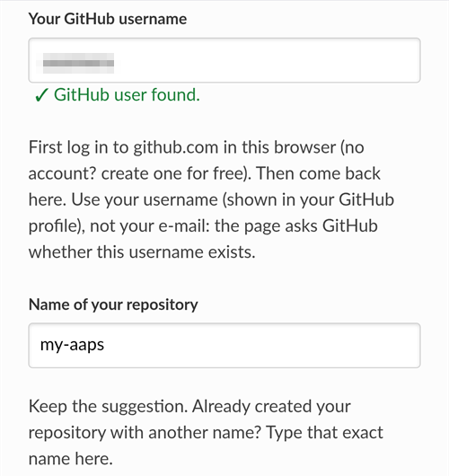
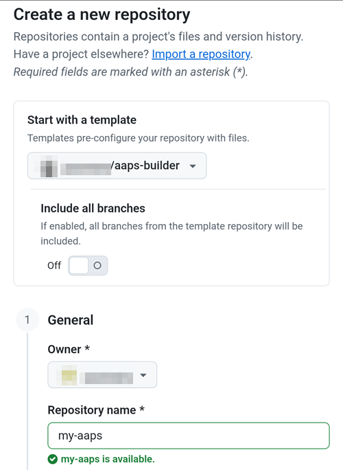
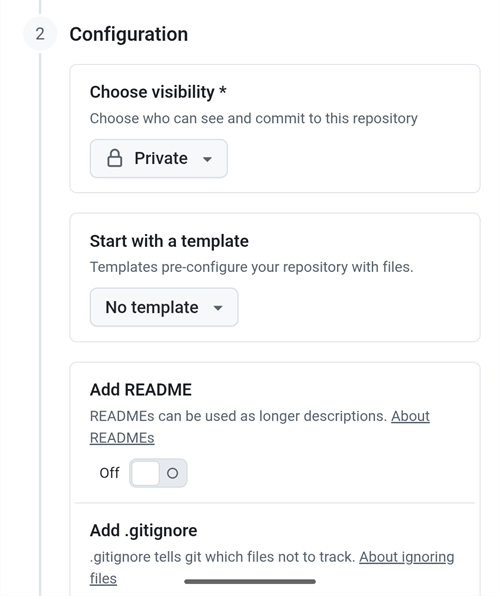
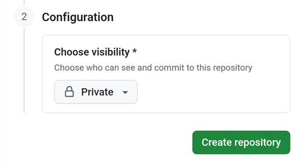
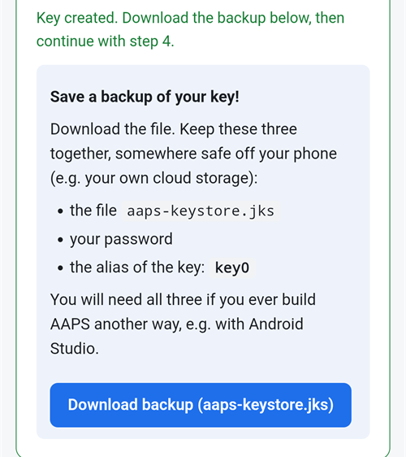
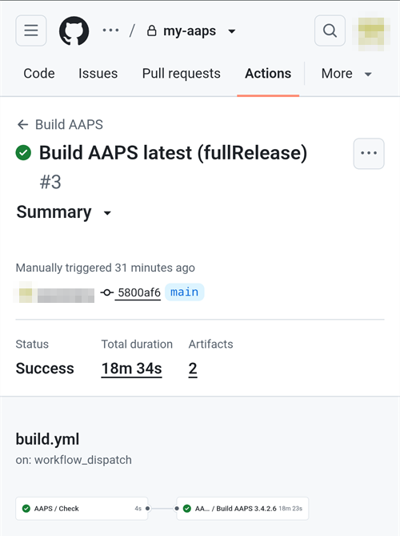
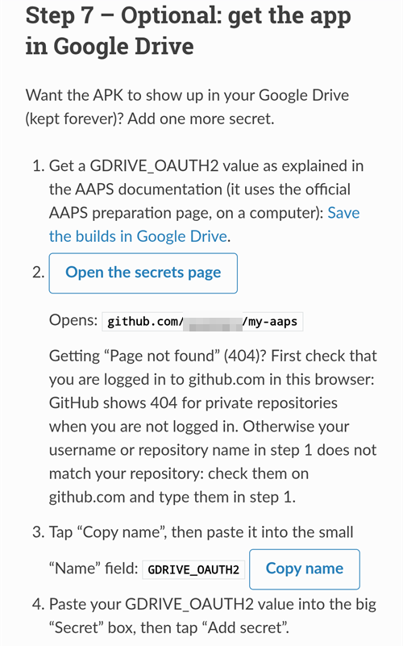

(aaps-builder)=

# Browser build with AAPS Builder

```{note}
This is the recommended way to build AAPS from an **Android phone**. It also works from any computer browser. For the other ways to build from a computer or an iPhone, see the [Browser build](BrowserBuild.md) overview.
```

```{contents} In this page
:backlinks: entry
:depth: 2
```

**AAPS Builder** builds the AAPS app for you in GitHub, the free code-hosting website. There is nothing to install on your phone, and no preparation file to open.

A setup page on this site walks you through it. It takes about 10 minutes the first time:

1. Create an empty **private** repository in your GitHub account.
2. Add the **build workflow**, the file that tells GitHub how to build AAPS.
3. Create or upload your **signing key** (the keystore).
4. Give the key to your repository as a GitHub **secret**.
5. **Build** the app. One build takes 15 to 30 minutes.
6. **Download and install** the app on your phone.

You do **not** need to fork AndroidAPS: the AAPS source code is downloaded from the official AndroidAPS repository at every build. You also do **not** need Google Drive: you download the app directly from GitHub.

```{admonition} Where the code comes from
:class: note

The setup page and the build workflow are part of this documentation: they are maintained and reviewed together with it. The <a href="../aaps-builder-build.yml">workflow</a> you add to your repository is short: it runs the [build steps](https://github.com/openaps/AndroidAPSdocs/blob/dev/.github/workflows/aaps-builder.yml) kept in the documentation repository, pinned to one reviewed version. You can read both before you use them. When it builds, the workflow downloads only the official AAPS source code and GitHub's own build tools. Your keystore never leaves your browser and your private repository.
```

(aaps-builder-before-you-start)=

## Before you start

You will need:

- A **GitHub account** (free). If you don't have one, create it on [github.com](https://github.com/signup) first.
- A **web browser**: Chrome on your phone, or any browser on a computer. Log in to github.com in that browser before you start.
- **GitHub app on your phone?** You can keep it. Some buttons of the setup page then open the app instead of Chrome. Building works in the app, but the app **cannot download** the finished AAPS: [step 6](#aaps-builder-step6) shows how to switch to Chrome for the download.
- Your **existing keystore** (`.jks` file), its password and its alias, if you built AAPS before and want to update it without reinstalling.

```{warning}
**Your build repository must stay private.** Everything a build produces is visible to anyone who can see the repository. The setup page creates a private repository for you. Never change it to public.

A private repository gets 2000 free GitHub Actions minutes per month, which is enough for several builds.
```

```{warning}
**New key or existing key: this decides whether you can update AAPS.**

- **You already have AAPS on your phone, built with a keystore you still have**: choose **I already have a keystore** on the setup page and upload it. Your next build will update AAPS in place. Built AAPS with the previous browser build (your own fork)? Your keystore is in your fork: [get a copy of it first](#aaps-builder-from-fork).
- **You build AAPS for the first time, or you lost your keystore or its password**: choose **Create a new key**. An app signed with a new key **cannot update** an AAPS signed with another key. You must export your settings, copy the file off your phone, uninstall the old AAPS, install the new one, then import your settings: see [Reinstalling AAPS with a new keystore](#reinstall-aaps).

Always keep using the same key afterwards. When you create a new key, download the backup the page offers and store it with its password and its alias (`key0`) somewhere safe, off your phone.
```

(aaps-builder-from-fork)=

## Coming from the previous browser build (fork)

Skip this section if you never built AAPS with the previous browser build method (your own copy, or fork, of AndroidAPS in GitHub, with the preparation file and Google Drive).

Your keystore is stored as secrets in your fork. GitHub never shows a secret again, so you can't copy it to your new repository. Get a copy of your keystore first, then use it in [step 3](#aaps-builder-step3) with **I already have a keystore**.

```{warning}
Don't choose **Create a new key**. AAPS built with a new key cannot update the AAPS on your phone.
```

Which case is yours?

- **You used Option 2** (you uploaded your own keystore from Android Studio), and you still have the `.jks` file, its passwords and its alias: nothing to do here. Use that file in step 3.
- **You used Option 1** (the preparation file created your key), or you no longer have your keystore file: export it from your fork as below.

To export your keystore from your fork:

1. In your fork, open **Settings** → **Secrets and variables** → **Actions** and add a secret named `ZIP_PASSWORD`. Choose a password with only English letters and numbers. It protects the file you are about to create.
2. Open the **Actions** tab of your fork, tap **CI Keystore Export**, then **Run workflow**. More details: [Export your keystore](#ci-keystore-export).
3. When the run has a green check, open your Google Drive: the file `keystore.zip` is in the folder **AAPS** → **KeyStore**. If the run fails at the Google Drive step, your fork's Google Drive access has expired: see [Google refresh token expired](#aaps-ci-google-token-expired).
4. Download `keystore.zip` and open it with your `ZIP_PASSWORD`: on a computer, or on your phone with a file manager app that can open password-protected ZIP files. It contains:
   - `keystore.jks`: your keystore,
   - `keyStoreInfo.txt`: your `KEYSTORE_PASSWORD`, `KEY_PASSWORD` and `ALIAS` (usually `key0`).
5. Copy `keystore.jks` to your phone (or to Google Drive, so you can pick it from there).

In [step 3](#aaps-builder-step3) of the setup page:

1. Tap **I already have a keystore**.
2. In **Keystore file**, choose `keystore.jks`.
3. In **Keystore password**, type the `KEYSTORE_PASSWORD` from `keyStoreInfo.txt`.
4. In **Key alias**, pick or type the `ALIAS` from `keyStoreInfo.txt`.
5. If `KEY_PASSWORD` is different from `KEYSTORE_PASSWORD`, untick **Key password is the same as the keystore password** and type the `KEY_PASSWORD`.

Keep `keystore.zip` and its `ZIP_PASSWORD` somewhere safe, off your phone: it is the backup of your key.

Your fork's Google Drive access can't be copied either. To also save the builds of AAPS Builder in Google Drive, do [step 7](#aaps-builder-google-drive). You can keep your fork until AAPS built with AAPS Builder is installed on your phone.

## Open the setup page

**→ <a href="../aaps-builder.html">Open the AAPS Builder setup page</a>**

Keep this documentation page open in another tab: the steps below explain each part of the setup page in more detail.

The setup page runs entirely in your browser: your key and passwords are never sent anywhere, except into the GitHub secret you paste them into yourself. It remembers your GitHub username and repository name, so you can come back to it at any time to reopen your secrets page or your builds.


(aaps-builder-step1)=

## Step 1 – Create your private build repository

This step creates an empty private repository in your GitHub account. Only you can see it and the apps it builds.

1. Make sure you are logged in to github.com in this browser.

2. In **Your GitHub username**, type your GitHub username.

3. In **Name of your repository**, keep the suggestion `my-aaps`. If you already created your repository with another name, type that exact name.

4. Check the line **Your repository:** it shows `github.com/<your username>/my-aaps`.

5. Tap **Create my private repository**.

   

6. GitHub opens in a new tab with your account as **Owner** and the name you chose.

   

   Scroll down: **Private**, **No template** and **Add README: Off** are already selected. Don't change anything, and don't add a README or other files.

   

7. Scroll down and tap the green **Create repository** button.

   

Go back to the setup page tab.

(aaps-builder-step2)=

## Step 2 – Add the build workflow

The build workflow is a short text file that tells GitHub how to build AAPS. The setup page adds it to your repository, once: you only confirm it.

1. Check that the page shows **Workflow version … is ready**, then tap **Add the workflow to my repository**.

   

2. GitHub opens a new file in your repository, already named `.github/workflows/build.yml` and already filled in. Check the file name at the top: it must be exactly `.github/workflows/build.yml`. Don't change the text.

3. Tap **Commit changes…**

   

4. then **Commit changes** again in the window that opens.

   

   GitHub shows the new file `build.yml` in the `.github/workflows` folder of your repository.

   

```{warning}
Don't press your phone's **Back** button or pull the page down while the file editor is open: GitHub reloads the page and the text disappears. If that happens, tap **Restore** in the blue banner, or go back to the setup page and tap the button again.
```

If the text area is empty, open **Updating the workflow, or the text area is empty** at the bottom of step 2 on the setup page: tap **Copy workflow** and paste it into the text area (long press on a phone).

```{warning}
Only use the workflow from this setup page. Don't copy a build workflow from another website or repository: the workflow runs next to your signing key.
```

(aaps-builder-step3)=

## Step 3 – Your signing key

The app must be signed with your own key. Choose one of the two tabs. Read the [new key or existing key warning](#aaps-builder-before-you-start) first.


### I already have a keystore

1. Tap **I already have a keystore**.
2. In **Keystore file**, choose your `.jks` file (or `.keystore`, `.p12`, `.pfx`). On a phone, copy the file to your phone or to Google Drive first.
3. In **Keystore password**, type the keystore password.
4. In **Key alias**, pick your alias from the list. For keystores made with Android Studio it is usually `key0`.
5. If your key password is different from the keystore password, untick **Key password is the same as the keystore password** and type the key password.
6. Tap **Check and continue**.

The page checks the password and the alias on your device. **Keystore OK! Continue with step 4.** means everything is right. If it says the password will be checked when you build, continue anyway: the build tells you if something is wrong.

### Create a new key

1. Tap **Create a new key**.

2. Choose a password and type it twice. Rules: at least 8 characters, only the letters a–z and A–Z, the digits 0–9 and symbols such as `! ? #`. No spaces, no accented letters, and not the `|` character.

3. Tap **Create key**. It takes a few seconds before **Key created** appears.

   

4. Tap **Download backup (aaps-keystore.jks)**. Keep these three together, somewhere safe off your phone (for example your own cloud storage):

   - the file `aaps-keystore.jks`,
   - your password,
   - the alias of the key: **`key0`**.

   You need all three if you ever build AAPS another way, for example with Android Studio. Keys created with an earlier version of the setup page have the alias `aaps`.

   

(aaps-builder-step4)=

## Step 4 – Give the key to your repository

Step 4 unlocks when step 3 is done. Your key, its passwords and its alias are packed into one value, the `KEYSTORE_SET` secret.

1. Tap **Open the secrets page**. 


2. GitHub opens the **New secret** page of your repository. On a phone, it is below the settings menu: scroll down.


3. In the **Name** field, type `KEYSTORE_SET`. You can use the **Copy** button next to it on the setup page.

4. On the setup page, tap **Copy secret**. In the **Secret** field on GitHub, paste it (long press on a phone).

5. Tap **Add secret**. `KEYSTORE_SET` now shows under **Repository secrets**.


You only need to do this once.

```{tip}
GitHub shows **Page not found** (404)? The username or repository name in step 1 doesn't match your repository. Check the name on github.com, correct it in step 1, and tap the button again.
```

(aaps-builder-step5)=

## Step 5 – Build the app

1. On the setup page, tap **Open the build page**. GitHub opens the **Build AAPS** page of your repository.

   

   If the **GitHub app** opens instead: tap **RUN WORKFLOW**, check the version and the variant, and tap **RUN WORKFLOW** again. Then continue with step 4 below.

2. If GitHub asks, tap the green button to enable workflows.
3. Tap **Run workflow**. A small form opens:
   - **Version**: keep `latest` to build the newest AAPS release, or type a release number such as `3.3.2.1`.
   - **Variant**: keep `fullRelease` for normal use with a pump. The other variants are explained in [build variants](#browserbuild-variant). `aapsclient3Release` builds **AAPSClient3**, available from **AAPS** version 4.0 (see [About AAPSClient, AAPSClient2 and AAPSClient3](#remotecontrol-aapsclient-versions)).
   - Tap the green **Run workflow** button.
   
   
   
4. The build starts and shows **In progress**, with two parts: **AAPS / Check**, then **AAPS / Build AAPS**.

   

5. Wait 15 to 30 minutes. A green check means the build is done. A red cross means it failed: open the build to read the message, then see [troubleshooting](#aaps-builder-troubleshooting).

   

If there is no **Build AAPS** or **Run workflow** button:

- Open your repository and check that the file `.github/workflows/build.yml` is there. If it is missing or has another name, do [step 2](#aaps-builder-step2) again.
- Open the **Actions** tab. If it says workflows are disabled, tap the green button to enable them, then tap **Build AAPS** in the list.

(aaps-builder-step6)=

## Step 6 – Install the app on your phone

```{warning}
**Before every update**, [export your settings](#ExportImportSettings-Automating-Settings-Export) in AAPS and copy the file **off the phone** (Google Drive, Dropbox…). Keep several older exports and the APK files there too, so you can always go back.
```

1. On your phone, open the setup page in **Chrome**. Log in to github.com if asked.
2. Tap **Open my builds**, then the newest build with a green check.

   ```{admonition} The GitHub app opened instead of Chrome?
   :class: note

   The GitHub app cannot download builds. In the app, open the newest build, then tap **Artifacts ↗**, or tap the share icon at the top and choose **Chrome**. The build opens in Chrome: continue with the next step there.
   ```

   

3. Scroll down to the build summary and tap the **Download AAPS** link.

   

   ```{tip}
   Scroll with your finger on the text, not on the diagram of the build steps: the diagram moves instead of the page.
   ```

   You can also scroll further down to **Artifacts** and tap the download icon next to `aaps-….apk`.

   

4. When the download is done, open Chrome's menu **⋮** → **Downloads**, tap `aaps-….apk` and choose **Install**. If asked, allow installing apps from this source.

   

`aaps-wear-….apk` is the smartwatch app. Skip it if you don't use one.

The app is kept on the build page for **14 days**. It is not shown under **Code** in your repository. Copy it somewhere safe, off your phone, together with your settings exports.

For more ways to install the app, see [Transferring and Installing AAPS](TransferringAndInstallingAaps.md).

```{note}
From September 2026, Google's [Android developer verification](#android-developer-verification) may block installing the APK by tapping the file, depending on your country. Free workarounds are explained on that page.
```

(aaps-builder-google-drive)=

## Step 7 (optional) – Also save the app in Google Drive

You can also have each build saved to your Google Drive, in the folder `AAPS/<version>`. This is optional: the app is always available on the build page.

It needs one more secret, `GDRIVE_OAUTH2`. You get its value with the preparation file used by the other browser build methods:

1. On a **computer**, download the preparation file and open it as described in [Option 1 – Computer](BrowserBuildO1Computer.md). Skip the keystore part: you already have your key.
2. Follow [Step 3 – Authorize Google Drive](#aaps-ci-google-drive-auth) to get the `GDRIVE_OAUTH2` value.
3. On the setup page, step 7 opens your secrets page.

   

   Create a secret named `GDRIVE_OAUTH2` (the **Copy** button copies the name), paste the value, and tap **Add secret**.

From the next build, the APKs are also saved in Google Drive.

Google stops the access if you don't build for 6 months, or if you change your Google password. The build then tells you so: redo these steps. See [Google refresh token expired](#aaps-ci-google-token-expired).

(aaps-builder-updates)=

## Updating AAPS

Your repository never builds anything by itself: you decide when to build, which version and which variant. When a new AAPS version is released:

1. [Back up your settings](#aaps-builder-step6) as explained in step 6.
2. Build the new version as in [step 5](#aaps-builder-step5). Keep `latest`, or type the release number.
3. Download and install it as in [step 6](#aaps-builder-step6).

**Updates of the build workflow:** your repository never downloads a new workflow by itself, and the build steps it runs are pinned to one reviewed version. When the workflow changes, the [Docs updates & changes](../Maintenance/DocumentationUpdate.md) page says so. To update, open step 2 of the setup page, then **Updating the workflow, or the text area is empty**:

1. Tap **Copy workflow**, then **Open my workflow file**.
2. Replace the whole text with the copied workflow (long press on a phone: **Select all**, then **Paste**).
3. Tap **Commit changes…**, then **Commit changes**.

The first line of the file shows its version.

(aaps-builder-troubleshooting)=

## Troubleshooting

To see why a build failed, [read the build log](#aaps-ci-read-the-logs): the step names are different, but you find the error the same way. You can also [update a secret](#aaps-ci-update-secret) and [run the build again](#aaps-ci-rerun) the same way.

- **The build stops with "This repository is PUBLIC"**: in your repository, open **Settings** → **General** → **Danger Zone** → **Change visibility** → **Private**, then build again.
- **"Secret KEYSTORE_SET is missing"** or **"KEYSTORE_SET is not valid"**: redo steps 3 and 4 of the setup page, and copy the secret again.
- **"Keystore, password or alias is wrong"**: check your keystore's password and alias, then redo steps 3 and 4 of the setup page.
- **"Version … does not exist"**: the version you typed is not an AAPS release. Use `latest`, or check the release number.
- **"Page not found" (404) when the setup page opens GitHub**: the repository name in step 1 of the setup page does not match your repository. Type the exact name.
- **No Download link, or the GitHub app opened**: the GitHub app cannot download builds. Open the build in Chrome as explained in [step 6](#aaps-builder-step6).
- **"Could not read the workflow file"** on the setup page: reload the page and tap the button again. The setup page must be opened from this documentation site.
- **GitHub says the file already exists** when you commit the workflow: your repository already has a workflow. Update it instead, as explained in [Updating AAPS](#aaps-builder-updates).
- **"Google Drive access has expired or was revoked"**: redo [step 7](#aaps-builder-google-drive) and update the `GDRIVE_OAUTH2` secret.

For other GitHub and Google Drive issues, see [Browser build troubleshooting](../GettingHelp/BrowserBuildTroubleshooting.md).
